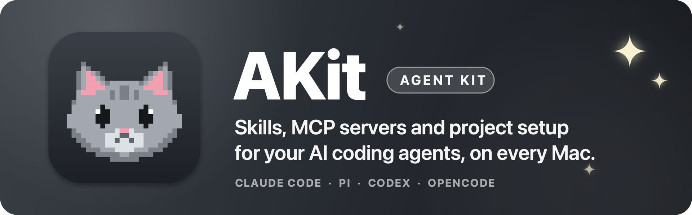
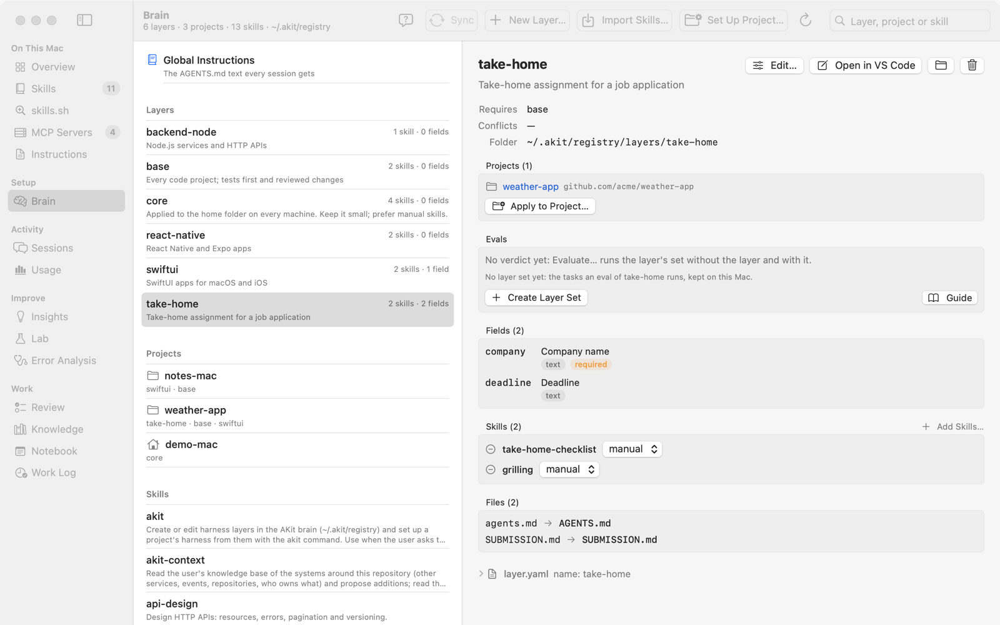
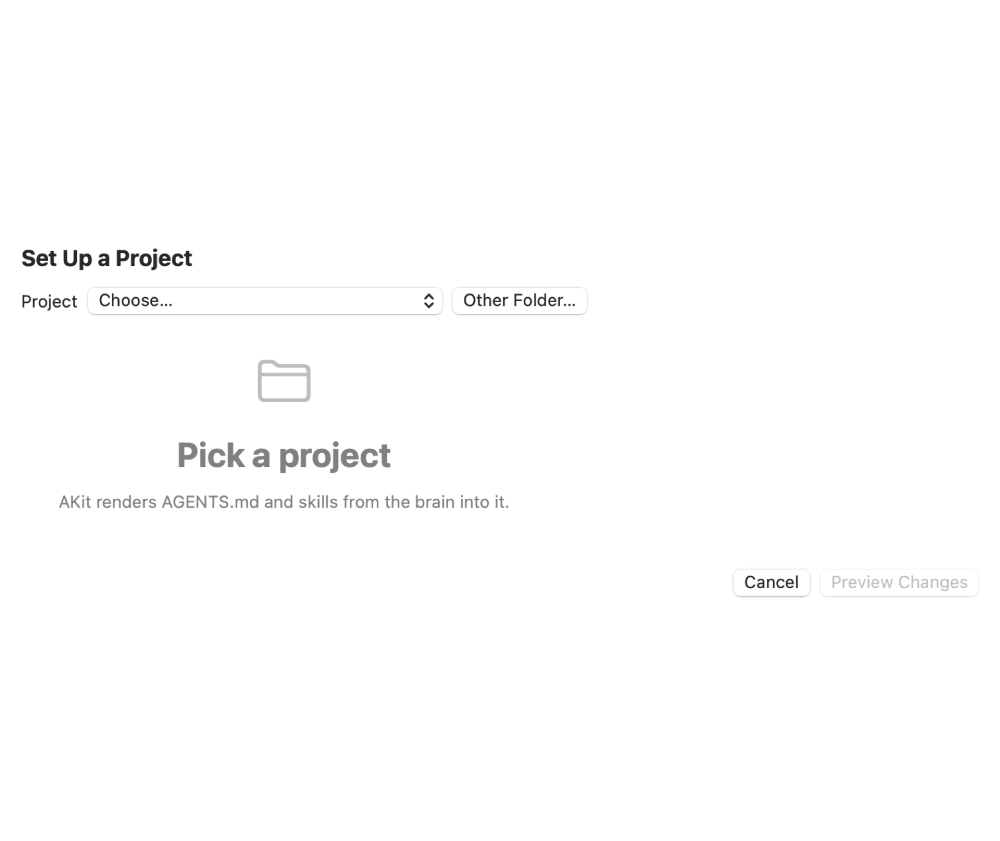

<p align="center">
  
</p>

<p align="center">
  
  
  
  <a href="LICENSE"></a>
</p>

<p align="center">
  <a href="#install"><b>Install</b></a> ·
  <a href="#how-it-works"><b>How it works</b></a> ·
  <a href="#the-app"><b>The app</b></a> ·
  <a href="#the-brain"><b>The brain</b></a> ·
  <a href="#everyday-use"><b>Everyday use</b></a> ·
  <a href="#akit-reference"><b>akit reference</b></a>
</p>

**AKit** stands for **Agent Kit**: the kit your AI coding agents work with (their skills,
MCP servers, rules and settings), kept in one place and packed the same way for every
project and every Mac.

AKit is a native macOS app and command line for people who work with several AI coding
agents (Claude Code, Pi, Codex, OpenCode). It shows what the agents are set up with and how
they worked, sets them up per project from your own **brain** (a private git repo of skills
and layers that follows you to every Mac), finds what to change, and gives you agents for
daily work: merge request review, a knowledge base, a notebook and a work log.

<p align="center">
  <picture>
    <source media="(prefers-color-scheme: dark)" srcset="docs/assets/brain-dark.png">
    
  </picture>
</p>

- **See** what each agent loads: skills, MCP servers, instruction files, sessions, tokens and cost.
- **Set up a project in one step:** pick layers (`swiftui`, `take-home`, …), answer their
  questions, review the diff, apply. Every agent gets the same skills and `AGENTS.md`.
- **Keep one setup on every Mac:** the brain is a git repo; `akit sync` or the Sync button
  moves changes between Macs.
- **Make the setup cheaper and better:** Insights shows skills and tools the model never
  calls and what they cost in every request; Lab and Error Analysis find why sessions go
  wrong and whether a fix helped.
- **Get help with daily work:** AI review of GitLab merge requests (you approve every
  comment), a knowledge base of your services that agents read, a notebook of plans and
  to-dos, and a work log that fills itself from your sessions.
- **Let your agent do it:** the `/akit` skill drives the `akit` command, so "set up this
  project" or "make a layer for React Native apps" is one request.

## Install

```sh
/bin/bash -c "$(curl -fsSL https://raw.githubusercontent.com/Stanislavussov/akit/master/install.sh)"
```

> **❗ On a work Mac, run it with `AKIT_MACHINE=work` the first time:**
>
> ```sh
> AKIT_MACHINE=work /bin/bash -c "$(curl -fsSL https://raw.githubusercontent.com/Stanislavussov/akit/master/install.sh)"
> ```
>
> It must be set before anything is saved: it keeps that Mac's project records out of your
> brain (see [A work Mac](#a-work-mac)). A plain install on a work Mac is a personal one.

Needs macOS 15 or later and git (`xcode-select --install` if it's missing). The script
downloads the latest release into `~/Applications/AKit.app` and `~/.local/bin/akit` (no
Xcode needed), adds `~/.local/bin` to your PATH, and starts `akit setup`, which asks a few
questions. Enter takes the default each time:

1. **Your brain.** Type the repo you use on your other Macs (`you/brain` or a git URL),
   or press Enter to start a new one. A new brain begins with a `core` layer holding the
   `/akit` and `/akit-context` skills. With the GitHub CLI signed in (`gh auth login`),
   setup offers to put it in a private GitHub repo right away.
2. **Your projects folder** (default `~/Projects`), shared with the app's Settings.
3. **A `~/.claude/skills` folder of your own**, if you have one: moved into
   `~/.agents/skills` (backed up) so every agent reads the same skills. Asked, never
   done silently.
4. **Skills already in `~` that differ from the brain's:** kept unless you say replace
   (the old files are backed up).
5. **Session capture** (Claude plugin, Pi extension, hourly import), asked once; a no is
   remembered (`akit insights install --yes` turns it on later). Later runs keep the parts
   that are there up to date without asking, and ask once before adding a new one (say
   Claude Code, installed since). `--skip-home` skips capture too.

Then the brain's core layer goes into your home folder for every agent on the Mac. That's
it: open a project and ask your agent `/akit set up this project`.

**Updates.** When a newer GitHub Release exists, a blue **Update to …** button shows at the
bottom of the sidebar (and in AKit → Update to …). It downloads the release, replaces the
app and the `akit` command, moves the old app to the Trash and restarts. A copy built from
source updates from its git folder instead (`make install`). Running the install again
works too. `akit setup` is safe to run again any time: it syncs the brain, adds agents
installed since, and puts new core skills into `~`. After an update, restart Pi (or run
`/reload` in it): a running Pi keeps the old extension.

> [!IMPORTANT]
> **Rating a Pi run** (Pi 0.80.4 or newer) uses Option keys: after a run, ⌥G rates it good, ⌥X bad, ⌥R with a
> comment. Until your next prompt the same keys change the rating or its comment, and ⌥U
> removes it. Your terminal must send Option as Meta (iTerm2: Profiles → Keys → Left Option
> key: Esc+; Terminal: Settings → Profiles → Keyboard → Use Option as Meta key). The ratings
> show on the Sessions screen, after the run they rate; the model never sees them.

**Settings for scripts:** `AKIT_BRAIN_REPO=you/brain` answers the brain question,
`AKIT_SKIP_HOME=1` leaves `~` alone, `AKIT_FROM_SOURCE=1` builds from source,
`AKIT_RELEASE_URL` installs another `AKit.zip`, `AKIT_MACHINE=work` marks a work Mac (see
below). Without a terminal (CI), every default is taken.

## How it works

AKit is one loop: set the agents up, watch how they work, find what to change, change the
setup. The sidebar groups follow it. The Work group sits beside the loop: agents that help
with your own daily work.

```
   ┌──────────── Setup ────────────┐  renders skills, AGENTS.md, MCP   ┌── On This Mac ──┐
   │ Brain: your git repo of       │ ────────────────────────────────▶ │ what the agents │
   │ skills, layers, instructions  │   into projects and your home     │ load right now  │
   └───────────────▲───────────────┘                                   └────────┬────────┘
                   │ layer edits, fixes                                         │
                   │                                         agents work (Claude Code, Pi, …)
   ┌───────────── Improve ─────────┐                                            │
   │ Insights: unused skills/tools │                                   ┌────────▼────────┐
   │ Lab: review, replay a commit  │ ◀──── sessions, signals ───────── │    Activity     │
   │ Error Analysis: failure modes │                                   │ sessions, usage │
   └───────────────────────────────┘                                   └─────────────────┘

   Work: Review (GitLab MRs) · Knowledge (services, maps) · Notebook · Work Log
```

What happens where:

| Part | What it is | Where it lives |
| --- | --- | --- |
| **The app** | Reads the agents' own files and shows them; every change goes through a diff first. | `~/Applications/AKit.app` |
| **`akit`** | The same logic in a terminal, so you and your agents can script it. Every app button has a command. | `~/.local/bin/akit` |
| **The brain** | A private git repo of skills, layers and global instructions. No agent reads it; AKit renders from it. | `~/.akit/registry` |
| **Session index** | Facts from the agents' session files: counts, sizes, skill and tool calls. Never message text. | `~/.akit/index` |
| **Capture** | A Claude Code plugin, a Pi extension and an hourly import keep the index fresh. | installed by `akit insights install` |
| **Knowledge base** | Notes, maps, the notebook and the work log, in a local git repo with no remote. | `~/.akit/local/knowledge/<world>` |
| **Agent skills** | `/akit` (set up AKit and agents) and `/akit-context` (read the knowledge base during a task). | the core layer, so in `~` on every Mac |

Rules AKit keeps:

- **Read first.** AKit only reads agent files unless you apply a change. Every change shows
  a diff, replaced files are backed up in `~/.akit/backups`, and removed files go to the Trash.
- **No secrets on screen.** Tokens, `auth.json`, MCP env and header values are never shown or
  copied. MCP secrets you enter go to the Keychain.
- **Nothing leaves the Mac by itself.** Anything that sends session data to a model (Lab,
  Error Analysis, Auto-Fill, Ask AKit) follows Settings → Sending policy, shows the ≈ cost
  first, and is logged in Lab → Sends.
- **Only recorded numbers.** Tokens and cost come from what the agents recorded, not from
  estimated prices.

## The app

The sidebar has five groups. Hover an item for a one-line hint; right-click it for
**What Is … For?** (the in-app guide) or **Ask AKit About This**.

### On This Mac: what the agents have now

| Screen | What it does |
| --- | --- |
| **Overview** | Which agents are installed, their versions and where their configs live. Pi's setup is checked like `claude doctor` (Pi Doctor). Agents AKit doesn't know yet can be described in a form. |
| **Skills** | Every skill the agents can see, grouped by where it lives (global, per project, plugins, claude.ai), with filters by project and agent. Turn a skill on, off or manual per agent without deleting it, resolve duplicates, move a global skill into the projects that use it (or back), remove it everywhere. |
| **skills.sh** | Search the public [skills.sh](https://skills.sh) directory, preview a skill and install it into one folder you choose, as is or as your own copy. |
| **MCP Servers** | Every MCP server per agent and project. Add one from a form, pasted JSON or the public catalogs (Anthropic's directory, the MCP Registry); edit, delete or turn it off in one project or everywhere. **Check Connection** asks the agent itself whether the server connects; Sign In, Set Variable and Approve fix what's missing; Copy to moves a server between Pi and Claude Code. |
| **Instructions** | The `AGENTS.md` and `CLAUDE.md` files each agent loads in a project, in the order the model gets them, with their size, files it skips, and sections it gets twice. Remove one copy of a section. |

### Setup: what the agents should have

| Screen | What it does |
| --- | --- |
| **Brain** | Your layers and skill library: create and edit layers, add skills to them, import skills, set up a project, sync with the remote. **Global Instructions** keeps one `AGENTS.md` text for every agent on the Mac in the brain, takes over text already in `~/.claude/CLAUDE.md` or Pi's file, and analyzes it (size per section, a model review, how your corrections in sessions match the rules). **Loaded in Sessions** shows the instruction files recorded sessions really loaded. |

### Activity: how the agents worked

| Screen | What it does |
| --- | --- |
| **Sessions** | Saved conversations of every agent, newest first, with token use and Pi ratings. Copy one as Markdown or JSON. A session gets an Analysis tab (calls, fresh tokens, where the context went, friction, commits) and **Review in Terminal…**, which starts a Lab review. |
| **Usage** | Tokens and cost per day and subscription, from the agents' own session files. Only what they recorded; the one exception, Claude Code sessions that saved no cost, is marked as an estimate. |

### Improve: what costs too much, what goes wrong, did a fix help

| Screen | What it does |
| --- | --- |
| **Insights** | What the skill list costs in every request, which skills, MCP servers and tools the model never calls in a date range, and whether Claude Code's skill listing fits its budget. Recommendations come with a button: make a skill manual in its layer, move it to the one project that uses it, or remove it. Before/after shows how an apply changed the first request. |
| **Lab** | The queue of runs that start an agent or a model, one at a time, in an Orca or herdr tab or in the background. **Review** a session: a diagnosis with up to three problems, each with a quote as proof and a prompt for the agent. **Replay** a commit: redo it from its parent in an isolated clone under different setups, and the commit's own tests judge it. Numbers come from the transcript and git, never from the agent. **Sends** logs what went out and at what cost. |
| **Error Analysis** | Finds what goes wrong across many sessions: a model writes notes per session (checked by a verifier), you label a bootstrap set, notes are grouped into failure modes, and each mode's frequency comes from a code check or a validated judge, with intervals. Fixes are judged before/after and on control tasks. |

### Work: agents for your daily work

| Screen | What it does |
| --- | --- |
| **Review** | AI review of GitLab merge requests (or a local branch). Pi reads the merge request and its work items through your MCP servers; AKit adds the diff, history and knowledge base, and runs roles and a verifier. You approve each comment; AKit adds it as your draft. Linked merge requests, reruns on what changed, a change map, roles and scenarios you can write with AI, Debug… for a run. |
| **Knowledge** | Notes about your services, flows and teams, by space, with Excalidraw maps whose arrows are relations. Agents read it through `/akit-context` and `akit kb`, and may only propose changes, which you accept or reject. **Ask Pi** about a note. Open the base in Obsidian. |
| **Notebook** | Short notes, plans and to-dos, one tab per Markdown file in the knowledge base: check boxes, images, links, Today, drawings. `akit://notebook/<tab>` opens a tab (Raycast). |
| **Work Log** | What you did, one short line at a time; the day and time are added for you, with minutes per kind. **Auto-Fill** proposes a day's entries from your prompts in agent sessions. |

**Everywhere in the app:**

- **Ask AKit** (⌥⌘/, or right-click → Ask AKit About This): a panel that explains a number,
  label or button from the guides and what the screen shows.
- **Help → AKit Screens Guide**, **Search Guides and Screens…** (⌥⌘F): in-app guides (in
  Russian) with screenshots, from simple tasks to hard ones.
- **Help → Copy Diagnostics** copies what AKit sees on this Mac, without secrets.
  **Report a Bug…** opens a GitHub issue.
- `akit://<screen>` links open a screen from outside (Raycast, a note).

## The brain

The brain is an ordinary git repo in `~/.akit/registry`. No agent reads it; AKit renders
from it into projects and your home folder. Nothing in it ships with AKit: it's yours, and
it should stay private (it records your projects).

```
skills/<name>/SKILL.md          skill library, one copy of each skill
layers/<name>/layer.yaml        a layer: questions, skills, files
layers/<name>/templates/        files a layer puts into projects (AGENTS.md sections, scripts, configs)
layers/core/                    the layer for your home folder, with the global AGENTS.md text
projects/<id>/answers.json      what each project chose (written by akit)
projects/<id>/lock.json         what was written there and from which brain commit
insights/machines/<id>.json     each Mac's usage summaries (counts per day, no text)
```

### Layers

A layer is one reusable piece of setup. A project picks several; they add up.

```yaml
name: take-home
description: Take-home assignment for a job application
requires: [base]                # always comes with base, rendered after it
conflicts: []
fields:                         # questions asked when a project picks the layer
  - id: company
    prompt: Company name
    type: text                  # text | bool | choice | multi
    required: true
  - id: stack
    type: choice
    options: [node, swift]
    default: node
skills:
  - name: grilling
    mode: manual                # manual: only when you type /grilling
  - tdd                         # auto: the agent uses it when it fits
files:
  - template: agents.md
    to: AGENTS.md               # sections from several layers are joined in layer order
  - template: review.md
    to: REVIEW.md
    when: stack == node         # only for some answers
```

Templates can use `{{company}}`, `{{project_name}}` and `{{target}}`. Skills stay in
`skills/`; a layer only lists them, so one skill can serve many layers.

### What a project gets

`akit apply` (or Set Up Project in the app, or `/akit`) writes:

- `.agents/skills/<name>/`: the chosen skills, read by Pi, Codex and OpenCode;
- `.claude/skills`: a link to `.agents/skills`, so Claude Code reads the same skills;
- `AGENTS.md` from the layers' sections (when they have any), and a `CLAUDE.md` that points Claude Code at it;
- MCP servers and settings from the layers, merged key by key into `.mcp.json`,
  `.claude/settings.json` and Pi's `.pi/` files (the project's own keys stay);
- any other files the layers bring.

Applying again updates exactly what changed in the brain. Files you edited by hand, or that
AKit didn't write, are left alone unless you say otherwise. Layers are only a starting point:
AGENTS.md and the other files they bring become the project's own once you edit them, and
a newer layer version is only offered. A project can also take extra brain skills (or turn a
layer's skill off) and keep skills of its own in `.agents/skills`, which AKit never overwrites.
Commit the result in the project, so it also works for people without AKit.

### The core layer and your home folder

`core` is the one layer that goes into `~` instead of a project, so its skills are there in
every project on the Mac. Its `AGENTS.md` text is your global instructions: AKit writes it as
a marked block into `~/.claude/CLAUDE.md` and Pi's global file. Keep it small and prefer
manual skills, so agents don't load what they don't need. `akit setup` or
`akit apply --home` puts it in place.

### More than one Mac

```sh
akit sync                        # or Sync on the Brain screen
```

Sync imports new sessions, publishes this Mac's usage summaries, brings in the other Macs'
commits and pushes this Mac's. If both sides changed the same lines, nothing is changed and
you're told which files to merge. Uncommitted edits are never synced or lost. The Sync
button shows what's waiting (`↑2` to push, `↓1` to pull). When the core layer changed, run
`akit apply --home` (or `akit setup`).

Created a brain without a remote? Push it to a private repo once:

```sh
git -C ~/.akit/registry remote add origin git@github.com:you/brain.git
git -C ~/.akit/registry push -u origin HEAD
```

On another Mac, answer `you/brain` when the install asks.

### A work Mac

The brain goes to your personal remote, and `projects/` names every project you set up.
On a computer whose projects must not end up there, run `akit machine work` (or Settings →
This Mac → Work, or `AKIT_MACHINE=work` on install) before setting anything up. Answers and
locks of its projects then stay in `~/.akit/local/projects` and are never committed; the
home folder's record is named `work` instead of the host name, and its usage summary uses a
pseudonym. Skills and layers still come from the brain. `akit machine` shows the current
role; a broken `~/.akit/machine.json` counts as work.

Projects on a work Mac are local only by default (`--local-only yes|no` changes it per
project): AKit's files stay out of git through a block in the repository's
`.git/info/exclude`, and every other git worktree of the repository gets links to them
(`akit worktrees sync`, which a worktree tool's hook can run). When something doesn't work,
`akit doctor` shows what AKit sees.

## Everyday use

**With your agent** (Claude Code, Pi, …): `/akit` followed by what you want.

- `/akit set up this project`: reads the project, suggests layers, asks what the layers
  need to know, shows the plan and applies it after your yes.
- `/akit make a layer for React Native apps with the vercel-react-native-skills skill`
- `/akit add the tdd skill to the take-home layer`
- `/akit which skills does the model never call here?`

`/akit-context` loads by itself during ordinary tasks: the agent reads the knowledge base
card for the project (`akit kb context`), searches notes, proposes additions
(`akit kb propose`), and adds a to-do or a work log line when you ask.

<p align="center">
  <picture>
    <source media="(prefers-color-scheme: dark)" srcset="docs/assets/setup-dark.png">
    
  </picture>
</p>

**In the app:** Brain → Set Up Project… (pick a folder, tick layers, fill fields, see every
change as a diff, Apply), New Layer…, Import Skills… (copies skills from `~/.agents/skills`
into the brain), and the trash buttons on layers and skills. On a layer: Add Skills…, a mode
menu per skill (auto, manual, off), and Edit… for its description, requires and AGENTS.md
section. On a brain skill: Add to Layer. Every change is committed to the brain.

**In a terminal:**

```sh
cd ~/Projects/my-app
akit plan --layers swiftui               # what would change, with diffs; writes nothing
akit apply --layers swiftui              # do it
akit apply --set company=Acme            # change one answer, keep the rest
akit stats --unused                      # skills the model never called in 30 days
akit review https://gitlab.example.com/group/app/-/merge_requests/42
akit worklog add "#bug fixed the login redirect"
```

## akit reference

A short map. `akit --help` and `akit <command> --help` have every flag.

```
Setup and brain
  akit setup [--repo REPO] [--yes] [--skip-home]   the install questions (safe to rerun)
  akit init / sync / check                         create a brain; sync it; list problems
  akit layers [--json] / skills                    layers with fields, skills, files; brain skills

Projects and home
  akit answers [PROJECT]                           a project's saved answers
  akit plan / apply [PROJECT] [ANSWERS]            what would change, with diffs / write it
  akit plan --home / apply --home                  the core layer into ~
  akit remove layer|skill|project …                shows what happens; --yes does it
  akit move skill NAME --to PROJECT | --to-global  a skill into the projects that use it, or back
  akit worktrees [sync] [PROJECT]                  local-only files linked into git worktrees
  akit machine [work|personal]                     a work Mac keeps project records out of the brain

Skills, MCP, instructions, Pi
  akit skills state / set NAME --harness … --state on|manual|off
  akit mcp state / set / check / approve / login / connectors
  akit instructions [FOLDER]                       instruction files each agent loads, in order
  akit instructions global [set FILE] / seen / analyze
  akit pi packages [install|remove]                Pi packages, through pi itself
  akit doctor [pi]                                 what AKit sees and what is wrong (read-only)

Sessions and insights
  akit sessions import                             new session lines into the index
  akit stats [skill NAME | tools | listing | bindings | changes | mark]
  akit recommend [apply|dismiss ID]                unused auto skills, with a patch
  akit insights install / status / uninstall / publish

Lab and error analysis
  akit lab analyze SESSION                         numbers of one session
  akit lab new review SESSION | replay COMMIT | analysis
  akit lab list / show ID / compare COMMIT / policy / sends
  akit analysis notes / signals / check / modes / batch / report / bootstrap / fix / control …

Work
  akit review MR-URL… | local [PATH]               review a merge request or a local branch
  akit review show / approve / reject / post RUN   decide on the drafts, then post them
  akit review roles / scenarios / eval / quality   configure and measure the review
  akit kb areas / notes / search / show / context  read the knowledge base (agents may)
  akit kb propose …                                an agent's only way to change it
  akit notebook tabs / show / add / done           the notebook
  akit worklog add / show / fill / kinds           the work log; fill = Auto-Fill
  akit translate --to LANG …                       model output in another language

ANSWERS: --layers a,b  --set field=value  --unset field  --targets claude,pi  --answers FILE
         --local-only yes|no|auto
```

`PROJECT` defaults to the current folder. Commands that change files show the change and
need `--yes` to do it. `--brain DIR` uses another brain folder; `AKIT_PROJECTS_ROOT`
overrides the projects folder.

## Where things live

| Path | What |
| --- | --- |
| `~/Applications/AKit.app`, `~/.local/bin/akit` | the app and the command |
| `~/.akit/registry` | your brain |
| `~/.akit/backups/<time>/` | every file AKit replaced, by path under `~` |
| `~/.akit/index` | the session index (facts only, never message text) |
| `~/.akit/machine.json`, `~/.akit/local/projects/` | this Mac's role; on a work Mac, its project records |
| `~/.akit/local/knowledge/<world>/` | the knowledge base: `areas/`, `notebook/`, `worklog/` (`akit kb path` moves it, say into an Obsidian vault) |
| `~/.akit/local/review/` | Review runs, their logs and drafts |
| `~/.akit/lab/` | Lab runs (one folder each) and checked replay tasks |
| `~/.akit/lab/analysis/` | error analysis: modes (a local git repo), notes, checks, labels, batches, the send log |
| `~/.akit/lab/evals/` | control tasks |
| `~/.akit/insights.json` | extra path templates that bind sessions to projects |
| `~/.agents/skills`, `~/.claude/skills` | skills from the core layer (the second links to the first) |
| Keychain | MCP secret values you entered in AKit |

To uninstall, delete the app and `~/.local/bin/akit` (and `akit insights uninstall --yes`
first, to remove session capture). Your brain, backups and the skills already rendered stay
where they are.

## Build from source

Needs Xcode and [XcodeGen](https://github.com/yonaskolb/XcodeGen) (`brew install xcodegen`).

```sh
git clone https://github.com/Stanislavussov/akit && cd akit
./install.sh            # build and install, then akit setup
make run                # debug build and launch
make test               # core tests (Swift Testing, in a temporary fake home)
make install            # release build into ~/Applications and ~/.local/bin
make install-cli        # only the akit command
make snapshot OUT=/tmp/akit.png SECTION=skills   # a window snapshot, no screen recording
make release            # dist/AKit.zip (universal app + akit) for a GitHub release
make screenshots        # README screenshots from a made-up home (tools/demo-home.sh)
make guide-screenshots  # in-app guide screenshots from a made-up home
make banner             # redraw docs/assets/banner.png
```

The logic lives in the Swift package in `AKitCore/`, one module per area (harnesses,
skills, sessions, usage, MCP, brain, render, project setup, insights, instructions, lab,
error analysis, review, knowledge, doctor, help, the `akit` command);
`docs/design/architecture.md` shows the modules and how they depend on each other. The app
in `AKit/` is SwiftUI on top of them. `docs/design/README.md` maps the design docs: what is
built and what comes next. In-app guides are in `docs/guides/`. See `CLAUDE.md` for the
project rules.

## License

MIT, see [LICENSE](LICENSE).
