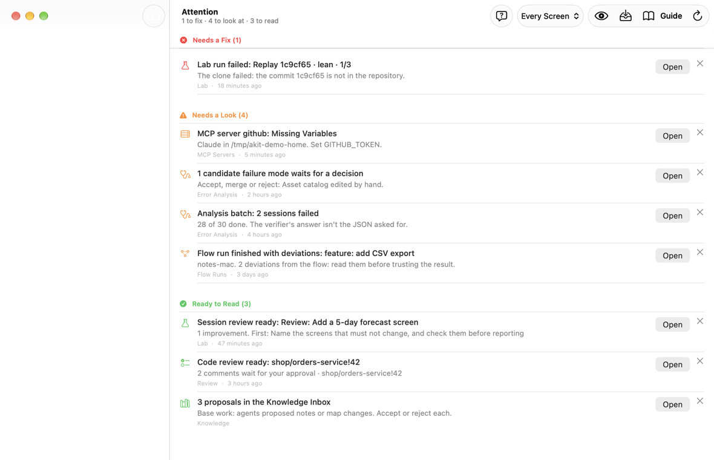

# Attention: what needs me now, from every screen, in one place

Status: step 1 built 2026-11-20 (asked by the user the same day: a guide mode that puts the most
important signals in one place, failures of the modules, finished code reviews, analyses and evals,
each with a short description and a link to the problem's place, so nobody walks through every
window).

Code: `AKitAttention` (`Attention.swift`: the item, the link, the dismissals; `AttentionSources.swift`:
one reader per screen), `AKit/Attention/` (the screen and `AppModel.open(_:review:knowledge:)`),
`AKitCommandLine/AttentionCommand.swift` (`akit attention`), `AppLink` (`akit://<screen>?item=…`).

## Goal

The sidebar has 19 screens. A failed Lab run, a review whose comments wait, a flow run that halted
or an MCP server that stopped connecting each shows only on its own screen, so it is found late or
never. Attention reads what those screens already keep on disk and lists it in one place: what
failed, what needs a look, what is ready to read, each with Open.

Not a log of everything that happened, and not a place to act: the action stays on the item's own
screen, which Open shows.

## Decisions

| # | Topic | Decision |
|---|---|---|
| T1 | Where | Its own sidebar group Now, first, with one screen, Attention; the start screen of the window (was Overview). Badge: the problems and the items that need a look, not dismissed |
| T2 | Module | `AKitAttention`, above Lab, Review, ErrorAnalysis, Flows, MCP, Knowledge and Brain, below CommandLine. It reads only: no git, no agent, no model, no index import. The app reads it off the main thread at start, on the screen and every 30 seconds |
| T3 | Levels | Needs a Fix (something failed), Needs a Look (not broken, waits for a decision or looks off), Ready to Read (finished work). Problems first, newest first inside a level |
| T4 | Sources (step 1) | Lab: a failed run, an agent error, a session review with findings, a review without a valid `review.json`, hidden tests that failed; failed control cells are one item. Review: the latest run of each merge request: failed, comments not sent, sends that may have gone through, comments waiting for approval. Error Analysis: a batch with failed sessions, a paused batch, a finished report; candidate modes. Evals: each layer's saved verdict per agent (a failed sanity check is a problem, cells left out need a look). Flow runs: stopped (by the user: a look), halted, finished with deviations, a record that can't be read. MCP: the last check that didn't connect (failed, timed out, not found: a fix; sign-in, approval, variables, untrusted folder: a look). Knowledge: proposals in each base's inbox. Brain: its problems |
| T5 | Age | Runs, reviews, batches, verdicts and checks older than 14 days are left out; inbox proposals and brain problems count at any age |
| T6 | Open | Each item has a link: screen, tab, item, folder. Open (or a double click) shows the screen with the run, batch, layer set, server or base selected, through the screens' reveal hooks (`revealLabRun`, `revealBatch`, `showLayerSet`, `revealAnalysisTab`, `revealFlowRun`, `revealMCPCheck`, `revealBrainLayer`, `ReviewModel.open`, the knowledge base and its Inbox tab) |
| T7 | Dismiss | Dismiss hides an item until it changes (another status, check or count): its id and fingerprint in `~/.akit/attention.json`, entries of items gone are dropped. Show Dismissed, Restore; Dismiss All Ready for what was read |
| T8 | Links outside | `akit attention` prints each item's `akit://<screen>?tab=…&item=…&folder=…`; the app opens that place (`AppLink.place`). Copy Link in the context menu |
| T9 | Agents | `akit attention [--all] [--json]` in `/akit`: an agent may look before work; it never dismisses |
| T10 | Secrets | Details are the masked texts the screens show (MCP errors are stored masked); the command masks its output again. Ask AKit gets only the counts: item texts may quote session data (mode names, task titles) |

## Screen

```
┌ Attention ─ 1 to fix · 8 to read ───── [Every Screen ▾] [👁] [⇩] [Guide] [⟳]
│ ⊗ Needs a Fix (1)
│   Review failed: fix(col-318561): show the backend's message      [Open] ✕
│   Pass brief failed: terminated
│   Review · last week
│ ✓ Ready to Read (8)
│   Code review ready: col-301313 restapi/common V2 upgrade         [Open] ✕
│   1 comment waits for your approval · group/col-fe!7687
└──────────────────────────────────────────────────────────────────────────
```



## Next

- Agent Reports (`agent-reports.md`, being built): a summary saved in the last days as Ready to
  Read, linked to Error Analysis → Agent Reports, once that work is in master.
- Corrections: a rule whose corrections went up (`CorrectionVerdict.more`); needs the index scan,
  so off the 30-second loop.
- Layer evals whose cells all finished but whose verdict was never saved (only shown comparisons save one).
- Meetings that failed to transcribe (the Meetings package, read in the app).
- Insights recommendations and stuck loops, if they prove worth an item (they need the index).
