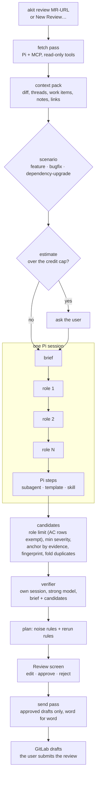
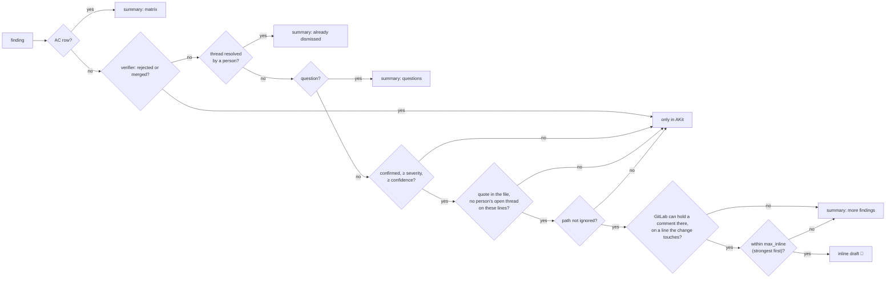

# AKit Review: AI review of merge requests

Status: 2026-10-15, built on branch `akit-review`; MCP change (R2, R3 revised, below) on branch
`review-mcp`. Grilled with the user on 2026-10-15 from a
research plan (Pi with the `github-copilot` provider, GitLab, Azure DevOps). The decisions
below are agreed. The user's employer allows both parts: Copilot from a third-party harness
(Pi) and AI comments in merge requests. Step 0 (facts on the work Mac) is still open: the code
was built against the public GitLab and Azure DevOps REST and Pi 1.0.4 on a personal Mac, and
`akit review check HOST` is the first fact to collect there. Context for a run (notes, links,
read-only context servers; GitHub issue #1) built 2026-10-22 on branch `review-context`, below.

Revised 2026-10-22 (branch `review-cleanup`, after an audit of the review): posted text names
no tool, only 🤖 (marker default `🤖`, no "AKit is an AI reviewer" line, the "looks fixed"
reply without AKit's name); the hidden line is `<!-- ai-review:v1 … -->` and the old
`akit-review:v1` is still read. The fingerprint drops the title (Findings, below). AC rows
don't count against a role's `max_findings`, so the matrix has a row per criterion. The
Feature scenario gets `bug-hunter` as a required role. Mermaid diagrams of a run under One run.

Added 2026-10-24 (branch `review-impact-map`): R40–R48, a map of the change for the user and its
uses in other repositories, an overview with a flow diagram in the chosen language, the whole work item chain, found by the agent through GitLab's MCP server (section "Change map
and impact on other repositories").

Added 2026-10-23 (branch `review-branch-wi`): R39, the work item comes only from the source branch
(`COL-317494`); without one the review checks the code alone.

Added 2026-10-23 (branch `review-deferred`): R37, limits only alert and are 4× higher; R38, passes
reach MCP servers with deferred tools through `tool_search`.

Added 2026-10-23 (branch `review-log`): R36, the run's log for analysis and while it runs, model
choices from Pi's list, required fields marked, an empty fetch that says why (section "Decisions
(2026-10-23)").

Added 2026-10-23 (branch `review-czech`): R35, Czech comments only (section "Decisions
(2026-10-23)").

Added 2026-10-23 (branch `review-practices`): decisions R20–R34 from a research note on agentic code
review (section "Decisions (2026-10-23)"), built in four parts with a reviewer round each.

Added 2026-10-22 (branch `review-audit-2`): checks without a model (the quote in the file, a
person's open thread, inline only on changed lines, a secret scan, the size of the change; section
"Checks without a model"); four optional roles, `performance`, `concurrency`, `data-migrations`
and `observability`, with `architecture` optional in Feature (a role per pass costs credits; turn
it on when the change has a design question); the `nitpicks` switch is gone (`severity_threshold`
already keeps `nit` out; set it to `nit` to post them); the verifier runs in a session of its
own with the brief, not as a fork of the passes' session, so the roles' reasoning doesn't sway
it; and Pi steps and Pi flags (section "Pi steps", below).
A run can add the user's pi-subagents agents (`/run reviewer …`), prompt templates and skills
as passes after the roles, and extra Pi flags for the passes; `akit review pi` and New Review…
suggest what the user's Pi has. Checked on a real Pi 1.0.4: an extension command such as
`/run` doesn't finish in `pi -p` (Pi exits before the subagent; the extension's context goes
stale), and the `subagent` tool can run scripts, change agent settings and start agents with
bash and edit outside AKit's checks. So AKit runs a step itself: the agent's prompt and model,
the review's reading tools.

Built: step 1 (2026-10-15): module `AKitReview` with the project profile, the three levels
(`ReviewCatalog`, `ReviewResolver`, `run.json`), Gather from GitLab and Azure DevOps REST into a
scrubbed context pack, the worktree at `head_sha`, `akit review MR-URL`, `akit review config show`,
`akit review token`, `akit review check`. Two additions to the design: the profile's `checkout:`
(the local clone the worktree comes from) and the tracker's `url:` (Azure DevOps Server). The
roles and scenarios of step 5 ship built in (`ReviewBuiltIns`, source `built-in`) and are used
while the brain has no layer `review`.

Built: step 2 (2026-10-15): `ReviewPasses` runs brief → roles → verifier in one Pi session
(`--session-id`, the verifier as `--fork` of it with its own model; since 2026-10-22 the verifier
has a session of its own), `akit-review.ts`
(`ReviewExtension`) with the two tools and the `tool_call` policy, the estimate and the cap, the
send log (purpose `review-<pass>`, the paths read), `akit review passes RUN`. Checked with a fake
Pi in tests and with real Pi 1.0.4 against a fake model server. Decisions made while building:

- **Credits** (R14): AKit's own unit, 1 credit = 1,000 tokens as Pi recorded them (input, cache
  writes, output); a cached read counts one tenth. Recorded numbers only. Step 0 checks how it
  lines up with the Copilot plan.
- **Sending policy**: a new origin `mergeRequest`. Revised 2026-10-16 at the user's request
  ("I only run Pi; Pi already has access to the model"): AKit runs Pi on the merge request as
  the user would, so any Pi destination may get it, on a work Mac too, without an allowed-list
  entry. Other harnesses may not. Masking before sending, the cap and the send log stay.
- **Role text**: every pass gets all of the run's role skills (`--skill`) and the same appended
  system prompt, so the session keeps one prompt cache; each role pass's prompt carries its
  checklist.
- **Verifier**: a session of its own since 2026-10-22 (before: a fork of the passes' session),
  so it doesn't inherit the roles' reasoning; prompted with the brief, the candidates and their
  snippets (`prompts/candidates.md`); one tool, `akit_submit_findings`, takes
  `findings` or `verdicts`.
- **Secret files**: Gather deletes them from AKit's own worktree, because `grep` and `find` read
  folders and the policy sees only the folder.
- **Anchors**: when a finding's evidence isn't within ±3 lines of its line but is on exactly one
  line of the file, AKit moves the anchor there.
- Pi reads stdin when it isn't a terminal: a pass's stdin is `/dev/null`.

Built: step 3 (2026-10-15): `ReviewPlanner` (the noise rules, positions from the diff hunks, the
scrubber, the summary draft, the rerun table), `ReviewWorkflow` (decisions with reasons, Move
Inline, Add Missed…, Send Drafts with a fresh read of the drafts and threads first),
`ReviewQuality` (labels and precision read from each run's `requests.json`), the Review screen
(sidebar group Work: the runs, the requests with the code around each anchor, Edit, Approve,
Reject with a reason, Only in AKit with Move Inline, the gaps, Send Drafts…, New Review…, Review
Settings… with the tokens and the profiles), `akit review show|approve|reject|inline|missed|post|quality`.
Decisions made while building:

- The hidden meta line also carries `th=`, a hash of the text AKit proposed: a rerun that would
  propose the same text leaves a draft the user edited alone.
- A suggestion block whose code the scrubber would change is left out of the draft.
- Labels are not a separate log: they are read from the runs' decisions. Error Analysis notes
  (origin `review`) are not written yet: notes there belong to agent sessions, and review's
  labels fit them only through the verifier's session; open.
- Gather and the passes run inside the app (one review at a time, Stop ends the pass); a run
  survives a quit as a folder, and Run Passes (or `akit review passes RUN`) runs it again.

Built: step 4 (2026-10-15): reruns by fingerprint end to end (a new run of the same merge
request sees the drafts the last one sent: same text → nothing, gone → delete), Discuss in Pi…
(`ReviewDiscuss`: `<run>/discuss.command` with `pi --fork` of the verifier's session, opened in
Orca, herdr or Terminal by `Launcher.openInteractive`; Make New Version turns what Pi submitted
into `findings.json` version N+1, keeps `findings-v<N>.json` and plans the requests again),
`akit review discuss|apply`. In a discussion, `verdicts` change findings by id and `findings`
add new ones (counted as confirmed: the developer was there); the discussion's tokens go into
`passes.json` and the send log when its version is made.

Built: step 5 (2026-10-15): Review → Roles, Scenarios (with the defaults) and Quality; Save… with a
diff, Duplicate to Project…, Reset to Brain, Add to Brain (the built-ins into `layers/review`,
committed), the work-word warning for brain saves on a work Mac; `layers/review` is reserved
(the brain doesn't read it as a project layer). The guide `review.ru.md`, the Work group in the
screens guide, the Review terms in the glossary.

MCP change (2026-10-15, the user's decision after trying the first build): AKit keeps no GitLab or
Azure DevOps token and has no REST client. Pi connects to GitLab, Azure DevOps and the other
trackers with the MCP servers the user configured in Pi; AKit is the configuration that fits each
kind of merge request (roles, scenario checks, rules, models and thinking, which servers and tools)
and the guard around every call. In the user's words: AKit passes Pi what to call, with which
roles, tools and skills, what to check, in which context, with which guardrails and limits.
Built the same day:

- **Fetch pass** (Gather, R3): Pi (`-ne -e builtin:mcp -e builtin:codemode`, the user's
  `mcp.json`) reads the MR, versions, diffs, threads, the user's drafts, the signed-in user and
  the work items in codemode scripts. The extension saves every MCP answer in `<run>/mcp/calls/`
  (AKit masks secrets in it after the pass); AKit sorts them by shape (`ReviewMCPData`: GitLab's and Azure DevOps's
  JSON) and trusts the servers' answers, never the model's account. `akit_submit_context` takes
  what a server answers in prose. With a `checkout:` AKit makes the worktree and the diff with
  git (`base..head`), so no model carries the diff. Its own session; its credits count toward
  the cap; it goes through the sending policy like every pass.
- **MCP rules** (`ReviewMCPPolicy`, the same in `akit-review.ts`): a profile's `mcp:` names the
  servers (none = all), extra read patterns, the write patterns (default `*draft_note*`) and
  `in_passes` (the rules were tightened by the security review below).
  `--tools mcp__<server>__*` keeps other servers' tools out too. Every call, direct or from a
  codemode script, passes the extension's `tool_call` (verified with Pi 1.0.4).
- **Passes** read through MCP too when `in_passes` (default): codemode with reading tools only.
- **Send pass** (Send Drafts…, R4–R5): AKit writes the approved requests to
  `<run>/send/approved.json`; Pi creates, updates and deletes draft notes with the GitLab
  server's draft tools, reading the requests from `akit_approved_requests` in a script. The
  extension lets a write through only when it carries an unsent approved request word for word:
  the same action (create, update, delete by the tool's verb), the body, the draft id, the
  thread, the file and the line; each request once. It logs GitLab's answer per request in
  `<run>/send/log.jsonl`; AKit marks requests sent from that log, not from the model. Drafts to
  change and threads to reply in are checked against what the run's fetch pass read (a fresh
  read is a new run: Refresh from GitLab is gone). The send pass is never stopped by the cap.
- Pass environments keep the user's variables, so Pi's MCP servers find the `${VAR}` their
  `mcp.json` names; the model has no shell or environment tool.
- `akit review check [--project P]` and Review Settings… → **Check Servers** run
  `pi mcp list --json` and sort each tool (read, write drafts, blocked); never a server's
  command line, environment or headers. `akit review token` and the token blocks are gone.
- Checked end to end with real Pi 1.0.4, a fake model and a fake GitLab MCP server: fetch →
  passes → approve → send; in the send pass an altered text, another line, another draft, a
  second send, a published note and bulk publish were blocked, and only the three approved
  calls reached the server.

Local review (2026-10-16, the user's request: review a git workspace of herdr or Orca by its
path, showing the commit range or saying that only the diff is there):

- `ReviewLocal`: `inspect(path, base?)` reads the workspace's top folder, branch, HEAD, the base
  (`origin/HEAD`, `origin/main`, `origin/master`, `main`, `master`, never the branch itself; or
  `--base REF`, checked as a ref name), the commits `merge-base..HEAD` and the
  `git status --porcelain` lines. It says in one sentence what is there: N commits since the base
  (with the range), only the uncommitted changes, or nothing to review.
- Modes: `all` (default when both exist), `commits`, `uncommitted`. Uncommitted changes
  (untracked too, `.gitignore` honoured) become a snapshot commit on top of HEAD, made with a
  temporary index (`GIT_INDEX_FILE` + `add -A` + `write-tree` + `commit-tree`): the workspace's
  index, files and branches never change; the object stays dangling in the repository.
- The run: `ReviewRunSpec.local` (`ReviewLocalTarget`: path, branch, base ref, mode, base, head,
  commits, uncommitted files), `MergeRequestRef.local(repo)` (label `repo (local)`, run id
  `…-local`). Gather skips the fetch pass, makes the worktree from the workspace (Pi reads that
  copy, never the workspace) and the diff with git; `merge-request.md` holds the branch, the range
  and the commits. Files that usually hold secrets are left out of the diff in every review, with
  a gap. Work item numbers in the branch or commits are a gap ("A local review doesn't read the
  tracker"). The project profile is the one whose GitLab project is the `origin` remote or whose
  `checkout:` is this repository.
- No GitLab: no Send Drafts… (the button is hidden, `send` refuses, `post` says so); verdicts
  still count for quality. Deleting a run removes its worktree from the workspace it came from.
- `akit review local [PATH] [--base REF] [--what all|commits|uncommitted] [--show]` (PATH: the
  current folder, so `akit review local .` in an Orca or herdr terminal); New Review… →
  **Local Workspace** with Choose…, Base, What to review, the commits and the uncommitted files.

Finding the points (2026-10-24, the user's request: find the commits and points of a review by a
branch or commit name):

- `ReviewLocal.points(path, query)`: the branches, remote branches (without `origin/HEAD`), tags
  (an annotated tag gives its commit, the commit's author and date, its own message) and the last
  1,000 commits of all branches and HEAD (newest first), plus an older commit by an id start of
  4+ hex characters. Every word of the query must be in the name, the subject or the author, or
  start the id; any case. A filter (All, Branches with the remote ones, Tags, Commits; `--kind`)
  keeps one kind before the limit. Refs first (the most recent first, `creatordate`: a tag by its own date),
  then commits; at most 30. A tag on a tree or a blob is left out. New Review… clears the range
  while it reads a new Base or Head, so Start Review never takes the old one.
- Head: `inspect(path, base?, head?)`. A head other than the workspace's HEAD reviews
  `merge-base(head, base)..head` without the uncommitted changes (they belong to HEAD), so only
  **Commits only** is offered; the current branch by name is still HEAD. `ReviewLocalTarget.headRef`
  keeps it for Review Again….
- A ref the user types may hold `#` and `+` now (`feature/AB#41-total` was refused); still no
  leading `-`, no spaces, `:`, `?`, `*`, `[`, `\`, `{`, `}` or `..`.
- `akit review points [PATH] [--find TEXT] [--json]`, `akit review local --head REF`; New Review… →
  Local Workspace → **Find…** next to **Base** and the new **Head** opens a search sheet; a click
  puts the name (a commit: 12 characters of its id) into the field.

Context and extra servers (2026-10-22, GitHub issue #1 "Code review improvement - context for
review"; the user chose the three parts below):

- **Notes** (New Review… → **Context for this review**, `--note TEXT`, `--note-file PATH`): the
  user's own text for one run: what the change is for, what to focus on, decisions made. Kept in
  `run.json` (`notes`, secrets masked, at most 20,000 characters), written scrubbed to
  `context/notes.md`, and quoted in the system prompt of every pass (so the verifier and
  Discuss in Pi… have it too). It is trusted as instructions for focus only: the prompt says it
  doesn't change the rules, and the model still only returns findings. The brief starts from it
  and adds a "Focus" line.
- **Links** (New Review… → **Links**, one per line; `--link URL`, repeatable): https only, with a
  host, no user name or password, no secret-like query parameter (`sig`, `token`, `access_token`,
  `key`, `apikey`, `password`, `secret`, `code`, `signature`), at most 20 (`ReviewContext.links`).
  The fetch pass is told to
  read each link with a reading tool of the server that serves it, one link at a time, naming it
  first with `akit_reading_link` (a fetch-pass tool; it accepts only the run's links). The
  extension tags every MCP answer saved after it with that link (`ReviewMCPCall.link`) and its
  server (`ReviewMCPCall.server`, the longest-name split), and logs every call it blocks in
  `mcp/blocked.jsonl`. **`akit_reading_link` only labels the calls that follow it: it doesn't
  gate which pages or tools the model reads.** What may be read is decided by the MCP policy
  alone (the run's servers, the read allowlist). AKit files an answer under a link when the
  tag or the call's arguments name it, and writes `context/links.md`: the servers' answers per
  link (masked, 40k characters per link, 150k in all) or "Not read: <why>"; each unread link is a
  gap ("No MCP call of the fetch pass read it", "AKit blocked <tool>: <reason>", "<tool> failed")
  and is listed in `run.json` (`linksUnread`). The merge request's data (`ReviewMCPData`) comes
  only from the run's own servers (`ReviewMCPAccess.answeredByBase`), tagged or not: a GitLab
  thread read after a link was named still counts, and an answer of the merge request's shape
  stays out of the link's text; a context server's answer is never the merge request's data.
  Base-server calls stay tagged on purpose: Azure DevOps wiki pages and work items are read by
  the tracker's own (base) server. A local review runs a
  fetch pass only when it has links, with a links-only prompt (no GitLab reading, no
  `akit_submit_context`); if that pass fails, the links become one gap and the review goes on.
  Checked in tests with a fake Azure DevOps wiki answer (`wiki_get_page_content` reads by its
  second word), a Figma answer named by its arguments, a blocked Confluence write and a link no
  server read.
- **Context servers** (`ReviewMCPAccess.extraServers`): the profile's `mcp: extra_servers:` plus
  the run's choice (New Review… → **Extra servers**, the servers of `pi mcp list` that aren't the
  run's own, ticked per run; `--extra-server NAME`). They are added on top of `servers:` (or the
  default GitLab and tracker names), never replace them. A context server is there in the fetch
  pass, the brief, role and verifier passes and Discuss in Pi…, and only reads: its tools pass the
  same read allowlist (reading verb, `readOnlyHint`, `read:` patterns, the forbidden words), and a
  writing verb is blocked even when it matches `write:` (`ReviewMCPPolicy.kind` and
  `akit-review.ts` v6, the same rule). The send pass never gets one: its `--tools` has only the
  base patterns and its `AKIT_REVIEW_MCP` has no `extraServers`. A server the defaults or
  `servers:` already allow keeps its role (writes in Send Drafts included); `config show` and
  `check` warn about such an `extra_servers` entry. `--tools` gets `mcp__<server>__*` for each
  context server (`toolPatterns`) in the other passes. `run.json` records
  `mcpServers`: each server (or default name pattern) with its source (`built-in`, `project`,
  `run`) and whether it is read only. Browser, file-system and fetch-type servers (names with the
  words `browser`, `chrome`, `file`, `fs`, `http`, … or the parts `fetch`, `web`, `crawl`,
  `browser`, `puppeteer`, `playwright`, `firecrawl`, `tavily`, `exa`, `jina`, `brightdata`,
  `filesystem` anywhere) are never ticked by default;
  ticking one shows a warning (`ReviewMCPAccess.warning`), `config show` marks it with "!".
  Review Settings… → **Check Servers** with a profile in **Rules of** shows a **Context server**
  checkbox for each other server; **Save Extra Servers…** changes only the `extra_servers` line of
  the profile's `mcp:` (block, one-line flow, or a new block; a trailing comment and CRLF line
  ends stay; the parsed profile must stay the same except `extra_servers`), shows the diff, then writes
  (`ReviewConfigEditor.extraServers`, kind `profile`). Not done: a context server per link
  (the model picks the server by the link's site); a fetch pass for a local review with context
  servers but no links (the passes read through them anyway when `in_passes`).

Security review of the MCP change (2026-10-15), fixed the same day:

- Servers: without `servers:` a run uses only Pi servers named like `gitlab`, `azure`,
  `devops` or `ado` (and `--tools` keeps only theirs), never a browser, file or fetch server.
- Reading is an allowlist: a reading verb as the first word or the second after a namespace
  (`get_merge_request`, `wit_get_work_item`), a server's read-only hint, `mr_discussions`, or
  the profile's `read:`; `publish`, `submit`, `approve`, `vote`, `resolve`, `rebase` anywhere in
  a name block it in every pass.
- Writes are checked by field, not by value: only known arguments (project, merge request
  number, body, draft, thread, position with its known fields); the project and number must be
  the run's (`mr` in each approved request), every other argument (`resolve_discussion`, a
  second text field) blocks the call; the verb comes from the tool's own name.
- `akit_submit_context` is the model's account: it may give the merge request and diffs for the
  context, never the user, the threads or the drafts that decide what AKit may change.
- Commit ids from MCP answers must be hex; the target branch must be a plain branch name and is
  fetched as `refs/heads/<name>` without a destination.
- A server is the longest allowed name before `__`, so `gitlab__x` is not `gitlab`.
- Checked again with real Pi: `resolve_discussion`, a reply into another thread, a second text
  field, another MR or project, an extra position field, a decoy delete argument and another
  server were blocked, each with its reason; the exact calls went through.

Review round (2026-10-15, code review of the branch), fixed:

- The path policy refuses paths that start with `~`, `@` or `file:` (Pi expands them itself),
  `find` patterns that leave the folder, and more secret files (`.npmrc`, `.netrc`,
  `.git-credentials`, `id_*`, `*.p12`, …). A pass reads only the worktree and `context/`,
  `roles/`, `prompts/` of the run: never `gitlab/` or `tracker/` (raw, unscrubbed).
- AKit's own reads of worktree files (snippets, anchors, the screen) don't follow a symlink
  out of the worktree and are masked.
- What a run keeps from MCP servers is masked on disk (`ReviewMask`, 2026-10-16): the saved
  answers (`mcp/calls/`) and the send log after each pass and when AKit opens a run (Discuss
  in Pi… saves answers too), the pass streams (`passes/*.jsonl`) line by line as Pi writes
  them. Only string values change (`SecretFilter.masked`, the Scrubber's token shapes and
  passwords, plus whole private-key blocks), JSON stays JSON and a text keeps its lines, so
  diffs keep their line numbers; files without a secret stay byte for byte. Pi's own session
  files in `sessions/` stay as Pi wrote them.
- Tokens: one Keychain account per exact `https://host[:port]` (Azure DevOps: per collection
  address), https only, no redirects. They are now written and read in-process
  (`ReviewKeychain`), not through `/usr/bin/security`, so another program gets a Keychain
  prompt instead of the token. Gather commands (they run the merge request's code) and passes
  get a minimal environment without GitLab or Azure DevOps variables.
- A thread is AKit's only when the token's user started it with AKit's line; "looks fixed" is
  proposed once per thread and only when no finding of the run has the fingerprint.
- Model text can't open or close an HTML comment, the meta line is read from the end, and a
  discussion's finding takes a role of the run only.
- Send Drafts sends only the requests the sheet showed, with the text it showed; after a send
  the snapshot learns GitLab's drafts, and sent requests stay on the list after a replan.
- Diff positions after hunks that only add or only remove lines.

## What and why

The user reviews GitLab merge requests at work. An agent can read the change first, check it
against the work item (Azure DevOps) and propose comments. The user checks every comment, and
only then do the comments reach GitLab, as drafts in the user's own pending review.

Public numbers say that most AI review comments are noise: in a study of 31,073 CodeRabbit
comments (Lin et al., arXiv:2607.03316) 36.4 % were accepted and 56.3 % rejected; RevMate
(arXiv:2411.07091) saw 7–8 % accepted. Quality falls fast as the diff grows, and many false
positives come from missing context. So the design aims at precision, not recall: a verifier
pass, a hard cap on inline comments, and explicit **context gaps** instead of guesses.

The rule that shapes everything: **the model only reads and returns structured findings.**
Everything that writes, dedupes, marks or limits is deterministic Swift code in AKit. That keeps
the agent harmless against prompt injection from MR text, makes reruns idempotent and makes
the harness replaceable (Pi now, Claude Code later).

## Decisions (2026-10-15)

| # | Question | Decision |
|---|---|---|
| R1 | Where does it live? | A new module `AKitReview` in AKit. It depends on `AKitLab` and `AKitFoundation`, not the other way. Work configuration lives only in `~/.akit/local/review/` |
| R2 | Who writes to GitLab? | (revised 2026-10-15) Pi, through the user's GitLab MCP server, in a send pass that only carries out approved requests: the extension blocks every write that isn't an approved request word for word. AKit keeps no token. (Was: only AKit, through REST, with a Keychain token) |
| R3 | How does the agent read GitLab and Azure DevOps? | (revised 2026-10-15) Through the MCP servers configured in Pi, reading tools only: the fetch pass reads the MR and work items, and AKit builds the context pack from the servers' saved answers; the passes may read more (`in_passes`). (Was: it doesn't; AKit fetched everything by REST) |
| R4 | When does AKit write? | Only after the user approves each request on the Review screen (or `akit review post RUN --yes`). Not one request goes out unapproved, deletes and updates included |
| R5 | What does AKit write? | Draft notes. The user publishes them in GitLab with **Submit review**, together with their own comments. AKit never calls `bulk_publish` or publishes a draft |
| R6 | Who orchestrates the passes? | AKit (Swift). Brief → roles → verifier, one after another **in one Pi session**, so later passes see the earlier ones and findings stay linked. Parallel fan-out only later, for big MRs. Revised 2026-10-22: the verifier has a session of its own with the brief and every role's limits in its prompt, so the roles' reasoning doesn't sway it |
| R7 | Interactive work | After a run, **Discuss in Pi…** opens an interactive Pi in a terminal (herdr, Orca) as `pi --fork <verifier session>`: the brief, the candidates and the verifier's checks (since 2026-10-22 not the roles' reasoning), the run's sessions unchanged |
| R8 | First scenarios | Feature, Bugfix, Dependency upgrade. The user picks the scenario; the classifier comes later |
| R9 | What is a role? | One `SKILL.md` in the brain layer `review`, with review fields in its frontmatter. Scenarios are YAML in the same layer. These skills are not installed into the harnesses' skill folders; AKit passes them to review passes only |
| R10 | How configurable? | Everything, on three levels: brain → project profile → one run. The resolved `ReviewRunSpec` is saved in the run folder |
| R11 | Knowledge base | v1 reads markdown folders the project profile lists. A full KB (agent proposals in an inbox, linter) is a separate design, after the context gaps show what is missing |
| R12 | Reruns | By fingerprint, without the role in it (rules below). Every change to an earlier draft is a request to approve. Threads resolved by a person are never raised again. AKit never touches other people's threads |
| R13 | Noise | ≤ 7 inline drafts, severity ≥ medium, confidence ≥ 0.8; questions, gaps and the AC matrix go to one summary draft; the rest stays in AKit |
| R14 | Models | One model for the brief and the roles (one prompt cache), a strong model for the verifier, which gets only the candidates and their snippets. A cap per run, 150 credits by default (600 since R37, and it only alerts) |
| R15 | Agent tools | `read`, `grep`, `find`, `ls` and the `akit_*` tools. No `bash`, no `write`. Paths limited to the worktree and the run folder; secret patterns blocked. Git history and test output come from Gather |
| R16 | Quality | v1: the user's verdict on each finding at approval, with a reason tag, goes to Error Analysis. Sync of outcomes from GitLab comes later |
| R17 | Brain edits from the work Mac | Allowed for the generic review roles and scenarios, after a diff with warnings for work words (hosts, project paths, e-mails from the work profiles) |
| R18 | Order | Before wave 1 of `README.md` (layer evals on JS/TS) |
| R19 | Docs | An in-app guide `review.ru.md` describes how review works; each screen step updates it in the same commit (see Guide) |

Rejected on the way: the agent writing through GitLab MCP *unguarded* (no protection against
injection; now it writes only approved requests word for word, checked by the extension); AKit's
own REST clients and tokens (first build; the user wants Pi's MCP servers as the one way to the
work systems); orchestration in a Pi
extension (Pi only, no tests, the budget and send log written again in TypeScript); three
model tiers (switching models in one session loses the prompt cache); the role in the
fingerprint (one problem from two roles would become two comments).

## Decisions (2026-10-23): practices from Anthropic, OpenAI and Uber

Grilled with the user on 2026-10-23 from a research note on agentic code review in 2025–2026
(Anthropic's `code-review` plugin and Code Review, OpenAI's Codex review, Uber uReview, the
CodeRabbit field study). Built on branch `review-practices` in four parts: (a) R20–R26, R29;
(b) R27, R30, R33, R34; (c) R28, R31; (d) R32.

| # | Question | Decision |
|---|---|---|
| R20 | Where do review rules come from? | Built into AKit and generic for any project. A review doesn't read the repository's `AGENTS.md`, `CLAUDE.md` or `REVIEW.md` (Pi keeps `--no-context-files`); the project profile adds its own. Anthropic's false-positive list joins the built-in "never comment on" rules: issues from before the MR, rules silenced with `eslint-disable` / `@ts-ignore` / `swiftlint:disable`, and intended changes of behaviour |
| R21 | Language rules | One built-in rule set, TS/JS with React, on when the diff has `.ts`, `.tsx`, `.js`, `.jsx`, `.mjs` or `.cjs` files. Each rule has a level and a safe path. No other languages |
| R22 | MCP servers in the passes | The roles get every MCP server of the user's Pi, reading tools only (the extension's write guard is unchanged). The built-in rules say which server is for what: documentation servers (context7) when the behaviour of a framework, a library or a tool is in doubt, GitLab for merge requests and their history, Azure DevOps for work items. `access.in_passes` can still narrow the list. A server reached only this way (an *open* server; `mcp: all_servers`, default true, a toggle in Review Settings…) is stricter than the run's own: a tool runs only when its server marks it read-only, when it is a known exact read (context7's `resolve-library-id`, `query-docs`), or when its name starts with a reading verb and no word anywhere in it acts (`execute`, `run`, `query`, `create`, `send`, …); its arguments are at most 300 characters each and have no line break, so code of the change can't leave through a search box; secret stores, databases and cloud consoles count as risky (named only). Found by the review of part (a): the reading-verb rule alone let `execute_query` and `get_or_create_*` through |
| R23 | Issues from before the MR | A finding gets `preExisting: true` when the problem is already there at the base commit. It never goes to GitLab, not even to the summary; the Review screen lists it under "Before this MR". Move Inline still works |
| R24 | Confidence | Anthropic's rubric, on the 0–1 scale, in the role and verifier prompts: it says whether the problem is real, also for an issue from before the MR (that one gets `preExisting`, not a low score): 0 a false positive, 0.25 couldn't verify, 0.5 real but minor, 0.75 verified and will happen in practice, 1 certain. `confirmed` needs ≥ 0.75; the posting threshold stays 0.8 |
| R25 | The verifier's model | `models.verifier` is required: without it New Review… keeps Start Review off and `akit review` stops with a hint (`--verifier-model`) before a run folder exists. No automatic choice. Runs made before (spec version 1) keep their old verifier |
| R26 | How many drafts | `max_inline: 5` and a new `max_inline_medium: 3`; critical and high first. The rest stay one line each in the summary |
| R27 | Before the passes | Gather reads the draft status, the latest pipeline and earlier AKit runs on the same head SHA. If any of these holds, one question before money is spent, like the size question. Triviality isn't judged |
| R28 | Reruns | With an earlier run of the MR, the roles look only at the lines changed between the last reviewed head and the new one, and earlier findings are checked for "fixed". The 4th run asks whether to talk about the approach instead. **Full review** reads the whole MR again. After the review of part (c): a carried finding keeps every fingerprint it ever had (drafts and threads of any earlier run match); a role that finds an earlier problem again takes its fingerprints over; earlier findings not carried (questions, merged, rejected) keep their threads from "Looks fixed" while their lines didn't change (`rerun-kept.json`); a deleted or renamed file is a whole-file change; only a rejection noted "fixed" counts as fixed; Move Inline carries over; Discuss findings are not filtered; the kept fingerprints pass from run to run; a run whose newest earlier run is on the same head is a full review (the user asked for this commit again); without the earlier findings the run reviews the whole MR, with a gap |
| R29 | Rules off the changed lines | Unchanged: findings off the changed lines go to the summary; issues from before the MR follow R23 |
| R30 | History | Gather writes `history.md`: `git log` and `git blame` of the changed lines (local, no network) and people's threads in the last merged MRs that touched the same files (GitLab MCP). A new optional role `history`: an old bug coming back, or what people already asked for in these files. After the review of part (b): a past merge request's threads count only when the fetch pass read it as merged in this project; an answer about `!N` of another project, or a past merge request's diff, never becomes this merge request's data; draft and pipeline come only from calls about this merge request, and the pipeline concern only for the head commit; blame runs once per file with `--no-textconv` and a 90 s budget, and notes are quoted |
| R31 | Outcomes | Each rerun and a **Sync Outcomes** button read the threads with AKit's hidden line: anchor changed → `fixed`; resolved without a change → `dismissed`; the author's reply is shown as text; merged with no reaction → `ignored`. The Review screen shows the share accepted by role and model. After review: a run's own findings say "still there" only for its own head (a sync after a push sees the fix), AKit's "Looks fixed" reply counts as fixed, outcomes keep the time of their data (an older re-plan never overwrites a newer sync), a sync without threads changes nothing, and the sync pass reads GitLab only with a small limit of its own |
| R32 | Eval set | **Add to Eval Set** on a run or a finding records the MR, its head SHA and the expected findings (or "clean"). Running the set through Lab is a later step. Built: `~/.akit/local/review/eval-set.json` (`ReviewEvalSet`), one case per merge request and head; the run menu Add to Eval Set (approved findings, or clean), Expect in Eval Set on a held-back finding, the list with Remove on the Quality page, `akit review eval [list|add|remove]` |
| R33 | Modes | Chosen by the kind of run, no new choice: a colleague's MR uses the posting rules above; the user's own MR or a local review also posts `low` and has a higher limit. A built-in scenario `security` next to Feature and Bugfix |
| R34 | AI-written merge requests | The brief writes a personal risk map for the user, never posted: risk areas, whether the MR shows proof that it was tested, signs of slop. Slop in the code (a duplicated helper, a test of a mock, a swallowed error) is an ordinary finding of `tests` or `bug-hunter` |
| R35 | The comments' language | Asked by the user later on 2026-10-23: only Czech goes to GitLab. `posting: language` (default `cs`) tells the passes, the verifier and Discuss to write titles, reasons, notes and gaps in it; AKit's own words in a draft (the header, the summary, "Looks fixed") are Czech; Gather's own gaps stay out of the summary (they are English and about this Mac). Send checks each draft's text with Apple's language recognizer (code, links, markup and AKit's header line left out; Slovak counts only with letters only Czech has) and refuses one that isn't Czech; the Review screen warns on its card. Translate only shows a translation: Send always takes the original |
| R36 | Seeing what a run does | Asked by the user on 2026-10-23. While a run goes, **Details** under the status bar shows a live log: each pass's start and end (credits, time, tokens) and, indented, what the pass does now from Pi's events (files read, MCP tools by name, the model's answers with tokens, findings submitted, failures); never MCP arguments or answers. In a terminal the CLI prints the same lines to stderr at once; piped, only the steps. After it, **Log…** (`ReviewRunLog`, `akit review log RUN [--json]`) shows each pass's model, thinking, time, tokens, credits, files, MCP calls and blocked calls, its Pi session file, and what each role's findings became; **Copy for Analysis** gives it as Markdown without secrets, MCP arguments (work data) or answers. Model fields of New Review… are lists of `pi --list-models` with **Other…** to type one; Add Missed… picks a file of the change or Other…; required fields have a red asterisk. A fetch pass that read no merge request says which tools Pi called, what AKit blocked, which servers answered that the run doesn't use, and which server names the run looks for |
| R37 | Limits | Asked by the user on 2026-10-23: "avoid limit for code review just alert me when overlap, and increase limits 4x". `cap_credits_per_run` 600 and `max_changed_lines` 6000 by default; over them the review never stops: an estimate over the cap, a change over the line limit, and the credits passing the cap (once) each make a yellow alert in the Review screen and a progress line ("Over a limit: …"). `--over-cap` is gone. Still asked: Review it now? (draft, red pipeline, same commit, 4th round); still enforced: the monthly dollar limit of Settings → Lab and Sync Outcomes' own small limit. A brain `review.yaml` that holds the old numbers keeps them |
| R38 | Servers with deferred tools | Found on the work Mac on 2026-10-23: GitLab's own MCP server (`/api/v4/mcp`, 50 tools) runs in Pi with `deferred` exposure, so its tools are in no tool list until `tool_search` loads them, and the fetch pass made no MCP call. Every MCP pass and Discuss now load `builtin:tool-search` and allow `tool_search` (the extension checks each loaded tool as before); the fetch prompt says how to find tools that are in no list. That server has no draft-note tools: Send can't write drafts through it yet |
| R39 | The work item from the branch only | Found on the work Mac on 2026-10-23: the team names the work item in the branch (`feature/COL-317494-…`); the description names other, older items, and the review read those and reported their missing acceptance criteria as its only output. Gather and the fetch pass now take the number only from the source branch (`wi_ref_regex` default `(?i)(?:COL-|AB#|WI-)(\\d+)`) and drop items the fetch pass read anyway, unless a named item's parent or related item. With no number the run is code-only: no gap about it, no `requirements` role, and the prompts ask for contracts and regressions; the passes' gaps about a work item are dropped. Review Again… (next to Log… and in a run's menu) opens New Review… with the run's change, scenario, notes, links and models, and Full review on |

Not taken: CI layers (Danger, reviewdog, SAST, a `.gitlab-ci.yml` template) are the team's
repository set-up, and a team set-up is not a goal; the team agreement on 🤖 comments is the
user's. Automatic choice of a verifier model of another family (R25: the user wants it explicit).

## Change map and impact on other repositories (2026-10-24)

Asked by the user on 2026-10-24: "a graphic view of the merge request for me: the links, what
each change affects". When the change is on a boundary (an API, a micro-frontend, a shared
library, an event, infrastructure), the agent itself searches the whole GitLab through the MCP
server for the other repositories that use it. The user names no repositories. Built on branch
`review-impact-map` in three parts: (a) R40, R41 and `akit review map`; (b) R42–R44, the `impact` pass; (c) the Map tab, the guide and the `/akit` skill.

| # | Question | Decision |
|---|---|---|
| R40 | What is on the map? | Three lanes, left to right. **This change**: the changed files, grouped by module (the nearest folder with `package.json`, else the top folder), with lines added and removed and the worst severity of their findings. **Boundaries**: what the change provides or uses across the repository's edge. **Other repositories**: the projects and files that use a boundary. Faded nodes in the first lane: unchanged files of this repository that import a changed file. For TS/JS AKit reads the imports itself (`import`, `export … from`, `require`, `import()`), relative paths and the workspace's own package names; files of other languages are nodes without edges. The map is for the user only and is never posted. Saved as `<run>/map.json`; built again on each run and rerun |
| R41 | Who finds the boundaries? | The brief, with a new tool `akit_submit_boundaries`. Each boundary has a kind (`http-api`, `graphql`, `mfe` (an exposed or remote module), `shared-lib` (a published package), `event` (a topic, a queue, a message schema), `db-schema`, `infra` (Helm, Terraform, Kubernetes, Docker), `ci` (a shared CI template, a job others include), `config` (an environment variable, a feature flag, a config key)), a direction (`provides` or `uses`), a name to search for (an endpoint path, a package name, a module name, a topic, a variable; at most 120 characters), the file, the line and a quote. AKit keeps a boundary only when its quote is in the file at the reviewed commit, like a finding (Checks without a model). A boundary of a file the change doesn't touch is dropped |
| R42 | When does AKit look in other repositories? | Automatically, when the brief kept at least one boundary and the run has a GitLab server. A new pass `impact` runs after the brief and before the roles, in the main session, so the roles see what it found. `impact: auto` (default), `off` or `always` at the three config levels (review.yaml, the profile, the run: New Review… → Other repositories, `--impact`). `always` runs the pass even when the brief kept no boundary: the pass then looks at the diff itself. Without a GitLab server the run gets a gap |
| R43 | How does the pass search? | GitLab's MCP server, reading tools only (R22's policy, the 300-character argument limit): `search` with `scope: blobs` and the name, first in the merge request's top group (`group_id`), then in the whole GitLab when the group gives fewer than 3 projects; `get_repository_file` to read a hit around the use; `semantic_search` and Orbit's `query_graph` when the server offers them. A budget, given to the pass in its prompt and counted by AKit: 20 searches and 30 files read; over it AKit only alerts (R37). When search over code in a group or the instance fails (it can need Advanced search), the pass reports a gap that says so and what it tried. The pass submits each use with `akit_submit_consumers`: the boundary, the project path, the file, the ref, the line, a quote and how the file uses the boundary, and whether this change breaks it with the reason. AKit keeps a use only when its quote is in an answer the pass got from GitLab in `mcp/calls/` (never the model's word alone) and the project is not the merge request's own. The kept uses go to `context/consumers.md` for the roles and onto the map |
| R44 | Where do the uses go? | On the map (the third lane). A use that this change breaks is a candidate of the `contracts` role, which now runs in every run that has kept uses: its anchor is the changed line in this merge request (never a line in the other repository), its text names the other project and file, and it goes through the verifier and the user's approval like any finding. Answers from other projects are context: they never become this merge request's data (R30's rule) and AKit never writes to another project |

Built: part (a) (2026-10-24): R40, R41 and `akit review map RUN [--json | --mermaid]`
(`ReviewMap.swift`). The brief gets `akit_submit_boundaries`; right after it AKit writes
`<run>/boundaries.json`, and at the end of the passes `<run>/map.json` (a failure there only
writes a progress line). `consumers.json` (part b) is read when it is there. What differs from
or adds to the table:

- A boundary is kept only with a worktree (the quote can't be checked without one), in a file
  the change adds or modifies (not a deleted one); its line moves to the quote's line when the
  brief's line is more than 3 lines off. Model text is masked. Since the review of part (a): a
  removed boundary (`side: old`, and every boundary of a deleted file) is checked against the
  diff's removed lines with old line numbers, needs no worktree, and the map and the impact
  prompt mark it (its uses are the ones that break); the name, its last path segment or last
  identifier must be within 3 lines of the quote's hit, and a quote's piece counts only with 12
  characters or as a whole line (uses in other repositories too; findings keep 4); at most 50
  boundaries, quotes of 500 and notes of 300 characters.
- The import scan skips `node_modules`, `dist`, `build` and hidden folders, links and secret
  files; it reads at most 20,000 TS/JS files (200,000 entries) of up to 1 MB each and says so
  in the map's notes when it stops early. TS imports of `x.js` find `x.ts`. A workspace
  package resolves through its `source`, `module`, `main` or `types`, else `index.*` or
  `src/index.*`; a subpath also under `src/`. At most 200 dependents are shown. Comments and
  the insides of strings don't count as imports; `.mts`/`.cts` are read (`x.mjs` finds `x.mts`,
  `x.cjs` finds `x.cts`). Two workspace packages of one name: the shortest folder, then the
  first by name, and a note on the map. `exports` maps and tsconfig `paths` aliases aren't
  resolved: such imports are only missing edges.
- A file's lines added and removed count every `+`/`-` line after the first `@@` (GitLab's
  diff text has no file headers); `changes.md` counted the same wrong way and is fixed too.
- A node's severity is only what the plan could post as a problem: a finding the verifier
  confirmed, whose evidence was found, that the change brought, at its final severity.
- A run made before the map gets one the first time `akit review map` (or `ReviewMap.load`)
  asks, when its worktree is still there. When `findings.json`, `boundaries.json` or
  `consumers.json` is newer than `map.json` (Discuss in Pi changed the findings), `load` builds
  it again too. The passes delete the old `map.json` before they build a new one.

Review of part (a) (2026-10-24): removed boundaries, the name tied to the quote, stricter quote
pieces, line counts, the map's severity, imports in comments and strings, `.mts`/`.cts`,
duplicate package names, size caps, a non-list tool argument is an error (not "Saved 0"), no
stale `map.json`, Mermaid control characters, and the map follows Discuss in Pi.

Built: part (b) (2026-10-24): R42–R44, the `impact` pass (`ReviewPasses.impact`,
`ReviewConsumers.swift`, `ReviewPrompts.impact`). `impact: auto | off | always` in review.yaml
(top level), a profile's `review:` block and the run (`--impact`, also for `akit review local`);
`config show` lists it. The pass runs after the brief's boundary check, in the main session, with
the reading tools, MCP, `tool_search`, `akit_submit_consumers` and `akit_report_context_gap`.
What differs from or adds to the table:

- The run's GitLab server is the one the fetch pass read the merge request with (the run's own
  server whose saved answer holds it; for an older run, its own servers named like GitLab). A
  local review, `mcp: in_passes: false` or no such server: a gap (system `gitlab`) and no pass.
  A failed impact pass is a gap too, added after the gaps the pass reported itself; the review
  goes on, and the uses the pass submitted before it failed are checked like any others.
- The top group for `group_id` is the first segment of the merge request's project path; the
  prompt also names the full namespace, and when the group search fails (a user's namespace)
  the pass searches the whole GitLab. The 300-character, one-line argument limit holds for every
  server in this pass, GitLab included (and for open servers in every pass); it covers keys too,
  a value nested deeper than 4 levels is refused, the arguments as JSON may have at most 600
  characters, and `read_mcp_resource` (its `uri`) passes the same check.
- `always` with no boundary from the brief: the pass also gets `akit_submit_boundaries`, AKit
  checks those like the brief's, and a use names such a boundary by its name.
- `akit_submit_consumers` may be called more than once; the calls add up (at most 200).
- AKit keeps a use when its boundary is kept, its project is a GitLab path other than the merge
  request's, and ONE answer of a run's GitLab server to this pass holds the quote (each line,
  spaces collapsed, split at `...`; 12 characters or a whole line), the use's whole file path
  and its project. Such an answer is either a search hit (an object with `data` or `content`,
  base64 decoded when `encoding` says so, and `path`, `filename`, `file_path` or `file_name`; the
  project from `path_with_namespace`, `project_path`, `project` or `project_id`), or a file read
  (a tool with `file` and a reading verb in its name, like `get_repository_file`): its project
  (`project_id`, `id`, `project`, `project_path`) and file (`file_path`, `path`, `file`) come from
  the call, since the answer is that file, but only when the answer names no other file, and the
  quote must be in the answer. A project number counts only when an answer of the pass gives it
  exactly one path (`id` or `project_id` next to `path_with_namespace`, as `get_project` or a
  `projects` search answers). An answer of the merge request's own project (its path, or its
  number from `gitlab/snapshot.json`) is no evidence. The call's input is never evidence for the
  quote. Answers over 2 MB are skipped, base64 contents decode to at most 2 MB. One use per
  project, file and boundary, at most 100; texts masked and cut, the file and the ref defused in
  `consumers.md`. `url` is `<host>/<project>/-/blob/<ref or HEAD>/<file>#L<line>`, none when the
  ref or the file has a `.` or `..` segment.
- Searches (`search`, `semantic_search`, `query_graph`) and file reads (a tool like
  `get_repository_file`: `file` and a reading verb in its name, no `list` or `tree`) are counted
  from the saved answers or the pass's own tool calls, whichever is more; trees, file lists and
  projects count as neither.
- The contracts role that R44 adds is the built-in one, after the scenario's roles; `run.json`
  lists it with the reason "added: other repositories use the change". Each run of the passes
  first takes such a role out (and its folder, when it is the definition AKit wrote) and decides
  again. A role the user turned off (the profile's `roles: off` or the run's choice; `run.json`
  lists them as `rolesOff`) is never added: the progress says the uses were found but contracts
  is off by the user's choice.
- The estimate (credits and the monthly limit in dollars) counts the impact pass, and the
  contracts role it may add, whenever the pass may run (impact not `off`, MCP in the passes and
  a GitLab server).
- The extension's pure rules (`ReviewExtension.rules`: the argument limit, where it applies, the
  shape of a use) are plain JavaScript inside the TypeScript file; the tests run that same text
  with JavaScriptCore.

Review of part (b) (2026-10-24): a use is tied to its project and its whole file in one answer
(never the call's input), the added contracts role is decided again on every run and the user's
removal wins, the argument limit covers depth, keys, total size and resource reads, the
extension's rules run in the tests, big answers and base64 are capped, AKit's failure gap is
appended, the estimate counts the impact pass, a failed pass keeps its saved uses, file and ref
defused, `.`/`..` refs give no link, and trees and file lists don't count as file reads.

Built: part (c) (2026-10-24): the app. A run's detail has **Overview** on top (points, a table of
modules with their files in a popover and the why, the why's sources as tags, AKit's notes, the
run's one Translate menu) and the **Flow**, then a **Requests | Map** switch. What differs from or
adds to the decisions:

- The flow is drawn by `mermaid.js` 11.17.2 (`AKit/Resources/Mermaid`, MIT, sha256 in its README)
  in a `WKWebView` (`MermaidView`): the library is a user script, the page loads with no base URL
  and a content policy `default-src 'none'; script-src 'none'; style-src 'unsafe-inline'; img-src
  data:; font-src data:`; a content rule list blocks every URL but `about:` and `data:`;
  `securityLevel: "strict"`; the source goes in as an argument of `callAsyncJavaScript`; every
  navigation after the first load is cancelled, no windows, a
  non-persistent store, no context menu, the wheel scrolls the screen. A policy violation is
  counted under the diagram. The height follows the SVG; light and dark redraw. A hostile flow
  (`A@{ img: … }`, a label ``, `url(…)` in `classDef`/`style`) made no request to a
  local server: the image shape ends in mermaid's "Loading error", the label image is a counted
  violation, `url(` doesn't parse. Snapshots draw a picture of the web view on top
  (`takeSnapshot`), since `cacheDisplay` can't see it.
- Review of part (c) (2026-10-24): mermaid 11.17.2 (CVE-2025-54881, KaTeX `innerHTML` in
  sequence diagrams). The page has no script and `script-src 'none'`, so inline handlers don't
  run; mermaid (a user script) and AKit's render code (`callAsyncJavaScript`, the source and theme
  as arguments) run in a content world of their own (`akit-mermaid`), and only that world can post
  to the `akit` handler (the page world has no `window.webkit`). Labels are SVG text
  (`htmlLabels: false`); `<br/>` still breaks a line (a sequence diagram's KaTeX is still
  HTML). The flow check refuses any `<` before a
  letter, `/`, `!` or `?` (closed or not) but `<br/>`, `<br>`, `<br />`, and `$$`. Checked
  against a local server with the flows fed to the view directly: label and sequence ``,
  KaTeX `$$…$$`, `A@{ img: … }`, `url(…)`: no request reached it, the sequence image is a counted
  violation, inline handlers were blocked. A new diagram clears the error and the blocked loads
  (at most 20 kept); the rule list's first load draws the current diagram. Open in GitLab only
  for a link on the run's GitLab host. A left-out flow's button is **Copy Unchecked Source**.
  The map works out its id index once, resets its folds for another map, uses positions as list
  ids, and a node has an accessibility action that selects it.
- The Map is native SwiftUI: three lanes in a fixed layout, lines in a `Canvas` from anchor
  preferences (between lanes; imports as arcs on the first lane's left), hover lights a node's
  lines, a click opens an inspector (files and the file's diff, findings with Show Request, a
  boundary's quote, each use with its quote, why it breaks and Open in GitLab, only http/https).
  A module or project with over 8 files starts folded; 8 dependents show until Show All. A run
  without a map: "No map for this run" and Review Again….
- New Review… → This run only: **Other repositories** (Auto/Off/Always) and **Summary language**,
  each with "From the configuration (…)"; Review Again… carries a run-level choice over. Review
  Settings… → **Overview and other repositories** edits `impact` and `summary_language` for the
  level in Rules of (`ReviewConfigEditor.reviewSetting`: the top of the brain's review.yaml, or
  the profile's `review:` block; none takes the key out), shown as a diff before Save.
- Snapshots: `--tab requests` and `--tab map` fold the overview; `--tab map --query <node id>`
  selects a node. The demo home has a made-up overview, boundaries and uses for
  `shop/orders-service!42`; guide shots `review-overview` and `review-map`.

### Overview, flow and the work item chain (2026-10-24)

Asked by the user later on 2026-10-24: "a summary in the chosen language: 3–5 points on what
happens, which modules change and why (from the task and Azure DevOps through MCP); draw the
flow with Mermaid, how the change affects it"; and "the review always reads Azure DevOps: the
task, its parents up through every level (task, user story, feature, epic) and their comments".
Built as part (d), before the Map tab.

| # | Question | Decision |
|---|---|---|
| R45 | A short overview for the user | The brief submits it with a new tool `akit_submit_overview`: 3–5 points on what happens; the modules that change, each with its files and why it changes; where the why comes from (`work-item`, `description`, `notes`, `none`, more than one allowed). AKit keeps a module only when its files are changed files of the run, and keeps 3–5 points (fewer: the overview says it is short; more: the first 5). Saved as `<run>/overview.json`. Never posted |
| R46 | Its language | `summary_language` at the three config levels (review.yaml, the profile, the run: New Review… → Summary language, `--summary-language`), a `LabLanguage` code; default the Mac's preferred language when AKit knows it, else English. Only the overview and the flow's labels use it; GitLab text stays in `posting: language` (R35). Translate works on the overview too |
| R47 | The flow | In the same tool: a Mermaid diagram (`flowchart` or `sequenceDiagram`, at most 40 nodes and 6000 characters) of the path a request or data takes through the system where the change is (UI → micro-frontend → API → service → database, a job, an event), with the changed parts in a class `changed`. After the `impact` pass AKit adds the other repositories' uses as nodes under a `subgraph` (from `consumers.json`, not from the model). AKit rejects a diagram with `click`, `href`, `call`, `%%{init` or `<script` and keeps the text for the gap. The app renders it with `mermaid.js` shipped inside AKit (a pinned version, MIT, no network: `securityLevel: "strict"`, a content policy with no outside loads), light and dark; a syntax error shows the source and the error. **Copy Mermaid** copies the source |
| R48 | The work item chain | The fetch pass reads the work item named by the branch (R39), then its parent, the parent's parent and so on to the top (Task → User Story → Feature → Epic; at most 6 levels, a visited set against loops), each with its description, acceptance criteria and **all comments**; related items one level from the named item. Gather keeps the whole chain (R39's filter keeps ancestors of a named item, not only the direct parent). `work-items.md` shows the chain from the top down, so the overview's why can name the epic's or feature's goal |

Built: part (d) (2026-10-24): R45–R48 and `akit review overview RUN [--json | --mermaid]`
(`ReviewOverview.swift`). The brief gets `akit_submit_overview`; AKit checks it after the impact
pass and writes `<run>/overview.json` (a failure there only writes a progress line). What differs
from or adds to the table:

- The chain: the fetch prompt names both ways to a parent (`System.LinkTypes.Hierarchy-Reverse`
  and the field `System.Parent`, which AKit now reads too) and `tool_search`. Gather keeps each
  named item, its first parent and so on (at most 6 above it, a visited set), then the items
  related to a named item; each item's reason says `parent of #N` or `related to #N`. A parent
  the fetch pass didn't read is a gap ("Work item #P, the parent of #N"), not an error. The
  context pack has one `work-items.md` instead of `work-items/<id>.md`: a line per chain
  (`Epic #1 → Feature #2 → … → Task #4`), the items from the top down, then the related items.
- `summary_language` is read at the top of review.yaml and in a profile's `review:`; `--summary-
  language` on `akit review` and `akit review local`. The default is the first of the Mac's
  preferred languages by its language code (before the first `-`), when it is a `LabLanguage`, else English
  (`[built-in]` in `config show`). A run made before has none: AKit resolves it the same way when
  it reads the run.
- The check: points are masked and cut to 400 characters; fewer than 3 gives a note "short",
  more than 5 keeps the first 5. A module keeps only changed files (a deleted file by its old
  path) and goes when none is left. The flow is masked and must start with `flowchart`, `graph` or
  `sequenceDiagram`; AKit drops it for `click`, `href` and `call` outside labels,
  `%%{`, `<script`, `javascript:`, `<iframe`, any HTML tag but `<br/>`, over 6000 characters or
  about 40 nodes (a rough count of ids outside labels, or of participants); see the review of
  part (d) below for the full list. The dropped text stays in
  `overview.json` as `flowOriginal` with the reason in `notes`, not in `gaps.json`: gaps can reach
  the merge request's summary, the overview never does.
- The other repositories: for a flowchart only, a `subgraph akit_others` with one node per project
  of `consumers.json` (`akit_c1`…, at most 20, escaped like the map's labels, "· breaks" when a use
  breaks) and a dashed edge from the subgraph to each node whose label holds the file name of a
  used boundary.
- Translate: the overview's points (`overview:point:N`) and modules' why (`overview:module:N`)
  are parts of the run's translation, next to the brief and the requests.
- Review of part (d) (2026-10-24): the flow check now reads a check form of the text (NFKC,
  zero-width characters out, `&#…;`, `#…;` and named entities decoded, lowercased; the flow keeps
  the text as given) and refuses, over the whole text with labels: `://`, `url(`, `@import`, `@{`
  (Mermaid 11.3+ shapes and images), ids that start with `akit_` (AKit's own). A URL in a label
  is refused too: a label doesn't load it, but one strict rule is simpler to trust. Outside
  labels and edge texts (`"…"`, `[…]`, `(…)`, `{…}`, `|…|`, `-- … -->` and a sequence diagram's
  message and note texts blanked first, each `;` a statement): `click` at a statement's start,
  `href`, `call`, and `link`, `links` or `properties` lines (sequence diagram link menus). So
  `A["Click Pay"]` and `A[API call to billing]` pass. A `style`, `classDef` or `linkStyle` line
  may set only `fill`, `stroke`, `stroke-width`, `color`, `stroke-dasharray` and `font-weight`
  with a hex color, a word or numbers (a trailing `;` dropped as Mermaid does; no other `;`, `{`
  or `}`). A flowchart's `subgraph` and `end` lines must pair up. `box` stays allowed: it takes a
  color, never a URL. The other repositories' edge finds a node only by a real node label (ids
  `[A-Za-z_]\w*` after a line start, a space, `&`, `|` or an arrow; one-line labels, so `A-->B` is
  not the id `A--`) holding the boundary's file name on a word or path boundary (`api.ts` is not in
  `openapi.ts`). The module check also takes `a/`, `b/`, `/` and `./` paths and a renamed file's
  old path. The default summary language takes the code before the first `-` (`kok-IN` is not
  Korean, `zh-Hans` is Chinese). A named item is always "named by the merge request", also when it
  is the parent of another named item, and a chain cut after 6 levels is a gap ("AKit reads at
  most 6 levels above a named work item"). The brief prompt says the brief's own answer stays in
  English; `log.brief` goes only to the verifier's prompt, the app and Translate, never to a
  draft (ReviewPlan doesn't read it).

The Review screen of a run: **Overview** (points, modules, flow) on top, then the tabs **Map**
(R40) and the requests.

### The map on the Review screen

```
┌ This change ──────────────┐  ┌ Boundaries ────────────┐  ┌ Other repositories ──┐
│ orders/  +120 −40         │  │ ⇄ GET /api/orders/{id} │─►│ shop-mfe        2 ●  │
│   api/orders.ts   ● high  │─►│ ▣ mfe: ./OrderWidget   │─►│ billing-svc     1    │
│   ui/OrderForm.tsx        │  │ ⚙ env ORDERS_URL       │  └──────────────────────┘
│ helm/values.yaml  ● med   │─►│                        │
│ ┄ checkout/Cart.tsx ┄     │  └────────────────────────┘
└───────────────────────────┘
 a node selected → the inspector: files, findings, quotes, the GitLab link of a use
```

A tab **Map** next to the requests of a run. Native SwiftUI, a fixed lane layout (no force
layout), lines drawn between the lanes; hovering a node lights up its lines. Clicking a node
opens the inspector on the right: the files and their changed lines, the findings on them (a
click goes to the request), a boundary's quote, a use's quote and its GitLab link. A node's dot
is the worst severity of its findings. **Copy as Mermaid** copies the map as a `flowchart LR`.
`akit review map RUN [--json | --mermaid]` prints it in a terminal. A run without `map.json`
(made before) shows "No map for this run" and **Review Again…**.

### Facts to check on the work Mac

- Whether `search` with `scope: blobs` works at the group and instance level on the work
  GitLab (it may need Advanced search or exact code search).
- Whether the server offers `semantic_search` (Duo add-on) and the `orbit` toolset.
- How long a search over the instance takes.


## One run

```
akit review <mr-url> [--wi N] [--scenario S]        or  Review → New Review…
   │
   ├─ 1 Gather: the fetch pass (Pi + its MCP servers, reading tools only)
   │     GitLab: MR, diff_refs, versions, diffs, discussions (resolved too, with
   │     position), the user's drafts, the signed-in user
   │     Tracker: the work items (from --wi, the title, the description, the branch),
   │     parents and related items one level deep, comments
   │     → <run>/mcp/calls/ (every answer, secrets masked); AKit sorts them by shape
   │     AKit: worktree at head_sha and the diff by git (with a checkout)
   │     git log / blame of the changed files; profile commands (tests, linter) if set
   │     knowledge folders from the profile
   │     → <run>/context/  (files the agent reads)
   │
   ├─ 2 Scenario: the user's choice (default from the profile); roles from the scenario
   │     and the three config levels → <run>/run.json (ReviewRunSpec)
   │
   ├─ 3 Estimate: credits from the context size; over the cap → ask
   │
   ├─ 4 Passes, in order (brief, roles and Pi steps in one Pi session):
   │     brief      intent, touched components, what people already raised, AC, first gaps
   │     role × N   candidates (≤ max_findings each) through akit_submit_findings
   │     verifier   strong model, a fresh session with the brief, the candidates + snippets:
   │                confirms or rejects each, links and merges duplicates, turns a finding
   │                without enough context into a question or a gap, checks human threads
   │     → <run>/findings.json, <run>/gaps.json, sessions in <run>/sessions/
   │
   ├─ 5 Plan: AKit turns findings into requests (create / update / delete draft, summary)
   │     by the noise rules and the rerun rules
   │
   ├─ 6 Review screen: the user edits, approves or rejects each request (with a reason)
   │
   └─ 7 Send Drafts… → the send pass: Pi writes the approved requests word for word
         with the GitLab MCP server's draft tools → the user's Submit review in GitLab
```

The run folder is `~/.akit/local/review/runs/<run-id>/`. Nothing of it leaves the Mac.

The same run as a diagram, with where each finding ends up:





## Configuration

### Levels

```
brain layer `review`        generic: roles (SKILL.md), scenarios (YAML), review.yaml defaults
        ▼ overridden by
project profile             ~/.akit/local/review/projects/<slug>.yaml: own roles, roles off or
                            added, thresholds, models, constraints, path instructions
        ▼ overridden by
one run                     New Review…: scenario, roles on/off, models, thresholds, cap
        ▼
ReviewRunSpec (JSON)        <run>/run.json: exactly what this run used, with the source of each value
```

| Setting | Brain | Project | Run |
|---|---|---|---|
| Role text, `do_not_comment`, `max_findings`, `min_severity` | ✓ | ✓ (a project copy of the role) | — |
| A new role | ✓ | ✓ (work-only roles) | — |
| Roles of a scenario | ✓ | ✓ | ✓ |
| Model and thinking per pass | ✓ | ✓ | ✓ |
| Severity, confidence, inline cap | ✓ | ✓ | ✓ |
| Credit cap per run | ✓ | ✓ | ✓ |
| Constraints, path instructions, knowledge folders, Gather commands | — | ✓ | — |
| GitLab host and project, Azure DevOps org and project, WI pattern | — | ✓ | — |
| Pi MCP servers, read and write tool patterns, MCP in passes (`mcp:`) | — | ✓ | — |
| Context servers, read only (`mcp: extra_servers`, Extra servers) | — | ✓ | ✓ (added) |
| Notes and links (Context for this review, Links) | — | — | ✓ |

Roles that name work systems, hosts or team rules live only in the project profile.

### Role (brain `layers/review/skills/review-<id>/SKILL.md`)

```markdown
---
name: review-security
description: Review a change for authN/authZ, input validation, injection, secrets, SSRF, PII in logs.
akit-review:
  min_severity: medium
  max_findings: 3
  needs: [diff, full_files]
  do_not_comment:
    - style and naming
    - attacks without a path from an input to a sink
---

<the checklist the model reads>
```

First roles: `domain`, `requirements`, `tests`, `bug-hunter`, `upgrade-risk`, `security`; added
2026-10-18 at the user's request ("critical, on architecture and contracts first, not on syntax or
how the MR is written"): `contracts` (each changed contract and its consumers, found with grep)
and `architecture` (boundaries, dependency direction, duplicated concepts, fit; doubts go as
questions). The system text of every pass sets the focus order (contracts → architecture →
behaviour), a never-comment list (formatting, syntax, naming taste, comment wording, the MR's
title, description and commits, advice without a consequence, praise) and "every finding
states its consequence"; the brief lists the contracts touched; the verifier rejects the
never-comment list (prompts v3).
`requirements` puts no inline comments: it fills the summary's matrix "acceptance criterion →
covered by code / by a test / not found / can't check without X".

### Scenario (brain `layers/review/scenarios/<id>.yaml`)

```yaml
id: bugfix
roles: { required: [bug-hunter, requirements, tests], optional: [security] }
checks:
  - "Is the cause fixed, not the symptom (from the repro steps)?"
  - "Does a regression test reproduce the bug?"
context_required: [wi, full_files]
detect:            # read by the classifier later; ignored in v1
  wi_type: [Bug]
  branch_regex: "^(fix|bug)/"
```

| Scenario | Roles (required / optional) | Checks | Context |
|---|---|---|---|
| Feature | contracts, domain, bug-hunter, requirements / architecture, tests, security, performance, concurrency, data-migrations, observability | consumers of changed contracts, boundaries, invariants, business rules, edge cases and errors, AC covered by code and tests | WI with AC |
| Bugfix | bug-hunter, contracts, requirements, tests / architecture, security, concurrency, performance, observability | cause fixed, contract kept, regression test, nearby paths | repro steps, comments |
| Dependency upgrade | upgrade-risk, tests / contracts, security, performance | breaking changes, transitive upgrades, deprecated APIs, licenses | changelog or migration guide (often a gap) |

### Project profile (`~/.akit/local/review/projects/<slug>.yaml`)

```yaml
project: orders-service
gitlab: { host: https://gitlab.corp.example, project_path: team/orders-service }
tracker: { kind: azure-devops, org: corp, project: Orders, wi_ref_regex: "(?i)(?:COL-|AB#|WI-)(\\d+)" }
default_scenario: feature
knowledge: [~/.akit/local/knowledge/orders]
gather:
  - { name: tests, run: "dotnet test --no-build", timeout_s: 600 }
constraints:
  - "Public DTOs in contracts/ change only in backward-compatible ways"
path_instructions:
  - { paths: ["src/Domain/**"], instructions: "Aggregate invariants; no dependency on Infrastructure" }
  - { paths: ["**/*.generated.cs"], ignore: true }
mcp: { servers: [gitlab, azure-devops], write: ["*draft_note*"], in_passes: true }
roles: { off: [security], add: [orders-integration] }     # orders-integration: a project role
review: { max_inline: 5 }                                  # overrides review.yaml
```

### Defaults (`layers/review/review.yaml`)

```yaml
models: { passes: <from pi --list-models>, verifier: <required: a strong model> }
posting:
  marker: "🤖"
  severity_threshold: medium
  confidence_threshold: 0.8
  max_inline: 5
  max_inline_medium: 3
  language: cs        # Send lets only Czech go to GitLab (R35)
cost: { cap_credits_per_run: 600, max_changed_lines: 6000 }   # R37: over them the review alerts and goes on
```

### Screens for configuration

Review → **Roles** and **Scenarios**: each item with its source (brain, project), Edit…,
Duplicate to Project…, Reset to Brain. `akit review config show [--project P]` prints the
resolved configuration with the source of each value. The files can be edited by hand too.

On a work Mac, saving a brain role shows the diff first and marks work words: the GitLab
hosts, project paths, organisation names and e-mail addresses from the work profiles (R17).

## The agent in a pass

Each pass is a Lab model call through the sending policy and the send log:

```
pi -p --mode json --session-id <run-session> --session-dir <run>/sessions
   --provider github-copilot --model <model> [--thinking <level>]
   --no-skills --no-context-files --no-prompt-templates --no-extensions --offline
   -e builtin:mcp -e builtin:codemode            (or --no-mcp when in_passes is false)
   --skill <role skill> …  --append-system-prompt <run>/prompts/<pass>.md
   -e <akit-review.ts>
   --tools read,grep,find,ls,akit_submit_findings,akit_report_context_gap,codemode[,mcp__<server>__*]
   "<pass prompt>"
```

The fetch pass and the send pass use the same line without the skills and the system prompt,
with `--tools akit_submit_context,akit_report_context_gap,codemode…` or
`--tools akit_approved_requests,codemode…`, and `AKIT_REVIEW_MODE=fetch|send`.

```
```

The working folder is the worktree at `head_sha`. The prompt names the context pack files.

The extension `akit-review.ts` is thin:

| Part | What it does |
|---|---|
| `akit_submit_findings` | Validates the findings against the schema and writes `<run>/passes/<pass>.json` |
| `akit_report_context_gap` | Writes a gap: system, what is needed, why, how to get it, the effect on confidence |
| `tool_call` policy | Allows paths only inside the worktree and the run folder; blocks `**/.env*`, `**/secrets/**`, `*.pem`, `*.key`, `auth.json`, `settings.local.json`. MCP calls: the run's servers, reading tools; writes only in the send pass and only an approved request word for word; never publish, approve, merge, resolve |
| `tool_result` | Saves every MCP answer in `<run>/mcp/calls/`; in the send pass logs each write's answer in `<run>/send/log.jsonl` |
| `akit_submit_context`, `akit_approved_requests` | Fetch pass: what a server said in prose. Send pass: the approved requests as JSON |
| `appendEntry` | Records the run id, the scenario and `head_sha` in the session |

MR descriptions, comments and work item texts are untrusted input. The agent has no tool that
writes outside the run folder, its MCP tools only read, and the send pass can only carry out
approved requests word for word, so an injection can at most produce a bad finding, which the
user sees before anything is sent.

For Claude Code later the same pipeline runs `claude -p --resume`, the role skill as a
subagent body, and the `akit_*` tools as a small local MCP server with PreToolUse hooks for
the path policy.

## Checks without a model

Added 2026-10-22 (branch `review-audit-2`). The code decides these, not a pass:

| Check | Where | Result |
|---|---|---|
| The quote is in the file | `ReviewCandidates.anchor` sets `evidenceFound`: any quoted line, without a diff marker or a line number, split at `...`, spaces collapsed, after the same masking and defusing as the file's lines (nil without a worktree, a quote or for a removed line, and for findings added in Discuss in Pi…); the verifier's input says when it isn't | Plan: only in AKit, "The quoted code isn't in … at the reviewed commit" |
| A person's open thread on the same lines (±2, not AKit's, on the reviewed commit: an older version's line numbers point elsewhere) | `ReviewPlanner.personThread` | Plan: only in AKit, "… already has an open thread on these lines". Resolved threads stay with the prompt and the verifier |
| Inline only on lines the change touches | `DiffPositions.isInDiff` (added, removed, or a context line GitLab shows) | Plan: a line in the summary |
| Secrets in added lines | Gather writes `<run>/scan.json` (`ReviewScan`): the file, the line and the masked line cut to ±80 characters around the mask, never the value; ignored files and diffs over GitLab's limits (when git made them) are scanned too, at most 20; a file that usually holds secrets (`.env`, credentials) is one secret by path, unread; a match of only the password rules is weaker (`high`) and skipped in test, fixture and example paths | After the verifier: a finding of role `secret-scan`, `critical` (`high` for a password), confirmed by AKit. A role's finding on the same lines is merged into it, so the secret keeps its own text. The person's-thread and ignored-path rules don't hold it back |
| The size of the change | `scan.json` `changedLines` (added + removed lines of files not ignored; a local rename counts as removed and added); `cost: max_changed_lines`, default 6000 (1500 before R37; over it the review alerts and goes on), per run in New Review… → This run only or `--max-changed-lines` | Before the passes, before the credit question: **A big change** (Run Anyway / Stop); the command line goes on with `--over-cap` |

The first three don't apply to a finding the user moved inline. Existing runs without
`scan.json` skip the last two.

## Pi steps

The user's own Pi set-up can add passes after the roles (the user's request, 2026-10-22: run
their subagents, slash commands and extra Pi parameters from AKit, with suggestions).

```yaml
pi:                                    # review.yaml, a profile, or one run (New Review… → Pi steps)
  flags: ["--exclude-tools", "find"]
  steps:
    - "/run reviewer check the retries"          # a pi-subagents agent, with a task
    - "/review-migrations orders"                 # a prompt template, with arguments
    - { run: "/skill:security-audit", max_findings: 3, min_severity: high }
    - "Check every new SQL query for an index"   # plain text
```

| Step | What AKit reads | The pass gets |
|---|---|---|
| `/run AGENT [TASK]` | The agent's `.md`: `~/.pi/agent/agents/**`, then the agents of installed packages (pi-subagents' builtins, `pi-subagents.agents` / `pi.subagents.agents` of a manifest) | Its prompt and the task; its model in pi-subagents' order (a custom agent's frontmatter, then `subagents.agentOverrides`; for a builtin the override first; then `subagents.defaultModel`, else the passes' model; a `:high` suffix is the thinking level), checked by the sending policy like every pass |
| `/TEMPLATE [ARGS]` | `~/.pi/agent/prompts/*.md` and the packages' prompts | The template expanded by AKit with Pi's own rules (`$1`, `$@`, `$ARGUMENTS`, `${1:-default}`, `${@:N}`, `${@:N:L}`; Pi's argument split) |
| `/skill:NAME [REQUEST]` | `~/.pi/agent/skills`, `~/.agents/skills`, the packages' skills | The skill's text and the request |
| text | | The text |

- Each step is one pass `step-<id>` in the main session after the roles (id `pi-<name>`, or
  `pi-step-<n>`), with the role prompt's rules: findings through `akit_submit_findings`, at most
  `max_findings` (default 5) at `min_severity` (default medium). Its findings are candidates like
  a role's, so the verifier checks them.
- Only the review's reading tools: an agent's `bash`, `edit`, `write` and other tools are left
  out, and the prompt says so. AKit never loads the package's code into a pass.
- Never from the reviewed repository: `.pi/agents`, `.pi/prompts` and the project's settings are
  not read, because a merge request could bring them.
- Extension commands (`/subagents-doctor`, `/council` with tools) don't run: in `pi -p` Pi ends
  before an async command finishes, and their code would run outside the checks. A step naming
  one stops the run with the list of what can run.
- The instructions (secrets masked) are in `run.json` (`steps`) and `<run>/steps/<id>.md`.
- Levels add up: brain, then profile, then run; a repeated command runs once.
- Flags go to the brief, the roles, the steps and the verifier, not to the fetch and send
  passes. Only an allowlist: `--name`/`-n`, `--exclude-tools`/`-xt` (not AKit's own tools, no
  patterns), `--no-approve`/`-na`, `--verbose`; every other item, a value that starts with `-`
  or `@`, a flag without its value, or a value that looks like a secret stops the run. Found in
  the review round: Pi takes the next argument as a flag's value even when it starts with `-`
  (a trailing `--name` would swallow AKit's `-e akit-review.ts` and with it every check), a
  loose `@file` puts any file into the prompt, and `--provider` / `--models` send the merge
  request to a provider the sending policy didn't check. The provider goes in the model
  (`provider/model`). Suggestions come from `pi --no-extensions --offline --help`, limited to
  the allowlist.
- `akit review pi` lists the agents, templates, skills and flags; `--step` and
  `--pi-flags="…"` add them to one run; `config show` prints the steps with their models and
  the tools left out.

## Findings

```json
{
  "id": "f3",
  "role": "security",
  "file": "src/Auth/AuthMiddleware.cs",
  "side": "new", "line": 42,
  "title": "Token from the header is logged in full",
  "evidence": "logger.LogInformation(\"Auth: {Header}\", header)",
  "why": "The log goes to Kibana; anyone with log access gets the token",
  "severity": "high", "confidence": 0.86,
  "suggestion": "_logger.LogDebug(\"Auth header present: {Present}\", header is not null);",
  "related": ["f5"],
  "verifier": { "verdict": "confirmed", "note": "…" }
}
```

A verifier verdict is `confirmed`, `rejected` (with the reason), `question` (not enough
context: goes to the summary as a question to the author) or `merged` (into another finding).

**Fingerprint** = hash of the path and the anchor snippet (±2 lines, whitespace normalized).
Not the line number, so it survives shifts; not the role, so one problem from two roles is one
finding; not the title (revised 2026-10-22), because a model words it differently on each run,
which made a rerun delete and recreate drafts and reply "looks fixed" to a thread that wasn't.
Two problems on the same lines become one finding with the other in `related`; its
fingerprints stay in `foldedFingerprints`, so its drafts and threads still count as found. A finding
without lines of the file (an AC row, no checkout) keeps the normalized title in it. The
first rule's fingerprint (with the title) is kept as `previousFingerprint`, so drafts and
threads from before still match.

## Requests and posting

### Where each finding goes (R13)

| Finding | Inline draft | Summary draft | Only in AKit |
|---|---|---|---|
| Confirmed, severity ≥ threshold, confidence ≥ threshold | ✓ (up to the cap) | counted | ✓ |
| Confirmed, over the cap | — | one line each | ✓ |
| Question (not enough context) | — | "Questions to the author" | ✓ |
| Context gaps | — | "What was missing" | ✓ |
| Acceptance criteria matrix | — | ✓ | ✓ |
| Below the thresholds, rejected by the verifier | — | — | ✓, with the reason |

The user can move any finding into an inline draft by hand.

### Inline draft

```markdown
🤖 · `security` · **high** · confidence 0.86

The token from the header is logged in full in `AuthMiddleware.cs:42` and reaches Kibana.

```suggestion
_logger.LogDebug("Auth header present: {Present}", header is not null);
```
<!-- ai-review:v1 kind=finding fp=7c1e9a… role=security sev=high run=<run-id> th=… -->
```

A finding that quotes a secret is posted as "a secret in `X:42`", without the value. Every
draft and the summary pass the scrubber before the Review screen shows them.

### Positions

From `diff_refs` and the MR versions: an added line gets only `new_line`, a removed line only
`old_line`, an unchanged line both; `base_sha`, `start_sha`, `head_sha` from the latest
version. A file GitLab can't comment on (over the diff limits) gets no inline draft: its
finding goes to the summary. GitLab silently drops a draft on such a file when it is
published.

### Reruns (R12)

AKit reads the MR's drafts (the user's own, through the token) and discussions and finds its
own by the marker.

| Finding in the new run | In GitLab now | Request |
|---|---|---|
| new | nothing | create a draft |
| same, other text | the user's draft | update the draft |
| same | a published, open thread | none |
| same | a thread resolved by a person | none; in the summary as "already dismissed" |
| gone (anchor gone or fixed) | the user's draft | delete the draft |
| gone | a published thread | a reply "looks fixed in <sha>", only when ticked |

AKit never resolves a thread and never touches threads it didn't write. The summary is one
draft, updated on each run.

### The Review screen

One run: the scenario and roles, the cost, the passes with their status. Below it the list of
requests: kind (create, update, delete, summary), file:line, the code around the anchor, the
text (editable), role, severity, confidence, the verifier's note. Each request: approve or
reject. A rejected finding needs one reason tag (below). **Send Drafts…** sends the approved
requests and shows what GitLab answered. **Discuss in Pi…** opens the fork (R7); a new
`akit_submit_findings` from there makes a new version of the findings, and the screen shows
what changed. Below the list: the "only in AKit" findings and the gaps.

The command line: `akit review <mr-url> [--wi N] [--scenario S]`, `akit review show RUN`,
`akit review post RUN` (prints the requests; `--yes` sends the approved ones; `--approve-all`
is not offered).

## Quality (R16)

| The user's action | Label |
|---|---|
| Approves without edits | `approved` |
| Approves with an edited text | `approved_edited` (the text diff is kept) |
| Rejects | `rejected`: `false-positive`, `no-context`, `style-nit`, `wrong-anchor`, `already-handled`, `wrong-requirement`, `out-of-scope`, plus an optional comment |
| Moves an "only in AKit" finding inline | `missed-by-filter` |
| Add Missed… | `missed`, with the user's text |

Precision = approved / (approved + rejected), by role, scenario and model, on the Review
screen. Rejected and missed findings become Error Analysis notes (origin `review`); a fix is an
edit of a role, a scenario or a threshold. Later: past MRs with known findings, pinned at
`head_sha`, as control tasks for evals of role × model × scenario.

## Privacy and the work Mac

- No allowed-list entry: Pi sends to the model it is set up with (revised 2026-10-16). Which
  model and provider Pi may use is the user's Pi setup, as in daily work.
- What goes to the provider: the context pack files the agent reads (diff, files, threads,
  work items, knowledge notes). The send log records the run id, provider, model, tokens and
  credits, and the paths read (from `tool_call`).
- What Pi's MCP servers answer reaches the model of the pass that asked (the fetch pass's
  scripts return only short notes; the context pack is scrubbed as before; MCP answers read in
  the passes are not).
- Run folders, findings, verdicts and profiles stay in `~/.akit/local`; AKit keeps no tokens. The brain gets only generic roles and scenarios (R17).
- Review credits are their own line in the monthly limit.

## Tokens

AKit keeps none (since 2026-10-15). The tokens belong to the MCP servers in Pi's settings, with
the rights those servers need: GitLab to read MRs and notes and to create, update and delete the
user's draft notes; Azure DevOps to read work items.

## Steps

Each step is one feature branch.

| # | Step | Check |
|---|---|---|
| 0 | No code, on the work Mac: `akit review check` (Pi's GitLab and tracker MCP servers, their tool names and which read or write); Azure DevOps Services or Server; `pi --list-models` for `github-copilot`; one real fetch pass on a small MR | the facts written into this doc |
| 1 | `AKitReview`: project profile, the three config levels, `ReviewRunSpec`; Gather from GitLab and Azure DevOps REST into the context pack; the worktree; `akit review` up to `run.json` | Swift tests on a fake server |
| 2 | The passes: brief → roles → verifier in one Pi session, `akit-review.ts` with the tools and the path policy, the estimate and the cap, the send log | fake Pi |
| 3 | Requests and the Review screen: noise rules, positions, scrubber, verdicts, Send Drafts…; `akit review post` | tests on a fake server; `make snapshot` |
| 4 | Reruns by fingerprint; Discuss in Pi… | tests |
| 5 | Roles and Scenarios screens, the three first scenarios and their roles in the brain layer `review`; the work-word check for brain edits | `make snapshot` |

## Guide

The in-app guide `docs/guides/review.ru.md` (Russian, like the other guides) describes how
review works, from simple tasks to hard ones:

1. What AKit Review does and what it never does (no publishing, no unapproved request).
2. Setting up: Pi's MCP servers, a project profile.
3. One review: New Review… or `akit review`, the scenario, the estimate, the passes.
4. The Review screen: requests, editing, approve and reject with a reason, Send Drafts…,
   then Submit review in GitLab.
5. What goes inline, into the summary, or stays in AKit, and why (the noise rules).
6. Context gaps and questions to the author.
7. Discuss in Pi… and a new version of the findings.
8. Reruns after a push: what happens to drafts and threads.
9. Configuration: the three levels, Roles and Scenarios, Edit…, Duplicate to Project…,
   Reset to Brain, `akit review config show`.
10. Quality: the precision numbers and how rejected findings reach Error Analysis.

Button and tab names are quoted exactly as on screen. Each step that adds or changes a screen
(steps 3, 4, 5) updates the guide in the same commit, with screenshots from the made-up home:
a shot added to `tools/guide-screenshots.sh`, then `make guide-screenshots SHOTS="<name>"`;
never real MRs. Each caption says what the shot shows, since the guide search and Ask AKit read
it. Steps 1 and 2 add the setup and command-line sections. The AKit Terms glossary
(`terms.ru.md`) gets the new terms: context pack, finding, context gap, request, fingerprint,
verifier.

## Later

- A scenario classifier (`detect` rules, the WI type), with a choice shown when it is unsure.
- Parallel role passes for big MRs, split by file groups.
- Sync of outcomes from GitLab (resolved after a change of the anchor, an applied suggestion,
  no reaction until merge).
- More scenarios: hotfix, revert, refactoring, IaC, CI, database migration, API contract.
- A knowledge base with agent proposals in an inbox, a linter and an approval queue; a map of
  interactions for bugs; LikeC4 when the systems grow.
- Triggers: polling the MRs where the user is a reviewer, drafts only, a "reviewed this
  `head_sha`" record.
- The Claude Code adapter.
- Reading `.gitlab/duo/mr-review-instructions.yaml` as team rules, if a repository has it.

## Not goals

- Publishing comments, approving or merging. The user publishes in GitLab.
- Any write to Azure DevOps.
- Vector databases or embeddings for knowledge.
- A webhook server or a daemon.
- A diff viewer in AKit.
- Several users or a team setup.

## Open

- Whether Pi's `tool_result` event can change a tool's output (a second scrub inside Pi). Pi's
  docs (1.0.4) say `tool_result` handlers compose and may replace `content`; not used yet.
- The exact Pi provider id `github-copilot` and the model names on the work account.
- Drafts on files over GitLab's diff limits on the user's GitLab version.
- Whether the work Mac's GitLab and Azure DevOps MCP servers answer in GitLab's and Azure
  DevOps's JSON (AKit sorts answers by shape); if not, the fetch pass falls back to
  `akit_submit_context`, which is the model's account.
