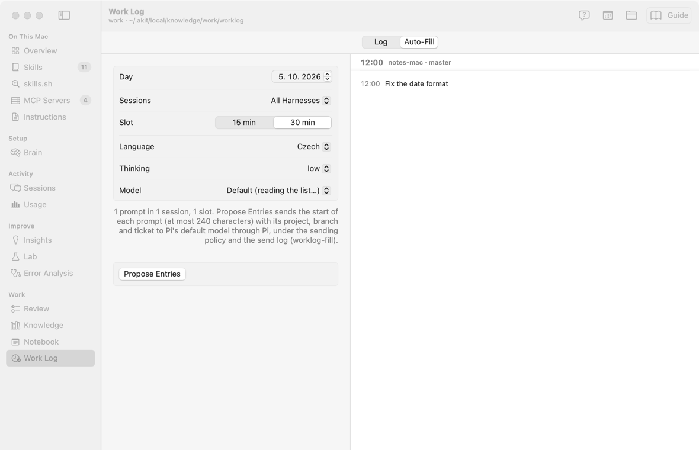

# Work log: what I did, one line at a time

Status: built 2026-10-28 (asked by the user: many tasks and window switches, a short log of what
they do, stamped by day and time without choosing either, with presets, and a link to the screen).

Code: `KnowledgeWorkLog` (AKitKnowledge: files, parsing, durations, checked writes),
`AKit/WorkLog/` (screen and model), `AKitCommandLine/WorkLogCommand.swift`, `AppLink` (links),
`WatchFilter` (`worklog/` changes).

## Goal

Writing an entry costs one keystroke more than the words: open (⌘L, a link, Raycast), type,
Return. The day and the time come from the clock. The files stay plain Markdown, easy to read
and to process (`akit worklog show --json`).

Not a timer and not a time sheet for billing.

## Decisions

| # | Topic | Decision |
|---|---|---|
| W1 | Where | In the world's knowledge base, in `worklog/` beside `notebook/`: its git keeps the history, Obsidian reads it, the commit queue commits app edits in batches (U2); `akit worklog add` commits at once. Search, lint and `kb context` leave it out (as NB9) |
| W2 | Files | One file per local day, `worklog/YYYY-MM-DD.md`; one entry per line, `- HH:MM #kind text`, in time order. Other lines (a note typed in Obsidian) are kept. The app and `add` stamp the moment of Return; only Edit… and `--at` set a time |
| W3 | Kinds | Presets agent, task, bug, research, reply, meeting, review, break (⌘1…⌘8 on screen); any other `#tag` works too. A leading `#tag` in the text is the kind. The kind resets after each entry |
| W4 | Time | An entry lasts until the next entry of its day; the last one of today until now; the last one of a past day has no length. `break` is not counted as work. Each day shows `work` and minutes per kind |
| W5 | Edits | Edit… (time, kind, text; the day stays), Again Now, Copy, Delete… (git keeps the line). An edit finds its line by number and refuses when the line changed |
| W6 | Links | `akit://worklog` (cursor in the field), `?kind=bug`, `akit://worklog/add?text=…&kind=…` (adds at once, for a Raycast quicklink); View → New Work Log Entry (⌘L) |
| W8 | Auto-Fill | Asked by the user the same day: the Work Log's second tab (not a sidebar item) rebuilds a past day. The user's prompts of that day in the chosen harness's saved sessions (Claude Code, Pi or both) are put in 15- or 30-minute slots; each slot gets its project, the git branch its checkout was on then (the folder's reflog, `GitBranchHistory`) and a ticket (`COL-123`, from the branch, else the prompt). Shown before anything is sent. Propose Entries sends the starts of the prompts (≤ 240 characters each, ≤ 24,000 in all) to a Pi model, by default the GPT-6 Luna Pi lists (GitHub Copilot on the work Mac), chosen from Pi's list (Copilot's when it has them), through `ModelCall` (sending policy, scrub, monthly limit, send log `worklog-fill`). The entries are written in the chosen language, Czech by default (the user's choice; Language, `--language`). The ticked proposals go into that day with their times. `akit worklog fill` does the same |
| W9 | Summary and thinking | Asked by the user the same day: each Auto-Fill entry gets a summary of 2–3 sentences (the goal, what was tried, found or decided, the result), in the entries' language, kept on the lines under it as a quote (`  > …`, paragraphs as `  >`) so Obsidian shows it under the entry. The Log and the proposals show it as an accordion (a chevron under the line; open in the proposals, closed in the log); Edit… changes it. The prompts sent grow to ≤ 400 characters each, so a summary has something to go on. Auto-Fill has a Thinking setting (Pi's levels, default low), `--thinking` |
| W10 | Many days | Asked by the user: the Log shows today and the latest 14 days with entries; Show N More Days adds 14 (with how many are left); Go to Day… (a calendar in the toolbar) loads the pages up to a day and scrolls to it. A reload reads only day files whose change date or size moved, past days are parsed once per change, and only today follows the clock (every minute). Checked with 400 days. Auto-Fill works on one day at a time, so it has no pages: its input is capped (W8) |
| W7 | Agents | `akit worklog add`, `show`, `kinds`; an agent adds only when the user asked (`/akit-context`) |

## Screen

```
┌ Work Log ─────────────────────────────── [Base ▾] [📁] [Guide]
│ (Agent) (Task) (Bug) (Research) (Reply) (Meeting) (Review) (Break)
│ [ What are you doing now? Return adds it with the time ] [Add]
├──────────────────────────────────────────────────────────────
│ Today · Wednesday 28. 10.   work 2 h 10 min    Bug 1 h · Agent 50 min
│ 09:20  Bug     order-created arrives twice              1 h 20 min
│ 10:40  Agent   Review of COL-123 with Pi           now · 50 min
└──────────────────────────────────────────────────────────────
```



## Open

- Auto-Fill: the ticket's title and state through Pi's GitLab MCP server (as AKit Review reads
  work items), checked on the work Mac.

- A menu bar item or a global hotkey for an entry without bringing AKit forward.
- Weekly totals; custom presets in the base.
