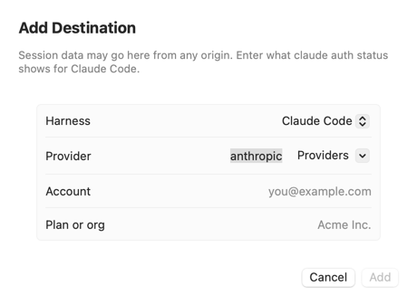
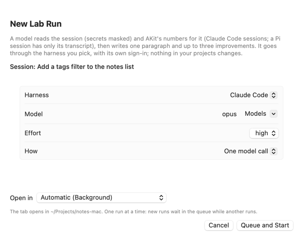
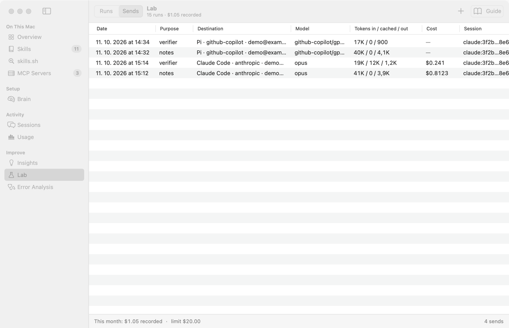
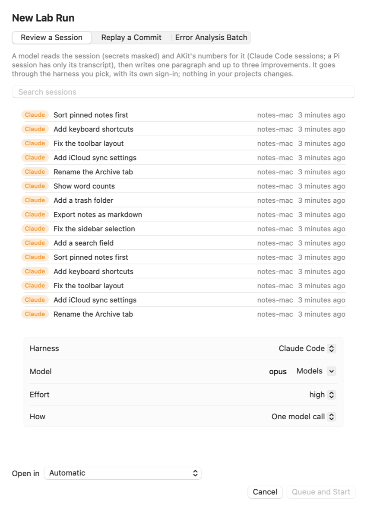
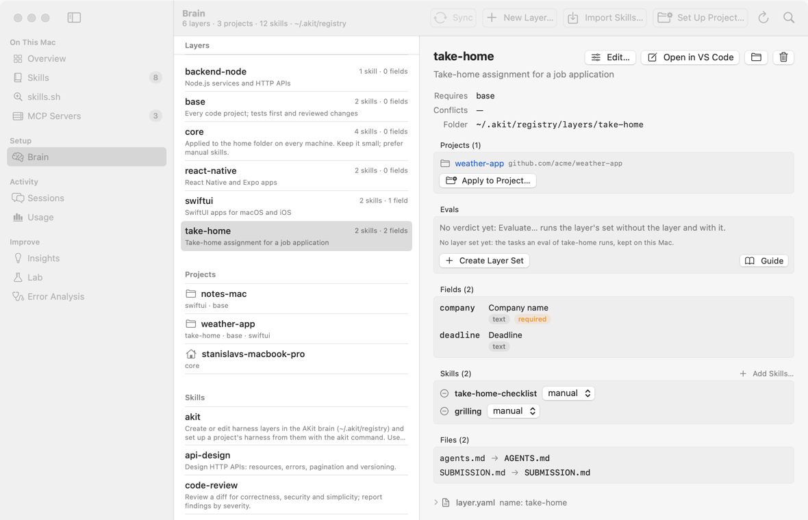

# Error Analysis: подробное руководство

Это руководство по экрану **Error Analysis** в AKit и по тому, что эта функция добавила на экраны **Lab** и **Settings**. Оно написано по коду, а не по замыслу: если кнопка делает что-то неожиданное, здесь сказано, что именно. Названия кнопок и полей даны по-английски, как на экране.

**Что такое Error Analysis простыми словами.** Представьте журнал врача. В нём записано, на что пациенты жалуются снова и снова, как часто встречается каждая жалоба и помогло ли лечение. Error Analysis ведёт такой журнал для ваших агентов (Claude Code, Pi): какие ошибки повторяются в сессиях, как часто, и помог ли ваш фикс.

**Кому это нужно:**

- У вас десятки сессий, и агент ошибается похожим образом снова и снова.
- Вы меняете `CLAUDE.md`, скиллы или хуки и хотите знать по цифрам, помогло ли это.

**Когда это не нужно:**

- У вас мало сессий. Стартовый набор требует 30 сессий, а вердикт «до/после» ждёт 15+ сессий с каждой стороны.
- Вы хотите посмотреть одну сессию. Для этого откройте экран **Sessions** и нажмите **Review in Terminal…** у сессии (см. [разбор одной сессии](screens#sessions-review)).

**Как построено руководство.** Сначала идут три общие части: что это, что настроить, в каком порядке идти. Потом по одной части на каждую вкладку. В каждой вкладке задачи идут от «Просто» к «Сложно», а редкие случаи собраны в конце. В конце руководства есть [словарь](#glossary).

**Как искать.** Меню Help → **Search Guides and Screens…** (⌥⌘F) открывает окно руководства с курсором в поле поиска. Поиск находит названия кнопок, вкладок и подписи к картинкам. Подробно: [как искать](screens#start-search).

## Что это и как всё устроено
<!-- section: overview -->

**Что это:** Error Analysis находит проблемы, которые повторяются во многих сессиях, считает их частоту и показывает, помог ли фикс. Сессия здесь — один записанный разговор с агентом, а транскрипт — его полный текст по шагам. Каждое утверждение опирается на шаги настоящих транскриптов.

**Когда пригодится:**

- «Агент опять прочитал огромный файл целиком. Это случайность или привычка?» → заведите режим и запустите его проверку по всем сессиям.
- «Я добавил правило в `CLAUDE.md`. Оно помогло?» → отметьте момент применения фикса и сравните сессии до и после.
- «Что у меня ломается чаще всего?» → запустите пакет и откройте отчёт с частотами.
- «Модель пишет, что проблем нет. Можно ли ей верить?» → разметьте стартовый набор сами и сравните с заметками модели.
- «Хочу сравнить две настройки на одних и тех же задачах» → соберите контрольные задачи на вкладке **Evals**.


### Зачем это нужно
<!-- section: overview-why -->

Один разбор одной сессии отвечает на вопрос «что пошло не так здесь». Error Analysis отвечает на другие вопросы:

- что ломается снова и снова;
- как часто;
- на каком шаге работы;
- помог ли фикс.

Пример: один разбор говорит «на шаге #42 агент прочитал файл на 34 КБ целиком». Error Analysis говорит «так было в 12 сессиях из 108».

### Весь цикл на одном примере
<!-- section: overview-loop -->

Возьмём одну проблему и проведём её через все шаги. Проблема: агент читает большой файл целиком, хотя ему нужна одна функция. Числа в примере условные.

1. **Вы читаете сессии сами.** На вкладке **Bootstrap** вы открываете сессию и пишете заметку: шаг **#42**, цитата — строка с вызовом Read, описание «прочитал весь файл на 34 КБ, хотя нужна была одна функция».
2. **Модель пишет свои заметки.** Она читает те же сессии и не видит ваших заметок. Потом вы сравниваете: нашла ли модель вашу проблему.
3. **Заметки становятся режимом.** Похожие заметки собираются в режим отказа «A large file read whole». Вы подтверждаете его на вкладке **Review** или **Modes**.
4. **Проверка считает частоту.** У режима есть проверка: она отвечает «есть / нет» по каждой сессии. Например: «12 of 108», то есть режим есть в 12 сессиях из 108.
5. **Пакеты добавляют новые сессии.** Вы запускаете пакеты по 20 сессий, пока новые режимы не перестанут появляться.
6. **Вы пишете черновик фикса.** Например, правило для `CLAUDE.md`: «Файлы больше 20 КБ читай по частям, с offset и limit». Там же вы заранее пишете критерий «помогло».
7. **Вы применяете фикс сами** и нажимаете **Mark Applied…**. Этот момент называется точкой T.
8. **AKit сравнивает до и после.** Когда с каждой стороны от T есть 15+ сессий, блок **Before and after T** даёт вердикт. Например: до T режим был в 15 сессиях из 30, после T — в 6 из 30.

Подробный порядок по дням — в разделе [Первые шаги](#first-steps).

### Метод: сначала вы, потом модель
<!-- section: overview-method -->

Метод взят у Hamel Husain и Shreya Shankar (error analysis для LLM-систем). Его суть:

- Сначала вы сами читаете сессии и пишете свои заметки. Модель в это время свои заметки вам не показывает.
- Модель пишет свободные заметки о проблемах в каждой сессии, без заранее заданных категорий.
- Заметки группируются в конкретные «режимы отказа» (modes): например, «прочитан целиком файл на 34 КБ», а не «проблемы с контекстом».
- Частота режима считается только по проверке (check), которая выносит вердикт «есть / нет» по каждой сессии. Не по заметкам.
- Новые сессии добавляют, пока не перестанут появляться новые режимы (насыщение).

Ваше суждение задаёт режимы и метки. Модели применяют его к большому числу сессий.

Вы не размечаете каждую сессию. Вы делаете три вещи: размечаете стартовый набор, подтверждаете изменения списка режимов и решаете спорные случаи.

### Главные слова
<!-- section: overview-terms -->

Эти слова встречаются во всём руководстве. Полный список — в [словаре](#glossary).

- **Заметка (note)** — одна проблема в одной сессии: описание, номер шага и цитата. Пример: «шаг #42, прочитал весь файл на 34 КБ».
- **Режим отказа (mode)** — проблема, которая повторяется в разных сессиях, с определением и критериями. Пример: «A large file read whole».
- **Проверка (check)** — вердикт «есть / нет» по каждой сессии для одного режима. Это код или LLM-судья. Пример: код ищет вызовы Read без `offset` и `limit`, которые вернули больше 20 КБ.
- **Судья (judge)** — проверка, в которой модель читает транскрипт и отвечает, есть ли в нём этот режим.
- **Пакет (batch)** — один запуск анализа над выборкой сессий. Пример: 20 сессий проекта `weather-app` за две недели.
- **Стартовый набор (bootstrap)** — сессии, которые вы размечаете сами, вслепую, до модели. Обычно 30.
- **Насыщение (saturation)** — новые сессии больше не дают новых режимов. Пример: три пакета подряд без единого нового кандидата.
- **Фикс (fix)** — ваше изменение настройки против режима: правило в `CLAUDE.md`, скилл, хук.
- **Харнесс (harness)** — программа-агент, которая записала сессию: Claude Code или Pi.

### Конвейер: что происходит с каждой сессией
<!-- section: overview-pipeline -->

Для каждой сессии, которую разбирают (поштучно или в пакете), происходит одно и то же. Шагов пять. Первые три идут для каждой сессии, четвёртый — в конце пакета, пятый — отдельно от заметок.

#### 1. Заметки (notes)
<!-- section: overview-pipeline-notes -->

Один вызов модели. Модель не видит список режимов, поэтому заметки «слепые». Она получает дайджест транскрипта, то есть его сжатую версию, и пишет по порядку:

- требования задачи (из реплик пользователя);
- исход сессии (outcome);
- список заметок;
- решающий и наблюдаемый шаг (decisive/observed step);
- абзац в 3–5 предложений;
- не больше трёх советов.

В каждой заметке есть: описание, шаг `#n`, цитата из этого шага, серьёзность, слой вины, «корень или симптом», примерная цена.

Пример заметки: «шаг #42 · Read · прочитал весь файл на 34 КБ · серьёзность medium».

#### 2. Проверка заметок (verifier)
<!-- section: overview-pipeline-verifier -->

Проверяющий отсеивает выдуманные заметки. Он работает в два прохода.

Сначала код проверяет каждую цитату:

- Цитата должна быть не короче 8 символов. У цитаты с пропуском «…» — хотя бы одна её часть.
- Цитата должна дословно найтись в указанном шаге. У цитаты с пропуском — все части по порядку.
- Переносы строк и кавычки прощаются, слова нет.

Затем второй вызов модели проверяет, подтверждает ли цитата утверждение:

- Проверяющая модель видит цитируемый шаг и по три шага до и после него.
- Для заметок высокой серьёзности она сначала пишет аргумент «проблемы здесь нет» (steelman), потом выносит вердикт.

Что бывает с отклонённым:

- Отклонённые заметки хранятся с причиной, но в пул не попадают. Пул — это все разобранные сессии и их принятые заметки.
- Советы, все заметки которых отклонены, выбрасываются.

Пример: модель написала «агент не запустил тесты», а в цитате стоит «tests passed». Проверяющий отклоняет заметку.

#### 3. Сопоставление (matching)
<!-- section: overview-pipeline-matching -->

Отдельный вызов. Он решает, к какому режиму относится каждая заметка.

- На вход идут только принятые заметки и текущий список режимов (определения, критерии, примеры), без транскрипта.
- Пример из сессии, которую этому адресату слать нельзя, в вызов не идёт.
- Для каждой заметки модель выбирает один режим с уверенностью от 0 до 1 или явно отвечает «ничего не подходит» (none fits).
- Маршрут с уверенностью ниже 0.6 уходит вам на вкладку **Review**. Маршрут — это решение «заметка → режим».

Пример: заметка «прочитал весь файл на 34 КБ» → режим «A large file read whole», уверенность 0.9.

#### 4. Кластеризация (clustering)
<!-- section: overview-pipeline-clustering -->

Один вызов в конце пакета (или по кнопке) над заметками, которым не подошёл ни один режим. Он предлагает режимы-кандидаты (candidates). Кандидат никогда не подтверждается автоматически по результату кластеризации.

Пример: заметка про правку `Assets.xcassets` руками даёт кандидата «Asset catalog edited by hand». Он ждёт вас на вкладке **Review**.

#### 5. Проверки режимов (checks)
<!-- section: overview-pipeline-checks -->

Отдельно от заметок. По каждому активному режиму есть проверка: код (mechanical или heuristic) или LLM-судья (judge). Только они дают частоты в отчётах.

Пример: код-проверка режима «A large file read whole» показывает «12 of 108».

### Заметки не дают частоту
<!-- section: overview-frequency -->

Это важное различие.

- Заметки и сопоставление ведут список режимов: что бывает, примеры, кандидаты. Знаменатель они не дают никогда.
- Частота режима в отчёте берётся только из его проверки, прогнанной по всем сессиям пакета.
- Если у режима нет проверки, которой можно доверять, отчёт пишет «seen in k notes» («встречен в k заметках») без процента.

> **Почему так:** заметка говорит «здесь проблема есть». Она не говорит «в остальных сессиях проблемы нет». Проверка смотрит каждую сессию и поэтому даёт долю.

### Откуда берутся данные: индекс сессий
<!-- section: overview-index -->

Индекс сессий — это локальная база `~/.akit/index/index.sqlite` со всеми вашими сессиями. Это та же база, которую использует команда `akit sessions import`.

- Пакеты выбирают сессии из индекса.
- Код-проверки бегут по всем сессиям индекса.
- «До/после фикса» тоже считается по индексу.

Если индекс пуст, почти ничего не работает. Как его заполнить, сказано в разделе [Перед началом](#start-index).

**Что в анализ не попадает:**

- Сессии, которые сделал сам Lab (повторы коммитов, контрольные ячейки). Они исключаются из выборок, стартового набора и частот.
- Сами вызовы моделей для анализа. Они запускаются без сохранения сессии (`--no-session-persistence` у Claude Code, `--no-session` у Pi), поэтому в индекс не попадают.

### Где что лежит в интерфейсе
<!-- section: overview-places -->

**Экран Error Analysis.** Боковая панель → **Error Analysis** (иконка стетоскопа).

- Вверху переключатель вкладок: **Modes**, **Review**, **Bootstrap**, **Reports**, **Evals**.
- У **Review** в скобках стоит число ожидающих дел, например **Review (3)**. Число видно, только когда очередь не пуста.
- Справа в панели инструментов: **History** (история списка режимов), **Reload** (перечитать `~/.akit/lab/analysis`) и **Guide** (открывает это руководство).

**Полоса состояния.** Она появляется под панелью инструментов.

- Синяя с индикатором — пока что-то считается («Checking 120 of 900 sessions…»).
- Зелёная — итог последнего действия.
- Оранжевая — ошибка.
- У зелёной и оранжевой есть крестик **Dismiss**.

**Экран Lab.** Здесь живут все запуски, которые идут в терминале или в фоне.

- Пакеты анализа, разборы отдельных сессий и контрольные ячейки — это всё Lab-запуски.
- Там же вкладка **Sends** — журнал всех отправок данных моделям.
- Подробно: [что Error Analysis добавил в Lab](#lab).


**Settings** (⌘,). Раздел **Lab** и ниже: политика отправки, учётные записи Pi, маскирование, месячный лимит. Подробно: [Settings → Lab](#settings).

**Экран Sessions.** У сессии Claude Code или Pi есть две кнопки:

- Кнопка с колбой **Review in Terminal…** — разбор одной сессии. Её подсказка: «Lab: an agent reviews this session in a terminal tab and writes what to change».
- Кнопка со слоями **Add to Layer Set…** — контрольная задача из этой сессии в набор слоя (см. [Вкладка Evals](#evals)).

**Где открыть это руководство:**

- кнопка **Guide** в панели инструментов экрана **Error Analysis**;
- кнопка **Guide** в панели инструментов экрана **Lab**;
- кнопка **How It Works** в Settings → **Sending policy**;
- меню Help → **Error Analysis Guide**.

### Что AKit никогда не делает
<!-- section: overview-never -->

- **Не меняет ваши файлы.** Ваши настоящие сессии, `CLAUDE.md`, скиллы и хуки остаются как были. Фиксы вы применяете сами. AKit только записывает момент применения.
- **Не читает ключи харнессов.** Аккаунт Claude Code он узнаёт через `claude auth status --json`. Аккаунт Pi узнать нельзя, и для разбора сессии тем же провайдером он не нужен.
- **Не отправляет ничего мимо политики отправки.** Все вызовы моделей анализа идут через одну точку. Там проверяются политика, маскирование и лимит, и там пишется журнал.
- **Не отправляет ничего при код-проверках.** Они работают локально.

**Запуски агентов идут иначе.** Это контрольные ячейки, разборы **Agent with file tools** и повторы коммитов.

- Проверка политики та же.
- Маскируется только промпт или транскрипт. Код репозитория не маскируется.
- Лимит сверяется только с уже потраченным.
- У агента есть инструменты.

## Перед началом: настройки, индекс, деньги
<!-- section: start -->

**Что это:** список того, что нужно настроить до первого платного действия. Шаги идут от простого к сложному. Первые шаги бесплатны и работают только на вашем Mac.

**Когда пригодится:**

- «Кнопка пишет The akit command is not installed» → [поставьте команду akit](#start-cli).
- «В Error Analysis пусто, сессий нет» → [заполните индекс](#start-index).
- «Боюсь отправить рабочие данные не туда» → [проверьте, какой это Mac](#start-mac) и [настройте политику отправки](#start-policy).
- «Сколько это будет стоить?» → [задайте лимит](#start-policy) и [получите первую оценку](#start-cost).

Короткий список:

1. Команда `akit` — бесплатно.
2. Индекс сессий — бесплатно, локально.
3. **This Mac**: Personal или Work — бесплатно.
4. Захват: импорт каждый час и запись HEAD — бесплатно.
5. **Sending policy**: аккаунты, маскирование, лимит — бесплатно.
6. Одна модель для заметок — бесплатно, это решение.
7. Первая оценка цены — первое платное действие: разбор одной сессии.

### Просто: поставьте команду akit
<!-- section: start-cli -->

**Зачем:** все запуски Lab (разборы, пакеты, контрольные ячейки) выполняет команда `akit lab run ID` во вкладке терминала или в фоне. Без неё не работает ни одна кнопка постановки в очередь.

**Цена:** бесплатно.

1. Откройте терминал в папке AKit.
2. Выполните команду:

```
make install-cli
```

**Как понять, что команды нет.** Если `~/.local/bin/akit` нет или она старше приложения, кнопки постановки в очередь выдают ошибку:

- «The akit command is not installed» — команды нет;
- «… is older than this AKit» — команда старше приложения.

В обоих случаях выполните `make install-cli` в папке AKit.

### Просто: заполните индекс сессий
<!-- section: start-index -->

**Зачем:** анализ берёт сессии только из индекса. В приложении нет кнопки импорта сессий в индекс. Это делается командой.

**Цена:** бесплатно. Команда работает локально.

```
akit sessions import
```

Что делает команда:

- Читает логи Claude Code и Pi.
- Кладёт сессии в индекс и привязывает их к проектам.
- Если анализ уже используется (существует список режимов), сразу после импорта пересчитывает дешёвые сигналы и прогоняет код-проверки активных режимов по новым сессиям.

Дешёвые сигналы — это признаки сессии, которые считает код. Пример: прерывания, ошибки инструментов, «готово» без проверки.

### Просто: проверьте, какой это Mac
<!-- section: start-mac -->

**Зачем:** от этого зависит, куда AKit разрешает отправлять данные сессий и код.

**Цена:** бесплатно.

1. Откройте Settings (⌘,).
2. Найдите раздел **This Mac**.
3. В поле **This Mac is** выберите **Personal** или **Work**.


**Правило «тот же источник» (same origin).** Оно действует на обоих Mac. Ничего вводить не нужно.

- Сессия Claude Code может уйти в Claude Code под тем аккаунтом, что вошёл сейчас. Транскрипт аккаунт не хранит, сравнивается только харнесс.
- Сессия Pi может уйти в Pi через того же единственного провайдера, через которого шла.
- Всё остальное добавляется в список разрешённых явно.

**Чем отличаются Work и Personal:**

- **Work**: список составляйте по правилам компании, по умолчанию он пуст. Код репозитория (повторы коммитов и контрольные запуски) на рабочем Mac уходит только адресатам из списка.
- **Personal**: код репозитория может уйти и в тот агент, которым вы с ним работаете.

> **Важно:** AKit не видит, под каким аккаунтом записана сессия. Если после сессии вы вошли в агента под другим аккаунтом (например, на рабочем Mac — в личный Claude), разбор уйдёт в новый аккаунт. На рабочем Mac работайте в агентах только под рабочими аккаунтами.

### Средне: включите импорт каждый час и запись HEAD
<!-- section: start-capture -->

**Зачем:** чтобы индекс обновлялся сам и чтобы AKit записывал HEAD в начале каждой сессии. HEAD — это коммит, на котором стоял репозиторий. Пример: без HEAD нельзя повторить задачу сессии «с того же места».

**Цена:** бесплатно.

```
akit insights install --yes
```

Команда ставит захват: импорт каждый час и хуки, которые записывают HEAD репозитория в начале каждой сессии.

**Если команда отказала.** Для хука Claude Code нужен репозиторий мозга (brain): плагин хранится в нём. Brain — это ваш git-репозиторий с библиотекой скиллов и слоями. Без мозга команда откажет. Тогда есть два пути:

- Поставьте только части Pi и launchd: `akit insights install --only pi --yes` и `--only launchd`.
- Или сначала создайте мозг: `akit init`.

> **Важно:** HEAD в начале сессии записывает только хук захвата. Без него сессию нельзя превратить в контрольную задачу (вкладка Evals). Сессии, начатые до установки хука, тоже нельзя: для них пишут «минимальное воспроизведение».

Контрольная задача — это задача из настоящей сессии, которую агент решает заново на том же коммите. Подробно: [Вкладка Evals](#evals).

### Средне: настройте политику отправки
<!-- section: start-policy -->

**Зачем:** политика отправки решает, каким аккаунтам можно отдавать данные сессий. Здесь же задаются маскирование и месячный лимит. Настройте её до первого вызова модели.

**Цена:** бесплатно. **Check Accounts** спрашивает харнессы об аккаунте и не отправляет им сессии.

Подробно каждая кнопка описана в разделе [Settings → Lab](#settings). Минимум на старте:

1. Откройте Settings → **Sending policy**.
2. Нажмите **Check Accounts**. AKit спросит Claude Code и Pi, через какой аккаунт пойдёт разбор сейчас. Он покажет, можно ли туда слать их собственные сессии.
3. Решите, нужен ли вам список. Сессию можно без списка вернуть тому агенту и провайдеру, который её записал, на любом Mac.
4. Для остального нажмите **Add to List** у аккаунта, которому можно отдавать данные сессий. Пример «остального»: сессии Claude Code через Copilot в Pi. На рабочем Mac — только по правилам компании.
5. В **Masked before sending** добавьте шаблоны внутренних хостов и оставьте включённым **Mask e-mail addresses**. Например: шаблон `[a-z0-9.-]+\.corp\.acme\.com` в **Internal host patterns**.
6. В **Cost** задайте **Monthly limit (US dollars)**. Например: `20`.


**Для Pi.** Ничего вводить не нужно, если Pi уже вошёл к провайдеру: сессия уходит тому провайдеру, который её записал, на любом Mac. Запись нужна, только чтобы отправлять в Pi чужие данные. Пример: сессии Claude Code через `github-copilot`.

1. Нажмите **Add Destination…**.
2. В поле **Harness** выберите Pi.
3. Укажите провайдера, ваш логин и организацию.
4. Нажмите **Add**.

Эта же запись становится аккаунтом Pi для провайдера.



Маскирование (scrub) — это замена секретов, хостов и e-mail перед отправкой. Пример: `build.corp.acme.com` в транскрипте заменяется до того, как текст уйдёт модели.

![Settings, разделы Masked before sending и Cost: переключатель Mask e-mail addresses, поля Internal host patterns с шаблоном хоста corp.acme.com и Other patterns с шаблоном ACME-[0-9]{6}; ниже Monthly limit (US dollars) со значением 20 и строка Recorded this month $1.05](images/settings-scrub.png)

> **Почему так:** правило «тот же источник» значит, что сессию Claude Code на личном Mac можно разбирать через Claude Code без настройки. А вот разбор той же сессии через Pi и GitHub Copilot — это отправка данных другому провайдеру, и её надо разрешить явно.

### Средне: выберите одну модель для заметок и держитесь её
<!-- section: start-model -->

**Зачем:** качество заметок меряется отдельно для каждой «версии заметок». Версия заметок — это харнесс + модель + версия промпта. Пример: `claude-code · opus · notes v1`.

**Цена:** бесплатно. Это решение, а не действие.

Что меряется для версии заметок:

- **Полнота (recall)** — доля ваших проблем, которые нашла модель. Пример: вы нашли 10 проблем, модель нашла 7 из них — полнота 70%.
- **Точность (precision)** — доля принятых заметок модели, с которыми вы согласны.
- **Совпадение фаз** — совпал ли решающий шаг у вас и у модели по фазе работы.

Что будет, если модель сменить:

- Матрица переходов в отчётах показывается, только если для версии заметок пакета есть замеры стартового набора. Матрица переходов — это таблица «фаза перед решающим шагом × фаза решающего шага».
- Если вы разметили стартовый набор с одной моделью, а пакеты гоняете другой, отчёты будут без полноты и без матрицы.

> **Совет:** выберите модель для заметок один раз (например, ту, что стоит по умолчанию в Claude Code) и используйте её и в **Queue Model Notes…**, и в пакетах. Язык разбора тоже входит в ключ заметок: смена языка заставит переписать заметки.

Язык разбора задаёт поле **Review language** в Settings → **Lab**.

### Средне: узнайте цену до первого пакета
<!-- section: start-cost -->

**Зачем:** AKit показывает оценку «≈ $…» только по уже записанным вызовам той же модели. Пока вы ни разу не вызывали выбранную модель, оценки нет: формы пишут «no estimate yet».

**Цена:** это первое платное действие. Разбор одной сессии отправляет модели дайджест этой сессии после маскирования. Сколько он стоил, видно на экране Lab → **Sends**.

1. Разберите одну сессию выбранной моделью. Как это сделать, сказано в [Дне 1](#first-steps-day1).
2. Откройте любое окно отправки или форму пакета. Для того же харнесса и той же модели там стоит «≈ $…».

> **Важно:** имя модели должно совпадать точно. Оценка для `opus` не появится в форме, где выбрана другая модель.

**Откуда цифры.** AKit не знает тарифов и не считает цены по токенам. Он берёт только то, что записал сам харнесс:

- `total_cost_usd` у Claude Code;
- `usage.cost.total` у Pi.

Каждый вызов попадает в журнал `~/.akit/lab/analysis/sends.jsonl` (экран Lab → **Sends**).

**Оценка ячеек.** Ячейка — это один запуск агента на одной контрольной задаче с одной настройкой.

- Оценка ячеек появляется после первой контрольной ячейки этой модели.
- До неё — после первого реплея этой модели в Lab. Реплей — это повтор коммита агентом.
- Для оценки слоя в Brain → **Evaluate…** первые ячейки можно поставить отдельно: **Queue 2 Calibration Cells…**. Это по одной ячейке каждой настройки (см. [Оценка слоя из Brain: Evaluate…](#evaluate-layer)).

Подробно о деньгах — в разделе [Деньги, отправка и маскирование](#money).

## Первые шаги: как пройти путь правильно
<!-- section: first-steps -->

**Что это:** рекомендуемый порядок на первый день и первую неделю. Этапы идут от простого и бесплатного к сложному.

Порядок повторяет логику метода:

- сначала вы, потом модель;
- сначала список режимов, потом частоты;
- сначала критерий «помогло», потом фикс.

**Когда пригодится:**

- «Я открыл Error Analysis впервые и не знаю, с чего начать» → идите по этапам сверху вниз.
- «Хочу сначала узнать цену» → сделайте [День 0](#first-steps-day0) и [День 1](#first-steps-day1).
- «Список режимов уже есть, хочу частоты» → начните с [Недели 1](#first-steps-week1).
- «Хочу проверить, помог ли фикс» → [Неделя 2](#first-steps-week2).

Лестница целиком:

1. День 0 — подготовка. Бесплатно.
2. День 1 — пробный разбор одной сессии. Первые вызовы модели.
3. Дни 1–3 — стартовый набор. Ваше чтение бесплатно, вызовы модели платные.
4. Неделя 1 — пакеты и насыщение. Платно, оценка видна в форме.
5. Неделя 2 — проверки, фикс, оценка. Код-проверки бесплатны, судья и ячейки платные.

### Просто: День 0 — подготовка (30–60 минут)
<!-- section: first-steps-day0 -->

**Что будет в конце:** команда `akit` стоит, индекс заполнен, политика отправки и лимит заданы, модель для заметок выбрана.

**Цена:** бесплатно. Модели ничего не получают.

1. Установите `akit` (`make install-cli`), если её нет.
2. Выполните `akit sessions import`.
3. Если хотите, чтобы индекс обновлялся сам и записывался HEAD, выполните `akit insights install --yes`.
4. Settings → **This Mac**: проверьте Personal/Work.
5. Settings → **Sending policy**: нажмите **Check Accounts**.
6. Нажмите **Add to List** у адресатов чужих данных. Для Pi кнопка называется **Add to List…**: она спросит логин и организацию.
7. Задайте шаблоны маскирования и **Monthly limit**. Например: шаблон хоста `[a-z0-9.-]+\.corp\.acme\.com` в **Internal host patterns** и лимит `20`.
8. Выберите модель для заметок (см. [раздел о модели](#start-model)).

Каждый шаг подробно описан в разделе [Перед началом](#start).

### Просто: День 1 — пробный разбор одной сессии ради цены
<!-- section: first-steps-day1 -->

**Что будет в конце:** один разбор с заметками и советами и первая оценка цены в долларах для вашей модели.

**Цена:** платно. Модели уходит дайджест одной сессии после маскирования. Вызовов несколько: `notes`, `verifier` и `matching`.

1. Откройте экран **Sessions** и выберите длинную сессию Claude Code (5+ запросов). Например, сессию, где агент написал «готово», а тесты потом упали.
2. Нажмите кнопку с колбой **Review in Terminal…**.
3. В окне выберите **Harness**, **Model**, **Effort** и **How** = **One model call**.
4. Нажмите **Queue and Start**.
5. Откройте экран **Lab**. Он покажет запуск. Когда запуск закончится, вы увидите исход, требования, заметки (принятые и отклонённые) и советы.
6. Откройте Lab → **Sends**. Посмотрите, сколько стоили вызовы `notes`, `verifier` и `matching`.





> **Почему так:** после этого форма пакета и окна отправки показывают оценку в долларах для этого харнесса и этой модели. Без записанного вызова этой модели оценки нет вообще. Сессия, разобранная моделью, больше не попадёт в стартовый набор: AKit не берёт туда сессии, заметки которых вы могли видеть.

> **Важно:** в анализ попадают только разборы в режиме **One model call**. Режим **Agent with file tools** — это старый разбор Lab: он пишет абзац и советы, но не создаёт заметок и ничего не добавляет в пул.

Подробно: [разбор одной сессии](screens#sessions-review) и [что Error Analysis добавил в Lab](#lab).

### Средне: Дни 1–3 — стартовый набор (bootstrap), самое важное
<!-- section: first-steps-bootstrap -->

**Что будет в конце:** 30 сессий с вашими заметками, полнота и точность модели, первые подтверждённые режимы и метки для проверок.

**Цена:** чтение и разметка бесплатны. Платные шаги: **Queue Model Notes…**, **Propose Pairs…**, **First Modes…** и **Find Similar Cases…**. Каждый из них вызывает модель.

Стартовый набор — это сессии, которые вы читаете и размечаете сами, до того как увидите заметки модели. Вкладка описана в разделе [Bootstrap](#bootstrap).

**Часть 1. Зарезервируйте сессии.**

1. Откройте Error Analysis → **Bootstrap**.
2. Нажмите **Pick Sessions…**, оставьте 30 и нажмите **Reserve**.

Как AKit выбирает сессии из индекса:

- Половина — представители групп «проект × слой». Слой здесь — это харнесс | семейство модели | сильнейший сигнал.
- Остальные — случайные.

Эти сессии сразу резервируются:

- Поштучный разбор их не возьмёт, пока вы их не разметите.
- Пакеты не возьмут их никогда, даже после разметки.

**Часть 2. Разметьте сессии сами.**

1. Откройте первую сессию в списке слева и читайте транскрипт.
2. Для каждой проблемы нажмите номер шага и выделите цитату в окошке.
3. Напишите, что пошло не так, и нажмите **Add Note**.
4. В конце задайте **Outcome** и примерный решающий шаг.
5. Нажмите **Finish…** и затем **Finish** в окне подтверждения. Если прервались, нажмите **Save Draft**.
6. Повторите для всех 30.

Пример заметки: шаг **#42**, цитата — строка с вызовом Read, описание «прочитал весь файл на 34 КБ, хотя нужна была одна функция».

Сессия без проблем — тоже полноценная метка: просто задайте исход и нажмите **Finish…**.


**Часть 3. Сравните себя с моделью.**

1. Нажмите **Queue Model Notes…**.
2. Выберите ту же модель, что будет у пакетов, и нажмите **Queue N Sessions**. В Lab появится один пакет «Bootstrap: model notes on N labeled sessions».
3. Дождитесь конца пакета.
4. Для каждой размеченной сессии нажмите **Propose Pairs…** → **Send**. Пара — это ваша заметка и заметка модели про одну проблему.
5. Проверьте пары. Отметьте **A real problem** у заметок модели, с которыми согласны.
6. Нажмите **Confirm**. В обзоре **Metrics and Mapping** появятся полнота и точность.

**Часть 4. Получите первые режимы.**

1. Нажмите **First Modes…** → **Send**. Модель сгруппирует ваши и свои заметки в кандидатов.
2. Откройте вкладку **Review** → **Candidate modes**.
3. Подтвердите настоящие и конкретные (**Confirm**).
4. Переименуйте неточные (**Rename…**) и слейте дубликаты (**Merge into…**).
5. Отклоните мусор с причиной (**Reject…**).
6. Откройте вкладку **Modes** и посмотрите девять «семян» (seeds). Семена — это режимы из исследований и наших наблюдений.
7. Если вы видели такие проблемы в своей разметке, подтвердите их (**Confirm**).


**Часть 5. Превратите свои заметки в метки.**

1. Вернитесь в **Bootstrap** → **Metrics and Mapping** → **Your notes → modes**.
2. Каждой своей заметке выберите режим или **Unclear**.
3. Для каждого режима с вашими заметками нажмите **Find Similar Cases…**.
4. Примите или отклоните каждую находку.


> **Почему так:** выборочная проверка заметок модели показывает только точность (не выдумала ли модель проблему). Полноту (что модель пропустила) видит только человек, который сам прочитал транскрипт. Поэтому вы размечаете первым и вслепую. Полнота — главный риск, и это единственное место, где она меряется.

> **Важно:** разметьте все свои заметки в сопоставлении. Отрицательной меткой для режима сессия становится, только когда все ваши заметки в ней сопоставлены (с другими режимами или с **Unclear**). Пока хоть одна не сопоставлена, сессия даёт только положительные метки режимам уже сопоставленных заметок, а отрицательных не даёт вовсе.

Метка — это ваш ответ «в этой сессии режим есть» (положительная) или «режима нет» (отрицательная). По меткам потом проверяют проверки.

### Средне: Неделя 1 — пакеты и насыщение
<!-- section: first-steps-week1 -->

**Что будет в конце:** отчёты с частотами режимов, разобранная очередь на вкладке **Review** и ответ на вопрос «список режимов уже полон?».

**Цена:** платно. Пакет отправляет модели дайджесты выбранных сессий. Оценка стоит внизу формы до запуска, записанная цена — в Lab → **Sends**.

Пакет — это один Lab-запуск над выборкой сессий: заметки, проверка, сопоставление, судьи, в конце кластеризация.

1. Откройте экран **Lab** → **New Run…** → **Error Analysis Batch**.
2. Выберите проект или **All projects** и период.
3. Задайте **Sessions** = 20.
4. В **Notes by** выберите ту же модель, что в стартовом наборе, через **Choose…**. Или оставьте **Automatic**.
5. Посмотрите оценку внизу формы и нажмите **Sample and Queue**.
6. Следите за пакетом в Lab: там видно продвижение по шагам. Пакет идёт по две сессии одновременно. Его можно остановить (**Pause**) и продолжить (**Resume**).
7. Когда пакет закончится, в Lab нажмите **Open Report**. Отчёт откроется на вкладке **Reports**.
8. Откройте вкладку **Review** и разберите всё: кандидаты, маршруты с низкой уверенностью, выборочные проверки (spot checks), «зонтичные» семена.
9. Повторяйте пакеты.

Пример для шагов 2–3: проект `weather-app`, **From** — две недели назад, **Sessions** = 20.



**Нужно ли нажимать Reload.** Обычно нет. Экран Error Analysis перечитывает данные сам: после каждого шага идущего пакета и когда пакет закончился. **Reload** нужна, если вы меняли что-то командой `akit` в терминале.

**Как понять, что пора остановиться.** В отчёте смотрите блок **Saturation**. Если доля заметок без режима и число новых режимов несколько пакетов подряд около нуля, список насыщен.


Зонтичное семя — это слишком широкое семя: оно забирает больше 30% заметок. Выборочная проверка — это случайная принятая заметка модели с вопросом к вам: это настоящая проблема?

> **Совет:** по возможности продолжайте размечать стартовые сессии, пока счётчик «Since the list of modes last changed» на вкладке Bootstrap не станет зелёным (20 размеченных сессий без изменений списка). Это правило остановки стартовой разметки.

Подробно: [пакеты в Lab](#lab), [Вкладка Reports](#reports), [Вкладка Review](#review).

### Сложно: Неделя 2 — проверки, фикс, оценка
<!-- section: first-steps-week2 -->

**Что будет в конце:** частота режима по всем сессиям, записанный фикс с критерием «помогло» и вердикт «до/после».

**Цена:** код-проверки и **Run Check** бесплатны и локальны. Черновик фикса (**Draft Fix…**) и отметка применения (**Mark Applied…**) тоже бесплатны: они только пишут файлы на Mac.

Платные шаги: проверка судьи (**Validate on Dev…**, **Validate on Test…**) и ячейки (**Run Cells…**). Они вызывают модели. Сама кнопка **Enable Judge…** модель не вызывает, но после неё каждый следующий пакет вызывает судью на каждой своей сессии.

**Часть 1. Узнайте частоту.**

1. На вкладке **Modes** выберите частый режим.
2. Если у него есть код-проверка, нажмите **Run Check**. Посмотрите долю по всем сессиям индекса.

**Часть 2. Запишите фикс до любых запусков.**

1. Нажмите **Draft Fix…**.
2. Заполните: слой (правило `CLAUDE.md`, скилл и т. п.), текст фикса, что должно измениться в транскриптах, критерий «помогло».
3. Сохраните до любых запусков.

Пример для режима «A large file read whole»:

- слой — CLAUDE.md rule;
- текст — «Файлы больше 20 КБ читай по частям, с offset и limit»;
- ожидаемое изменение — «Read больших файлов идёт с диапазоном».

**Часть 3. Включите судью, если режим того стоит.**

Судья — это LLM-проверка одного режима по транскрипту. Его можно включить, если режим в тройке самых частых или самых дорогих и у него есть черновик фикса.

1. Нажмите **Enable Judge…**.
2. Проверьте судью на dev: **Validate on Dev…**. Доведите его до приемлемого.
3. Затем один раз проверьте на test: **Validate on Test…**.

Dev и test — это две части ваших меток (метки делятся на train, dev и test). Dev служит для доводки, test — для одной финальной проверки.

**Часть 4. Примените фикс и отметьте момент.**

1. Примените фикс сами: отредактируйте свой `CLAUDE.md` или скилл.
2. Нажмите **Mark Applied…** и укажите момент, когда изменение попало в вашу настройку. Это точка T.
3. Работайте как обычно. Импорт (`akit sessions import` или hourly-агент) прогоняет код-проверки по новым сессиям.
4. Ждите. Когда с каждой стороны от T будет 15+ сессий, блок **Before and after T** даст вердикт.


**Часть 5. По желанию: контрольные задачи.**

1. Откройте вкладку **Evals** и соберите контрольные задачи.
2. Нажмите **Run Cells…** с базой и вариантом. База (baseline) — агент как есть. Вариант (variant) — ровно одно отличие от базы, например черновик фикса.

Это сильнее, чем «до/после», потому что набор задач не меняется.

Подробно: [Вкладка Modes](#modes), [Страница режима](#mode-page), [Вкладка Evals](#evals), [Как считается каждая цифра](#numbers).

## Вкладка Modes
<!-- section: modes -->

**Что это:** список всех режимов отказа, которые AKit знает: таблица вверху и страница выбранного режима внизу. Режим отказа — это повторяющаяся ошибка агента с точным описанием, например «файл больше 20 КБ прочитан целиком».

**Когда пригодится:**

- «Хочу увидеть, какие ошибки агента AKit уже знает» → откройте вкладку: каждая строка таблицы — один режим, колонка **Status** говорит, насколько он подтверждён.
- «Какая ошибка встречается чаще всего?» → смотрите колонку **Seen in**: «24 notes» значит, что режим встречен в 24 заметках.
- «Как часто агент читает большие файлы целиком?» → нажмите **Run All Checks** и прочитайте колонку **Code check**, например «12 of 108». Проверка идёт на Mac и ничего не отправляет.
- «Два режима описывают одно и то же» → правый клик по строке → **Merge into…**.
- «Я менял режимы командой `akit` в терминале, а экран показывает старое» → **Reload** перечитает данные, **History** покажет, когда менялся список.


### Что такое режим отказа
<!-- section: modes-what -->

Режим отказа (mode) — это не название, а шаблон: имя, определение в одно-два предложения и критерии для спорных случаев. По шаблону и человек, и модель одинаково решают: «в этой сессии это было» или «не было».

Три примера из демо-данных:

- **A large file read whole** — «файл больше 20 КБ прочитан целиком, а не нужная часть». Это семя (seed): режим, который AKit кладёт в список сам. Вид `efficiency`: работа сделана, но токены потрачены зря.
- **Swift edited, no build before "done"** — «агент правит Swift-файлы и сообщает "готово", ни разу не собрав приложение после последней правки». Это режим `emergent`: его нашли в заметках о ваших сессиях. Вид `failure`: результат неверный.
- **Asset catalog edited by hand** — «агент правит JSON-файлы каталога ассетов руками, и каталог ломается». Тоже `emergent`, пока кандидат: встречен в одной заметке.

Хороший режим конкретен. «Агент читает лишнее» — плохо: под это подходит что угодно. «Файл больше 20 КБ прочитан целиком без диапазона» — хорошо: по сессии сразу видно, было это или нет.

Три слова, которые нужны дальше:

- Заметка (note) — одна запись о проблеме в одной сессии: что пошло не так, на каком шаге, с цитатой из транскрипта. Заметки пишет модель при разборе сессии. См. [словарь](#glossary).
- Пул (pool) — все принятые заметки всех разобранных сессий.
- Маршрут (route) — решение «эта заметка относится к этому режиму». Его ставит модель при сопоставлении или вы сами.

### Статусы режима: что каждый значит для вас
<!-- section: modes-statuses -->

Статус показывает цветная плашка в колонке **Status** и рядом с названием на странице режима.

- `seed, inactive` (серая) — семя, которое вы ещё не подтвердили. Для вас: AKit считает, что такая ошибка возможна, но в отчётах её нет. Заметки на него попадать могут.
- `candidate` (оранжевая) — режим, который предложила модель по заметкам. Для вас: ждёт вашего решения. Подтвердите его, слейте с другим или отклоните.
- `active` (зелёная) — подтверждённый режим. Для вас: он есть в отчётах, его проверки запускаются сами, ему можно включить судью.
- `rejected` (красная) — вы отклонили режим и записали причину. Для вас: модель больше не предложит его под этим именем. Виден только в списке **All**.
- `merged` (серая) — режим слит в другой. Для вас: его заметки считаются за целевой режим. Виден только в списке **All**.

> **Почему так:** режимы никогда не удаляются. Отклонённый режим остаётся с причиной, чтобы модель не предлагала его снова. Слитый остаётся со ссылкой на целевой режим, и его старые результаты пересчитываются через эту ссылку.

### Откуда берутся режимы
<!-- section: modes-sources -->

- **Семена.** При первом обращении AKit создаёт список и кладёт в него девять семян в статусе `seed, inactive`. Колонка **Origin** показывает `seed (studies)` для семян из опубликованных исследований и `seed (ours)` для семян из наших наблюдений. Список — в [«Девять семян»](#modes-seeds).
- **Кластеризация.** Модель группирует заметки, которым не подошёл ни один режим, и предлагает кандидатов. Это происходит в конце каждого пакета и по кнопке **Cluster Unmatched Notes…** на вкладке [Review](#review). **Origin** у них `emergent`.
- **Стартовый набор.** Кнопка **First Modes…** на вкладке [Bootstrap](#bootstrap) группирует ваши заметки и заметки модели в первых кандидатов.
- **Деление.** **Split…** на странице режима заменяет широкий режим несколькими узкими кандидатами.

Кандидат становится активным режимом двумя путями: вы нажали **Confirm**, или заметка из ещё одной независимой сессии получила маршрут к нему. По одному только результату кластеризации кандидат не подтверждается никогда.

### Что на экране
<!-- section: modes-screen -->

Экран делится на две части. Вверху таблица режимов, внизу [страница выбранного режима](#mode-page). Границу между ними можно перетаскивать.

Панель инструментов окна (вверху справа):

- **History** (часы со стрелкой) — список всех изменений списка режимов с датами. Только чтение.
- **Reload** (круглая стрелка) — перечитать данные из `~/.akit/lab/analysis`.
- **Guide** — открывает это руководство.

Строка над таблицей:

- Переключатель **Current** / **All**. **Current** показывает режимы, которые не слиты и не отклонены. **All** показывает все режимы, когда-либо созданные.
- Счётчик «N modes · K notes fit none». N — число строк в таблице. K — сколько принятых заметок пула сейчас имеют маршрут «ничего не подходит».
- **Run All Checks** — запускает код-проверки всех текущих режимов по всем сессиям индекса. Работает на Mac, ничего не отправляет.

Колонки таблицы:

- **Name** — название режима. Наведите курсор: всплывёт определение.
- **Status** — плашка статуса, см. [статусы](#modes-statuses).
- **Kind** — вид: `failure` (отказ), `efficiency` (лишняя трата времени или токенов), `success` (стратегия, которая сработала).
- **Origin** — происхождение: `seed (studies)`, `seed (ours)` или `emergent`.
- **Scope** — область: `general` (все проекты) или `project:<id>` (один проект).
- **Ver.** — версия, например `v2`. Растёт при любом изменении смысла режима: определение, критерии, вид, слияние, разделение.
- **Seen in** — «N notes»: сколько принятых заметок модели из всего пула сейчас относятся к режиму.
- **Code check** — результат код-проверки: «k of n (95% a–b%)» и её тип. «not run» — проверку ещё не запускали. Прочерк — код-проверки у режима нет.

Под таблицей, пока режим не выбран, стоит заглушка **Select a Mode** с текстом «A mode is a pattern with a definition and criteria, seen in reviewed sessions. Its page shows the notes routed to it and its code check.».

### Просто: найти режим и прочитать его строку
<!-- section: modes-read -->

Нужно, когда вы хотите быстро понять, что известно об одной ошибке. Пример: строка **A large file read whole** в демо-данных.

1. Откройте Error Analysis → **Modes**. Активные режимы стоят вверху списка.
2. Прочитайте **Status**: `active` — режим подтверждён и считается в отчётах.
3. Прочитайте **Seen in**: «7 notes» — модель семь раз записала эту проблему в разобранных сессиях.
4. Прочитайте **Code check**: «12 of 108 (95% 6–18%) · mechanical». Проверка нашла режим в 12 сессиях из 108.
5. Щёлкните по строке. Под таблицей откроется [страница режима](#mode-page).

Как читать «95% 6–18%»: это доверительный интервал. По 108 сессиям доля равна 11%, но настоящая доля с уверенностью 95% лежит где-то между 6% и 18%. Чем больше сессий, тем уже интервал.

> **Важно:** **Seen in** и **Code check** — разные числа. **Seen in** считает заметки и показывает, что режим бывает. Долю сессий даёт только проверка, которая смотрит каждую сессию. Подробно — в разделе [о цифрах](#numbers).

### Просто: посчитать код-проверки — Run All Checks
<!-- section: modes-run-checks -->

Код-проверка (code check) — это программа, которая сама ищет режим в транскрипте сессии, без модели. Нужна, когда вы хотите увидеть доли по всем сессиям сразу, например после импорта новых сессий.

1. Нажмите **Run All Checks** справа над таблицей.
2. Под панелью инструментов появится синяя полоса с прогрессом, например «Checking 120 of 900 sessions…».
3. Когда полоса станет зелёной, колонка **Code check** покажет новые числа.

Что важно знать:

- Проверка идёт за один проход по индексу сессий, прямо на Mac. Она ничего не отправляет и ничего не стоит.
- Проверяются все текущие режимы, у которых есть код-проверка, в том числе неактивные семена.
- Пока идёт любая проверка, кнопка серая. Она серая и тогда, когда ни у одного текущего режима нет код-проверки.
- В терминале то же делает команда `akit analysis check` без имени режима.

Тип проверки в колонке **Code check**:

- `mechanical` — проверка и есть определение режима. Её доля и есть частота режима.
- `heuristic — not validated` — проверка только приближает режим, и её ещё не сверяли с вашими метками. Доля — ориентир, а не частота.
- `heuristic — provisional` — проверку сверили, но меток пока мало.
- `heuristic — validated` — проверку сверили на тестовом наборе этой версии режима, ей можно верить.

> **Важно:** колонка говорит только о код-проверке. Если у режима включён судья, отчёты берут судью. Его доверие показывает плашка рядом с заголовком **Judge & validation** на странице режима.

### Средне: изменить режим прямо из таблицы
<!-- section: modes-menu -->

Нужно, когда вы разбираете список и не хотите открывать каждую страницу. Пример: кандидат **Asset catalog edited by hand** оказался дубликатом другого режима.

1. Щёлкните правой кнопкой по строке режима.
2. Выберите действие: **Confirm**, **Rename…**, **Edit…**, **Scope…**, **Merge into…**, **Split…**, **Reject…** или **Restore**.
3. Заполните окно действия и нажмите его кнопку.

Меню показывает только то, что подходит режиму: **Confirm** есть у кандидатов и неактивных семян, **Restore** — только у отклонённых. Это те же действия, что кнопки на странице режима. Что делает каждое, сказано в задачах раздела [«Страница режима»](#mode-page).

> **Важно:** **Retro-match…** в меню нет. Эта кнопка есть только на странице режима.

### Средне: проверить, что и когда менялось — History и Reload
<!-- section: modes-history -->

Нужно, когда режим вдруг сменил версию или пропал из списка **Current**.

1. Нажмите **History** в панели инструментов.
2. Откроется окно **History of the Modes**: слева дата и время, справа что изменилось, например «Confirm mode …» или «Add mode …».
3. Закройте окно кнопкой **Done**.

Папка `~/.akit/lab/analysis` — локальный git-репозиторий. Каждое изменение списка режимов — один коммит в нём. Окно показывает последние 200 коммитов и ничего не меняет.

**Reload** нужна в одном случае: вы меняли что-то командой `akit` в терминале. Экран сам перечитывает данные:

- после каждого своего действия;
- после каждого законченного поштучного разбора, пакета и контрольной ячейки;
- пока пакет идёт — после каждого шага любой его сессии.

### Девять семян
<!-- section: modes-seeds -->

Семена — это режимы, которые встречаются у большинства агентов. AKit кладёт их в список при первом обращении, все в статусе `seed, inactive`:

1. **Overclaiming completion** — заявлено «готово», хотя ничего это не подтвердило, или ошибка инструмента скрыта.
2. **Explicit user constraint violated** — нарушено явное ограничение пользователя.
3. **Intent misread on an underspecified request** — неоднозначный запрос прочитан не так, без вопроса.
4. **Scope overreach** — изменения вне запроса без согласия.
5. **Weakening tests or oversight** — тесты или проверки ослаблены, чтобы пройти.
6. **False premise / wrong diagnosis** — действие на непроверенном неверном предположении.
7. **Steps repeated without progress** — одно и то же действие 3+ раз без новой информации.
8. **A long session not reset after finished steps** (efficiency) — после законченных шагов новая работа в том же большом контексте.
9. **A large file read whole** (efficiency) — файл больше 20 КБ прочитан целиком.

Что умеет и чего не умеет неактивное семя:

- Оно участвует в сопоставлении: заметки могут на него попадать.
- Его нет в отчётах, и оно не может получить судью.
- Его код-проверка (если она есть) не запускается сама ни при импорте, ни в конце пакета. Ручной **Run Check** и **Run All Checks** работают, и колонка **Code check** показывает результат.

Семя становится активным в двух случаях:

- вы нажали **Confirm**;
- два разных пакета своим сопоставлением отнесли к нему заметки из двух разных сессий. Считаются и маршруты с низкой уверенностью, которые вы ещё не рассматривали.

### Тонкости и редкие случаи
<!-- section: modes-details -->

**Из чего состоит режим:**

- **id** — постоянный slug, например `large-file-read-whole`. Он переживает переименования: результаты и примеры привязаны к нему.
- **Name** — конкретное название. **Definition** — 1–2 предложения.
- **Include** / **Exclude** — критерии для пограничных случаев: что считать режимом и что нет.
- **Kind**, **Origin**, **Scope**, **Version**, **Status** — то же, что колонки таблицы.

**Порядок строк:**

- Сначала активные режимы, потом кандидаты, потом неактивные семена, потом отклонённые, потом слитые.
- Внутри каждой группы режимы идут по имени.

**Что именно считает Seen in:**

- Считаются принятые заметки модели из всего пула, после слияний режимов.
- Маршрут с низкой уверенностью считается только после того, как вы его приняли.
- Ваши собственные заметки стартового набора сюда не входят.

**Что считает «notes fit none»:**

- Это заметки с явным маршрутом «ничего не подходит». Они — материал для кластеризации.
- Заметки совсем без маршрута в счётчик не входят.
- При одной заметке текст звучит «1 note fits none».

**Что показывает Code check:**

- «k of n (95% a–b%)» считается по всем сессиям индекса. Интервал — Wilson, см. [раздел о цифрах](#numbers).
- У эвристической проверки показан её настоящий уровень доверия по тестовому прогону текущей версии режима.
- Наведите курсор на ячейку: всплывёт описание того, что проверка ищет.

**Что живёт до перезапуска AKit:**

- Состояние экрана держится, пока открыто приложение. Если уйти в другой раздел и вернуться, список «The notes missed …» судьи и блок «Clustered from scratch» на Reports остаются на месте.
- Пропадают они только при перезапуске AKit.

### Связи
<!-- section: modes-links -->

- Заметки и маршруты приходят из разборов сессий и пакетов: см. [раздел о Lab](#lab).
- Кандидаты и сомнительные маршруты ждут вашего решения на вкладке [Review](#review).
- Первые режимы из ваших собственных заметок делает вкладка [Bootstrap](#bootstrap).
- Частоты активных режимов по пакету показывает вкладка [Reports](#reports).
- Как считается каждое число — в разделе [«Как считается каждая цифра»](#numbers). Файлы и команды — в разделе [о файлах](#files).

## Страница режима
<!-- section: mode-page -->

**Что это:** всё об одном режиме на одной странице: определение, проверки, фикс, примеры и заметки. Она открывается под таблицей, когда вы выбираете строку на вкладке **Modes**.

**Когда пригодится:**

- «Что именно AKit называет этим режимом?» → прочитайте определение и списки **Include** и **Exclude** под названием.
- «В скольких сессиях это было?» → блок **Code check**: кнопка **Run Check** и строка «Over indexed sessions: 12 of 108».
- «Покажи, где именно агент так сделал» → блок **Seen in N notes** внизу: сессия, шаг и цитата каждой заметки.
- «Кандидат описывает проблему, которую я сам видел» → **Confirm** делает режим активным, и он появляется в отчётах.
- «Я придумал правило для `CLAUDE.md` против этой ошибки. Помогло ли оно?» → **Draft Fix…**, потом **Mark Applied…**, потом блок **Before and after T** сравнит сессии до и после.


### Что на экране
<!-- section: mode-page-screen -->

Страница прокручивается. Блоки идут сверху вниз в таком порядке.

**Заголовок:**

- Название режима и плашка статуса.
- Строка «id · kind · origin · scope · vN», например «large-file-read-whole · efficiency · seed (ours) · general · v1».
- Ряд кнопок действий. Какие из них видны, зависит от статуса режима.

**Кнопки действий:**

- **Confirm** — сделать кандидата или неактивное семя активным режимом.
- **Rename…** — новое имя, id остаётся.
- **Edit…** — определение, критерии и вид. Поднимает версию.
- **Scope…** — все проекты или один проект.
- **Merge into…** — слить режим в другой.
- **Split…** — разделить режим на несколько узких.
- **Reject…** — отклонить с причиной. У отклонённого режима на этом месте **Restore**.
- **Retro-match…** — поискать режим в заметках, разобранных раньше. Это вызов модели.

**Зелёная плашка после Confirm:** текст «… is active. Next: count it over your sessions and find it in the notes already reviewed.» и кнопки **Run Check** (только если у режима есть код-проверка) и **Retro-match the Note Pool…**.

**Определение и критерии:**

- Текст определения.
- **Include** — список с зелёными плюсами: что считать режимом.
- **Exclude** — список с красными минусами: что режимом не считать.
- «Rejected: …» — причина отклонения, если режим отклонён.
- «Merged into …; its notes count there.» и кнопка **Show** — у слитого режима. **Show** открывает страницу целевого режима.
- «Fix: …» — статус фикса, например «Fix: none yet». У режима вида `success` вместо неё «A success mode: a strategy to keep, so it takes no fix.».

**Code check:** описание того, что проверка ищет, строка о доверии к ней, строка «Over indexed sessions: k of n (95% a–b%)» и кнопка **Run Check**. Блок есть у всех режимов.

**Judge & validation** (только у активных текущих режимов):

- Плашка доверия рядом с заголовком: `exact`, `validated`, `provisional` или `not validated`.
- Строка судьи: «Judged by …» с кнопками **Change…** и **Disable**, или «No judge: …» с кнопкой **Enable Judge…**.
- Строка «Over the pool: present in k of n» и кнопка **Run Judge over the Pool…** — только когда судья включён.
- Кнопки **Validate on Dev…** и **Validate on Test…**, карточки **Dev** и **Test** с TPR и TNR.
- Строки **Labels** и **Split** — сколько у режима меток и как они разложены.

**Fix** (у режимов `failure` и `efficiency`, пока режим текущий):

- Статус фикса справа от заголовка: `open: no draft yet`, `draft`, `applied at … (T)`, `confirmed`, `didn't help`, `rejected`.
- Кнопки **Draft Fix…** или **Edit Draft…**, **Mark Applied…**, **Confirmed**, **Didn't Help**, **Rejected…**, **Try on Control Tasks…**.
- Текст черновика: слой и дата, сам текст, «Expected change: …», «Helped when: …», раскрывающийся список «N exemplar notes».
- **Before and after T** — сравнение сессий до и после применения фикса.

**Exemplars:** счётчик «N of 3», кнопка **Add from the Pool…**, подпись «They go into every matching call. A session in a test set is never one.» и список примеров с кнопкой **Remove** (кружок с минусом) у каждого.

**Seen in N notes:** заметки, отнесённые к режиму. У каждой кнопки **Show Session Notes** и **Make Exemplar**, а под ней **Accept**, **Reject**, **Move to…**. Ссылка **Show all N** раскрывает весь список.

### Просто: прочитать определение и частоту
<!-- section: mode-page-read -->

Нужно, когда вы видите режим впервые и хотите понять, что он значит и насколько он част. Пример: **A large file read whole** на картинке выше.

1. На вкладке **Modes** щёлкните по строке режима.
2. Прочитайте определение под кнопками: «A file over 20 KB is read in full instead of the part that is needed.».
3. Прочитайте **Include**: «A file over 20 KB read in full: Read without a range, or `cat` of the whole file.». Это то, что режимом считается.
4. Прочитайте **Exclude**: «The file is then rewritten whole (a Write of the same path).». Это исключение: если агент потом перезаписал файл целиком, читать его целиком было нужно.
5. Спуститесь к **Code check**. Строка «Over indexed sessions: 12 of 108 (95% 6–18%)» говорит: режим найден в 12 сессиях из 108.
6. Если вместо числа стоит «Not run yet.», нажмите **Run Check**. Проверка идёт на Mac по всем сессиям индекса и ничего не отправляет.

Серая строка под описанием проверки говорит, можно ли считать эту долю частотой режима:

- «Mechanical: the check is the definition, exact by construction, so its rate is the mode's frequency.» — да, это и есть частота.
- «Heuristic — validated on the test set: reports show its rate corrected for its errors.» — да, отчёты показывают долю с поправкой на ошибки проверки.
- «Heuristic — provisional (20+ test labels per class): its rate is shown beside "seen in N notes", never as the frequency.» — пока нет: доля стоит рядом с числом заметок.
- «Heuristic — not validated: until it is, the mode's frequency is "seen in N notes", not this rate.» — нет, доля только ориентир.

Если код-проверки у режима нет, блок пишет: «No code check for this mode: its frequency is "seen in N notes".». Тогда о частоте говорит только число заметок. Процент появится, когда вы включите судью и провалидируете его.

> **Совет:** код-проверки есть только у пяти семян. Их список — в [тонкостях](#mode-page-details).

### Просто: посмотреть, где режим встречен
<!-- section: mode-page-notes -->

Нужно, когда вы хотите увидеть настоящие случаи, а не число. Пример: у режима **Swift edited, no build before "done"** блок называется «Seen in 24 notes».

1. Прокрутите страницу режима до блока **Seen in N notes** в самом низу.
2. Прочитайте заметку. Первая строка: название сессии, шаг и id заметки, например «Add markdown export to notes · step #14 · n1».
3. Вторая строка — что пошло не так: «Edited ExportView.swift and reported the export done without building the app.».
4. Серый блок под ней — дословная цитата из транскрипта: «Export is wired up and ready to use.».
5. Нажмите **Show Session Notes** справа от заметки. Откроется окно со всем разбором этой сессии: исход, все заметки, советы, маршруты и сигналы.
6. Если заметок больше 20, нажмите **Show all N** под списком.

Если у режима ещё нет заметок, блок называется «Seen in 0 notes» и пишет «No accepted note is routed here yet.».

Окно заметок сессии описано в [разделе о Lab](#lab). В нём есть кнопки **Route Again…** и **Show Review Run**. Оно работает и для сессий пакетов: у них вторая кнопка называется **Show Run in Lab**.

### Средне: подтвердить режим — Confirm
<!-- section: mode-page-confirm -->

Нужно, когда кандидат или семя описывает проблему, которую вы узнаёте. Пример: кандидат **Asset catalog edited by hand** — вы сами видели, как агент ломал каталог ассетов.

1. Откройте страницу режима и прочитайте определение и заметки.
2. Нажмите **Confirm**. Кнопка есть только у кандидатов и неактивных семян.
3. Плашка статуса станет зелёной `active`. Под кнопками появится зелёная плашка со следующими шагами.
4. Если у режима есть код-проверка, она уже запущена. Пока она идёт, кнопка **Run Check** в плашке серая. Когда закончится, вместо кнопки стоит «Checked: k of n (95% a–b%)».
5. Нажмите **Retro-match the Note Pool…**, чтобы найти режим в сессиях, разобранных раньше. Это вызов модели, см. [задачу о Retro-match](#mode-page-retro).

Что меняет подтверждение:

- Режим появляется в отчётах и может получить судью.
- В файле `modes/modes.json` статус становится `active` и записывается дата подтверждения. В истории появляется коммит «Confirm mode …».
- Код-проверка режима бежит по всем сессиям индекса: локально, бесплатно, с прогрессом в полосе состояния.
- Счётчик правила остановки стартовой разметки сбрасывается, потому что список режимов изменился. См. [Bootstrap](#bootstrap).

> **Совет:** подтверждайте только конкретные режимы. «Агент читает лишнее» — плохо. «Файл больше 20 КБ прочитан целиком без диапазона» — хорошо. Широкий режим потом придётся делить, а деление сбрасывает валидацию.

### Средне: переименовать, уточнить, ограничить проектом
<!-- section: mode-page-edit -->

Три кнопки меняют сам режим, но не его заметки. Каждая открывает окно с кнопками **Cancel** и действием. Каждая делает коммит в истории режимов.

**Rename…** — когда имя неточное. Пример: «Swift edited, no build» → «Swift edited, no build before "done"».

1. Нажмите **Rename…**. Откроется окно **Rename Mode** с полем **Name**.
2. Введите новое имя и нажмите **Rename**. Кнопка серая, пока имя пустое или не изменилось.

Id не меняется, поэтому результаты, примеры и метки остаются привязанными. Версия не растёт, валидация не сбрасывается. Имя не может совпадать с именем другого текущего режима.

**Edit…** — когда определение пропускает нужные случаи или ловит лишние. Пример: добавить в **Exclude** строку «Edits to comments or docs only».

1. Нажмите **Edit…**. Откроется окно с полями **Kind**, **Definition**, **Include**, **Exclude**.
2. В **Include** и **Exclude** пишите по одному критерию на строку.
3. Нажмите **Save**. Кнопка серая, пока **Definition** пусто.

Любое изменение этих полей дорого стоит, поэтому окно предупреждает заранее. Что происходит:

- Версия режима растёт на 1, например v1 → v2.
- Результаты валидации перестают считаться: они привязаны к версии.
- Результат код-проверки устаревает. Страница предупредит оранжевым: «Made for vN; the mode is vM now. Run it again.».
- Ключ сопоставления меняется. Следующее сопоставление сессий пройдёт заново, а это вызов модели и деньги.
- Если вы сменили вид на `success`, фикс режима сбрасывается.

> **Почему так:** критерии — это то, что модель применяет. Изменили критерии — значит, проверка теперь меряет другое. Старые TPR и TNR к новой версии не относятся.

**Scope…** — когда режим бывает только в одном проекте. Пример: **Asset catalog edited by hand** имеет смысл только в проекте с Xcode.

1. Нажмите **Scope…**. Выберите **General** или **One project**.
2. Для **One project** введите id проекта в поле **Project id** (например `github.com/acme/app`) или выберите его в меню **Projects**. Меню подставляет проекты из brain.
3. Нажмите **Save**.

Область действует только в отчётах. Режим одного проекта считается только по сессиям этого проекта в пакете. В отчёте пакета, где таких сессий нет, его нет вовсе. Сопоставление, проверки и судьи по-прежнему видят все режимы. Версия не меняется.

### Средне: слить, разделить, отклонить, вернуть
<!-- section: mode-page-merge -->

Эти кнопки наводят порядок в списке. Каждая делает коммит.

**Merge into…** — когда два режима про одно и то же. Пример: кандидат «Reports done without a build» дублирует **Swift edited, no build before "done"**.

1. Откройте страницу менее удачного режима и нажмите **Merge into…**.
2. В списке **Into** выберите целевой режим из текущих.
3. Нажмите **Merge**.

Режим получает отметку «слит в …» и уходит из списка **Current**. Его заметки теперь считаются за целевой режим. Версия целевого режима растёт, и его валидация сбрасывается.

> **Важно:** отменить слияние кнопкой нельзя. Проверьте определения обоих режимов до того, как нажать **Merge**.

**Split…** — когда режим слишком широкий. Пример: «Агент не проверил работу» делится на «нет сборки» и «нет тестов».

1. Нажмите **Split…**.
2. Заполните минимум две части: **Name** и определение каждой. **Add Part** добавляет ещё одну часть, кружок с минусом убирает лишнюю.
3. Нажмите **Split**. Кнопка серая, пока у какой-то части пусто имя или определение.

Новые режимы создаются как кандидаты версии 1, с тем же видом и происхождением. Старый режим остаётся, но становится отклонённым с причиной «split into …», и его версия растёт. Что происходит с его заметками, сказано в [тонкостях](#mode-page-details).

**Reject…** — когда режим мусорный или слишком общий.

1. Нажмите **Reject…**.
2. В поле «Rejected because…» напишите причину, например «слишком широкий».
3. Нажмите **Reject**. Без причины кнопка серая.

Режим остаётся в списке **All** со статусом `rejected`. Его имя попадает в список «не предлагать» для кластеризации. Заметки, уже отнесённые к нему, остаются за ним: они не возвращаются в «fit none» и не кластеризуются заново.

**Restore** — когда вы отклонили режим по ошибке. Кнопка есть только у отклонённого режима и срабатывает сразу, без окна. Режим возвращается в прежнее состояние: подтверждённый ранее становится активным, семя — неактивным семенем, остальные — кандидатами.

### Средне: найти режим в старых заметках — Retro-match…
<!-- section: mode-page-retro -->

Нужно сразу после подтверждения нового режима. Пример: вы подтвердили **Asset catalog edited by hand** и хотите знать, не было ли его в 64 сессиях, разобранных раньше.

1. На странице режима нажмите **Retro-match…** (или **Retro-match the Note Pool…** в зелёной плашке после **Confirm**).
2. Откроется окно отправки. Прочитайте, что уйдёт, и строку с оценкой «≈ $…».
3. Выберите **Harness**, **Model**, **Effort** и нажмите **Send**. Пока модель отвечает, окно пишет «Waiting for the model…».
4. Итог появится в зелёной полосе под панелью инструментов. Заметки, которые подошли, появятся в блоке **Seen in N notes**.

> **Важно:** это вызов модели, он стоит денег. Модели уходят описания и цитаты всех принятых заметок пула, пачками по 60, вместе с определением и критериями режима. Оценку показывает окно отправки до нажатия **Send**, а фактическую цену — журнал Lab → **Sends**. Отправку разрешает политика отправки, действует месячный лимит. См. [раздел о деньгах](#money).

Что модель делает с каждой заметкой:

- Отвечает «подходит» или «не подходит» и даёт уверенность от 0 до 1.
- Заметка, у которой режима не было, переезжает в этот режим (маршрут источника `retro`). Если уверенность ниже 0.6, маршрут сначала ждёт вас на вкладке [Review](#review).
- Заметка, которая уже относится к другому режиму, получает второй маршрут «also fits» с уверенностью ниже 0.6. Он ждёт вашего решения на Review и пока ничего не меняет. **Accept** перенесёт заметку в этот режим, и из старого она уйдёт.

После этого AKit проверяет кандидатов: кандидат, получивший заметку из новой сессии, становится режимом.

> **Совет:** не запускайте **Retro-match…** после каждого пакета. Новые сессии и так сопоставляются со всеми режимами. Кнопка нужна только для режима, которого раньше не было.

### Средне: поправить маршрут заметки
<!-- section: mode-page-routes -->

Нужно, когда заметка в блоке **Seen in N notes** попала в режим по ошибке. Пример: в режиме **A large file read whole** лежит заметка о том, что агент дважды запустил одну и ту же команду.

1. Найдите заметку в блоке **Seen in N notes**.
2. Под ней нажмите **Move to…** и выберите правильный режим.
3. Если ни один режим не подходит, выберите в том же меню **None Fits**. Если вы не можете решить — **Unclear**.

Что делает каждая кнопка:

- **Accept** — вы согласны с маршрутом модели. Кнопка есть, только пока маршрут модели не рассмотрен. Решение идёт в метрику route acceptance на вкладке Review.
- **Reject** — маршрут неверный. Без переноса заметка остаётся без маршрута.
- **Move to…** → режим — перенести заметку в другой текущий режим.
- **Move to…** → **None Fits** — заметка получает маршрут «ничего не подходит» и станет материалом для кластеризации.
- **Move to…** → **Unclear** — то же, и заметка записывается в список неясных.

Это те же решения, что на вкладке [Review](#review). Отличие одно: здесь их можно принять для любого маршрута, в том числе уверенного. Заметка, которую вы перенесли к кандидату, может оказаться его вторым независимым случаем, и тогда кандидат станет режимом.

### Средне: дать режиму примеры — Exemplars
<!-- section: mode-page-exemplars -->

Пример (exemplar) — это цитата из сессии, которая показывает режим. Примеры идут в каждый вызов сопоставления как «Example: …» и помогают модели узнавать режим. Нужно, когда модель путает режим с соседним.

Способ 1, из заметок режима:

1. В блоке **Seen in N notes** найдите заметку с самой ясной цитатой.
2. Нажмите **Make Exemplar** справа от неё.
3. Счётчик в блоке **Exemplars** станет «1 of 3».

Способ 2, из всего пула:

1. В блоке **Exemplars** нажмите **Add from the Pool…**.
2. Откроется окно «Add an Exemplar to …» с полем **Search notes**. Сначала в списке идут заметки этого режима, потом остальные.
3. Введите слово из описания или цитаты и нажмите **Add** у нужной заметки. Окно закроется.

Чтобы убрать пример, нажмите **Remove** (кружок с минусом) справа от него.

Ограничения:

- У режима не больше трёх примеров. Когда их три, **Add from the Pool…** серая, а кнопки **Make Exemplar** пропадают.
- **Make Exemplar** нет и у заметки, шаг которой уже стал примером.
- Сессия из тестового набора не может быть примером: у неё **Add** и **Make Exemplar** серые. У кнопки **Add** при наведении видна подсказка «This session is in a test set».

> **Почему так:** примеры попадают в каждый вызов сопоставления. Если бы примером стала сессия из тестового набора, тест «протёк» бы: модель увидела бы ответ заранее.

### Средне: судья — что это и как читать TPR и TNR
<!-- section: mode-page-judge -->

Код-проверки есть только у пяти семян. Режим вроде **Swift edited, no build before "done"** программой не поймать: надо понимать, что агент сказал и что сделал. Для таких режимов есть судья.

Судья (judge) — это модель, которая читает сжатый транскрипт сессии (дайджест) и отвечает на один вопрос: есть ли в этой сессии этот режим. Она также отмечает шаги, «сложный случай» (tough call) и «серьёзно» (severe).

Судья тоже ошибается. Поэтому его сверяют с вашими метками. Метка (label) — это ваше решение по одной сессии: «режим есть» (present) или «режима нет» (absent). Сверка называется валидацией. Она даёт два числа:

- **TPR** — доля сессий с режимом, где судья сказал «есть». Показывает, сколько настоящих случаев судья ловит. Пример: режим есть в 34 сессиях, судья нашёл 33 → TPR 97%.
- **TNR** — доля сессий без режима, где судья сказал «нет». Показывает, как редко судья поднимает ложную тревогу. Пример: режима нет в 36 сессиях, судья согласился в 35 → TNR 97%.

Оба числа нужны вместе. Судья, который всегда отвечает «есть», имеет TPR 100% и TNR 0%: он бесполезен.

![Блок Judge & validation на странице режима Swift edited, no build before "done": строка «Judged by Claude Code · opus · high · one model call» с кнопками Change… и Disable, строка «Over the pool: present in 21 of 60 (95% 24–48%)» с кнопкой Run Judge over the Pool…, кнопки Validate on Dev… и серая Validate on Test…. Карточка Dev: TPR 90%, lower bound 60%, on 10 labels present; TNR 92%, lower bound 65%, on 12 labels absent. Карточка Test: TPR 97%, lower bound 85%, on 34 labels present; TNR 97%, lower bound 86%, on 36 labels absent. Ниже строки Labels и Split и начало блока Fix.](images/analysis-mode-judge.png)

Как читать карточку **Test** с картинки, по шагам:

1. «TPR 97% … on 34 labels present». Вы пометили 34 сессии как «режим есть». Судья нашёл режим в 33 из них.
2. «lower bound 85%». Это нижняя граница Wilson: с учётом того, что меток всего 34, настоящий TPR вряд ли ниже 85%. Она зелёная, потому что не ниже 80%.
3. «TNR 97% … on 36 labels absent», «lower bound 86%». То же для сессий без режима: 35 из 36, нижняя граница зелёная.
4. Обе нижние границы не ниже 80%, и в каждом классе не меньше 30 тестовых меток. Значит, проверке можно верить: плашка `validated`.

Теперь карточка **Dev** с той же картинки: TPR 90%, но «lower bound 60%» оранжевая. Причина — мало меток: 9 из 10. При десяти метках настоящий TPR может быть и 60%. Число 90% само по себе ничего не доказывает.

Правило написано под карточками: «Valid: the Wilson lower bounds of TPR and TNR are both ≥ 80% on 30+ test labels per class; 20+ is provisional.». Плашка рядом с заголовком **Judge & validation** показывает итог:

- `exact` — проверка механическая, она и есть определение. Валидация не нужна.
- `validated` — обе нижние границы не ниже 80% на 30+ тестовых метках в каждом классе. Отчёты показывают процент с поправкой на ошибки проверки.
- `provisional` — есть 20+ тестовых меток в каждом классе, но до `validated` не хватает. Доля показывается рядом с числом заметок.
- `not validated` — тестового прогона для этой версии нет или меток мало. Частота режима — «seen in k notes».

Под карточкой могут стоять две приписки:

- «N tough calls left out» — сложные случаи без вашего решения в расчёт не вошли. Решите их на вкладке [Review](#review).
- «N labels without a verdict» — у N меток нет вердикта проверки. У эвристической проверки нажмите **Run Check**. У судьи это значит, что вызов по сессии не удался или транскрипта больше нет; см. [частые сообщения](#problems).

Формулы и другие примеры — в разделе [о цифрах](#numbers).

### Сложно: включить судью и прогнать его по пулу
<!-- section: mode-page-judge-enable -->

Нужно, когда режим частый или дорогой, у него нет код-проверки, и вы собираетесь его чинить. Пример: **Swift edited, no build before "done"**, 24 заметки, черновик фикса уже есть.

1. На странице режима найдите блок **Judge & validation** и нажмите **Enable Judge…**.
2. В окне «Judge for …» выберите **Harness**, **Model** и **Effort** (у Pi — **Thinking**).
3. Нажмите **Save**. Для Claude Code кнопка серая, пока поле **Model** пусто. Пока сохранение идёт, она тоже серая.
4. В блоке появится строка «Judged by Claude Code · opus · high · one model call» с кнопками **Change…** и **Disable**.
5. Нажмите **Run Judge over the Pool…**. Кнопка на миг сереет: AKit считает, сколько сессий реально уйдёт.
6. В окне отправки прочитайте «Judges N of the M reviewed sessions …» и оценку «≈ $…». Модель выбирать не нужно: отвечает судья режима. Нажмите **Send**.
7. Когда судья закончит, в блоке появится «Over the pool: present in 21 of 60 (95% 24–48%)».

> **Важно:** судья стоит денег дважды. **Run Judge over the Pool…** делает один вызов модели на каждую разобранную сессию: уходит дайджест транскрипта, секреты замаскированы. А после включения судьи каждый следующий пакет вызывает его на каждой своей сессии: это строка **Judges** в Lab и прибавка к оценке пакета. Цену каждого вызова показывает Lab → **Sends**.

Почему **Enable Judge…** может быть серой. Судья положен режиму, который выполняет оба условия:

- он среди активных режимов в тройке лучших по числу заметок или по цене. Цена — сумма токенов или сумма шагов, записанных в его заметках;
- у него есть фикс в статусе `draft` или `applied`.

Иначе под кнопкой стоит пояснение «Only a mode in the top 3 by notes or by cost (the tokens or the steps its notes record) with a fix drafted or applied gets a judge; this one isn't. Other modes get a code check or stay "seen in k notes".».

> **Почему так:** судья стоит денег на каждой сессии каждого пакета, а валидация требует около 100 меток на режим. Поэтому судья положен только тем режимам, которые часты или дороги и которые вы реально собираетесь чинить.

Что меняется после включения судьи:

- В отчётах частоту этого режима теперь даёт судья, а не код-проверка.
- Код-проверка режима продолжает работать, но в отчёт и в «до/после» идёт судья.
- Судья записывается в файл `labels/judges.json`.

Что ещё показывает прогон по пулу. Под строкой «Over the pool» появляется список «The notes missed N of the judge's finds:». Это сессии, где судья нашёл режим, а ни одна заметка туда не попала. Показаны первые 12 и строка «and N more». Список говорит, сколько упускают заметки. Если пропусков нет: «The notes missed none of the judge's finds.».

Остальные кнопки строки судьи:

- **Change…** — то же окно, в полях уже стоит текущий судья. Смена модели требует нового тестового прогона.
- **Disable** — убирает судью из `judges.json`. Режим возвращается к код-проверке или к «seen in k notes». Вердикты судьи остаются в файле `checks/<mode-id>@judge.json`.

### Сложно: валидировать проверку на своих метках
<!-- section: mode-page-validate -->

Нужно, чтобы отчёты показывали процент, а не «seen in k notes». Валидируется то, что режим проверяет: судья, если он включён, иначе эвристическая код-проверка.

Откуда метки. Вы их не ставите на этой странице: они собираются сами из трёх источников. Строка **Labels** внизу блока показывает счёт. Пример с условными числами: «Labels: 105 (50 present, 55 absent) · bootstrap 60, similar cases 33, tough calls 12». Всего 105 меток: 50 «есть» и 55 «нет». По источникам: 60 + 33 + 12 = 105. Источники:

- bootstrap — ваши заметки стартового набора, сопоставленные с режимами;
- similar cases — находки **Find Similar Cases…**, которые вы приняли или отклонили;
- tough calls — сложные случаи, которые вы решили на вкладке Review.

Метки делятся на три набора. Train (10%) — отсюда берутся образцы для судьи. Dev (30%) — набор для подбора: на нём можно проверять сколько угодно раз. Test (60%) — набор для одного честного итогового замера.

Порядок работы с судьёй:

1. Нажмите **Validate on Dev…**. Откроется окно отправки «Judges the N dev sessions and records TPR and TNR against your labels.». Нажмите **Send**.
2. Прочитайте карточку **Dev**: TPR, TNR и их нижние границы.
3. Если числа плохие, улучшайте режим: уточните критерии через **Edit…**, добавьте примеры. Потом снова **Validate on Dev…**.
4. Когда dev вас устраивает, нажмите **Validate on Test…**. Окно отправки предупреждает: «Judges the N held-out test sessions once for this mode version and judge, and records TPR and TNR. Iterate on dev first: test runs once.».
5. Нажмите **Send**.
6. Прочитайте карточку **Test** и плашку у заголовка. Как читать, сказано в [предыдущей задаче](#mode-page-judge).

> **Важно:** с судьёй валидация — это вызовы модели: судья судит каждую сессию набора, по одному вызову. Сессии, уже осуждённые тем же судьёй на неизменённом файле, пропускаются и ничего не стоят. Оценка «≈ $…» стоит в окне отправки, факт — в Lab → **Sends**.

Порядок работы с эвристической код-проверкой (судьи нет):

1. Нажмите **Run Check** в блоке **Code check**. Без результата проверки для текущей версии режима обе кнопки валидации серые с пояснением «Run the code check for vN first: validation reads its verdicts.».
2. Нажмите **Validate on Dev…**. Валидация идёт сразу, без окна отправки: берутся вердикты код-проверки по индексу. Ничего не отправляется.
3. Нажмите **Validate on Test…**. Появится вопрос «Validate on the test set?». Кнопка **Validate on Test** запускает прогон, **Cancel** — нет.

Правило одного теста:

- **Validate on Test…** можно нажать один раз на версию режима и проверку. После этого кнопка серая с пояснением «Test ran for vN with this check: iterate on dev; a change of the mode, model or prompt allows a new test run.».
- Новый тест разрешает только смена версии режима, харнесса или модели судьи, промпта судьи или версии код-проверки.

> **Почему так:** если гонять тест много раз и каждый раз подправлять режим, вы подгоните режим под тестовые сессии. Тогда TPR и TNR перестанут говорить о новых сессиях. Поэтому подбор идёт на dev, а тест бывает один.

Другие сообщения блока:

- «Exact by construction: TPR = TNR = 1 against the definition, so no validation and no correction.» — у механической проверки без судьи кнопок валидации нет.
- «Enable a judge first: there is no check to validate.» — у режима нет ни судьи, ни код-проверки, кнопки серые.
- «N earlier runs for another version, model or prompt don't count.» — старые прогоны есть, но они относятся к другой версии режима или к другому судье.
- «Not split yet: the first validation run splits the labels 10 / 30 / 60.» — метки ещё не разложены по наборам.
- «Split: train 9 · dev 24 · test 72. Exemplars come from train only.» — сколько сессий в каждом наборе. В примере это те же 105 меток: 9 + 24 + 72. Одна метка — одна сессия.

### Сложно: записать фикс и отметить применение
<!-- section: mode-page-fix -->

Фикс — это изменение вашей настройки, которое должно убрать режим: правило в `CLAUDE.md`, скилл, хук. AKit фикс не применяет. Он записывает ваш план до проверки, момент применения и считает, помогло ли.

Нужно, когда вы решили бороться с режимом. Пример: против **Swift edited, no build before "done"** вы добавляете в `CLAUDE.md` правило о сборке.

Шаг первый — черновик:

1. В блоке **Fix** нажмите **Draft Fix…**. Статус справа от заголовка сейчас `open: no draft yet`.
2. Выберите **Layer** — куда пойдёт фикс: **CLAUDE.md rule**, **AGENTS.md rule**, **Skill**, **Hook**, **Tool description** или **Environment**. Для **Skill** появится поле имени папки скилла, например `build-before-done`.
3. В **Text** напишите сам текст фикса: «After editing Swift files or project settings, build the app (make build) before you say the work is done. If the build fails, say so.».
4. В **Expected change in transcripts** напишите, что вы увидите в транскриптах, когда фикс работает: «A make build or xcodebuild call between the last Swift edit and the final report.».
5. В **Helped when** оставьте или перепишите критерий «помогло». По умолчанию стоит: «P(after < before) ≥ 0.95 on the mode's check, 15+ sessions a side, and no more than 50% that it got worse.».
6. В списке **Exemplar notes** поставьте галочки у заметок режима, на которые фикс опирается. Заголовок считает: «2 of 24 routed here».
7. Нажмите **Save Draft**. Кнопка серая, пока не заполнены **Text**, **Expected change in transcripts**, **Helped when** (и папка скилла для слоя **Skill**).


После сохранения статус становится `draft`. В блоке **Fix** видно черновик: «CLAUDE.md rule · drafted …», текст, «Expected change: …», «Helped when: …» и раскрывающийся список «2 exemplar notes». Ничего в ваших файлах не меняется.

> **Почему так:** критерий «помогло» записывается до любого запуска. Если придумывать его, глядя на результат, легко подогнать вывод под желаемое.

Шаг второй — применение:

1. Примените фикс сами: отредактируйте свой `CLAUDE.md`, скилл или хук.
2. Вернитесь на страницу режима и нажмите **Mark Applied…**. Кнопка есть, когда черновик есть, а момент применения ещё не записан.
3. В окне **Mark the Fix Applied** задайте **Applied at** — дату и время, когда изменение реально попало в вашу настройку. Будущее время выбрать нельзя.
4. Нажмите **Mark Applied**.

Этот момент называется T. Сессии, начатые раньше T, считаются «до», остальные «после». Статус фикса становится «applied at … (T)» с датой и временем, например «applied at 10. 10. 2026 at 9:25 (T)». T ставится один раз: кнопка **Mark Applied…** после этого пропадает.

По желанию — опробовать черновик на контрольных задачах. Контрольная задача — это задача с известным правильным результатом, которую агент решает заново в чистой копии репозитория; см. [вкладку Evals](#evals).

1. Нажмите **Try on Control Tasks…**. Кнопка есть, когда слой черновика — файл в репозитории: `CLAUDE.md`, `AGENTS.md` или скилл.
2. Откроется окно **Run Cells** с вариантом «A mode's fix draft»: черновик дописывается в этот файл в каждом клоне.
3. Дальше действуйте по описанию [Run Cells](#evals). Запуск ячеек — это запуски агента, они стоят денег.

Кнопка серая, если контрольных задач ещё нет: подсказка «Make control tasks on the Evals tab first». Для слоёв **Hook**, **Tool description** и **Environment** кнопки нет, а окно черновика предупреждает, например: «A hook can't be tried on control tasks; only production signals will judge it.».

### Сложно: прочитать «до и после» и вынести решение
<!-- section: mode-page-before-after -->

Блок **Before and after T** появляется, когда T записан. Он берёт проверку режима (судью, если он включён, иначе код-проверку) и сравнивает два окна времени: от T до сейчас и столько же времени до T, но не меньше суток.

![Блок Fix на странице режима Swift edited, no build before "done": статус «applied at 10. 10. 2026 at 9:25 (T)», кнопки Edit Draft…, Confirmed, Didn't Help, Rejected…, Try on Control Tasks…, текст черновика со строками Expected change и Helped when, раскрывающийся список 2 exemplar notes. Ниже блок Before and after T: полоски Before T «15 of 30 sessions (95% 33%–67%)» и After T «6 of 30 sessions (95% 10%–37%)», зелёная плашка helped, строка «P(after < before) 0.992 · P(after > before) 0.008 · Fisher p 0.029», изменение матрицы переходов «edit → verify: -28% (12 → 4)». Внизу блок Exemplars 0 of 3 с кнопкой Add from the Pool….](images/analysis-mode-fix.png)

Прочитаем картинку по шагам:

1. «Before T: 15 of 30 sessions (95% 33%–67%)». До фикса режим был в 15 сессиях из 30, то есть в 50%.
2. «After T: 6 of 30 sessions (95% 10%–37%)». После фикса — в 6 из 30, то есть в 20%. Цветная полоска — интервал, кружок на ней — сама доля.
3. «P(after < before) 0.992». Вероятность того, что режим на самом деле стал реже, равна 99,2%. Порог правила — 0.95.
4. «P(after > before) 0.008». Вероятность того, что стало хуже, равна 0,8%. Правило допускает не больше 50%.
5. «Fisher p 0.029» — точный тест Фишера для тех же четырёх чисел. Это справочное число: вердикт от него не зависит.
6. Плашка `helped` и строка «Helped: P(after < before) ≥ 0.95 and no more than 50% that it got worse.». С каждой стороны 15+ сессий, оба условия выполнены.

Три возможных вердикта и их точный текст:

- `helped` (зелёная) — «Helped: P(after < before) ≥ 0.95 and no more than 50% that it got worse.». Данные показывают, что режим стал реже.
- `not shown` (оранжевая) — «Not shown: the rule fixed before the run isn't met.». Сессий хватает, но правило не выполнено. Это не значит «фикс вреден»: эффект не доказан.
- `no conclusion` (серая) — «No conclusion: fewer than 15 sessions on a side.». Данных мало. Работайте дальше и вернитесь позже.

Остальные строки блока:

- «With these numbers only a drop to about 17% or lower would show (80% power).» — минимальный заметный эффект. При таком числе сессий блок способен заметить только падение примерно до 17% или ниже.
- Оранжевые предупреждения: «The sessions' model changed: … before, … after.», «The harness version (and its system prompt) changed: … before, … after.», «The mode's check isn't validated: these are a heuristic's numbers.». Каждое значит, что разницу мог дать не фикс.
- «Higher failure rate after T: …» (красная) — другие активные режимы, у которых после T стало хуже: P ≥ 0.95 при 15+ сессиях с каждой стороны. Фикс мог их задеть.
- «Transition matrix, reviewed sessions after T against before (beyond noise):» — изменения в матрице переходов по разобранным сессиям, только те, что за пределами шума. На картинке «edit → verify: -28% (12 → 4)», зелёным: стало лучше. Матрица описана в [Reports](#reports).
- Справа от каждой полоски — модель и версия харнесса, которые чаще всего были в этом периоде.

Если вместо чисел стоит «No check results for this mode yet: run its code check, or its judge over the pool.», у режима ещё нет вердиктов проверки.

> **Важно:** «после» растёт, только если по новым сессиям есть вердикты. Код-проверки активных режимов прогоняются при каждом импорте. Вердикты судьи появляются только в пакетах, по кнопке **Run Judge over the Pool…** (она судит только разобранные сессии) и при валидации с судьёй. Если режим судит судья, гоняйте пакеты после T.

Когда вы решили, запишите решение:

1. Нажмите **Confirmed** (фикс сработал) или **Didn't Help** (не помог).
2. В вопросе «Mark the fix as confirmed?» или «Mark the fix as didn't help?» нажмите ту же кнопку ещё раз. **Cancel** отменяет.
3. Если фикс оказался плохой идеей, нажмите **Rejected…**, напишите причину в поле **Why** окна **Reject the Fix** и нажмите **Reject**.

Эти три кнопки появляются после применения. Они только записывают ваше решение в статус фикса и делают коммит. Вердикт блока **Before and after T** они не проверяют: решение за вами. Кнопка текущего статуса серая.

Правило вердикта с формулами разобрано в разделе [о цифрах](#numbers).

### Тонкости и редкие случаи
<!-- section: mode-page-details -->

**Пять код-проверок.** Код-проверки есть только у пяти семян:

- **A large file read whole** — механическая (`mechanical`). Ищет Read без offset/limit или голый `cat` одного файла, вернувший больше 20 КБ, если тот же файл потом не перезаписан целиком.
- **Steps repeated without progress** — эвристическая. Один и тот же вызов с тем же результатом 3+ раз, кроме опроса (`sleep`, `watch`, `gh run`, статусы).
- **Overclaiming completion** — эвристическая. Финальный отчёт говорит «готово», а после последней правки не было теста, сборки или проверки, или «готово» сразу после ошибки инструмента.
- **Weakening tests or oversight** — эвристическая. Правка тестового файла уменьшает число тестов или проверок либо добавляет skip.
- **A long session not reset after finished steps** — эвристическая. Коммит, затем новый запрос пользователя и ещё 5+ вызовов инструментов в сессии, где контекст перевалил за 100K токенов.

**Механическая и эвристическая:**

- Механическая проверка — это и есть определение режима. Её доля по индексу и есть частота режима, без поправок.
- Эвристическая проверка только приближает режим. Пока её не провалидируют, частота режима — «seen in k notes», а доля проверки — просто ориентир.
- Если у режима есть судья, к строке о доверии добавляется «The mode has a judge: reports go by the judge's validation, not this one.».

**Run Check:**

- Проверка идёт по всем сессиям индекса, кроме лабораторных. Сессия, файл которой не менялся с прошлого раза, пропускается.
- Результат пишется в `checks/<mode-id>.json`.
- Пока горит синяя полоса прогресса (эта или любая другая проверка), кнопка серая.
- Импорт сессий (`akit sessions import`) и конец каждого пакета сами прогоняют код-проверки активных режимов.
- Нажимать **Run Check** нужно в трёх случаях: после правки определения, перед валидацией эвристической проверки и у неактивных семян, если хотите увидеть их долю.

**Confirm, когда другая проверка уже идёт:**

- Полоса пишет «… is active. Its code check starts when the one running now is done.».
- Проверка режима начнётся сама, когда та закончится.

**Edit… и Scope…:**

- У слитого режима кнопки **Edit…** нет. Правьте тот режим, в который его слили.
- У слитых и отклонённых режимов нет кнопок **Merge into…**, **Split…** и **Retro-match…**.
- Меню **Projects** в окне **Scope…** серое, если в brain нет проектов.

**Split… и заметки старого режима:**

- Заметки старого режима сохраняют маршрут к старому, теперь отклонённому режиму.
- **Retro-match…** по каждому новому режиму только предложит им второй маршрут «also fits» (уверенность ниже 0.6). Вы принимаете его на вкладке Review.
- Заново заметки сопоставятся, только когда сессию разберут ещё раз: пакет, **Queue Model Notes…** или `akit analysis route`.

**Что не уходит модели:**

- Заметки сессий, которые выбранному адресату слать нельзя, в вызов **Retro-match…** не идут. Итог в зелёной полосе добавляет «N of M notes left out: …» с причиной.
- Пример из сессии, которую адресату этого вызова слать нельзя, в вызов не идёт. У остальных примеров источники проверяются вместе с источником самой сессии.

**Примеры:**

- Обычно у режима 2–3 примера, максимум 3.
- Примеры из train-набора идут судье как образцы. При каждом запуске валидации сессии примеров переносятся в train.
- Хранятся в `modes/exemplars/<mode-id>.json`. Каждое добавление и удаление — коммит.

**Judge & validation — у кого есть блок и кнопки:**

- Блок есть только у активных текущих режимов. У неактивных семян и кандидатов его нет.
- Правило тройки ограничивает только **Enable Judge…** и **Change…**. **Disable**, **Run Judge over the Pool…** и кнопки валидации им не ограничены.
- Включённый судья продолжает работать в пакетах, даже если режим потом выпал из тройки.
- Без судьи строка пишет одно из трёх: «No judge: the mechanical code check is exact.», «No judge: the heuristic code check is what gets validated.» или «No judge and no code check: the mode stays "seen in k notes".».

**Run Judge over the Pool… — размеры и пропуски:**

- Один вызов на сессию. Дайджест до 360K символов (около 90K токенов), а для моделей с большим окном — до 1M символов. Секреты замаскированы.
- Сессии с неизменным файлом при том же судье, той же версии режима и той же версии маскирования пропускаются. Окно пишет: «K judged before on an unchanged file are skipped and cost nothing».
- Размер и оценка «≈» в окне считаются только по сессиям, которые реально уйдут.
- Сессию, у которой реплики пользователя и ошибки инструментов одни не влезают в бюджет модели судьи, судья не получает. Она остаётся без вердикта с ошибкой «too long for one judge call».
- Пока судью по пулу не запускали, строка пишет «Not run over the pool yet.».
- Список «The notes missed …» нигде не сохраняется. Он держится, пока открыто приложение, и пропадает при перезапуске.

**Валидация — как раскладываются метки:**

- При каждом запуске валидации метки раскладываются по хешу сессии: 10% train, 30% dev, 60% test.
- Сессия, однажды попавшая в набор, там остаётся. Новые метки раскладываются заново.
- Вердикты судьи пишутся в `checks/<mode-id>@judge.json`. Дальше они считаются и в отчётах, и в «до/после».
- Результат валидации пишется в `labels/validation.json`.
- В карточке нижняя граница зелёная при ≥ 80% и оранжевая иначе.
- Эвристическую код-проверку нельзя валидировать без её результата для текущей версии режима. Иначе у меток не было бы вердиктов, и единственный тестовый прогон пропал бы.
- Вопрос «Validate on the test set?» (без судьи) поясняет: тест идёт один раз на эту версию режима и проверку, его TPR и TNR решают, насколько проверке верить. С судьёй подтверждением служит окно отправки.

**Фикс — у кого есть блок:**

- Блок **Fix** есть у режимов `failure` и `efficiency`, пока режим текущий, в том числе у неактивных семян и кандидатов.
- У режима `success` блока нет: это стратегия, которую надо сохранить.
- После закрытия фикса статус показывает и дату применения, например «confirmed · applied 10. 10. 2026 at 9:25».
- У отклонённого фикса под заголовком стоит «Rejected: …» с вашей причиной.

**Фикс — что сохраняется:**

- **Save Draft** пишет `fixes/<mode-id>.json` и ставит статус `draft`.
- Коммит в истории режимов получает только смена статуса: папка `fixes/` вне git.

**Start Over… — начать фикс заново:**

- Так называется кнопка сохранения в окне черновика, если фикс уже применён или закрыт. Окно предупреждает оранжевым: «The fix is applied. The draft and its "helped" criterion were fixed before the run; a new draft starts over: it drops T and the criterion.».
- Кнопка спрашивает «Start the fix over?». **Start Over** подтверждает.
- Фикс возвращается в `draft`, T удаляется, «до/после» начнётся с нового **Mark Applied…**.
- Поле **Helped when** остаётся заполненным старым критерием. Сохраняется то, что стоит в окне, поэтому перепишите его, если нужно.

**Before and after T — что считается:**

- Лабораторные сессии исключены.
- Учитываются только сессии, у которых есть вердикт проверки.
- Окно «до» той же длины, что окно «после», но не короче суток.

### То же в терминале
<!-- section: mode-page-cli -->

- `akit analysis check [MODE…]` — код-проверки. Без имени режима это то же, что **Run All Checks**.
- `akit analysis retro MODE` — то же, что **Retro-match…**. `akit analysis route SESSION` сопоставляет заметки одной сессии заново.
- `akit analysis judge enable|disable|run MODE` — включить судью, отключить, прогнать по пулу.
- `akit analysis validate MODE dev|test` и `akit analysis validation [MODE]` — валидация и её результаты.
- `akit analysis fix draft|applied|show|status MODE …` — черновик фикса, момент T, «до/после» и статус.

Полный список команд — в разделе [о файлах и командах](#files).

### Связи
<!-- section: mode-page-links -->

- Заметки блока **Seen in N notes** приходят из разборов и пакетов: см. [раздел о Lab](#lab). Там же описано окно заметок сессии.
- Маршруты с низкой уверенностью, «also fits» и сложные случаи вы решаете на вкладке [Review](#review).
- Метки для валидации дают вкладки [Bootstrap](#bootstrap) и Review.
- Частоту режима по пакету и матрицу переходов показывает вкладка [Reports](#reports).
- **Try on Control Tasks…** ведёт в окно **Run Cells** вкладки [Evals](#evals).
- Окно отправки, оценки «≈» и месячный лимит описаны в разделе [о деньгах](#money). Формулы — в разделе [о цифрах](#numbers). Тексты ошибок — в [частых сообщениях](#problems).

## Вкладка Review
<!-- section: review -->

**Что это:** очередь дел, которые ждут вашего решения. После каждого пакета AKit не просит вас смотреть всё подряд: только то, в чём модель не уверена или что без человека решать нельзя.

**Когда пригодится:**

- У вкладки появилось число, например **Review (3)** → здесь лежат три дела, которые ждут вас, и больше ничего.
- Хотите быстро проверить, не выдумывает ли модель проблемы → в блоке **Spot checks** ответьте **Agree** или **Disagree** на несколько случайных заметок.
- Модель не уверена, к какому режиму относится заметка (уверенность ниже 0.6) → в блоке **Low-confidence routes** нажмите **Accept**, **Reject** или **Move to…**.
- Модель предложила новый режим, например «Asset catalog edited by hand» → в блоке **Candidate modes** нажмите **Confirm**, **Rename…**, **Merge into…** или **Reject…**.
- После поштучных разборов накопились заметки без режима → **Cluster Unmatched Notes…** одним платным вызовом модели предлагает из них режимы-кандидаты.


### Что попадает в очередь и почему решаете вы
<!-- section: review-why -->

Сначала четыре слова, без которых вкладку не прочитать.

- **Заметка** — одна проблема в одной сессии: описание, шаг `#n` и цитата. Пример: «Reported the work done without opening the current screen again», шаг #16.
- **Режим отказа** (далее просто режим) — повторяющийся шаблон проблем с определением. Пример: «Overclaiming completion» — агент говорит «готово» без проверки.
- **Маршрут** — куда отнесена заметка: к режиму или «ничего не подходит». Маршрут ставит модель и пишет уверенность от 0 до 1.
- **Пул** — все разобранные сессии и их принятые заметки.

Остальные слова есть в [словаре](#glossary).

В очередь попадают пять видов дел. У каждого своя причина, по которой модель не решает сама.

- **Candidate modes** — режимы, которые модель предложила, сгруппировав заметки. Список режимов задаёте вы: по нему потом считаются все частоты, и лишний или слишком общий режим исказит отчёты.
- **Low-confidence routes** — маршруты с уверенностью ниже 0.6. Модель сама говорит «не уверена», поэтому заметка не считается в режиме, пока вы не примете маршрут.
- **Tough calls** — пограничные вердикты проверок («режим в сессии есть» или «нет»). Ваше решение становится меткой, по которой меряется сама проверка.
- **Spot checks** — несколько случайных заметок модели. Только человек может сказать, настоящая ли это проблема; из ответов получается точность заметок.
- **Seeds that may be umbrellas** — семена, которые забирают слишком много заметок. Сузить или разделить режим — решение о смысле, его принимаете вы.

Шестой блок, **Unclear**, — не дело, а корзина. В ней лежат заметки, которые вы сами не смогли отнести ни к одному режиму.

> **Почему так:** ваше суждение задаёт режимы и метки, а модели применяют его к большому числу сессий. Поэтому очередь короткая: в ней только то, где суждение модели не годится.

### Что на экране
<!-- section: review-screen -->

Сверху вниз. Блок виден, только когда в нём что-то есть; исключение — **Unclear**, он виден всегда.

- **Название вкладки** — «Review (3)»: число дел в очереди. Числа нет, когда очередь пуста. Записи корзины **Unclear** в это число не входят.
- **Route acceptance: k of n accepted** — доля маршрутов, которые вы проверили и приняли. Подпись под строкой: «Matching's one metric: the share of the routes you reviewed that you accepted».
- **Cluster Unmatched Notes… (N)** — кнопка справа. N — число принятых заметок пула с маршрутом «ничего не подходит». Кнопка серая, когда N равно 0.
- **Зелёная плашка** «… is active. Next: count it over your sessions and find it in the notes already reviewed» — появляется после **Confirm** у кандидата. В ней **Run Check** (или «Checked: …»), **Retro-match the Note Pool…** и крестик.
- **Nothing waits for you.** — строка с галочкой, когда очередь пуста.
- **Candidate modes** — карточки кандидатов: имя, вид, «seen in k notes», определение. Кнопки **Confirm**, **Rename…**, **Merge into…**, **Reject…**.
- **Low-confidence routes** — карточки заметок с сомнительным маршрутом. Кнопки **Accept**, **Reject**, меню **Move to…**.
- **Tough calls** — карточки пограничных вердиктов. Кнопки **Present** и **Not Present**.
- **Spot checks** — карточки случайных заметок. Кнопки **Agree** и **Disagree**.
- **Seeds that may be umbrellas** — карточки слишком широких семян. Кнопки **Edit…** и **Split…**.
- **Unclear** — корзина: у каждой записи сессия, id заметки, её текст и кнопка **Remove**. Когда корзина пуста, в блоке написано «Empty.».

У каждого блока рядом с заголовком стоит число карточек, а под заголовком — строка-подсказка, что это и что с этим делать.

Карточка заметки в блоках **Low-confidence routes** и **Spot checks** устроена одинаково:

- первая строка — «название сессии · step #n · id заметки», например «Add a 5-day forecast screen · step #16 · n2»;
- вторая — описание проблемы;
- третья — цитата из шага, на сером фоне.

### Просто: ответить на одну выборочную проверку
<!-- section: review-spot -->

Это самое лёгкое дело: один вопрос, два ответа. Вопрос такой: заметка описывает настоящую проблему?

1. Найдите блок **Spot checks**. В нём до 8 случайных принятых заметок модели из последнего пакета (меньше, если столько нет).
2. Прочитайте описание и цитату одной карточки.
3. Нажмите **Agree**, если проблема настоящая, или **Disagree**, если модель её выдумала или преувеличила.
4. Карточка уходит из очереди. Ответ записан в `labels/book.json`. Ничего не отправляется.

Что меняется дальше: ответы дают плитку **Spot checks** в шапке отчёта этого пакета на вкладке [Reports](#reports). Это точность заметок модели: доля проверенных заметок пакета, с которыми вы согласились, в виде «x% k/n». Пока ответов нет, там «no spot checks yet».

> **Важно:** очередь читает только самый новый пакет. Как только вы поставите следующий пакет, неотвеченные выборочные проверки прошлого исчезнут.

### Просто: принять или отклонить сомнительный маршрут
<!-- section: review-routes -->

В блоке **Low-confidence routes** лежат заметки, для которых сопоставление (или ретро) не было уверено: меньше 0.6. Сопоставление — это вызов модели, который относит каждую заметку к режиму. Ретро — то же самое, но для всего пула против одного режима.

Пример с картинки выше. Заметка: «Reported the work done without opening the current screen again», цитата «Done: ForecastView is in the tab bar.». Ниже стрелка и маршрут: **Overclaiming completion**, «confidence 0.45». Ещё ниже объяснение модели: «Done reported with no check, but the note is a symptom of n1».

1. Прочитайте заметку, режим у стрелки и объяснение.
2. Если заметка действительно про этот режим, нажмите **Accept**.
3. Если нет, нажмите **Reject**.
4. В зелёной полосе появится «Accepted the route. Route acceptance: k of n.» или «Rejected the route. …».

Что делает каждая кнопка:

- **Accept** — маршрут принят. Заметка начинает считаться в «seen in k notes» этого режима. Это плюс к route acceptance.
- **Reject** — маршрут отклонён. Это минус к route acceptance.
- **Accept** на маршруте ретро «also fits» переносит заметку в этот режим, из прежнего она уходит.

> **Важно:** после **Reject** заметка без другого живого маршрута остаётся вообще без маршрута. Она не считается ни в одном режиме и не идёт в кластеризацию. Чтобы отправить её в кластеризацию, вместо **Reject** выберите **Move to…** → **None Fits**.

### Средне: перенести заметку в другой режим, в None Fits или в Unclear
<!-- section: review-move -->

Бывает, что маршрут модели неверный, но вы знаете верный. Например, заметка про «готово без проверки» отнесена к режиму про сборку. Тогда не отклоняйте, а переносите.

1. На карточке маршрута откройте меню **Move to…**.
2. Выберите одно из трёх:
   - **название режима** — старый маршрут отклоняется, а заметка получает ваш маршрут к выбранному режиму. В списке все текущие режимы, кроме того, куда заметку отнесла модель;
   - **None Fits** — отклонить и явно записать «ничего не подходит». Такая заметка попадёт в следующую кластеризацию;
   - **Unclear** — то же, что **None Fits**, плюс заметка попадает в корзину **Unclear** внизу вкладки.
3. Карточка уходит из блока.

После любого решения о маршруте AKit проверяет кандидатов. Если ваш перенос дал кандидату вторую независимую сессию, кандидат сам становится режимом.

Корзина **Unclear** хранится в `labels/unclear.json`. Заметки в ней не теряются: именно из них потом рождаются новые режимы. Кнопка **Remove** у записи только удаляет её из корзины и пишет «Removed from the unclear bucket.».

> **Важно:** после **Remove** маршрут заметки остаётся «ничего не подходит». Перенести её в режим из приложения в текущей версии нельзя.

### Средне: решить судьбу кандидата
<!-- section: review-candidates -->

Кандидат — режим, который предложила кластеризация: модель сгруппировала заметки без режима и дала группе имя и определение. Пока вы его не подтвердили, в отчётах его нет.

Пример с картинки: «Asset catalog edited by hand», «failure · seen in 1 note». Определение: агент правит JSON-файлы `Assets.xcassets` руками, и каталог ломается.

1. Прочитайте имя и определение. Спросите себя: это настоящий повторяющийся шаблон, и он достаточно конкретный?
2. Выберите кнопку:
   - **Confirm** — сделать кандидата режимом;
   - **Rename…** — дать более точное имя;
   - **Merge into…** — слить с другим режимом, если они про одно и то же;
   - **Reject…** — отклонить, с причиной.
3. **Rename…**, **Merge into…** и **Reject…** открывают те же окна, что на [странице режима](#mode-page); там они описаны подробно.

Что происходит после **Confirm**:

- режим становится активным, как при подтверждении на странице режима;
- если у режима есть код-проверка, она сразу запускается. Код-проверка — это программа, которая ищет режим в сессиях без модели;
- над очередью появляется зелёная плашка со следующими шагами.

Кнопки зелёной плашки:

- **Run Check** — прогнать код-проверку по всем сессиям индекса. Ничего не отправляется. Кнопка есть только у режима с код-проверкой; когда проверка уже прошла, вместо неё стоит «Checked: …» с результатом.
- **Retro-match the Note Pool…** — платный вызов модели: подходит ли каждая заметка пула к новому режиму. Открывает окно отправки (см. [кластеризацию](#review-cluster)) с оценкой стоимости.
- **Крестик** справа закрывает плашку.

> **Совет:** если два кандидата про одно и то же, слейте менее удачный в более удачный. Если кандидат слишком общий, лучше отклонить его с причиной «слишком широкий», чем подтвердить.

### Средне: решить сложный случай (Tough calls)
<!-- section: review-tough -->

Проверка режима выносит по каждой сессии вердикт: «режим есть» или «нет». Проверку ведёт код или судья. Судья (judge) — это модель, которая читает транскрипт и отвечает про один режим. Иногда судья помечает вердикт как пограничный. Это и есть сложный случай.

Пример с картинки: режим **Overclaiming completion**, сессия «Add a 5-day forecast screen». Текст: «The check says present at #16: done with no check after the last edit.». Если проверка считает, что режима нет, там стоит «absent».

1. Прочитайте, что говорит проверка и на каком шаге.
2. При сомнении откройте сессию на экране [Sessions](screens#sessions) и посмотрите этот шаг.
3. Нажмите **Present**, если режим в сессии есть, или **Not Present**, если нет.
4. В зелёной полосе появится «Noted: present.» или «Noted: not present.».

Что меняется дальше:

- Ваше решение пишется в `labels/book.json` и становится меткой для проверки этого режима.
- Пока человек не решил, такой вердикт не входит в TPR и TNR. TPR — доля сессий с режимом, которые проверка поймала; TNR — доля сессий без режима, которые она верно пропустила.
- Пока сложные случаи не решены, валидация проверки пишет «N tough calls left out».

### Средне: сузить или разделить «зонтик»
<!-- section: review-umbrellas -->

Семя — один из девяти заранее заданных режимов. «Зонтик» — семя, которое забирает слишком много заметок и поэтому, возможно, слишком широкое. Блок **Seeds that may be umbrellas** показывает семя, которому достаётся больше 30% всех отнесённых к режимам заметок, при 10+ заметках у этого семени.

1. На карточке прочитайте строку вида «Takes 42% of the routed notes (21).».
2. Откройте [страницу режима](#mode-page) и посмотрите его заметки: они про одно или про разное?
3. Если про одно, но критерии размыты, нажмите **Edit…** и сузьте критерии.
4. Если про разное, нажмите **Split…** и разделите режим.

Оба окна те же, что на странице режима. Карточка уходит из очереди, когда доля семени падает до 30% или ниже или у семени остаётся меньше 10 заметок.

### Сложно: собрать режимы из заметок без режима (Cluster Unmatched Notes…, платно)
<!-- section: review-cluster -->

Кластеризация — вызов модели, который группирует заметки без режима и предлагает для каждой группы режим-кандидата. Пакет делает это сам в конце, но только над заметками своих сессий. Кнопка берёт весь пул. Нажимайте её после поштучных разборов, когда накопились заметки без режима: например, кнопка показывает «(10)».

1. Нажмите **Cluster Unmatched Notes… (N)**. Откроется окно отправки **Cluster Unmatched Notes**.
2. Выберите адресата: **Harness**, **Model** (рядом меню **Models** со списком моделей) и **Effort**. Для Pi поле называется **Thinking**.
3. Прочитайте строку оценки: «About N characters to … : ≈ $…». Это размер того, что уйдёт, и примерная стоимость.
4. Нажмите **Send**. Пока модель отвечает, в окне крутится индикатор и написано «Waiting for the model…»; окно в это время не закрывается.
5. Окно закрывается само. Итог виден в зелёной полосе: «New: имя (статус), …», «No new candidates.» или «No notes to cluster.».
6. Новые кандидаты ждут вас здесь же, в блоке **Candidate modes**.


Что уходит модели и сколько это стоит:

- **Что уходит.** Один вызов: описание и цитата каждой из N заметок, плюс список текущих режимов («не повторять») и отклонённых («не предлагать»). Транскрипты не уходят.
- **Где видна цена.** В строке оценки в окне, до нажатия **Send**. Если вызовов этой модели ещё не было, там «no estimate yet (no recorded calls of this model)».
- **Кто разрешает.** Под оценкой написано: решает политика отправки (Settings → Sending policy), и действует месячный лимит. Подробнее в разделе [Деньги, отправка и маскирование](#money).
- **Отказ.** Если отправка запрещена или вызов не удался, причина появляется красным в том же окне.

Что возвращает модель и что с этим делает AKit:

- Модель возвращает группы: имя, вид, определение, include и exclude, список заметок.
- Каждая группа становится режимом-кандидатом (коммит «Add candidate mode …» в истории списка режимов). Её заметки получают маршрут к нему.
- Кандидат ждёт вашего **Confirm**. Он также станет режимом сам, когда следующая независимая сессия получит к нему маршрут: сопоставлением, ретро или вашим **Move to…**.

> **Важно:** заметки сессий, которые выбранному адресату слать нельзя, в вызов не идут. Итог в зелёной полосе тогда добавляет «N of M notes left out: …» с причиной. Вызов не делается, только если нельзя слать ни одну заметку.

### Тонкости и редкие случаи
<!-- section: review-details -->

**Route acceptance**

- Это единственная метрика сопоставления. Считаются маршруты, поставленные моделью (сопоставление, кластеризация, ретро), по которым вы вынесли решение.
- Ваши собственные маршруты (после **Move to…**) принять нельзя: у такого маршрута кнопки **Accept** нет.
- Та же цифра по всему пулу стоит в шапке отчёта: плитка **Routes accepted · whole pool** на вкладке [Reports](#reports).

**Cluster Unmatched Notes…**

- В число N входят только заметки с явным маршрутом «ничего не подходит». Заметки совсем без маршрута (например, после **Reject**) не входят.
- Кнопка **Send** серая, пока для Claude Code не указана модель.
- Так же, с «N of M notes left out», ведут себя **Retro-match…**, **First Modes…**, **Find Similar Cases…** и **Cluster All Notes Again…**.

**Маршруты**

- В блок попадают только ещё не рассмотренные маршруты с уверенностью ниже 0.6.
- Все решения пишутся в маршруты заметок сессии: `notes/<session-key>.json`.
- Те же кнопки **Accept**, **Reject**, **Move to…** есть под каждой заметкой на [странице режима](#mode-page), там они работают для любого маршрута, в том числе уверенного.

**Tough calls**

- Блок читает те вердикты, что идут в отчёты: судьи, если он включён, иначе код-проверки.
- На деле сложные случаи ставят только судьи (`checks/<mode-id>@judge.json`): код-проверки этот флаг не ставят.
- Сложные случаи слитых и отклонённых режимов в очередь не попадают.

**Spot checks**

- Если сессию потом разбирают снова, ответ переносится на ту же заметку нового разбора: тот же шаг и та же цитата. Ответ о заметке, которой больше нет, удаляется.
- Подсказка под заголовком блока говорит, куда идут ответы: в точность выборочных проверок отчёта пакета на вкладке Reports.
- Точность по подтверждённым парам на вкладке [Bootstrap](#bootstrap) — отдельная цифра.

**Unclear**

- Заметки стартового набора, которым вы в сопоставлении на вкладке Bootstrap выбрали **Unclear**, сюда не попадают. Они хранятся в разметке стартового набора.

**Confirm во время другой проверки**

- Если в момент **Confirm** уже идёт другая код-проверка, зелёная полоса пишет «… is active. Its code check starts when the one running now is done.». Проверка нового режима стартует сама, когда текущая закончится.

### Связи
<!-- section: review-links -->

- **Откуда приходят дела.** Кандидаты, сомнительные маршруты и выборочные проверки — из пакетов и поштучных разборов в [Lab](#lab). Сложные случаи — от судей режимов, см. [страницу режима](#mode-page).
- **Куда уходят решения.** Подтверждённый кандидат появляется на вкладке [Modes](#modes) и в отчётах. Ответы на выборочные проверки — в плитку **Spot checks** на вкладке [Reports](#reports). Решённые сложные случаи — в метки для валидации судьи.
- **Что значат цифры.** Формулы route acceptance, TPR и TNR — в разделе [Как считается каждая цифра](#numbers).
- **Деньги и политика отправки.** [Деньги, отправка и маскирование](#money).

## Вкладка Bootstrap
<!-- section: bootstrap -->

**Что это:** стартовый набор — ваши собственные заметки на 30+ сессиях, написанные до того, как вы увидите заметки модели. Слева список зарезервированных сессий и кнопки, справа разметка выбранной сессии или обзор **Metrics and Mapping**.

**Когда пригодится:**

- Вы только начинаете, и своих режимов ещё нет → **Pick Sessions…** резервирует 30 сессий; вы читаете их и пишете свои заметки.
- Хотите узнать, сколько ваших проблем находит модель → **Queue Model Notes…**, затем **Propose Pairs…**; обзор **Metrics and Mapping** покажет **Recall** и **Precision**, например «50% (1/2)».
- Нужны первые режимы из ваших заметок → **First Modes…** группирует ваши заметки и заметки модели в кандидатов.
- Нужны метки, чтобы проверить судью → сопоставьте свои заметки с режимами в блоке **Your notes → modes** и нажмите **Find Similar Cases…**; каждая находка с **Accept** или **Reject** становится меткой.
- Вы сменили модель заметок или промпт → разметьте 10–15 новых сессий и повторите пары.


### Зачем размечать самому и сколько сессий нужно
<!-- section: bootstrap-why -->

Разметить сессию — значит прочитать её транскрипт и записать, что пошло не так: заметки, исход и примерный шаг ошибки.

**Зачем это вам, если есть модель.** Ваша разметка — линейка, которой меряется модель. У модели два возможных промаха:

- **Точность (precision)** — не выдумала ли модель проблему. Это видно «на глаз»: вы читаете её заметку и говорите «да» или «нет».
- **Полнота (recall)** — что модель пропустила. Это главный риск, и его видно только тому, кто сам прочитал транскрипт.

Пример: вы нашли в сессии две проблемы, модель — одну из них. Полнота 1 из 2, то есть 50%. Без вашей разметки вы бы видели одну верную заметку модели и считали, что всё хорошо.

**Почему сначала вы, потом модель.** Если вы сначала прочитаете заметки модели, вы начнёте искать то же, что нашла она, и пропустите то же, что пропустила она. Поэтому разметка слепая: заметки модели скрыты, пока вы не закончили сессию. А сессии резервируются, чтобы модель не разобрала их раньше вас.

**Сколько сессий.** Слева написано «At least 30 are needed.»: нужно не меньше 30.

- На нескольких сессиях проценты ничего не значат. Обзор говорит это сам: «Recall and precision need more than a few sessions to mean much». На картинке выше «50% (1/2)» — это всего две ваши заметки.
- Из ваших заметок рождаются первые режимы. Чем больше разных сессий, тем меньше шанс пропустить целый вид проблем.

**Когда остановиться.** Когда 20 размеченных подряд сессий не изменили список режимов. За этим следит счётчик «Since the list of modes last changed: k (stop after 20)»: при 20+ он зелёный.

### Что на экране
<!-- section: bootstrap-screen -->

**Слева, сводка и кнопки:**

- **k of n labeled** — сколько сессий закончено из зарезервированных, например «1 of 4 labeled».
- **At least 30 are needed.** — напоминание о минимуме.
- **Since the list of modes last changed: k (stop after 20)** — сколько сессий вы закончили после последнего изменения списка режимов. Зелёный цвет при 20+.
- **Pick Sessions…** — зарезервировать сессии для разметки. Ничего не отправляет.
- **Queue Model Notes…** — один платный пакет в Lab: заметки модели по всем размеченным сессиям. Кнопка серая, пока нет ни одной размеченной сессии.

**Слева, список:**

- **Metrics and Mapping** — первая строка. Открывает справа обзор: цифры согласия с моделью и книгу меток.
- **Reserved sessions** — зарезервированные сессии. У каждой название и плашка состояния.
- Плашки: `to label` (серая, не начата), `draft` (оранжевая, есть черновик), `labeled` (зелёная, закончена).
- Пока ничего не зарезервировано, в списке «No sessions reserved» и подсказка нажать **Pick Sessions…**.

**Справа — одно из трёх:**

- **Обзор** (выбрана строка **Metrics and Mapping**): блоки **Agreement with the model**, **Your notes → modes** с кнопкой **First Modes…**, **Similar cases** с кнопками **Find Similar Cases…** и **Finds** с кнопками **Accept** и **Reject**.
- **Форма разметки** (выбрана сессия `to label` или `draft`): слева транскрипт с номерами шагов, справа блоки **New note**, **Your notes**, **The session** и кнопки **Save Draft** и **Finish…**.
- **Законченная сессия** (выбрана сессия `labeled`): ваши заметки, исход, кнопка **Reopen for Editing…**, блок **The model's review** и редактор **Pairs**.

Каждая часть разобрана в задачах ниже.

### Просто: зарезервировать сессии и открыть первую
<!-- section: bootstrap-pick -->

Резерв — список сессий, отложенных для вашей слепой разметки. Начните с него.

1. Нажмите **Pick Sessions…**. Откроется окно **Pick Sessions to Label**.
2. В счётчике **Sessions** оставьте 30 (можно от 1 до 100).
3. Нажмите **Reserve**. **Cancel** закрывает окно без изменений.
4. В зелёной полосе появится «Reserved N sessions for labeling.», а в списке **Reserved sessions** — сессии с плашкой `to label`.
5. Нажмите первую сессию в списке. Справа откроется форма разметки.

Ничего не отправляется. Кнопку можно нажимать повторно, чтобы добавить ещё сессий.

Что меняется с этой минуты (окно говорит то же самое):

- Поштучный разбор зарезервированной сессии будет отклонён при запуске, пока вы её не разметите. Сообщение: «This session is reserved for bootstrap labeling; review it after you have labeled it».
- Пакеты такую сессию не выберут никогда, даже после разметки.

> **Почему так:** зарезервированные сессии навсегда исключены из выборок пакетов. Иначе одна и та же сессия была бы и эталоном для измерения модели, и частью выборки, частоты по которой меряются.

### Просто: поставить исход сессии
<!-- section: bootstrap-outcome -->

Исход — ответ на вопрос «достигла ли сессия цели пользователя». Судите по тому, что видел пользователь, а не по тому, что агент сообщил.

Пример с картинки ниже: сессия «Sort pinned notes first». На шаге #9 агент пишет «Pinned notes now come first in the list. Done.», а на шаге #10 пользователь отвечает «The build failed, it isn't done.».

![Форма разметки сессии Sort pinned notes first на вкладке Bootstrap: слева транскрипт с номерами шагов от #0 до #11, шаг #7 Bash выделен, шаг #8 Bash failed красный. Справа напоминание «The model's notes on this session stay hidden until you finish», блок New note с окошком текста шага, полями What went wrong, Quote from the step, полем номера шага со значением 7 и кнопками Clear и Add Note, блок Your notes (1) с заметкой и корзиной, блок The session со списком Outcome в значении Not set, полями Decided about step и Visible about step с кнопками Use #7 и кнопки Save Draft и Finish….](images/analysis-labeling.png)

1. Прочитайте транскрипт слева. Реплики пользователя выделены цветом, вызовы и результаты инструментов свёрнуты в строки: нажмите строку, чтобы раскрыть.
2. В блоке **The session** справа откройте список **Outcome**. Сейчас в нём **Not set**.
3. Выберите одно из четырёх:
   - **Achieved** — цель достигнута;
   - **Partly** — достигнута частично;
   - **Not achieved** — не достигнута;
   - **Unclear** — по транскрипту не понять.
4. Нажмите **Save Draft**. В зелёной полосе появится «Saved a draft with N notes.», плашка сессии станет `draft`.

**Save Draft** сохраняет черновик в `labels/bootstrap/<session>.json`. Сессия остаётся зарезервированной, и к ней можно вернуться позже.

> **Совет:** сессия без единой проблемы — тоже разметка. Блок **Your notes** так и говорит: «None yet. A session with no problems is a valid label too.». Поставьте исход и заканчивайте.

### Просто: написать одну заметку у шага
<!-- section: bootstrap-note -->

Заметка — одна проблема: что пошло не так, на каком шаге и цитата из этого шага. Шаги пронумерованы `#n`, и это та же нумерация, что видит модель.

Пример: на шаге #9 агент сказал «Done» сразу после упавшей сборки.

1. В транскрипте нажмите номер шага, например **#9**. Шаг подсветится.
2. Справа в блоке **New note** появится строка «Select the quote in step #9:» и окошко с текстом шага. В поле **Step #** подставится номер, в поле **Quote from the step** — первая строка шага.
3. В окошке выделите мышью нужный кусок текста. Он станет цитатой. Цитату можно поправить руками в поле **Quote from the step**.
4. В поле **What went wrong** напишите своими словами, что пошло не так. Например: «Said done right after the build failed.».
5. Нажмите **Add Note**. Заметка появится в списке **Your notes (N)**: шаг, описание и цитата.

Остальные элементы блока:

- **Add Note** серая, пока нет описания, номера шага или цитаты.
- **Clear** появляется, когда в **What went wrong** или в цитате что-то есть. Она очищает оба поля.
- **Корзина** у заметки в списке **Your notes** удаляет её.
- **Step #** можно ввести руками, не нажимая номер в транскрипте.

> **Почему так:** слой вины и «корень или симптом» у человека не спрашиваются. От вас нужны только описание, шаг и цитата: этого хватает, чтобы сравнить вашу заметку с заметкой модели.

### Средне: указать решающий шаг и закончить сессию
<!-- section: bootstrap-finish -->

Перед окончанием отметьте, где сессия свернула не туда. Это два поля в блоке **The session**.

- **Decided about step** — шаг ошибки, которая решила исход. В примере это шаг #7: агент запустил `swift build` в проекте, где так собирать нельзя.
- **Visible about step** — первый момент, когда проблема стала видна, если он позже. В примере это шаг #10, реплика пользователя.

Оба шага приблизительные. Под полями написано: «Both are approximate: "about here" is enough.».

1. Нажмите в транскрипте номер нужного шага, например **#7**.
2. У поля **Decided about step** нажмите **Use #7**. Номер подставится. Его можно ввести и руками.
3. Так же заполните **Visible about step**, если проблема стала видна позже.
4. Проверьте, что **Outcome** выбран: без исхода кнопка **Finish…** серая, а подсказка говорит «Give the session's outcome first».
5. Нажмите **Finish…**. Появится окно «Finish labeling this session?» с объяснением, что будет дальше.
6. Нажмите **Finish** в окне. **Cancel** возвращает к форме.
7. В зелёной полосе появится «Finished labeling: N notes. A model may review the session now.». Плашка сессии станет `labeled`, а справа откроется законченная сессия.

Что меняется после **Finish**:

- Разметка сохранена как законченная. «Слепота» снята: теперь модель может разобрать эту сессию.
- У заметок есть id `h1`, `h2`…: заметка получает его при первом сохранении, в том числе черновика. Фаза каждой заметки вычисляется кодом по шагу.
- Сессия входит в счётчики «k of n labeled» и «Since the list of modes last changed».

> **Важно:** если в **What went wrong** или в цитате остался недописанный текст, **Finish…** не продолжает и пишет «A note is still being written: Add Note, or Clear it, before you finish». Так заметка не потеряется молча.

### Средне: получить заметки модели по одной сессии и подтвердить пары
<!-- section: bootstrap-pairs -->

Пара — ваша заметка и заметка модели про одну и ту же проблему. Из пар считаются полнота и точность. Попробуйте на одной сессии, прежде чем ставить пакет на все.

**Шаг первый: разбор моделью (платно).**

1. Выберите слева сессию с плашкой `labeled`. В блоке **The model's review** написано «No model has reviewed this session yet. Now that you have labeled it, one may.».
2. Нажмите **Review with Model…**. Откроется окно **Review with a Model**.
3. Выберите **Harness**, **Model** и **Effort** и нажмите **Queue and Start**. В зелёной полосе появится «Queued a review of … in the Lab.».
4. Пока разбор стоит в очереди или идёт, в блоке написано «A review is queued in the Lab.» или «A review is running in the Lab.». Кнопка **Show in Lab** открывает этот запуск на экране Lab.
5. Когда разбор готов, в блоке появляется строка «N notes, k accepted by the verifier · версия заметок».

Что уходит: замаскированный транскрипт сессии, один обычный разбор в Lab, как с экрана [Sessions](screens#sessions). Работает и для сессий Pi. В этом окне оценки стоимости нет: записанная стоимость видна в строке **Cost** на странице запуска в [Lab](#lab).

Проверяющий (verifier) — второй проход после заметок: он отклоняет заметки с неверной цитатой или неподтверждённым утверждением. «k accepted by the verifier» — сколько заметок он оставил.

**Шаг второй: предложить пары (платно).**

1. Нажмите **Propose Pairs…**. Откроется окно отправки **Propose Pairs** с оценкой стоимости, такое же, как у [кластеризации](#review-cluster).
2. Нажмите **Send**. В зелёной полосе появится «The model proposed N pairs. Check them and confirm.».

Что уходит: ваши заметки и все заметки модели по этой сессии (описания, шаги, цитаты). Отклонённые проверяющим тоже уходят, потому что меряется и сам проверяющий. Результат пишется в `labels/pairs/<session>.json`.

**Шаг третий: проверить и подтвердить (бесплатно).**

Ниже появляется редактор **Pairs**. Рядом с заголовком оранжевая надпись «Proposed by the model: check them».

1. В колонке **Yours** у каждой вашей заметки откройте список **Same problem as**. Выберите заметку модели про ту же проблему или **None**.
2. В колонке **The model's** у каждой заметки модели включите **A real problem**, если согласны, что это настоящая проблема. У заметок из предложенных пар он сразу включён.
3. Нажмите **Confirm**. В зелёной полосе появится «Confirmed N pairs.», а рядом с заголовком — зелёная надпись **Confirmed**.

Правила редактора:

- Одна заметка модели может быть только в одной паре. Если вы выберете её у второй своей заметки, у первой пара снимется.
- При выборе пары **A real problem** у этой заметки модели включается сам.
- Под заметкой модели в паре стоит подпись «Paired with your h1».
- После подтверждения кнопка называется **Save Changes**: ею сохраняются поправки.

> **Важно:** в метрики идут только подтверждённые пары. Предложение модели без вашего **Confirm** ни на что не влияет.

### Средне: книга меток — сопоставить свои заметки с режимами
<!-- section: bootstrap-mapping -->

Книга меток — файл `labels/book.json`, куда AKit записывает ваши решения: какая ваша заметка к какому режиму относится, какие находки вы приняли. Из неё берутся метки для проверок режимов. Метка — ваш ответ «в этой сессии режим есть» или «нет».

Откройте слева **Metrics and Mapping**. Блок **Your notes → modes** показывает карточки законченных сессий с вашими заметками.

Пример с первой картинки: сессия «Show pinned notes at the top». Заметка `h1`, «Reported done although swift build had just failed», сопоставлена с режимом «Swift edited, no build before "done"». Заметка `h2` — **Unclear**.

1. У каждой заметки откройте список справа от неё.
2. Выберите одно из трёх:
   - **режим** — в списке все текущие режимы, включая кандидатов и неактивные семена;
   - **Unclear** — проблема настоящая, но подходящего режима нет;
   - **Not mapped** — ещё не решено (так стоит сначала).
3. Выбор сохраняется сразу, кнопки «сохранить» нет. Ничего не отправляется.

Это сопоставление — единственный путь, которым ваши заметки становятся метками для проверок:

- сессия положительна для режима, если хоть одна ваша заметка в ней сопоставлена с этим режимом;
- сессия отрицательна для всех остальных режимов, но только когда сопоставлена каждая её заметка (с режимом или с **Unclear**);
- пока хоть одна заметка стоит **Not mapped**, сессия отрицательных меток не даёт вообще.

> **Важно:** сопоставьте каждую заметку. Одна оставленная **Not mapped** лишает проверки всех «нет» по этой сессии. Если режим подобрать не можете, выберите **Unclear**: такие заметки хранятся как источник новых режимов.

Пока ни одна сессия с заметками не закончена, в блоке написано «Finish labeling a session to map its notes.».

### Средне: собрать первые режимы и набрать дешёвые метки (платно)
<!-- section: bootstrap-first-modes -->

Обе кнопки живут в обзоре **Metrics and Mapping** и обе открывают окно отправки с оценкой стоимости, как у [кластеризации](#review-cluster).

**First Modes… — первые режимы из заметок.**

Нужна, когда вы разметили сессии, а сопоставлять заметки не с чем: режимов ещё нет.

1. Нажмите **First Modes…** в блоке **Your notes → modes**. Кнопка серая, пока нет ни одной размеченной сессии.
2. В окне **First Modes** выберите модель, прочитайте оценку и нажмите **Send**.
3. Итог в зелёной полосе: «New: … . Confirm or edit them, then map your notes.» или «No new candidates.».
4. Подтвердите кандидатов на вкладке [Review](#review-candidates) или [Modes](#modes), затем вернитесь и сопоставьте заметки.

Что уходит: один вызов кластеризации над вашими заметками и заметками модели по всем законченным сессиям, плюс текущие режимы («не повторять») и отклонённые («не предлагать»). Каждая группа становится кандидатом. Семена уже есть в списке режимов.

**Find Similar Cases… — похожие случаи.**

Нужна, когда режиму не хватает меток для валидации судьи. Модель ищет в пуле случаи, похожие на ваши заметки этого режима.

1. В блоке **Similar cases** найдите строку режима, например «Swift edited, no build before "done" · 1 note of yours».
2. Нажмите **Find Similar Cases…**, выберите модель, прочитайте оценку и нажмите **Send**.
3. Итог: «N possible cases of … wait for your verdict.» или «No similar cases found.».
4. Каждая находка появляется карточкой в блоке **Finds**: «For режим, found from your h1», ниже заметка модели с цитатой.
5. Нажмите **Accept** — положительная метка: в этой сессии режим есть. Или **Reject** — отрицательная метка.

Что уходит: ваши заметки этого режима и заметки всех остальных разобранных сессий (кроме размеченных вами), пачками по 80.

После решения на карточке находки стоит **Accepted** или **Rejected**, а кнопка выбранного ответа серая. Передумать можно: нажмите другую кнопку.

> **Совет:** находки — дешёвый способ набрать метки, но они склонны к лёгким случаям. Поэтому в тестовом наборе должны оставаться и метки стартового набора.

Пока ни одна ваша заметка не сопоставлена с режимом, в блоке **Similar cases** написано «Map some of your notes to modes first.».

### Сложно: поставить модель на все размеченные сессии (Queue Model Notes…, платно)
<!-- section: bootstrap-queue -->

Когда размечено много сессий, не запускайте разбор по одной. **Queue Model Notes…** ставит один пакет на все сразу. Пакет — один запуск в Lab, который разбирает моделью список сессий.

1. Нажмите **Queue Model Notes…** слева вверху (такая же кнопка есть в блоке **The model's review** законченной сессии). Откроется окно **Queue Model Notes**.
2. Выберите **Harness**, **Model** и **Effort**.
3. В списке **Open in** выберите, где откроется вкладка пакета: **Automatic**, Orca, herdr или Background. Это то же, что `--env` у команды `akit analysis bootstrap notes`.
4. Прочитайте строку оценки со значком доллара: «N sessions, ≈ $… at the recorded cost per reviewed session so far (judges included).».
5. Нажмите **Queue N Sessions**. В зелёной полосе появится «Queued Bootstrap: model notes on N labeled sessions in the Lab.».
6. Дождитесь пакета на экране [Lab](#lab). Затем в каждой законченной сессии нажмите **Propose Pairs…** и подтвердите пары, как в [задаче про пары](#bootstrap-pairs).

Что уходит и сколько стоит:

- **Что уходит.** Замаскированные транскрипты всех законченных сессий. Окно напоминает: транскрипты идут по политике отправки (Settings → Sending policy), действует месячный лимит.
- **Что делает пакет.** Для каждой сессии: заметки, проверка, сопоставление, судьи активных режимов. В конце кластеризация и запись совпадений семян, как у обычного пакета.
- **Оценка.** Зависит только от модели: прошлые записанные стоимости по усилию не разделены, поэтому **Effort** её не меняет. Если этой моделью ещё ничего не разбирали, там «N sessions; no estimate yet: no session was reviewed with … before.».
- **Отчёт.** Пакет берёт все законченные сессии, а не выборку (вероятность включения 1). Его отчёт появится на вкладке [Reports](#reports) с пометкой «bootstrap».

> **Совет:** используйте ту же модель, что будет у пакетов. Метрики стартового набора и матрица в отчётах привязаны к версии заметок.

> **Важно:** пока пакет идёт, законченная сессия, до которой он ещё не дошёл, по-прежнему показывает «No model has reviewed this session yet» и обе кнопки. Не ставьте разбор второй раз.

### Сложно: прочитать цифры согласия с моделью
<!-- section: bootstrap-metrics -->

Откройте **Metrics and Mapping**. Блок **Agreement with the model** — таблица, одна строка на версию заметок. Версия заметок — это харнесс, модель и версия промпта вместе, например «claude-code · opus · notes v1». В таблицу идут только сессии с подтверждёнными парами.

Пример с первой картинки: одна сессия, **Recall** «50% (1/2)», **Precision** «50% (1/2)», **Phase** «100% (1/1)». В скобках всегда «k/n»: из чего посчитан процент.

- **Notes version** — версия заметок.
- **Sessions** — сколько сессий с подтверждёнными парами.
- **Recall** — полнота: доля ваших заметок, у которых есть подтверждённая пара с заметкой модели, принятой проверяющим. По-простому: сколько ваших проблем нашла модель и оставил проверяющий.
- **Before verifier** — то же до проверяющего: пары с любой заметкой модели, в том числе отклонённой. Разница с **Recall** — сколько полноты стоили отказы проверяющего.
- **Precision** — точность: доля принятых проверяющим заметок модели, которые вы отметили **A real problem**.
- **Phase** — доля сессий, где решающий шаг ваш и модели попал в одну фазу работы. Фаза — этап вроде Explore, Edit или Verify; её вычисляет код.
- **±3 steps** — доля сессий, где решающие шаги отличаются не больше чем на 3.
- **Outcome** — доля сессий, где совпал исход.

Как читать:

- **Recall 50% (1/2)** значит: из двух ваших проблем модель нашла одну. На двух заметках это ещё не вывод; смотрите на «n».
- **Before verifier** заметно выше **Recall** → модель проблему находила, но проверяющий отклонил её заметку.
- **Низкая Precision** → модель записывает лишнее: вы не отметили её заметки как настоящие.
- **Phase** и **±3 steps** считаются только по сессиям, где и вы, и модель указали решающий шаг.

> **Почему так:** матрица переходов в отчётах показывается, только если совпадение фаз для этой версии заметок не ниже 70%. Если модель плохо находит решающий шаг, матрица по её шагам врала бы.

Пока подтверждённых пар нет, вместо таблицы написано «No confirmed pairs yet: finish a session, review it with a model, then propose and confirm pairs.». Прочерк в ячейке значит, что считать пока не из чего.

### Сложно: поправить законченную разметку (Reopen for Editing…)
<!-- section: bootstrap-reopen -->

Нужна, когда вы заметили ошибку в уже законченной сессии: не тот исход, лишняя заметка, забытая проблема.

1. Выберите слева сессию с плашкой `labeled`.
2. В шапке справа нажмите **Reopen for Editing…**. Появится окно «Reopen this label for editing?» с предупреждением.
3. Нажмите **Reopen** (или **Cancel**). В зелёной полосе появится «Reopened the label as a draft. Finish it again when you are done.».
4. Сессия снова открывается в форме разметки с плашкой `draft`. Поправьте её и снова нажмите **Finish…**.

О чём предупреждает окно:

- Пока разметка не закончена заново, она не входит в метрики стартового набора, и ни одна модель не может разбирать сессию.
- Если вы уже видели заметки модели по этой сессии, правка больше не слепая. Полнота и точность, измеренные по вашей разметке, сдвигаются в сторону модели.

Что сохраняется и что пропадает:

- Заметки модели и пары не удаляются. Дата окончания стирается.
- Если в черновике вы удалите свою заметку (корзина), при сохранении вместе с ней исчезают её сопоставление с режимом и её пары.
- Остальные заметки сохраняют свои id, сопоставления и пары. Отметки **A real problem** у заметок модели остаются.

Кнопка серая, пока разбор этой сессии стоит в очереди или идёт.

### Тонкости и редкие случаи
<!-- section: bootstrap-details -->

**Как Pick Sessions… выбирает сессии**

- AKit берёт из индекса сессии с 5+ запросами. Не берёт уже зарезервированные, уже разобранные моделью (их заметки вы могли видеть) и лабораторные.
- Группирует по «проект × слой» (харнесс | семейство модели | сильнейший сигнал). Из самых крупных групп берёт по одной случайной сессии: половина нужного числа. Остальные — случайно.
- Выбранные сразу записываются в `labels/reservations.json`.
- Если индекс сессий пуст, окно пишет красным «The session index is empty. Run akit sessions import first.».

**Счётчик «Since the list of modes last changed»**

- Список режимов меняют: добавление режима, переименование, правка, слияние, разделение, отклонение, восстановление, подтверждение, активация семени.
- Изменения фиксов, примеров и области не считаются.
- Кандидат кластеризации тоже не считается. Список меняется, только когда кандидата подтвердят: вы или второй независимый случай.

**Транскрипт в форме разметки**

- Над транскриптом написано «Scrubbed as a model would see it. Click a step's number to start a note there.».
- Текст замаскирован так же, как его увидела бы модель: секреты, ваши шаблоны хостов и e-mail.
- «Мышление» модели скрыто. Упавший вызов инструмента показан красной строкой «… failed».
- Окошко с текстом шага в блоке **New note** показывает до 20 000 символов.
- Если транскрипт не читается, вместо него «No Transcript» и причина «The transcript can't be read: …».

**Save Draft и Finish…**

- Id заметок не меняются. Сохранённая заметка держит свой id при любом следующем сохранении.
- Новая заметка получает следующий ещё не использованный номер. Номер удалённой заметки больше никому не даётся.
- Клавиша Return кнопку **Finish…** не нажимает.
- Окно «Finish labeling this session?» напоминает: открыть разметку заново можно, но после того, как вы увидели заметки модели, она уже не слепая.

**Законченная сессия**

- В шапке: название, плашка исхода, «Labeled дата», строка «Decided about step #n · visible about step #n» и ключ сессии.
- Блок **Your notes (N)** показывает ваши заметки. Если их нет, там «No problems noted.».
- Если файл разметки пропал, справа написано «The label file of this session is missing.».
- Если выбранной сессии нет в резерве, справа «Not reserved»: «This session isn't reserved for the bootstrap.».

**Review with Model…**

- Если политика отправки не пускает эту сессию к выбранной модели, окно показывает оранжевое предупреждение. Когда это можно исправить на месте, рядом есть кнопка **Add Destination…**.
- **Queue and Start** серая, пока для Claude Code не указана модель.

**Queue Model Notes… повторно**

- Повторный запуск снова включает все размеченные сессии.
- Сессии, уже разобранные той же моделью, не переписываются (тот же ключ готовности). Но сопоставление пройдёт заново, если список режимов изменился.

**Пары**

- **Propose Again…** (так называется кнопка, когда пары уже есть) запрашивает пары заново. Подтверждённые вами пары и отметки **A real problem** остаются, для той же версии заметок и тех же заметок. Сессия из метрик не выпадает.
- Новые предложения модели видны в редакторе. Чтобы они вошли в метрики, снова нажмите **Save Changes**.
- Пары привязаны к тому разбору, на котором вы их сделали. У каждого нового разбора модель нумерует заметки заново: `n1`, `n2`… могут достаться другим заметкам.
- Когда сессию разбирают снова (например, она выросла), AKit переносит пары и отметки **A real problem** на те же заметки нового разбора. Заметка та же, если совпадают шаг и цитата.
- Пары с заметками, которых в новом разборе нет, удаляются. Пары, сделанные на ещё более раннем разборе, в метрики не идут.

**Сопоставление с режимами**

- Если заметка сопоставлена с режимом, который больше не текущий (например, отклонён), он остаётся в её списке, пока выбран.
- Заметки, которым вы здесь выбрали **Unclear**, в корзину **Unclear** на вкладке [Review](#review) не попадают. Они хранятся в разметке стартового набора.
- Законченная сессия без заметок карточки в блоке не имеет, но отрицательные метки даёт: сопоставлять в ней нечего.

**Похожие случаи**

- Заметки сессий, которые выбранному адресату слать нельзя, не уходят. Итог говорит, сколько их осталось в стороне: «N of M notes left out: …».
- В одной сессии одна принятая находка делает сессию положительной для режима, что бы ни было отклонено рядом.
- Метка стартового набора сильнее метки-находки для той же сессии.

**Повтор при смене модели**

- Если вы поменяли модель заметок или промпт, разметьте 10–15 новых сессий и повторите пары. Полнота меряется для каждой версии заметок отдельно.

### То же в терминале
<!-- section: bootstrap-cli -->

- `akit analysis bootstrap notes` — то же, что **Queue Model Notes…**; флаг `--env` соответствует списку **Open in**.
- Остальные команды стартового набора перечислены в разделе [Где что хранится и команды CLI](#files).

### Связи
<!-- section: bootstrap-links -->

- **Откуда сессии.** Из индекса сессий; сами сессии видны на экране [Sessions](screens#sessions).
- **Куда идут разборы.** **Review with Model…** и **Queue Model Notes…** ставят запуски в [Lab](#lab); отчёт пакета — на вкладке [Reports](#reports) с пометкой «bootstrap».
- **Куда идут кандидаты.** **First Modes…** создаёт кандидатов, которые ждут на вкладках [Review](#review) и [Modes](#modes).
- **Куда идут метки.** Сопоставление и находки дают метки для валидации проверки на [странице режима](#mode-page): строка **Labels** считает их по источникам bootstrap и similar cases.
- **Куда идут цифры.** **Recall** попадает в плитку **Notes recall** отчёта, а совпадение фаз решает, показывать ли матрицу переходов. Формулы — в разделе [Как считается каждая цифра](#numbers).
- **Деньги и политика отправки.** [Деньги, отправка и маскирование](#money).

## Вкладка Reports
<!-- section: reports -->

**Что это:** отчёт по одному пакету. Пакет — это выборка сессий, которую AKit разобрал за один запуск в Lab. Отчёт отвечает на три вопроса: что ломается чаще всего, появляются ли ещё новые режимы отказа и на каком шаге работы агент срывается.

**Когда пригодится:**

- «Пакет закончился. Что ломается чаще всего?» → таблица **Mode frequencies** даёт долю каждого активного режима с интервалом, например «5%, 0%–11%».
- «Можно ли верить этим цифрам?» → плитки в шапке показывают, сколько сессий разобрано и сколько ваших проблем модель находит.
- «Пора ли прекращать новые пакеты?» → блок **Saturation** показывает долю заметок без режима и новые режимы. Если оба числа несколько пакетов подряд около нуля, список режимов насыщен.
- «На каком шаге работы агент срывается?» → **Transition matrix** показывает переходы между фазами. Клик по ячейке открывает список её сессий.
- «Стало ли лучше после фикса?» → выберите второй пакет в списке **Compare with** и переключитесь на **Difference**.


Отчёт строится заново при каждом открытии: AKit читает транскрипты сессий пакета, чтобы вычислить фазы. На большом пакете это занимает несколько секунд, на экране в это время «Building the report…». Ничего не отправляется.

### Что на экране
<!-- section: reports-screen -->

Сверху вниз:

- **Batch** — какой пакет показать. По умолчанию самый новый. Название пакета: дата · проект (или «all projects», или «bootstrap») · сделано/всего, например «11. 10. 2026 at 11:30 · all projects · 28/30».
- **Compare with** — второй пакет для сравнения или **Nothing**. Влияет только на матрицу переходов.
- Заголовок «Batch …» с id пакета, датой и моделью заметок («notes by opus»).
- Пять плиток: **Coverage**, **Notes recall**, **Verifier rejected**, **Spot checks**, **Routes accepted · whole pool**. Рядом с процентом мелко «k/n»: из чего он посчитан. В узком окне плитки переносятся на новую строку.
- **Mode frequencies** — таблица частот по каждому активному режиму. Колонки: **Mode**, **Share (95% interval)**, **Plain**, **Goal reached / not**, **Check**.
- **Saturation** — строка «x% of the notes matched no mode · new modes: …», таблица по проектам (**Project**, **Sessions**, **Unmatched**, **New modes**) и подпись «Both near zero for several runs in a row: the list of modes is saturated.».
- Оранжевая плашка с кнопкой **Cluster All Notes Again…** — появляется не всегда, см. [«Средне: пересобрать заметки с нуля»](#reports-rebuild).
- **Transition matrix** — матрица переходов между фазами. Справа переключатель **Share of the batch** / **Share of the row**, а при сравнении ещё **Side by side** / **Difference**.
- Вместо матрицы может стоять воронка **Deviations per phase** или объяснение, почему матрица скрыта.

Пока пакетов нет, вкладка показывает «No Batches Yet» и подсказку: Lab → **New Run…** → **Error Analysis Batch**. Если отчёт построить не удалось, вместо него «No Report» с причиной.

### Просто: прочитать плитки в шапке
<!-- section: reports-tiles -->

Плитки говорят, насколько полон пакет и насколько можно верить заметкам модели. Смотрите их первыми. Пример с картинки выше: **Coverage** «28/30», «sessions done · 2 failed» — из 30 сессий пакета разобрано 28, две упали с ошибкой.

- **Coverage** — сколько сессий пакета дошли до конца из всех. Под числом «sessions done» и, если есть, уточнения из списка ниже.
  - «N still running» — пакет ещё идёт.
  - «N waiting, paused» — пакет на паузе.
  - «N failed» — сессии с ошибкой. Их повторяет **Retry Errors** в Lab.
  - «N too long for a digest» — такие сессии навсегда вне частот: самые длинные сессии в них не попадают.
  - «N left out before sampling» — сессии фильтра, которые автоматический рецензент не может получить по политике отправки. Они не попали в выборку.
- **Notes recall** — полнота: какую часть проблем, которые вы сами нашли в стартовом наборе, нашла и модель (после проверяющего). «50% 1/2» значит: из двух ваших проблем модель нашла одну.
  - Считается для версии заметок этого пакета.
  - Прочерк, если для этой версии нет подтверждённых пар.
- **Verifier rejected** — доля заметок модели в этом пакете, которые отклонил проверяющий, и «k/n». «0% 0/17» значит: из 17 заметок не отклонена ни одна.
- **Spot checks** — точность: какую часть заметок этого пакета вы подтвердили в выборочных проверках на вкладке [Review](#review). «k/n» — сколько подтвердили из скольких. Пока ответов нет, стоит «no spot checks yet: answer them on the Review tab».
- **Routes accepted · whole pool** — «k/n» маршрутов, которые вы приняли. Это цифра по всему пулу и всем пакетам, не только по этому, о чём и говорит подпись. Прочерк, пока вы не смотрели ни одного маршрута.

> **Совет:** низкая полнота в **Notes recall** значит, что модель пропускает проблемы. Тогда доли в таблице ниже занижены, и сначала стоит вернуться к [стартовому набору](#bootstrap).

### Просто: прочитать частоту с интервалом
<!-- section: reports-frequency -->

Частота — это доля сессий пакета, где [режим отказа](#glossary) случился. Пакет — выборка, а не все ваши сессии, поэтому рядом с долей стоит интервал: границы, между которыми настоящая доля лежит с вероятностью 95%.

Пример. Строка «17%, 9%–28%» читается так: в пакете режим встретился примерно в каждой шестой сессии. Во всех ваших сессиях доля почти наверняка не меньше 9% и не больше 28%. Чем меньше сессий в пакете, тем шире интервал: при 30 сессиях он широкий, при 200 — узкий.

Как прочитать одну строку (на картинке выше строка «Swift edited, no build before "done"»):

1. **Mode** — имя режима.
2. **Share (95% interval)** — точка на шкале с усами интервала и число: «4%», под ним «0%–11%». Это главная цифра строки. Наведите курсор: подсказка говорит, как она посчитана.
3. **Plain** — простая доля без весов: «18%». Подсказка при наведении показывает «k of n sessions».
4. **Goal reached / not** — доля среди сессий, где цель достигнута, и среди остальных: «0% / 35%». Здесь режим встречается только там, где цель не достигнута.
5. **Check** — плашка доверия к проверке и под ней «checked 28/28»: у скольких законченных сессий пакета есть вердикт проверки из скольких, по которым режим считается.

Что значат плашки в **Check**:

- `exact` — механическая код-проверка: проверка и есть определение режима, поправка не нужна.
- `validated` — проверка прошла валидацию: нижние границы Wilson для TPR и TNR не ниже 80% на 30+ тестовых метках на класс.
- `provisional` — 20+ тестовых меток на класс, но граница не пройдена. Её доля — не частота.
- `not validated` — провалидированной проверки нет.

Как сравнивать строки: если интервалы двух режимов почти совпадают, считать один режим более частым нельзя. «4%, 0%–11%» и «5%, 0%–11%» — это одно и то же. Все полоски стоят на одной шкале (до ближайших 10% над самым большим интервалом), поэтому их можно сравнивать глазами.

> **Почему так:** в **Share** и **Plain** разные числа, потому что выборка берёт сессии с разной вероятностью. **Share** учитывает эти веса, а у провалидированной проверки ещё и поправлена на её ошибки. Подробности — в разделе [«Как считается каждая цифра»](#numbers).

Что ещё бывает в строке:

- **«Seen in N notes» вместо трёх колонок.** Проверка режима не механическая и не провалидирована. AKit показывает, сколько принятых заметок этого пакета отнесено к режиму, и не показывает процент.
- **«Provisional check: k of n (x%) — not a frequency»** оранжевым под «Seen in N notes». Проверка `provisional`: число есть, но частотой оно не считается. На картинке: «Provisional check: 3 of 28 (11%) — not a frequency».
- **Прочерк в Share** у режима с плашкой `exact` или `validated`. У проверки ещё нет вердиктов по сессиям пакета («checked 0/N»). Под прочерком сказано почему.
- **«Below detection threshold»** вместо числа. Наблюдаемая доля не выше доли ложных срабатываний проверки (1 − TNR). Проверка не может отличить такую долю от нуля.
- **Оранжевая пометка «As frequent when the goal was reached: maybe not worth fixing»** под именем. Режим одинаково част в успешных и неуспешных сессиях (разница меньше 5 пунктов). Возможно, он ничему не мешает.

### Средне: понять, пора ли остановиться (Saturation)
<!-- section: reports-saturation -->

Насыщение — это момент, когда новые пакеты перестают приносить новые режимы отказа. Пока список режимов растёт, частоты неполны: часть проблем ещё не имеет своего режима.

Пример с картинки ниже: «35% of the notes matched no mode · new modes: none». Каждая третья заметка пакета не подошла ни к одному режиму. Список ещё не насыщен, хотя новых режимов в этом пакете нет.

1. Прочитайте первую строку блока **Saturation**. Первое число — доля заметок пакета без режима. После «new modes:» — имена новых режимов или «none».
2. Посмотрите таблицу по проектам. **Sessions** — сколько сессий проекта в пакете, **Unmatched** — доля заметок без режима, **New modes** — число новых кандидатов.
3. Сравните с прошлыми пакетами: выберите их по очереди в **Batch**. Если оба числа около нуля несколько пакетов подряд, список насыщен, и новые пакеты можно делать реже.

Два определения «новых режимов» разные:

- **В первой строке** новыми считаются найденные в заметках режимы, подтверждённые с момента создания пакета. Считается по всему списку режимов.
- **В колонке New modes** — сколько кандидатов, созданных кластеризацией этого пакета, получили заметки из сессий проекта.

### Средне: пересобрать заметки с нуля (Cluster All Notes Again…)
<!-- section: reports-rebuild -->

Пересборка проверяет, не навязал ли первый список режимов свою структуру. Модель группирует все заметки заново и не видит текущего списка режимов.

Оранжевая плашка с кнопкой появляется в двух случаях:

- больше 15% заметок пакета без режима: «35% of the notes matched no mode (more than 15%): cluster all notes again from scratch.»;
- это каждый пятый пакет: «Every 5 runs, cluster all notes again from scratch to check the list.».


1. Нажмите **Cluster All Notes Again…**. Откроется окно отправки «Cluster All Notes Again».
2. Прочитайте окно. Это платный вызов модели: один вызов по всем заметкам пула, без списка режимов. Окно показывает оценку стоимости до отправки.
3. Выберите модель и нажмите **Send**. Результат появится блоком «Clustered from scratch: N groups (not saved)».
4. Прочитайте группы: у каждой имя и число заметок. Группа, заметки которой сейчас разбросаны по нескольким режимам, помечена «Spans …: an umbrella, or modes to merge.».
5. Нажмите **Dismiss**, чтобы убрать блок.

> **Почему так:** если с нуля получается другое деление, стоит пересмотреть список режимов. Но решать вам, поэтому результат нигде не сохраняется.

### Средне: найти, на каком переходе ломается (Transition matrix)
<!-- section: reports-matrix -->

Матрица переходов отвечает на вопрос «после чего и на чём агент срывается». AKit делит каждую сессию на фазы: Understand, Explore, Plan, Edit, Verify, Report. У сессии с проблемами есть решающий шаг — шаг, на котором всё пошло не так.

Как читать ячейку:

- **Колонка** — фаза решающего шага.
- **Строка** — фаза шага прямо перед решающим.
- **В ячейке** — число сессий и доля. Чем больше доля, тем ярче цвет.
- **Колонка No failures** — сессии без принятых заметок. Все они лежат в строке Report.

Пример с картинки ниже, правая матрица: в ячейке Edit → Verify стоит «12, 40%» при N 30. В 12 сессиях из 30 агент правил код, а сорвался на проверке. Это самое горячее место пакета.


1. Найдите самую яркую ячейку. Подсказка при наведении: «Edit → Verify: 12 sessions».
2. Переключите **Share of the batch** / **Share of the row**. Первое — доля от всего пакета: «где горячо». Второе — доля от строки: «куда агент срывается после этой фазы».
3. Кликните по ячейке. Откроется список её сессий: исход, принятые заметки с цитатами (решающая первой, с пометкой «decisive»).
4. Нажмите **Show Session Notes** у сессии. Откроется окно со всеми её заметками, см. [«Окно заметок сессии»](#lab-session-notes).
5. Закройте список кнопкой **Done**.

> **Почему так:** если решающий шаг — результат инструмента, строка — это фаза шага перед вызовом этого инструмента, а не сам вызов. Иначе каждый упавший тест стоял бы в ячейке Verify → Verify.

### Сложно: сравнить два пакета (Difference)
<!-- section: reports-compare -->

Сравнение показывает, что сдвинулось между двумя пакетами: например, между пакетом до фикса и пакетом после. Сравнивается только матрица. Таблицы частот и насыщения всегда относятся к пакету из **Batch**.

1. Выберите новый пакет в **Batch** и старый в **Compare with**.
2. Прокрутите до **Transition matrix**. Появился переключатель **Side by side** / **Difference**.
3. **Side by side** — две матрицы рядом: «This batch · N 28» и «Compared batch · N 30». Цветовая шкала у них общая («One colour scale for both.»).
4. **Difference** — одна сетка «This batch (N 28) against the compared one (N 30)». В ячейке изменение доли и число сессий «было → стало».

Как читать сетку разницы:

- **Зелёный** — лучше. **Красный** — хуже. В колонке **No failures** рост — это хорошо.
- **Серый** — в пределах шума: точный тест Фишера даёт p ≥ 0.05. Такое изменение могло получиться случайно.
- **Бледная ячейка** — меньше 3 сессий с обеих сторон. По ней ничего сказать нельзя.
- **Точка** — в этой ячейке нет сессий ни в одном пакете.

Пример с картинки в разделе о пересборке: ячейка Edit → Verify зелёная, «−29%, 12 → 3». В старом пакете там было 12 сессий из 30 (40%), в новом 3 из 28 (11%): срывов на проверке после правки стало меньше, и это не шум. Ячейка Verify → Report серая, «+11%, 3 → 6»: рост есть, но он в пределах шума.

> **Важно:** в режиме **Difference** переключателя **Share of the batch** / **Share of the row** нет: сетка всегда показывает изменение доли.

### Тонкости и редкие случаи
<!-- section: reports-details -->

**Откуда берутся частоты.**

- Частоты считаются только из проверок, по сессиям этого пакета, с весами выборки. Сопоставление заметок с режимами здесь не участвует.
- Для механической проверки **Share** — взвешенная доля (Horvitz–Thompson). Для провалидированной — доля, поправленная на TPR и TNR проверки (Rogan–Gladen).
- **Goal reached / not** — взвешенная доля среди сессий с исходом «Achieved» и среди «Partly» и «Not achieved». «Unclear» не входит.
- Режим одного проекта (**Scope…**) считается только по сессиям этого проекта. Если их в пакете нет, в таблице его нет.
- Пока активных режимов нет, вместо таблицы «No active modes yet: confirm modes on the Modes tab.».

**Почему в Share прочерк.**

- Код-проверки бегут после каждого импорта и в конце пакета. Пока пакет идёт, их ещё не было.
- Судья работает по каждой сессии, когда пакет её разбирает.

**Когда матрица скрыта.** На её месте объяснение, если:

- для версии заметок пакета нет замеров стартового набора («label and pair bootstrap sessions first»);
- совпадение фаз в стартовом наборе ниже 70%;
- пары подтверждены, но ни в одной сессии решающий шаг не указали и вы, и модель. Совпадение фаз посчитать не из чего; сообщение то же, что в первом случае.

**Воронка вместо матрицы.**

- Если в пакетах этого же фильтра проекта меньше 50 законченных сессий, вместо матрицы стоит воронка **Deviations per phase**. Она показывает, сколько решающих шагов пришлось на каждую фазу.
- Подпись: «Fewer than 50 sessions of this project in batches: the decisive step's phase only, not the 6×7 matrix.».
- При сравнении стоят две воронки рядом: «This batch» и «Compared batch».

**Сессии вне матрицы.**

- Сессии с принятыми заметками, но без решающего шага, в матрицу не входят: «N sessions with failures but no decisive step are left out». При сравнении там же число для второго пакета.
- В списке сессий ячейки бывает «No accepted notes: nothing went wrong.» (колонка **No failures**) и «Its notes are no longer in the pool.».

### Связи
<!-- section: reports-links -->

- Пакеты создаются в Lab: **New Run…** → **Error Analysis Batch**, см. [«Что Error Analysis добавил в Lab»](#lab).
- **Notes recall** и условия показа матрицы берутся из [стартового набора](#bootstrap).
- **Spot checks** и **Routes accepted** — из ваших ответов на вкладке [Review](#review).
- Плашки в **Check** зависят от валидации проверки на [странице режима](#mode-page).
- Формулы всех цифр — в разделе [«Как считается каждая цифра»](#numbers).
- Частый режим с доказанной частотой — кандидат на фикс. Проверить фикс до применения можно на вкладке [Evals](#evals).

## Вкладка Evals
<!-- section: evals -->

**Что это:** контрольные задачи — ваши собственные тесты для агента. Реальные сессии отвечают на вопрос «что ломается и как часто». Контрольные задачи отвечают на вопрос «помог ли фикс»: задачи одни и те же, поэтому их состав не может сдвинуть цифру.

Четыре слова, которые нужны на этой вкладке:

- **Контрольная задача** — промпт, коммит репозитория, с которого агент начинает, и оракул. Пример: «Show pinned notes at the top» в `notes-mac` на коммите `0af220c`.
- **Оракул** — кто решает, справился ли агент. Например, команда `make test`: код выхода 0 значит «прошла».
- **Настройка (setup)** — в каких условиях работает агент: как есть (база), с одним отличием (вариант) или только с чтением.
- **Ячейка (cell)** — один запуск агента: одна задача, одна настройка, один повтор. Три задачи, две настройки и три повтора дают 3 × 2 × 3 = 18 ячеек.

**Когда пригодится:**

- «Хочу посмотреть, какие задачи уже есть и как они прошли» → выберите задачу в списке: справа её карточка и таблица **Setups compared**.
- «Сессия пошла плохо, хочу повторять её как тест» → **From Session…** делает задачу из первой реплики пользователя и коммита, записанного в начале сессии.
- «Написал черновик фикса, хочу опробовать его до применения» → выделите задачи, нажмите **Run Cells…** с базой и вариантом. Таблица **Setups compared** покажет pass@1 и pass^k обеих настроек.
- «Есть коммит-исправление с тестами» → **From Commit…** делает задачу, где агент переделывает коммит, а судят скрытые тесты этого коммита.
- «Помогает ли слой мозга агенту?» → соберите набор слоя (**Layer Sets**) и запустите оценку: Brain → **Evaluate…** или **Run Cells…** на странице набора.


> **Важно:** создание задач бесплатно: оно читает только git и индекс и ничего не отправляет. Платные здесь только ячейки: каждая ячейка — полноценный запуск агента с вашим аккаунтом.

### Что на экране
<!-- section: evals-screen -->

Слева:

- Счётчик «N control tasks» и подпись «A prompt at a commit and an oracle. Cells run in isolated clones; select tasks to compare their setups.».
- **From Session…** — задача из разобранной сессии или сессии-примера.
- **Reproduction…** — задача, которую вы пишете сами: репозиторий, коммит, промпт и оракул.
- **From Commit…** — задача из коммита: агент переделывает его с родителя, судят тесты самого коммита. Только Swift-пакеты.
- **Run Cells…** — поставить ячейки в очередь Lab. Серая, пока не выбрана ни одна задача.
- Раздел **Layer Sets** — строка на каждый набор слоя: имя слоя и число задач. Раздела нет, пока нет ни одного набора.
- Список задач (под заголовком **Tasks**, если есть наборы). У задачи: заголовок, «репозиторий@коммит · оракул» и плашка reference. Пустой список: «No control tasks».

Справа:

- Ничего не выбрано — «Select Tasks» с подсказкой.
- Выбрана одна задача — её карточка и под ней **Setups compared**.
- Выбрано несколько задач (⌘-клик) — карточки и общая таблица «Setups compared over N tasks».
- Выбран набор слоя — страница набора, см. [«Сложно: собрать набор слоя»](#evals-layer-sets).

Карточка задачи:

- Заголовок и плашка reference: `green`, `red`, `not checked` или `no reference`. Плашка есть только у оракула-команды: у задачи из коммита и у оракула-проверки режима её нет.
- Кнопки **Check Reference** (только у оракула-команды с reference), **Add to Layer Set…** и **Remove…**.
- **Repository** — папка репозитория и базовый коммит. **Oracle** — оракул. **Source** — источник: «From session …», «Reproduction» или «From commit …».
- **Mode** — режим, о котором задача (если указан). **Reference** — коммит reference и результат его проверки.
- **In sets** — наборы слоёв, где есть задача. **Id** — идентификатор задачи. Ниже промпт.

Таблица **Setups compared**:

- **Setup** — имя настройки и агент, под ним «задача: прошло/всего».
- **pass@1** — шанс, что один запуск пройдёт.
- **pass^k** — доля задач, где прошли все k запусков; рядом «k = …».
- **Cells** — сколько ячеек и сколько из них «flagged, counted as failed».
- Под таблицей — плашки вердикта для каждого варианта и подпись с правилом.

### Просто: посмотреть задачу и её результаты
<!-- section: evals-look -->

Начните с чтения: оно ничего не стоит и ничего не запускает.

1. Кликните задачу в списке. Справа откроется карточка.
2. Прочитайте **Oracle**: «tests: make test» значит, что судит команда тестов. «assertion: large-file-read-whole» значит, что судит код-проверка режима.
3. Посмотрите плашку reference. `green` — тесты проходят на эталонном коммите, оракулу можно верить. `red` — не проходят, ячейки ставить нельзя.
4. Прокрутите до **Setups compared**. Пока ячеек нет, там «No finished cells yet. Run Cells… queues them in the Lab.». Если ячейки идут — «No finished cells yet. N queued or running.».
5. Выделите несколько задач ⌘-кликом, чтобы увидеть общую таблицу по ним.

Как читать числа. Пример: у настройки baseline две задачи по три повтора. Задача A прошла 3 раза из 3, задача B — 1 раз из 3.

- **pass@1** = среднее долей по задачам: (100% + 33%) / 2 = 67%. Это шанс, что один запуск пройдёт. Интервал рядом — Wilson по всем ячейкам вместе.
- **pass^k** при k = 3: все три запуска прошли только у задачи A, то есть у 1 задачи из 2 = 50%. Это надёжность: «проходит ли задача каждый раз». Интервал — бутстреп по задачам.
- **k** — наименьшее число ячеек у задачи.

В таблицу входят только законченные ячейки выбранных задач. Если часть ячеек ещё в работе, под таблицей «N cells still queued or running.».

### Средне: сделать задачу из сессии (From Session…)
<!-- section: evals-from-session -->

Пригодится, когда реальная сессия пошла плохо, и вы хотите повторять её начало как тест. Пример: агент в `notes-mac` по запросу «Add a search field» отчитался, не запустив сборку.


1. Нажмите **From Session…**. Откроется окно «New Control Task from a Session».
2. Выберите сессию в списке. В нём разобранные сессии и сессии-примеры; примеры стоят первыми с пометкой «exemplar of …». Поле **Search reviewed sessions** ищет по списку.
3. При желании выберите **Mode** — режим, о котором задача. По умолчанию **None**.
4. Выберите **Oracle**: **Test command** или **Mode's code check**.
5. Для **Test command** впишите команду, например `make test`. В **Reference commit** можно указать коммит, где тесты зелёные: обычно тот, что позже исправил проблему.
6. Для **Mode's code check** выберите проверку в списке **Code check**.
7. При желании выберите слой в **Add to layer set**: задача сразу попадёт в его набор. По умолчанию **None**.
8. Нажмите **Save Task**. Задача появится в списке.

Что AKit берёт из сессии сам:

- **Промпт** — первая реплика пользователя дословно.
- **Базовый коммит** — HEAD, который хук захвата записал в начале сессии.
- **Репозиторий** — тот, в папке которого шла сессия.

> **Важно:** сессия, у которой HEAD не записан (хук тогда не стоял), задачей не станет. Окно покажет ошибку с советом написать воспроизведение. То же с сессией, которая началась с незакоммиченными изменениями.

Два вида оракула в этом окне:

- **Test command** — команда тестов проекта. Она запускается в клоне через `/bin/sh`; код выхода 0 = прошла.
- **Mode's code check** — код-проверка режима на транскрипте ячейки. Ячейка проходит, если режима нет. У успешного режима наоборот: проходит, если он есть. Доступны только пять режимов с код-проверками.

То же окно открывается с экрана [Sessions](screens#sessions): кнопка со значком слоёв **Add to Layer Set…** в шапке сессии Claude Code или Pi. Подсказка кнопки: «Make a control task from this session's first turn and add it to a brain layer's set (Error Analysis → Evals)». Тогда эта сессия уже выбрана в списке, а в **Add to layer set** стоит первый слой мозга. Кнопки нет, если в мозге нет слоёв, кроме core.

### Средне: написать воспроизведение (Reproduction…)
<!-- section: evals-reproduction -->

Воспроизведение — задача, которую вы пишете сами. Пригодится, когда подходящей сессии нет или у неё не записан HEAD. Пример: режим «A large file read whole» вызывается запросом «Rename the Archive tab to Done».

1. Нажмите **Reproduction…**. Откроется окно «New Reproduction».
2. В **Repository** выберите git-проект из списка или нажмите **Other…** и укажите папку.
3. В **Base commit** впишите sha или ссылку, например `HEAD~3`.
4. В **Prompt** напишите простейший запрос, который вызывает режим.
5. Выберите **Mode**, **Oracle** и при желании **Add to layer set**, как в окне задачи из сессии.
6. Нажмите **Save Task**.

> **Почему так:** режимы 2 и 3 (нарушенное ограничение, неверно понятый запрос) одной репликой не воспроизвести: им нужен протест пользователя. Их фиксы оцениваются только по реальной работе.

### Средне: проверить эталон (Check Reference)
<!-- section: evals-check-reference -->

Reference — коммит, на котором задача уже решена правильно. Проверка отвечает на вопрос «проходят ли тесты хотя бы на правильном решении». Кнопка есть только у задачи с оракулом-командой и указанным reference.

1. Выберите задачу с плашкой `not checked`.
2. Нажмите **Check Reference**. AKit делает изолированный клон на коммите reference и запускает команду тестов (до 15 минут). Ход виден в строке состояния: «Checking the reference of …».
3. Дождитесь результата. Плашка станет `green` или `red`.

Что происходит при проверке:

- Моделям ничего не отправляется, проверка бесплатна.
- Лог пишется в `~/.akit/lab/evals/reference-<id>.log`.
- Клон уходит в Корзину, результат записывается в задачу.
- Если тесты красные, ячейки этой задачи ставить нельзя: исправьте команду тестов или reference.

> **Почему так:** если тесты не зелёные даже на правильном решении, оракул не отличит фикс от шума. Поэтому красная задача блокирует запуск.

### Средне: запустить ячейки (Run Cells…)
<!-- section: evals-run-cells -->

Ячейки показывают, как агент справляется с задачей сейчас. Начните с одной задачи и одной базы: это самый дешёвый запуск, и он даёт первую записанную цену.

> **Важно:** любая постановка из **Run Cells** платная. Каждая ячейка — запуск агента с вашим аккаунтом. Код репозитория уходит агенту выбранного харнесса по политике отправки, промпт маскируется. Ячейки идут в счёт месячного лимита.


1. Выделите одну или несколько задач (⌘-клик) и нажмите **Run Cells…**. Откроется окно **Run Cells**.
2. В **Tasks** оставьте галочки у нужных задач.
3. В **Setups** оставьте **Baseline: the task as is**: агент как есть.
4. В **Agent** выберите **Harness**, впишите **Model** (например, `opus`) и выберите **Effort**. У Pi вместо **Effort** стоит **Thinking**.
5. Задайте **Repeats**: по умолчанию 3 на задачу и настройку, можно от 1 до 10.
6. Прочитайте строку внизу: «3 cells to run (0 already done or queued); …». Это число ячеек, оценка стоимости и время в очереди Lab.
7. Нажмите **Queue N Cells…** (для одной ячейки кнопка называется **Queue 1 Cell…**). AKit спросит «Queue up to N cells for about $X (range $L–$H)?», а если цены ещё нет — «Queue N cells with no estimate yet?».
8. Нажмите **Queue**. Только теперь ячейки встают в очередь Lab. Потом вернитесь к таблице **Setups compared**.

Остальные поля окна:

- **Open in** — где открыть запуск: **Automatic** или конкретная среда (вкладка Orca, herdr, фон).
- **Keep the clones** — не отправлять клоны в Корзину после ячейки.
- **Read-only sanity setup (must fail)** — агент только с инструментами чтения. Его ячейки обязаны провалиться: агент, который может только читать, задачу не сделает. Это проверка, что оракул работает.

Сколько это стоит и откуда оценка:

- **Число ячеек** N = повторы × задачи × настройки. Уже сделанные и стоящие в очереди ячейки пропускаются и ничего не стоят.
- **Оценка** — средняя записанная цена прошлых контрольных ячеек этой модели, умноженная на число ячеек. Если контрольных ячеек нет, берутся реплеи.
- **Диапазон** — самая дешёвая и самая дорогая записанная ячейка, умноженные на число ячеек.
- **Пример.** Записаны три ячейки по $0.40, $0.50 и $0.90, средняя $0.60. Для 18 ячеек окно покажет «≈ $10.80 (range $7.20–$16.20) from 3 recorded control cells of Claude Code · opus».
- **Нет записей** — «no estimate yet (no recorded control or replay cell of Claude Code · opus)». Оценка появится после первой контрольной ячейки или реплея этой модели.
- **Время** — «≈ 9 min in the Lab queue (one cell at a time, median of 12 control runs of this repository)»: медиана записанных запусков, умноженная на число ячеек. Lab выполняет ячейки по одной. Если контрольных запусков этого репозитория нет, берутся его реплеи, потом запуски других репозиториев («… of other repositories»). Без записанных запусков строки времени нет.

В вопросе перед постановкой сказано ещё: «They run with your Claude Code account (opus, high), go through the sending policy and count toward the monthly limit.». Если в очереди Lab ждут другие запуски, там же «k other queued runs will start too». Перед постановкой AKit проверяет месячный лимит с оценкой.

Почему **Queue N Cells…** серая:

- для Claude Code не заполнено **Model**;
- среди задач есть красная: «The tests of … fail on its reference commit: fix the test command or the reference, then Check Reference on the Evals tab.»;
- выбран вариант без готового отличия или вариант без базы;
- ставить нечего: все ячейки уже сделаны или стоят в очереди.

### Средне: опробовать фикс до применения (Variant)
<!-- section: evals-variant -->

Вариант — это база плюс ровно одно отличие. Так вы проверяете, помогает ли текст в `CLAUDE.md`, скилл или черновик фикса, до того как применить его в проекте.

1. Выделите задачи и нажмите **Run Cells…**.
2. Оставьте включённой **Baseline: the task as is** и включите **Variant: one difference from the baseline**.
3. В **Difference** выберите, чем вариант отличается: **File and text**, **A mode's fix draft** или **A brain layer**.
4. Для **File and text** впишите в **File** файл (`CLAUDE.md`, `AGENTS.md` или `.claude/skills/NAME/SKILL.md`) и ниже текст.
5. Для **A mode's fix draft** выберите в **Mode** режим с черновиком фикса. Под списком подпись «Appends the draft to … in the clone.».
6. Проверьте строку стоимости и нажмите **Queue N Cells…**, затем **Queue**.
7. Когда ячейки закончатся, выделите те же задачи и прочитайте плашку вердикта под **Setups compared**.

Что нужно знать о варианте:

- Вариант сравнивается только с базой того же агента. Без галочки **Baseline** окно просит: «A variant is only compared with a baseline of the same agent: turn the baseline on.».
- Уже сделанные ячейки базы пропускаются. Если ставить их больше не нужно, подсказка добавляет «Its cells are all done or queued, so it costs nothing.».
- Черновик фикса со слоем Hook, Tool description или Environment не подходит: «This draft's layer (…) isn't a file in the repository, so it can't be tried here». Такой вариант ничего не ставит.
- **A brain layer** — это оценка слоя, у неё свои правила, см. [«Сложно: оценить слой через Run Cells…»](#evals-layer-run).

Плашка вердикта:

- Строка плашки: «variant against baseline: +N points per task over K tasks · x% of the bootstrap mass on improvement». «+25 points per task» значит: в среднем задача стала проходить на 25 пунктов чаще.
- Ниже причина и число ячеек: «Cells: baseline N, variant M.».
- Вердикты фикса: `helped`, `didn't show it helped`, `no conclusion`.
- Вариант сравнивается только на задачах, где ячейки есть у обеих настроек. Если базы того же агента нет, берётся первая база.

Правило `helped` зафиксировано до запуска, и подпись под плашками его повторяет. Нужны все четыре условия:

- 95%+ массы бутстрепа на улучшении;
- 3+ повтора каждой задачи с каждой стороны;
- 15+ ячеек с каждой стороны;
- «не хуже в реальной работе»: проверка режима по сессиям индекса даёт не больше 50%, что доля отказов выросла после момента T применения фикса, при 15+ сессиях с вердиктом с каждой стороны.

> **Важно:** пока вы пробуете черновик до применения, `helped` не бывает. Сигнал реальной работы есть, только если выбранные задачи с режимом указывают один и тот же режим и его фикс применён (**Mark Applied…**). Без него вариант даже при 95%+ массы получает `no conclusion` с причиной: у режима нет применённого фикса или с какой-то стороны T меньше 15 сессий.

> **Совет:** набор растёт до 20–30 задач раньше, чем число повторов. Три задачи по десять повторов говорят о трёх задачах, а не о фиксе.

### Сложно: сделать задачу из коммита (From Commit…)
<!-- section: evals-from-commit -->

Задача из коммита просит агента переделать коммит, начиная с его родителя. Оракул — скрытые тесты самого коммита (**Hidden tests**): агент их не видит. Пригодится, когда у вас есть коммит-исправление с тестами. Работает пока только для Swift-пакетов.

1. Нажмите **From Commit…**. Откроется окно «New Control Task from a Commit».
2. В **Repository** выберите git-проект или нажмите **Other…**.
3. Кликните коммит в списке ниже: его хеш встанет в поле **Commit**. В списке недавние коммиты, которые меняют Swift-тесты. Хеш можно вписать и руками.
4. При желании выберите слой в **Add to layer set**.
5. Нажмите **Check and Save**. AKit сначала проверяет коммит: гоняет тесты на родителе и на самом коммите. Это две локальные сборки на несколько минут; токены не тратятся.
6. Следите за строкой под списком: она показывает ход проверки. Когда проверка пройдёт, задача сохранится.

Что нужно знать:

- **Пометка `checked`** у коммита значит, что он уже проверен. Такой коммит сохраняется сразу, без сборок.
- **Cancel** во время проверки останавливает сборки, и ничего не сохраняется.
- **Повторный коммит.** Если у коммита уже есть задача, окно отдаёт её («The commit is already control task …»), а не делает вторую.
- **Промпт** — сообщение коммита без строк `Co-Authored-By` и подобных плюс фраза «Implement this in the repository. Build and tests must pass. Commit when done.».
- **Reference** — сам коммит: на нём тесты зелёные по построению. Поэтому кнопки **Check Reference** и плашки reference у такой задачи нет.
- **Не подойдёт** коммит без тестовых файлов, без Swift-пакета или без теста, который падает до коммита и проходит после. Окно покажет причину.
- Если подходящих коммитов нет, в списке «No recent commits that change Swift tests».

Как судят скрытые тесты (оракул `hidden tests of a1b2c3d`):

- После агента файлы тестов коммита копируются в клон.
- Тесты, которые до коммита падали (fail-to-pass), должны пройти.
- Остальные тесты (pass-to-pass) не должны сломаться.
- Так же устроен replay из Lab.

> **Почему так:** тесты коммита — готовый оракул, который судит результат, а не поведение. Но нужен коммит, чьи тесты не требуют нового API, которого агент не угадает: лучше всего подходят исправления и раунды ревью.

### Сложно: собрать набор слоя (Layer Sets)
<!-- section: evals-layer-sets -->

Слой — это часть мозга (brain): тексты и скиллы, которые AKit добавляет в проект. Набор слоя — задачи, на которых оценивается этот слой, и ответы на поля слоя, с которыми он рендерится. Пример: набор слоя `swiftui` из пяти задач репозитория `notes-mac`.

Как набор появляется:

- **Add to Layer Set…** на карточке задачи — меню слоёв мозга без core. Задача добавляется в набор выбранного слоя; набор создаётся, если его не было. Слой, в чьём наборе задача уже есть, серый.
- **Add to layer set** в окнах новых задач.
- **Create Layer Set** в Brain → слой → блок **Evals**: пустой набор сразу открывается на этой вкладке.
- В терминале: `akit analysis control layer-set СЛОЙ add ЗАДАЧА`.

Кликните набор в разделе **Layer Sets**. Откроется его страница:

- **Заголовок** — имя слоя и «Layer set». Под ним подпись, что набор локальный и берёт задачи одного репозитория.
- **Run Cells…** — оценка слоя на задачах набора. Окно **Run Cells** сразу открыто на **A brain layer** с этим слоем и с отмеченными задачами набора.
- **Delete Set…** → **Move to Trash** — файл набора уходит в Корзину. Задачи и ячейки остаются.
- **Tasks (N)** — задачи набора с репозиторием, коммитом и оракулом. У каждой **Remove from Set**: задача уходит из набора, но не удаляется.
- **Answers** — ответы на поля слоя и слоёв, которые он требует. Это единственное место, где они меняются.
- **Evals (N)** — оценки этого слоя, новые сверху: и из Brain → **Evaluate…**, и из **Run Cells…**.

Как заполнить **Answers**:

1. Впишите значение в поле. Обязательное поле помечено «*». Поле списка — значения через запятую.
2. Оставьте поле пустым или выберите **Default (…)**, если ответа в наборе быть не должно. Тогда действует сохранённый ответ проекта, потом значение по умолчанию из `layer.yaml`.
3. Нажмите **Save Answers**. **Revert** отменяет несохранённые изменения.

Подпись в блоке повторяет правило: «An empty answer leaves the field to the project's saved answer, then the layer's default.».

Как посмотреть прошлую оценку в **Evals (N)**:

1. Выберите оценку в меню **Eval**. Строка меню: дата, модель, усилие, «N tasks × повторы».
2. Под меню прочитайте строку «Eval <id> · brain <коммит>» и, если есть, запрещённые команды: «the agent may not run: …».
3. Ниже стоит **Setups compared** только по ячейкам этой оценки, с её вердиктом.

Правила набора:

- **Только этот Mac.** Файл набора — `~/.akit/lab/evals/sets/<слой>.json`. В мозг из набора ничего не попадает.
- **Один репозиторий.** От репозитория зависят `project_name` и сохранённые ответы проекта. Задачу другого репозитория набор отклоняет: «… a set takes the tasks of one repository for now …».
- **Worktree.** Рабочие копии одного репозитория считаются одним репозиторием. Имя проекта и его ответы берутся из основной папки.
- **Пропавшая задача.** Задача, чей файл удалён, помечена «…: missing (removed from the tasks; skipped)». Оценки её пропускают.
- **Пустой набор** показывает «No tasks yet: Add to Layer Set… on a task, or pick the set when you make one.».

### Сложно: оценить слой через Run Cells… (A brain layer)
<!-- section: evals-layer-run -->

**Difference** → **A brain layer** — это оценка слоя: помогает ли слой агенту на этих задачах. Обычный путь оценки — [Brain → **Evaluate…**](#evaluate-layer); здесь то же самое, но с ручным выбором задач.

![Окно Run Cells с отличием A brain layer: переключатель Difference с вариантами File and text, A mode's fix draft, A brain layer, список Layer со слоем backend-node, подпись о базе и варианте, строки «without backend-node@… · overlay …» и «layer backend-node@… · overlay …», «1 of 1 tasks can run · eval backend-node-…», строка «1 task: the layer's text is appended to the project's own AGENTS.md…» и переключатель Read-only sanity cells on 3 tasks (must fail). Внизу «6 cells to run (0 already done or queued); no estimate yet…», оранжевое предупреждение «No paid layer cells without an estimate…» и серая кнопка Queue 6 Cells….](images/analysis-run-cells-layer.png)

1. Выделите задачи одного репозитория и нажмите **Run Cells…** (или **Run Cells…** на странице набора).
2. Включите **Variant: one difference from the baseline** и выберите **A brain layer**. Переключатель **Baseline** исчезает: настроек всегда две, и окно строит их само.
3. Выберите слой в **Layer**. Слоя core в списке нет: это слой домашней папки, он и так есть в каждой ячейке.
4. Дождитесь конца «Rendering the layer…» и прочитайте строки под выбором слоя.
5. Включите **Read-only sanity cells on 3 tasks (must fail)**: это проверка оракула.
6. Прочитайте строку стоимости. Если записанной цены нет, кнопка серая: сначала нужны калибровочные ячейки из Brain → **Evaluate…**.
7. Нажмите **Queue N Cells…**. AKit спросит «Queue up to N cells for about $X (range $L–$H)?». Нажмите **Queue**.

Какие настройки строит окно:

- **База «without СЛОЙ»** — только слои, которые слой требует (`requires`), или ничего, если он ничего не требует.
- **Вариант «layer СЛОЙ»** — те же слои и сам слой. Так сравнение убирает ровно этот слой.
- **Read-only sanity cells** — по одной ячейке только с инструментами чтения на первых трёх задачах, без слоя. Они ставятся сразу после первого повтора, чтобы сломанный оракул был виден рано.

Что написано под выбором слоя:

- Подпись «Baseline: the layer's required layers alone; variant: them and the layer. … the layer's text is appended to the file Claude Code reads in the clone.».
- Две строки настроек с хешами их наборов файлов: «without swiftui@4e098f5 · overlay 43576087».
- «N of M tasks can run · eval …» — сколько задач могут идти, и id будущей оценки.
- Заблокированные задачи с причиной (значок запрета).
- По строке на каждый собственный файл проекта, куда попадёт текст слоя: «N tasks: the layer's text is appended to the project's own CLAUDE.md; the project would get it only by accepting the suggestion.». Вместо `CLAUDE.md` может стоять `.claude/CLAUDE.md` или `AGENTS.md`.
- Предупреждения о скиллах слоя, которые у вас уже установлены: «… is already installed in the home folder: the difference will look smaller than it is».

Как слой попадает в клон:

- Слой рендерится один раз, из коммита мозга, только для Claude Code.
- Поля берутся сначала из **Answers** набора слоя, затем из сохранённых ответов проекта (если проект настроен через AKit), затем из значений по умолчанию в `layer.yaml`.
- Обязательное поле без значения — ошибка, ячеек не будет. Ответьте на него в наборе слоя или для проекта в **Brain** → **Set Up Project…**. В командной строке значение задаёт ещё `--answer ПОЛЕ=ЗНАЧЕНИЕ`, поверх ответа набора.
- Текст слоя для `AGENTS.md` дописывается в файл, который Claude Code уже читает в клоне: в собственный `CLAUDE.md` проекта или в `AGENTS.md`, если `CLAUDE.md` его импортирует.
- Скиллы слоя ложатся в `.agents/skills`, рядом ссылка `.claude/skills`. Собственный скилл проекта с тем же именем побеждает: копия слоя пропускается.
- Всё это спрятано от `git status`. Настоящий репозиторий и мозг не меняются.

Когда задача блокируется:

- В её коммите уже есть файл, который слой пишет целиком.
- В её коммите есть своя папка `.claude/skills` (так же отказывает и Apply).
- В репозитории есть ссылка, ведущая наружу.
- В проекте есть `AGENTS.md`, но нет ни `CLAUDE.md`, ни `.claude/CLAUDE.md`: «The project has AGENTS.md but no CLAUDE.md; AKit can't yet tell what Claude Code reads there.». Пока не проверено, читает ли Claude Code такой `AGENTS.md` сам.
- Проект уже содержит всё, что добавляет слой: «The project already holds everything the СЛОЙ layer adds at … : both setups would be the same.» (так на картинке выше).

Когда слой отказывает целиком:

- В мозге есть незакоммиченные изменения в папке слоя, в папках требуемых слоёв или их скиллах.
- Слой сливает ключи в `.mcp.json`, `.claude/settings.json`, `.pi/mcp.json` или `.pi/settings.json`.
- Задачи из разных репозиториев.
- Выбран Pi: «Layer evals run Claude Code only for now.».
- В мозге нет слоёв, кроме core: «The brain has no layer to evaluate (the core layer is the home folder's).».

Деньги и оценки:

- Правило денег то же, что в Brain → **Evaluate…**. Пока у модели нет записанной цены, кнопка серая, и окно пишет: «No paid layer cells without an estimate: queue the calibration cells, one of each setup, in Brain → СЛОЙ → Evaluate… (the tasks must be in the layer's set); the eval reuses them.».
- Каждое нажатие **Queue N Cells…** создаёт новую оценку (eval) со своим id: папка `~/.akit/lab/evals/layer-evals/<id>/` с манифестом и файлами слоя, затем ячейки.
- Ячейки одной оценки сравниваются только между собой. Готовые ячейки других оценок не переиспользуются.
- Каждую ячейку со слоем AKit проверяет до агента и после него, см. [«Проверка настройки»](#evaluate-layer-setup-check).

> **Почему так:** база — это ваша настоящая домашняя папка, поэтому вопрос звучит «добавляет ли слой что-то к тому, что у меня уже есть». Обе стороны идут в одной очереди вперемешку и с одной домашней папкой. Если Claude Code за время оценки обновился, сравнение это покажет: «The cells mix Claude Code versions: …».

### Сложно: оценка слоя из Brain: Evaluate…
<!-- section: evaluate-layer -->

Это обычный путь оценки слоя. AKit запускает каждую задачу набора дважды: без слоя и со слоем, в изолированных клонах, с Claude Code. Оракулы задач решают, прошла ли ячейка, а вердикт появляется на странице слоя. Пример: вы написали слой `swiftui` и хотите знать, чаще ли агент с ним проходит пять задач `notes-mac`.

> **Важно:** ячейки — платные запуски вашего аккаунта Claude Code по политике отправки. Окно сначала показывает план и оценку стоимости. Ячейки встают в очередь только после вашего подтверждения.



#### Шаг 1: открыть окно Evaluate
<!-- section: evaluate-layer-open -->

1. Откройте Brain и выберите слой. На слое core блока **Evals** нет.
2. Найдите блок **Evals**. Пока оценок нет, там «No verdict yet: Evaluate… runs the layer's set without the layer and with it.».
3. Если набора нет («No layer set yet: …»), нажмите **Create Layer Set**. Пустой набор откроется на вкладке Evals: добавьте в него задачи, см. [«Сложно: собрать набор слоя»](#evals-layer-sets).
4. Когда в наборе есть задачи, в блоке стоит «Set: N tasks» и кнопка **Evaluate…**. Нажмите её. Откроется окно **Evaluate СЛОЙ**.

Другие кнопки блока:

- **Show in Error Analysis** — открывает страницу набора: его задачи, ответы и оценки.
- **Guide** — открывает этот раздел. Такая же кнопка стоит в левом нижнем углу окна **Evaluate СЛОЙ**.
- Строка «running: n of N cells · eval of …» — оценка ещё идёт.
- Строка последнего вердикта: модель, усилие, дата и коммит мозга. Подсказка при наведении показывает четыре строки вердикта.

Если набор есть, но пуст, кнопка **Evaluate…** серая, а блок говорит: «The СЛОЙ set has no tasks yet: add them in Error Analysis → Evals (Add to Layer Set… on a task).».

#### Шаг 2: задать агента и прочитать план
<!-- section: evaluate-layer-fields -->


Сначала заполните блок **Agent**. Пока **Model** пусто, в блоке **Eval** стоит «Which model? Type its name above.».

- **Claude Code** — харнесс. Оценка слоя идёт только с ним.
- **Model** — имя модели, например `opus`.
- **Effort** — усилие.
- **Repeats** — повторов на задачу и настройку, от 1 до 10.
- **Read-only sanity cells on 3 tasks (must fail)** — ячейки только с чтением на трёх задачах. Они обязаны провалиться: это проверка оракула.
- **The agent may not run** — команды, которые агенту запрещены, см. следующий шаг.
- **Open in** — где открыть запуски: **Automatic** или конкретная среда.
- **Keep the clones** — не отправлять клоны в Корзину.

Потом AKit рендерит слой и считает ячейки («Rendering the layer and counting the cells…») и заполняет блок **Eval**:

- **Continue the eval of …: n of N cells done** — переключатель: продолжить последнюю оценку этого слоя с той же моделью. Готовые ячейки не идут заново. Он есть, только если слой рендерится в те же файлы. У продолженной оценки поля **Repeats**, **Read-only sanity cells on 3 tasks (must fail)** и **The agent may not run** серые: она идёт со своими значениями.
- **Set** — «N tasks (k missing, m blocked) · repository …». Ниже заблокированные задачи с причиной.
- **Answers** — ответы набора, только для чтения. Если их нет: «none in the set: the project's or the defaults». **Edit in Set…** закрывает окно и ведёт на страницу набора.
- **Setups** — настройки с коммитом мозга: «without СЛОЙ@коммит · layer СЛОЙ@коммит · read-only sanity (3 cells)».
- **Eval** — id оценки с пометкой «(new)» или «(continued)».
- **Home overlap** — пересечения слоя с тем, что уже есть в домашней папке или в проекте. «none», если их нет.

#### Шаг 3: проверить запрещённые команды
<!-- section: evaluate-layer-denied -->

В **The agent may not run** стоят команды через запятую. Они запрещены агенту во всех ячейках обеих настроек. У Claude Code это `--disallowedTools "Bash(команда:*)"`. Пустое поле показывает «no extra commands».

Для репозитория самого AKit там по умолчанию стоит:

```
make snapshot, make run, make restart, make install, make install-cli, make screenshots, make guide-screenshots, make open, open, swift run
```

> **Почему так:** `CLAUDE.md` AKit просит делать снимок экрана после правки UI. В ячейке это собрало бы, поставило или запустило dev-AKit с вашим настоящим `~/.akit`.

- **Тот же список везде.** В репозитории AKit его получает каждая контрольная ячейка (и из **Run Cells…**) и каждый реплей.
- **Пишите команды, а не правила.** `make run` подойдёт. `Bash(make run:*)`, скобки и `*` AKit не примет.
- **Запрет смотрит на начало команды.** Он не ловит `make -C . snapshot`, `make OUT=x snapshot`, прямой запуск собранного `AKit.app` или `.build/…/akit`.
- **Что разрешено.** `swift build` и `swift test` разрешены, `swift run` — нет.
- **Продолженная оценка** сохраняет свой список: «A continued eval keeps its own denied commands: …». Если он пустой в репозитории AKit, окно предупредит и предложит начать новую оценку.

#### Шаг 4: прочитать оценку стоимости
<!-- section: evaluate-layer-cost -->

Когда план готов, под формой стоят строки: сколько ячеек, сколько это стоит и сколько займёт. Строки времени нет, пока нет записанных запусков.

- **Ячейки:** «N cells to run (k already done or queued)».
- **Стоимость по всем ячейкам модели:** «≈ $X (range $L–$H) from n recorded control cells of Claude Code · opus». Берётся записанная цена прошлых контрольных ячеек этой модели; если их нет — реплеев.
- **Диапазон** — самая дешёвая и самая дорогая записанная ячейка, умноженные на число ячеек.
- **Время:** «≈ … in the Lab queue (one cell at a time, median of n control runs of this repository)».

Когда у обеих настроек уже есть записанная ячейка, цена считается по каждой настройке отдельно:

```
≈ $X (range $L–$H) from the recorded cells of each setup (Claude Code · opus): without СЛОЙ n × $a (3 recorded on 2 tasks), layer СЛОЙ n × $b (from 1 cell on 1 task), read-only n × $a (no record of its own: as the baseline)
```

- **Какие записи учитываются.** Только ячейки той же модели и того же усилия (**Effort**).
- **«from 1 cell on 1 task»** значит, что цена настройки известна по одной ячейке. Диапазон тогда ещё грубый.
- **Слой дороже.** Слой добавляет текст в контекст, поэтому его ячейки обычно стоят больше.
- **Read-only** без своих записей считается по цене базы.
- **Пока записана только одна настройка,** цена берётся по всем контрольным ячейкам модели, с пометкой «(not per setup: the layer setup has no recorded cell yet)».

Пример. База записана по $0.50 за ячейку, слой — по $0.70. Оценка на 5 задач × 3 повтора: 15 × $0.50 + 15 × $0.70 = $18.00, плюс 3 ячейки read-only по $0.50 = $1.50. Всего около $19.50.

#### Шаг 5: калибровочные ячейки, если цены ещё нет
<!-- section: evaluate-layer-calibration -->

Калибровка — две платные ячейки, которые измеряют цену. Без записанной цены AKit не ставит оценку целиком: вы не знали бы, сколько заплатите.

Если записей нет, под формой «No estimate yet: no recorded control or replay cell of Claude Code · opus.», а **Queue N Cells…** серая.

1. Нажмите **Queue 2 Calibration Cells…**.
2. Прочитайте вопрос «Queue 2 calibration cells?»: «2 paid cells, one of each setup on the same task, to measure what each costs; the eval reuses them.».
3. Нажмите **Queue**. В очередь встанут две ячейки: «without СЛОЙ» и «layer СЛОЙ», на первой задаче и первом повторе.
4. Дождитесь их конца в Lab и снова откройте **Evaluate…**. Появится оценка по каждой настройке, переключатель **Continue** уже включён, и калибровочные ячейки войдут в ту же оценку.

Что нужно знать:

- **Зачем две.** Так оценка видит цену обеих настроек, а первая пара результатов уже есть. Ячейки read-only в калибровку не входят.
- **Кнопка есть и при готовой оценке,** если та посчитана не по настройкам, а по всем ячейкам модели. Калибровка даёт оценку по каждой настройке.
- **Queue 1 Calibration Cell…** — так кнопка называется, если у одной настройки ячейка уже есть. Она ставит только недостающую ячейку, на той же задаче, что и ячейка другой настройки.
- **Не больше одной на настройку.** Пока калибровочные ячейки идут, новые поставить нельзя: «The calibration cells are queued or running: when they finish, their cost gives the estimate.».
- **Вторая калибровка стоит денег.** Если вы выключили **Continue**, а у прошлой оценки ячейки ещё ждут, вопрос добавит «The eval of … still has n cells queued or running; this calibrates a new eval besides it.».

#### Шаг 6: поставить ячейки в очередь
<!-- section: evaluate-layer-queue -->

1. Нажмите **Queue N Cells…**.
2. Прочитайте вопрос «Queue N cells for about $X (range $L–$H)?». Под ним: ячейки идут с вашим аккаунтом Claude Code, проходят политику отправки и идут в счёт месячного лимита.
3. Если в очереди Lab ждут другие запуски, в вопросе есть «k other queued runs will start too».
4. Нажмите **Queue**. Ячейки встают в очередь только теперь. Сообщение: «Queued N cells of eval …».

Перед постановкой AKit ещё раз считает ячейки и цену. Если ячеек стало больше («The eval changed since the estimate …; check it again») или верхняя граница выросла, ничего не ставится: откройте окно заново. Потом проверяется лимит на месяц.

#### Проверка настройки (setup check)
<!-- section: evaluate-layer-setup-check -->

Каждая ячейка оценки слоя проверяется дважды. Цель одна: скилл или текст слоя не должен попасть не в ту настройку. Иначе сравнение «без слоя» и «со слоем» ничего не значит.

**Первая проверка: до запуска агента, без обращения к модели.**

- **Где ищет.** В клоне, в папках над ним и в `~/.claude`: `CLAUDE.md` и его импорты, `rules`, `skills`, `commands`. Команда с тем же именем для Claude Code то же, что скилл.
- **У «without СЛОЙ»** не должно быть ни скиллов слоя (по имени), ни его текста, ни его файлов.
- **Исключение у базы.** Скиллы, которые слой выключает (`mode: off`), у базы не проверяются: их могут приносить нужные ей слои.
- **У «layer СЛОЙ»** должны быть все скиллы рендера (ручные — с `disable-model-invocation: true`) и текст слоя в файле, который читает Claude Code.
- **Чего у слоя быть не должно:** скиллов, которые слой выключил или которые выпали по ответам.
- **Плагины и claude.ai.** Скиллы плагинов и синхронизированные скиллы (`~/.claude/skills/synced`) Claude Code называет с приставкой: `plugin:скилл`, `anthropic-skills:скилл`. Для них только предупреждение «Home overlap».

**Если проверка до агента не прошла.**

- Агент не запускается, запуск Lab падает с сообщением «Setup check failed for … , so the agent didn't start and the cell doesn't count: <путь> holds the skill <имя>, which this setup must not have».
- Ячейка ни во что не идёт и денег не стоит.

**Если скилл слоя лежит в домашней папке.**

- Скилл, команду или текст слоя в `~/.claude` увидели бы все ячейки базы. Окно показывает предупреждение, и постановка отказывает, пока вы его не уберёте.
- Текст предупреждения: «The setup without СЛОЙ would see what it must not: <путь> holds the skill <имя>, which this setup must not have (move <путь> elsewhere while the eval runs). Its cells won't start while it is there.».
- Строки «already installed in the home folder» для такого скилла в «Home overlap» нет.

**Если слой уже есть в проекте.**

- Если коммит задачи уже содержит текст или скиллы слоя, они есть в обеих настройках. В «Home overlap» появится строка «the СЛОЙ layer's AGENTS.md text is already in the project's CLAUDE.md at abc1234: both setups have it, so the difference will look smaller than it is.».
- Если в коммите уже есть все тексты и скиллы слоя, а других файлов слой не добавляет, задача блокируется: «The project already holds everything the СЛОЙ layer adds at abc1234 (…): both setups would be the same.».
- В журнале ячейки такие места помечены строкой «Setup check: the project's own CLAUDE.md already holds …: both setups have it.».

**Вторая проверка: после агента, по двум спискам.**

- **Список 1: что можно вызвать через `/`.** Это поле `skills` в начале потока. Ручные скиллы там есть, скиллов с `user-invocable: false` нет.
- **Список 2: что показано модели.** Это запись `skill_listing` в транскрипте. Ручных скиллов там нет, скиллы с `user-invocable: false` есть.
- **У базы** ни в одном списке не должно быть скиллов слоя: «Claude Code loaded <имя>, which this setup must not have».
- **У слоя** все его скиллы, кроме `user-invocable: false`, должны быть в первом списке. Не ручные должны быть показаны модели, ручные — не показаны.
- **Скилл, который и ручной, и `user-invocable: false`,** не попадает ни в один список. Его проверяет только первая проверка.
- **Если нет обоих списков,** пишется «not checked». Это не ошибка.

**Если вторая проверка не прошла.**

- У ячейки стоит «setup check failed: …». Сравнение и вердикт её не считают, а пишут, сколько таких: «n cells failed the setup check, left out».
- Следующие ячейки той же настройки, поставленные раньше, не запускаются: «An earlier cell of this setup (…) failed its setup check: …. The agent didn't start, so nothing was paid; fix the cause, then continue the eval to run this cell again.».
- Уберите причину и снова откройте **Evaluate…** с **Continue**: эти ячейки встанут в очередь заново и пойдут.

#### То же в терминале
<!-- section: evaluate-layer-cli -->

- `akit analysis control evaluate СЛОЙ --model opus` — печатает план и оценку («Calibration: 2 calibration cells, …») и ничего не ставит.
- `--calibrate --yes` — ставит калибровочные ячейки и печатает их ожидаемую цену, если она известна.
- `--yes --max-cost USD` — ставит остальные ячейки, если верхняя граница оценки не больше USD. Без оценки или без `--max-cost` отказывает.
- `--continue [ID]` и `--new` — выбирают оценку.
- `--deny КОМАНДЫ` и `--no-deny` — меняют запрещённые команды.
- `akit analysis control run --layer СЛОЙ --eval ID` — продолжает оценку, созданную через **Run Cells…**, без списка задач. Готовые ячейки пропускаются.
- `akit analysis control compare --eval ID` — печатает вердикт оценки; `--json` даёт машинный вид.

### Сложно: прочитать вердикт слоя
<!-- section: evals-layer-verdict -->

Слой оценивают до того, как кто-то начнёт с ним работать. Поэтому сигнала реальной работы у него нет и не нужно, и у пары «layer СЛОЙ» против «without СЛОЙ» свой уровень вердикта.

Где смотреть: страница набора → **Evals (N)** → меню **Eval**, или выделите задачи оценки в списке. Короткая строка вердикта стоит и в Brain, в блоке **Evals** слоя.

- `helps (offline)` (зелёная плашка) — 95%+ массы бутстрепа на улучшении, 3+ повтора каждой задачи и 15+ ячеек с каждой стороны.
- `didn't show it helped` — ячеек хватает, но порог 95% не пройден.
- `no conclusion` — мало ячеек или повторов.
- `no conclusion` с причиной «A read-only agent passed ЗАДАЧА: its oracle can't tell work from no work» — хоть одна ячейка «только чтение» этой же оценки прошла. Оракул не отличает работу от её отсутствия.

Что такое «масса бутстрепа»: AKit много раз пересобирает набор задач случайным образом и каждый раз считает среднее изменение. «97% on improvement» значит: в 97 пересборках из 100 слой оказался лучше базы.

В строке плашки у слоя рядом с долей на улучшении стоит доля на ухудшении: «… of the bootstrap mass on improvement, N% on worse». Это доля повторов бутстрепа, где среднее изменение меньше нуля. Повторы ровно с нулём не идут ни туда, ни туда.

Пока ячейки оценки стоят в очереди или идут, под плашкой «The eval's verdict waits for N cells still queued or running.». Когда открытых ячеек не осталось, под плашкой блок «Verdict of the eval (all its tasks), saved for the layer:» — четыре строки по всем задачам оценки, не только выделенным:

```
swiftui · Claude Code · opus · high · 5 tasks × 3 · eval 2026-10-08 · brain 53c89bb
success: 0% → 100%, helps (offline) (100% of the bootstrap mass on improvement, 0% on worse; needs 95%)
read-only sanity: 0 of 3 passed · Claude Code 2.1.290
home overlap: none · 5 tasks with the project's own CLAUDE.md or AGENTS.md (the project gets the layer's text only by accepting the suggestion) · $0.33
```

1. Первая строка — слой, агент, задачи × повторы, дата оценки и коммит мозга.
2. Вторая — успех без слоя и со слоем и вердикт. Здесь: без слоя 0%, со слоем 100%.
3. Третья — проверка «только чтение», флаги, заблокированные задачи, ячейки старой `akit` и версии Claude Code. Если версий несколько, стоит пометка «mixed versions».
4. Четвёртая — пересечение со скиллами домашней папки, задачи с собственным `CLAUDE.md` или `AGENTS.md` проекта и записанная стоимость ячеек.

Где вердикт хранится:

- AKit сохраняет его как последний для этого агента (харнесс, модель, effort) в `~/.akit/lab/evals/verdicts/СЛОЙ.json`. Там только числа, без промптов и путей. В мозг ничего не попадает.
- Более старая оценка не заменяет вердикт более новой. Тогда заголовок блока: «Verdict of the eval (all its tasks); a newer eval's verdict is kept for the layer:».
- Если файл не удалось записать, заголовок «Verdict of the eval (all its tasks), not saved:», а внизу «The layer's verdict couldn't be saved: …».
- Оценка, где ни у одной задачи нет законченных ячеек обеих настроек (например, всё отменено), вердикта не даёт и сохранённый не трогает.

Правила сравнения слоя:

- Слой сравнивается только с «without СЛОЙ» своей же оценки и того же агента, никогда с обычной базой.
- Ячейка «только чтение» этой оценки считается и тогда, когда её задача не выделена.
- Фикс режима (вариант с текстом или черновиком) `helps (offline)` не получает никогда: его правило прежнее.
- Подпись под плашками: «… A brain layer is compared only with its own eval's required layers and has its own level, helps (offline): the same 95% without production data, unless a read-only cell of its eval passed. A fix never gets it.».

### Тонкости: что делает одна ячейка
<!-- section: evals-cell -->

Каждая ячейка — полноценный запуск агента в Lab. Вот его шаги:

1. **Проверка политики.** Код репозитория уходит агенту выбранного харнесса. Для задачи из сессии ещё и источник той сессии должен быть разрешён. Промпт маскируется.
2. **Свежий репозиторий** только с историей базового коммита. Это не worktree и не клон с remote: позднее исправление в нём недостижимо.
3. **Вариант** дописывает текст в файл клона и прячет это от `git status`.
4. **Агент** работает под сторожем памяти. Если его собственный `swift test` в клоне разрастается больше 2 ГБ, процесс тестов убивается.
5. **Оракул.** У задачи из коммита это скрытые тесты: их файлы копируются в клон, пакет собирается, каждый тест идёт отдельным процессом. Лог — в `check.log` ячейки.
6. **Охрана** ищет нарушения. Нарушение — флаг: ячейка считается проваленной и заново не ставится.
7. **Стоимость** пишется в журнал отправок (purpose `control`), см. [Lab → Sends](#lab). Клон уходит в Корзину, если не стоит **Keep the clones**.

Порядок в очереди:

- Ячейки чередуются: сначала первый повтор всего, потом второй. Так недоделанное сравнение остаётся честным.
- Пропускаются ячейки, уже сделанные с тем же ключом (задача, настройка, коммит, номер повтора) без флагов, и ячейки, стоящие в очереди.
- Сообщение после постановки: «Queued N cells: 3 × 2 tasks × baseline, variant.» и, если были пропуски, «Skipped k cells already done or queued.».

Что проверяет охрана:

- Число тестов не уменьшилось, тестовые файлы не изменились.
- Агент не читал исходную сессию, историю сессий и настоящий репозиторий.
- Агент не заглядывал в Корзину (`~/.Trash`): туда уходят готовые клоны и папка проверки коммита.

Охрана у задачи из коммита:

- Она не смотрит на файлы скрытых тестов. Агент может дописать в них свои тесты: их всё равно заменят.
- Флагом станет хеш коммита в вызовах инструментов или их результатах.
- Флагом станет чтение папки Lab (`~/.akit/lab`).
- Поэтому задачи из коммита пока идут только с Claude Code: «Hidden-test tasks run Claude Code only for now.».

Как охрана читает вызовы инструментов:

- **Настоящий репозиторий** — это и папка задачи, и основная папка репозитория. Если задача сделана в worktree, чтение основной копии (main checkout) тоже флаг.
- **Путь в домашней папке** узнаётся и в виде `~/…`, `$HOME/…`, `${HOME}/…`, но только как целая папка. `~/Projects/akit-other` не считается путём к `~/Projects/akit`.
- **Во всём вызове** ищутся путь к репозиторию, Корзина, хеш коммита и id исходной сессии, вместе с текстом, который агент пишет в файл. Скрипт, который агент написал и потом запустил, тоже попадётся.
- **Только в том, что вызов запрашивает** (команда, путь, шаблон файлов), ищутся папка Lab (`.akit/lab`) и история сессий (`.claude/projects`, `.pi/agent/sessions`). В исходниках AKit эти пути упоминаются, и правка исходников — не утечка.
- **`Grep`.** Его шаблон (`pattern`) — это поиск по тексту, а не путь. `Grep` по исходникам со словом `.akit/lab` не флаг. `Glob` или `Grep` с путём в `~/.akit/lab` — флаг.
- **Текст без запроса.** Текст поручения субагенту, списка дел, плана и вопроса пользователю ничего не запрашивает. Но путь к репозиторию, Корзина и хеш в нём считаются.
- **Субагенты.** Вызовы субагентов Claude Code (их файлы `<сессия>/subagents/*.jsonl`) проверяются так же, как вызовы самой ячейки.

### Тонкости и редкие случаи
<!-- section: evals-details -->

**Задачи.**

- Задача хранится в `~/.akit/lab/evals/tasks/<id>.json`.
- **Remove…** → **Move to Trash** отправляет файл задачи в Корзину. Её ячейки остаются запусками Lab.
- **Add to Layer Set…** отклонит задачу другого репозитория: набор берёт задачи только одного.
- У оракула успешного режима в карточке пометка «(a success mode: passes when it shows)».

**Таблица Setups compared.**

- Бутстреп считается в фоне один раз на каждый новый набор законченных ячеек. Пока он идёт, на месте таблицы крутится индикатор.
- Если ячейки пары шли на разных версиях Claude Code, под плашкой «The cells mix Claude Code versions: …».
- Ячейки слоя, которые выполнила старая команда `akit` без слоя, в таблицу не входят: «N cells run by an older akit, left out: it ignored the layer. Install the app and akit together.».
- Если манифест оценки не читается, под плашкой причина, например «The eval … was written by a newer AKit; install the app and akit together.».
- Если сигнал реальной работы прочитать не удалось: «The production signal couldn't be read: …».

**Оценки слоя из Run Cells….**

- Продолжить такую оценку (те же задачи, настройки и число повторов) пока можно только командой `akit analysis control run --layer СЛОЙ --eval ID`.
- Команда отклонит другой список задач или другое `--repeats` и откажет, если слой с тех пор рендерится иначе.
- AKit ставит ячейки слоя только через команду `akit`, которая знает слои. Более старую попросит обновить.

**Терминал и деньги.**

- `run … --yes` без `--layer` показывает число ячеек и оценку. Когда цена записана, нужен ещё `--max-cost USD`.
- `run --layer … --yes` требует оценку и `--max-cost USD`.

### Связи
<!-- section: evals-links -->

- Сессии для **From Session…** берутся из разборов и примеров режимов, см. [страницу режима](#mode-page). Кнопка **Add to Layer Set…** есть и на экране [Sessions](screens#sessions).
- Черновик фикса для **A mode's fix draft** пишется на [странице режима](#mode-page), там же **Mark Applied…**.
- Слои, их поля и блок **Evals** с кнопкой **Evaluate…** живут на экране [Brain](screens#brain-evals).
- Ячейки идут как запуски [Lab](#lab): там их журнал, отмена и стоимость в **Sends**.
- Политика отправки и месячный лимит описаны в разделе [«Деньги, отправка и маскирование»](#money).
- Формулы pass@1, pass^k и правила «помогло» — в разделе [«Как считается каждая цифра»](#numbers).

## Что Error Analysis добавил в Lab
<!-- section: lab -->

**Что это:** Lab запускает работу, а Error Analysis делает из неё выводы. Запуск (run) — одна работа в очереди Lab: разбор одной сессии, пакет анализа или контрольная ячейка. Экран Lab показывает, что запущено, что получилось и сколько это стоило.

Три слова, без которых дальше не обойтись:

- **Заметка** — одно наблюдение модели о сессии: «на шаге 7 агент переписал файл, хотя его просили не трогать». У заметки есть цитата из сессии.
- **Режим отказа** (режим) — повторяющийся тип ошибки, например «Explicit user constraint violated». Заметки раскладываются по режимам. Подробнее — [режимы](#modes) и [словарь](#glossary).
- **Пакет** (batch) — N сессий, например 20, которые AKit отправляет модели за заметками. Пакет нужен, чтобы считать, как часто встречается режим.

**Когда пригодится:**

- «Сколько я потратил на разборы?» → откройте запуск и прочитайте строку **Cost**; за месяц — вкладка **Sends**.
- «Одна сессия пошла плохо, хочу понять почему» → разберите её одну: карточка итога, советы **What to Change** и проблемы **Problems by Type**.
- «Что и кому ушло с моего Mac?» → вкладка **Sends** показывает каждый вызов модели: цель, адресата, токены и стоимость.
- «Сессия трудная, одной модели не верю» → **Re-check with Another Model…** ставит новый платный разбор той же сессии другой моделью.
- «Хочу знать, как часто встречается каждый режим» → **New Run…** → **Error Analysis Batch** разбирает выборку сессий, а **Open Report** открывает отчёт.

![Экран Lab, вкладка Runs: вверху переключатель Runs / Sends, строка «15 runs · $1.05 recorded», кнопки плюс (New Run…) и Guide. В списке запусков слева выбран пакет «Error analysis: all projects · 30 sessions» с подписью «28/30 done, 2 failed». Справа страница пакета: строка Folder, блок Batch со сводкой «28 of 30 done, 2 failed», полосами Notes 30/30, Verifier 28/30, Matching 28/30, Judges 28/30 и строкой Clustering «not yet», кнопки Resume, Retry Errors, Open Report и таблица Sessions с кнопкой Show Notes в каждой строке.](images/lab.png)

Здесь описано только то, что добавил Error Analysis. Повтор коммита (**Replay a Commit**) и общий вид экрана — в [Lab в руководстве по экранам](screens#lab).

### Что на экране
<!-- section: lab-screen -->

Панель инструментов:

- **Runs** / **Sends** — переключатель. **Runs** — запуски. **Sends** — журнал всех вызовов, которые отправили данные сессий или код.
- Подзаголовок под словом Lab — «15 runs · 1 running · 2 queued · $1.05 recorded»: сколько запусков, сколько идёт, сколько в очереди и сколько денег записано по всем запускам.
- **New Run…** (кнопка с плюсом) — окно **New Lab Run** с тремя вкладками: **Review a Session**, **Replay a Commit**, **Error Analysis Batch**.
- **Guide** — открывает это руководство на этом разделе.

Список запусков слева, у каждой строки:

- Название: «Review: …» — разбор сессии, «Error analysis: …» — пакет, «Control …» — контрольная ячейка.
- Статус: **Queued** (в очереди), **Starting**, **Running** (или фаза: **Preparing**, **Agent working**, **Running tests**, **Computing metrics**), **Finished**, **Cancelled**, **Error**.
- Где идёт запуск: **Orca**, **herdr** или **Background**. Если запуск вёл Pi, рядом написано «Pi».
- У пакета — «28/30 done, 2 failed»: сколько сессий готово из скольких и сколько с ошибкой.
- У контрольной ячейки — значок: зелёная печать (оракул прошёл), красная печать (не прошёл), оранжевый флаг (ячейка помечена охраной).
- Справа стоимость и время постановки («4 hours ago»).

Страница запуска справа, сверху вниз:

- Название и статус.
- **Kind** — вид: «Session review», «Error analysis batch», «Control cell» или «Replay task».
- **Agent** — кто работал: «Claude Code · opus · high · one model call».
- **Language** — язык разбора; строка есть, только если язык не English.
- **Opens in** — где открыт запуск и в какой папке.
- **Queued**, **Started**, **Ended** — когда поставлен, начат и закончен.
- **Cost** — записанная стоимость запуска, число вызовов модели и токены.
- **Folder** — папка запуска `~/.akit/lab/<run-id>`.
- Ряд кнопок (ниже) и блок, который зависит от вида запуска: заметки разбора, **Batch** и **Sessions** у пакета, **Control task** и **Oracle** у ячейки.

Кнопки на странице запуска:

- **Show in Orca** / **Show in herdr** — вывести вкладку запуска вперёд. Кнопки нет у запусков в **Background**.
- **Cancel** — остановить идущий запуск (вкладка остаётся) или убрать запуск из очереди.
- **Start** — есть у запуска в очереди, который ещё не стартовал. Запускает следующий в очереди; нужна, если автозапуск остановился после ошибки.
- **Re-check with Another Model…** — есть у законченного разбора сессии. Ставит новый разбор той же сессии другой моделью.
- **Show in Finder** — открыть папку запуска.
- **Remove…** → **Move to Trash** — папка запуска уходит в Корзину. Кнопки нет, пока запуск идёт.

Lab выполняет запуски по одному: остальные ждут в очереди. Экран перечитывает папки запусков каждые две секунды.

### Просто: посмотреть запуск и его стоимость
<!-- section: lab-run-cost -->

Пример: вчера вы разобрали сессию «Add a 5-day forecast screen» и хотите знать, во что это обошлось.

1. Откройте **Lab**. Вкладка **Runs** выбрана сама.
2. Найдите запуск в списке слева. Цена стоит в строке запуска справа, например «$1.05».
3. Нажмите на запуск. Справа прочитайте строку **Cost**: «$1.05 over 2 model calls · 77K tokens» — сумма, число вызовов модели и токены.
4. Сумму по всем запускам смотрите в подзаголовке вверху: «15 runs · $1.05 recorded».

Как читать цену:

- «$1.05» — все вызовы записали стоимость.
- «$1.05+» — часть вызовов стоимость не записала. В строке **Cost** тогда есть «N of them recorded no cost».
- «77K tok» — ни один вызов не записал стоимость. В строке **Cost**: «no cost recorded (a subscription provider records none)».

> **Почему так:** AKit показывает только то, что записал сам харнесс (программа-агент: Claude Code или Pi). Оценочных цен здесь нет. Claude Code записывает цену по тарифам API даже на подписке.

### Просто: прочитать заметки разобранной сессии
<!-- section: lab-read-notes -->

Пример: разбор сессии закончился (**Finished**), и вы хотите за минуту понять, что пошло не так, почему и что поменять.

1. В **Lab** → **Runs** нажмите запуск «Review: …».
2. Прочитайте карточку итога: исход, главная проблема одной фразой, её причина (**Cause**), почему так вышло и одно исправление «👉 …».
3. Прочитайте **Your Reactions**: каждое место, где вы остановили агента, отказали в вызове, поставили оценку или поправили его. У каждого места — что вы хотели, что сделал агент, о чём он думал и причина.
4. Если есть **Loops** — это повторы одной ошибки. Строка «Started at step #n» говорит, где повтор начался.
5. Прочитайте **What to Change**: до трёх советов.
6. Если нужно доказательство, раскройте **Evidence** у совета или **Quote** у заметки.
7. Хотите читать на другом языке — нажмите **Translate** (глобус) над карточкой итога и выберите язык. Диагноз, ваши реакции, повторы, заключение, советы, абзац **What Happened**, требования и заметки модели заменятся переводом, над ними будет строка «Translated to … · модель». **Show Original** возвращает оригинал. Цитаты и ваши заметки не переводятся. Та же кнопка есть в окне заметок сессии, которое открывается со страницы режима, из матрицы переходов и со страницы пакета в Lab. Подробно: [перевести разбор](screens#lab-translate).

![Страница разбора одной сессии в Lab: строки Kind, Agent, Opens in, Queued, Started, Ended, Cost, Folder, кнопки Re-check with Another Model…, Show in Finder, Remove…, строка «Reviewed session: Add a 5-day forecast screen» с кнопками Show Session и Overview…, кнопка Translate. Ниже оранжевая карточка итога: строка «Partly done · 1 high · 1 medium», крупно диагноз «The agent rewrote the screen you asked to keep, then reported done without looking at it.», строка Cause с меткой Ignored instruction, абзац «You wanted a new forecast screen…» и исправление «👉 Add a rule: before editing a file the user named as unchanged, ask first…». Под карточкой начало раздела Your Reactions с реакцией Interrupted step #9.](images/lab-review.png)

Строка под кнопками:

- «Reviewed session: …» — какая сессия разобрана.
- **Show Session** — открывает экран Sessions. Кнопка есть, если сессия ещё в списке AKit.
- **Overview…** — открывает окно «Overview of …» с картой сессии: куда ушёл контекст и чем закончились вызовы инструментов. Закрывается кнопкой **Done**. Кнопка есть, пока файл сессии лежит на диске.

Карточка итога. Цвет говорит об исходе: зелёная — сделано, оранжевая — частично или есть серьёзная проблема, красная — не сделано, серая — неясно.

- Первая строка — исход: «✅ Done», «🟡 Partly done», «❌ Not done» или «❔ Unclear whether done».
- Рядом — число принятых проблем по серьёзности: «🔴 1 high · 🟠 2 medium · ⚪ 1 low». Если проблем нет: «no problems found».
- Крупная строка — диагноз: главная проблема одной фразой, без пересказа сессии.
- **Cause** — причина из одного списка (см. ниже). Наведите курсор на метку: подсказка скажет, что обычно помогает.
- Абзац «почему»: что вы хотели, о чём думал агент и что он сделал, со ссылками на шаги (#n).
- «👉 …» — одно исправление, которое стоит сделать.
- «The verifier doubts this diagnosis: …» (оранжевая строка) — проверяющий (verifier), второй вызов модели, не согласен с диагнозом и пишет почему. Ниже тогда стоит «Verifier's conclusion: …» — его вывод по принятым заметкам. Верьте ему и вашим реакциям больше, чем диагнозу.
- У разборов, сделанных до диагноза, вместо него стоит заключение: одно-два предложения проверяющего.
- Размер разобранной сессии (только Claude Code): «⏱ 2 hr, 35 min · 164 calls · 515K fresh tokens · peak context 397K».

Причины (**Cause**). Разбор выбирает самую глубокую причину, которую видно в сессии:

| Метка | Что значит | Что обычно помогает |
|---|---|---|
| **Unclear task** | в задаче не было того, что нужно агенту, или вы её потом поменяли | написать в запросе цель, рамки и как проверить |
| **Ignored instruction** | запрос или правило были ясны, агент сделал иначе | короче и заметнее правило, или hook |
| **Missing context** | агент не прочитал код, документацию или состояние, которые были нужны | указать, что прочитать сначала |
| **Missing skill or rule** | в настройке нет скилла, правила или документа с нужным знанием | добавить скилл или правило |
| **Misleading skill or rule** | скилл, правило, CLAUDE.md или AGENTS.md повели агента не туда | исправить или убрать это правило |
| **Hallucination** | выдуманный API, файл или факт; «сделал» или «проверил», хотя не было | требовать доказательство: вывод команды, файл |
| **No verification** | нет теста или проверки перед «готово», или упавшая проверка проигнорирована | правило или hook: проверка перед «готово» |
| **Weak model** | задача ясна, контекст есть, настройка подходит, а рассуждение всё равно неверное | модель сильнее или задача мельче |
| **Tool or environment** | упал инструмент, машина или сеть | чинить инструмент, агент не виноват |
| **Scope drift** | сделал больше или другое, чем просили | написать рамки и что не трогать |
| **No problem** | здесь всё в порядке | — |

> **Почему так:** **Weak model** разбор ставит последним. Сначала он проверяет, хватало ли агенту задачи, контекста и настройки. Иначе «слабая модель» объясняла бы всё и ничего не подсказывала.

**Your Reactions** — места, где вы реагировали на работу агента. AKit находит их кодом, без модели, и разбор обязан объяснить каждое:

- ✋ **Interrupted** — вы остановили агента (Esc).
- 🚫 **Refused a tool call** — вы или правило отказали в вызове инструмента.
- 👎 **Rated bad** / 👍 **Rated good** — ваша оценка запуска и комментарий к ней (в Pi: ⌥X и ⌥G). Комментарий разбор берёт как ваше мнение, без спора.
- ↩️ **Pushed back** — реплика вида «нет», «не то», «я просил».
- 💬 **Next message** — любая другая ваша реплика после первой.

У каждой реакции: шаг, ваши слова, метка причины и строки **Wanted** (что вы хотели), **Agent did** (что сделал агент перед этим), **Agent thought** (почему, по его размышлениям; «not visible», если в журнале этого нет) и «👉 …» — что помогло бы. Обычные реплики и хорошие оценки без проблем свёрнуты в строку **Other messages and good ratings (N)**.

**Loops** — повторы: одна и та же ошибка, одна и та же ваша поправка или правки, которые отменяют друг друга. «🔁 Steps #7–#15» — где повтор шёл, ниже — что повторялось и «Started at step #n»: решение, с которого всё началось. Часто оно раньше первого повтора.

![Страница разбора, прокрученная к Your Reactions: реакция Interrupted step #9 с меткой Ignored instruction, цитатой «[Request interrupted by user]», строками Wanted, Agent did, Agent thought и исправлением «👉 Name the files that must not change…»; Pushed back step #10 «No, don't touch CurrentView. I said keep it as it is.»; Rated bad step #16 с меткой No verification и комментарием «Broke the current screen again.»; раскрытая строка Other messages and good ratings (1) с Next message step #18 и меткой No problem. Ниже раздел Loops: «🔁 Steps #7–#15», метка Ignored instruction, «Edited CurrentView three times…» и «Started at step #5».](images/lab-reactions.png)

**What to Change** — до трёх советов «👉 …» и что каждый улучшит. **Evidence (n1)** раскрывает доказательства из сессии; в скобках — заметки, на которых совет стоит.

**Problems by Type** — принятые заметки, сгруппированные по режимам. Группы те же, что считают страницы режимов на экране Error Analysis.

- Заголовок группы — имя режима и число заметок: «Explicit user constraint violated · 1». Наведите курсор: подсказка покажет определение режима.
- У заметки: id (`n1`), шаг («step #7»), фаза, серьёзность (**High**, **Medium**, **Low**), слой вины, причина (та же метка, что в карточке) и описание. «symptom of n1» значит, что эта заметка — следствие заметки `n1`.
- **Quote** раскрывает цитату из сессии.
- **The verifier's case against it** есть у заметок высокой серьёзности. Это аргумент проверяющего против заметки и его вердикт.
- Метка «Type unconfirmed» — сопоставление было не уверено (уверенность ниже 0.6), а вы маршрут ещё не смотрели. Примите или перенесите его на вкладке [Review](#review). Страницы режимов такую заметку пока не считают.
- Группа «No type yet» — заметки, которым ни один режим не подошёл или которые ещё не сопоставлялись. Из таких кластеризация делает новые режимы.
- «Checked, no failures: the verifier accepted no notes» — принятых заметок нет. Такая сессия тоже считается в знаменателях частот.

![Страница разбора, прокрученная к заметкам, все строки раскрыты. Блок Problems by Type: режим «Explicit user constraint violated · 1» с заметкой n1 (step #7, метки Edit, High, Agent), раскрытой Quote «Edit CurrentView.swift: replace body with TabView { … }» и раскрытой The verifier's case against it со строкой Verdict; режим «Overclaiming completion · 1» с заметкой n2 (step #16, метки Verify, Medium, Agent, Type unconfirmed, «symptom of n1»). Ниже раскрытый блок Details: what happened, requirements, rejected notes со строкой «Notes by Claude Code · opus; verified by Claude Code · opus.» и разделами What Happened, Requirements, Where It Went Off («Decided about step #7», «Visible about step #16»).](images/lab-notes.png)

**Details: what happened, requirements, rejected notes** — свёрнутый блок с подробностями:

- «Notes by …; verified by …» — какая модель писала заметки и какая проверяла.
- **What Happened** — абзац о ходе сессии. Он пишется до проверки, поэтому может упоминать отклонённую заметку. Диагноз пишется в том же вызове, но проверяющий его проверяет: если он не согласен, в карточке есть оранжевая строка.
- **Requirements** — требования задачи, выписанные из ваших реплик.
- **Where It Went Off** — «Decided about step #n» и «Visible about step #m»: где решение пошло не туда и где это стало видно. Оба шага приблизительные.
- **Rejected by the verifier (N)** — отклонённые заметки с причиной: «Rejected by code» или «Rejected by the verifier model».

> **Совет:** «No conclusion yet» в карточке значит, что разбор сделан до появления заключений. **Re-check with Another Model…** с той же моделью, тем же усилием и тем же языком разбора возьмёт готовые заметки и заново запустит только проверку и сопоставление: два вызова модели вместо трёх.

### Просто: проверить, что и кому ушло (журнал Sends)
<!-- section: lab-sends -->

Пример: вы на рабочем Mac и хотите убедиться, что данные сессий ушли только тому провайдеру, которому можно. Или хотите знать, сколько потрачено за месяц.

1. Откройте **Lab** и нажмите **Sends** в переключателе **Runs** / **Sends**.
2. Читайте таблицу: одна строка — один вызов модели, новые сверху.
3. Итог месяца — в строке внизу.


Колонки:

- **Date** — когда сделан вызов.
- **Purpose** — зачем: `notes` (заметки), `verifier` (проверка), `matching` (сопоставление с режимами), `clustering`, `retro-matching`, `pairing`, `similar-cases`, `judge` (судья), `control` (контрольная ячейка), `review`, `replay`.
- **Destination** — адресат: харнесс · провайдер · аккаунт. Наведите курсор: подсказка добавит организацию. Если аккаунт не введён, написано «account not entered».
- **Model** — модель; «default», если модель не задана.
- **Tokens in / cached / out** — токены на входе, из кеша и на выходе.
- **Cost** — записанная стоимость; прочерк, если харнесс её не записал.
- **Session** — ключ сессии или имя файла транскрипта. Наведите курсор, чтобы увидеть значение целиком.

Строка внизу: «This month: $X recorded · limit $Y» и справа «N sends». Если лимит не задан, вместо него «no limit». Лимит ставится в [Settings → Lab](#settings-limit).

Журнал перечитывается при каждом открытии, при изменении запусков и когда меняется сам файл журнала. Вызовы с экрана Error Analysis и из команды `akit` в терминале появляются здесь через пару секунд. Пока вызовов нет, экран пишет «No sends yet».

### Средне: разобрать одну сессию с заметками
<!-- section: lab-review-session -->

Пример: сессия «Fix the toolbar layout» в проекте `notes-mac` заняла два часа, и агент дважды ломал соседний экран. Вы хотите заметки с цитатами и совет, что поменять в настройке.

Разбор запускается из трёх мест:

- экран Sessions: кнопка с колбой **Review in Terminal…** у сессии (см. [разбор в руководстве по экранам](screens#sessions-review));
- **Lab** → **New Run…** → **Review a Session**;
- вкладка [Bootstrap](#bootstrap): **Review with Model…**.

Шаги из Lab:

1. Нажмите **New Run…** (плюс вверху). Откроется окно **New Lab Run** на вкладке **Review a Session**.
2. В поле **Search sessions** введите часть названия или пути проекта, например `toolbar`.
3. Выберите сессию в списке. В нём сессии Claude Code и Pi; у строки метка харнесса, название, проект и давность.
4. Проверьте поля **Harness**, **Model**, **Effort**. AKit сам подставляет того, кто вёл эту сессию: ему данные можно вернуть на любом Mac.
5. Оставьте **How** = **One model call**.
6. Оставьте **Open in** = **Automatic** и нажмите **Queue and Start**.
7. Запуск появится в списке **Runs**. Когда статус станет **Finished**, читайте заметки, как в задаче [выше](#lab-read-notes).


Поля формы:

- **Search sessions** — фильтр списка по названию сессии и по пути проекта.
- **Harness** — через какой харнесс пойдёт вызов: **Claude Code** или **Pi** (только установленные).
- **Model** — имя модели. Меню **Models** рядом подставляет имя: для Claude Code это псевдонимы моделей, для Pi — модели из `pi --list-models`. Для Pi поле можно оставить пустым: тогда берётся модель Pi по умолчанию.
- **Effort** — усилие рассуждения. У Pi это поле называется **Thinking**.
- **How** — **One model call** или **Agent with file tools** (ниже).
- **Open in** — где откроется запуск: **Automatic** (AKit выбирает сам, выбор показан в скобках), **Orca**, **herdr** или **Background**. Под полем написано, в какой папке откроется вкладка.
- **Cancel** закрывает окно. **Queue and Start** ставит запуск в очередь; она серая, пока не выбрана сессия или пусто поле **Model** у Claude Code.

Два значения **How**:

- **One model call** — то, что нужно анализу. Один вызов без инструментов и без ваших настроек: AKit отправляет дайджест сессии (сжатый пересказ, не больше примерно 90K токенов). Только этот режим даёт заметки.
- **Agent with file tools** — старый разбор: агент сам читает весь транскрипт файловыми инструментами. Он медленнее и дороже и не даёт заметок. Нужен для сессий, которые слишком длинны для дайджеста.

Что и куда уходит:

- Уходит дайджест сессии с замаскированными секретами. Для сессий Claude Code к нему добавлены числа AKit об этой сессии; у сессии Pi есть только транскрипт.
- Уходит через выбранный харнесс под его собственным входом. В ваших проектах ничего не меняется.
- Разбор делает до трёх вызовов модели: заметки (`notes`), проверка (`verifier`) и сопоставление с режимами (`matching`). Проверки нет, если ни одна цитата не найдена; сопоставления нет, если нет принятых заметок или режимов.

Сколько стоит:

- До постановки оценки в этом окне нет. Месячный лимит всё равно проверяется перед каждым вызовом.
- После запуска записанная стоимость видна в строке **Cost** на странице запуска и построчно во вкладке **Sends**.

Оранжевая строка под полями появляется, если разбор заведомо не пройдёт политику отправки:

- «Not allowed: …» — этому адресату такие данные слать нельзя. Кнопка **Add Destination…** рядом добавляет его в список разрешённых прямо отсюда (см. [добавить адресата](#settings-add)).
- «Which Pi provider? Pick a model as provider/model (Pi has no default provider set).» — у Pi не задан провайдер по умолчанию. Введите модель в виде `провайдер/модель`.
- «Not sent: … settings.json can't be read…» — файл настроек Lab испорчен, и AKit ничего не отправит. Почините или уберите файл (см. [Settings → Lab](#settings-details)).

Что делает разбор в режиме **One model call**:

1. Отказывается, если сессия зарезервирована под стартовую разметку и ещё не размечена (см. [Bootstrap](#bootstrap)).
2. Проверяет аккаунт и политику отправки, маскирует транскрипт и строит дайджест.
3. Вызывает модель: заметки, потом проверка, потом сопоставление со всеми текущими режимами тем же агентом.
4. Пишет `notes/<session-key>.json`, заменяя прежний разбор этой сессии, а для экрана Lab — абзац и советы.

> **Важно:** это платное действие. Каждый вызов отправляет данные сессии выбранной модели и записывается в журнал **Sends**.

### Средне: перепроверить разбор другой моделью
<!-- section: lab-recheck -->

Пример: разбор моделью `opus` назвал сессию «Partly done», но вы не согласны с главной заметкой. Вы хотите второе мнение от модели другого семейства.

1. Откройте законченный разбор в **Lab** → **Runs**.
2. Нажмите **Re-check with Another Model…**.
3. В окне прочитайте строку «This review: …»: она показывает, какой моделью сделан этот разбор.
4. Выберите **Harness**, **Model** (или пункт из меню **Models**) и **Effort** (у Pi — **Thinking**).
5. Нажмите **Queue and Start**. Новый запуск появится в списке и будет выбран.


Что произойдёт:

- AKit поставит новый разбор той же сессии: заметки, проверка и сопоставление с режимами. После сопоставления AKit, как всегда, проверяет кандидатов на повышение.
- Заметки нового разбора заменят заметки старого в пуле. Пул — все сохранённые заметки, по одному файлу на сессию.
- Старый запуск сохранит свой абзац и советы. На его странице появится «A later review of this session replaced its notes; here are this run's paragraph and improvements» и кнопка **Show Review**, которая открывает новый разбор.
- Окно не спрашивает **Open in**: запуск открывается там, где AKit предлагает сам.

Кнопка **Queue and Start** серая, если выбран Claude Code, а поле **Model** пустое. Оранжевая строка «Not allowed: …» работает так же, как в окне разбора.

> **Важно:** это новый платный разбор: до трёх вызовов модели с данными сессии. Стоимость появится в строке **Cost** нового запуска и в журнале **Sends**. Используйте для трудных сессий, где нужен второй взгляд.

### Сложно: поставить пакет анализа (Error Analysis Batch)
<!-- section: lab-batch-new -->

Пример: в проекте `weather-app` за месяц набралось 80 сессий. Вы хотите узнать, какие режимы отказа встречаются чаще всего, и разбираете выборку из 20 сессий.

Пакет берёт выборку сессий из индекса (базы сессий AKit). Для каждой сессии модель пишет заметки, проверяющий их проверяет, сопоставление раскладывает их по режимам. Сессии идут по две одновременно. В конце один раз идёт кластеризация: заметки без режима собираются в кандидатов в новые режимы.

1. Нажмите **New Run…** и выберите вкладку **Error Analysis Batch**.
2. В **Project** выберите проект или оставьте **All projects**.
3. Если нужен период, включите **From** и **To** и задайте даты.
4. Задайте **Sessions**, например 20.
5. Оставьте **Notes by** = **Automatic** или выберите модель через **Choose…**.
6. Прочитайте строку оценки под полями: «20 sessions, ≈ $X …».
7. Нажмите **Sample and Queue**. Если AKit покажет окно подтверждения, прочитайте его и нажмите **Queue N Sessions** или **Cancel**.

![Окно New Lab Run, вкладка Error Analysis Batch. Сверху пояснение про выборку сессий индекса (5+ requests each). Поля Project (All projects), Period с галочками From и To и датами, Sessions from (All harnesses), Sessions: 20, Notes by (Automatic), Matching model с подсказкой same as the notes, Language (English). Строка оценки «20 sessions, ≈ $21.07 at the recorded cost per reviewed session so far (judges included). With your Claude Code model; the reviewer is picked when the sample is drawn.» Внизу Open in со значением Automatic (Background), подпись «The tab opens in ~. One run at a time…» и кнопки Cancel и Sample and Queue.](images/lab-new-batch.png)

Поля формы:

- **Project** — **All projects**, проект, к которому привязаны сессии («Project …»), или папка, где они шли. Число после точки — сколько в нём сессий с 5 и более запросами: короче пакет не берёт.
- **Period** — галочки **From** и **To** с датами. Без галочки граница не действует. По умолчанию **From** — 30 дней назад, **To** — сегодня.
- **Sessions from** — **All harnesses**, **Claude Code** или **Pi**: только сессии, которые вёл этот харнесс. Нужен для проекта, где есть и сессии Claude Code, и сессии Pi, а политика разрешает каждому получать только свои.
- **Sessions** — размер выборки: от 1 до 200, по умолчанию 20.
- **Notes by** — кто пишет заметки: **Automatic** или **Choose…**. При **Choose…** появляются поля **Harness**, **Model**, **Effort**.
- **Matching model** — модель для сопоставления и кластеризации. Пусто («same as the notes») — та же, что для заметок.
- **Language** — язык абзаца и советов, например **English**, **Russian** или **Czech** (всего 17 языков). По умолчанию берётся из [Settings → Lab](#settings-language).
- **Open in** — под формой: **Automatic**, **Orca**, **herdr** или **Background**.

Как **Automatic** выбирает модель заметок:

- Сначала AKit пробует модель другого семейства, чем у большинства подходящих сессий. Условие: такая модель настроена, и политика разрешает ей источник каждой сессии.
- Иначе берётся Claude Code с вашими настройками, если политика разрешает его.
- Если ни один адресат не разрешён для всех сессий, пакет ведёт тот, кому разрешено больше всего. Остальные сессии убираются до отбора выборки, и AKit скажет, сколько их.
- Пакет не ставится, только если ни одному адресату нельзя ни одной сессии.

**Choose…** оставляет все сессии. Если политика откажет выбранной модели в части из них, AKit тоже сначала спросит.

Что говорит строка оценки:

- «N sessions, ≈ $X at the recorded cost per reviewed session so far (judges included).» — AKit умножает N на среднюю записанную стоимость сессий, уже разобранных этой моделью. Судьи активных режимов входят в оценку. Судья — модель, которая выносит вердикт «режим есть / нет».
- «N sessions; no estimate yet: no session was reviewed with … before.» — оценки нет: этой моделью ещё ничего не разбиралось.
- При **Automatic** в конце добавлено «With your Claude Code model; the reviewer is picked when the sample is drawn.» Оценка считается по вашей модели Claude Code, а настоящий автор заметок выбирается при отборе выборки.
- «No sessions of the index match: each needs 5+ requests, in the project, harness and period chosen. Import sessions (akit sessions import) or widen the filter.» — под фильтр не подходит ни одна сессия. Кнопка **Sample and Queue** серая.

Что делает **Sample and Queue**:

1. Пересчитывает дешёвые сигналы сессий индекса. Сигнал — простой признак, который считает код без модели: прерывания, ошибки инструментов. Это делается локально.
2. При **Automatic** выбирает модель заметок и убирает сессии, которые ей слать нельзя.
3. Отбирает выборку: четверть случайно, остальное поровну по слоям выборки «харнесс | семейство модели | сильнейший сигнал». Сессии, в которых поштучные разборы нашли проблемы, подсказывают слои для дополнительного выбора. У каждой сессии записывается вероятность включения π.
4. Если сессии убраны или политика откажет в части выборки, показывает окно подтверждения (ниже).
5. Проверяет месячный лимит с оценкой. Если лимит не проходит, в окне появляется ошибка и ничего не ставится.
6. Пишет пакетный файл `batches/<run-id>.json` и ставит Lab-запуск.

Окно подтверждения бывает двух видов:

- «Sessions Left Out» — при **Automatic**: «N sessions of the filter are left out of the sample: …». Эти сессии убраны до отбора.
- «Sessions the Policy Refuses» — при **Choose…**: «N of the M sampled sessions may not go to …». Эти сессии в выборке, но отправлены не будут.
- **Queue N Sessions** ставит именно эту выборку. **Cancel** ничего не ставит.

Отказанные сессии при **Choose…** не отправляются и получают статус `error`. Отчёт тогда покроет меньше сессий. Лучше сузить выборку через **Sessions from**.

Выборка фиксируется сразу, поэтому запуск и отчёт всегда про одни и те же сессии.

> **Важно:** пакет — дорогое действие: до трёх вызовов модели на каждую сессию и ещё судьи и кластеризация. Транскрипты и заметки уходят по политике отправки. Оценка «≈» видна в форме до постановки, записанная стоимость — в строке **Cost** запуска и в журнале **Sends**.

> **Совет:** если при **Automatic** нужен конкретный вид сопоставления, выберите модель заметок явно через **Choose…**. При **Automatic** поле **Matching model** применяется к Claude Code с вашими настройками, даже если заметки пойдут через Pi.

### Сложно: вести пакет — пауза, продолжение, повтор ошибок, отчёт
<!-- section: lab-batch-page -->

Пример: пакет из 30 сессий идёт час. Вам нужно освободить лимит запросов на полчаса, потом продолжить, а в конце повторить две сессии с ошибкой и открыть отчёт.

Откройте запуск «Error analysis: …» в **Lab** → **Runs**. На странице два блока: **Batch** и **Sessions**.

![Страница пакета «Error analysis: all projects · 30 sessions» в Lab: строки Kind (Error analysis batch), Opens in, Queued, Started, Ended, Folder, кнопки Show in Finder и Remove…. Блок Batch со сводкой «A sample of 30 (asked 30, seed …) · all projects · notes by Claude Code · opus · high · one model call · matching by sonnet · 30 of 30 done · no estimate when queued», полосами Notes, Verifier, Matching, Judges по 30/30, строкой Clustering «done» и «1 candidates», кнопками Resume со стрелкой и Open Report. Блок Sessions: таблица с колонками Status, Session, π, Sampled, Last step и кнопкой Show Notes в каждой строке; статусы done, значения π от 0.08 до 0.65, в колонке Sampled «random» и слои вроде «claude|opus|pushback».](images/lab-batch.png)

Блок **Batch**, строка-сводка. Части разделены точками:

- Выборка: «A sample of 28 (asked 30, seed …)» — сколько сессий взято, сколько просили и seed: число, с которого начат случайный отбор. У пакета стартового набора: «Fixed sessions (the labeled bootstrap ones)».
- Проект («project weather-app» или «all projects»), «Pi sessions» или «Claude Code sessions» (если выбран **Sessions from**) и период («from …», «to …»).
- «notes by …» — кто пишет заметки. «matching by …» — кто сопоставляет, если это другая модель.
- «28 of 30 done, 2 failed, 1 too long for a digest» — сколько сделано, сколько с ошибкой и сколько слишком длинных.
- «N left out before sampling: … may not get them» — сколько сессий убрал **Automatic**.
- «≈ $X estimated when queued» или «no estimate when queued» — оценка на момент постановки.

Блок **Batch**, прогресс по шагам. У каждого шага полоса и «сделано/всего»:

- **Notes** — заметки написаны.
- **Verifier** — заметки проверены.
- **Matching** — заметки разложены по режимам.
- **Judges** — судьи активных режимов вынесли вердикты. Строка есть, только если судьи есть.
- **Clustering** — «done» и число кандидатов («3 candidates») или «not yet». Кластеризация идёт один раз в конце.

Плашки:

- Красная «The worker paused the batch: … Resume once that is sorted out.» — пакет остановился сам. Пример: после ошибки авторизации аккаунт сменился или не определился. Разберитесь с причиной и нажмите **Resume**.
- Оранжевая «Paused: the worker stops after its current calls. Resume continues from the same place.» — пакет на паузе по вашей просьбе.

Шаги для примера:

1. Нажмите **Pause**. Пакет перестанет брать новые сессии, а начатые доведёт до конца.
2. Кнопка **Resume** появится, когда запуск остановится. Когда будете готовы, нажмите её. AKit поставит новый Lab-запуск того же пакета и выберет его в списке.
3. Когда пакет закончится, найдите в блоке **Sessions** строки со статусом `error` и прочитайте красное сообщение под названием.
4. Нажмите **Retry Errors**. Ошибочные сессии вернутся в ожидание, и встанет новый запуск.
5. Нажмите **Open Report**. Откроется **Error Analysis** → [Reports](#reports) с этим пакетом.

Кнопки блока **Batch**:

- **Pause** — видна, пока запуск идёт или стоит в очереди и пакет ещё не на паузе. Пишет флаг паузы в пакетный файл. Конец пакета (код-проверки, кластеризация) на паузе не выполняется.
- **Resume** — видна, когда запуск не идёт и есть недоделанное. Ставит новый Lab-запуск того же пакета; он продолжит с того же места.
- **Retry Errors** — видна, когда запуск не идёт и есть сессии с ошибкой. Повторяет только их. Старый результат сессии удаляется, только когда повтор удался.
- Стрелка у **Resume** и **Retry Errors** открывает меню: «Resume in Orca», «Resume in herdr», «Resume in Background» (и «Retry Errors in …»). Оно выбирает, где откроется вкладка нового запуска. Простой клик открывает её там, где AKit предлагает сам, как **Automatic** в **Open in**.
- **Open Report** — видна, когда готова хоть одна сессия.

Блок **Sessions** — таблица, одна строка на сессию:

- **Status** — `pending` (ждёт), `running` (идёт), `done` (готово), `error` (ошибка) или `too-long`.
- **Session** — название сессии; под ним сообщение, у ошибки красное.
- **π** — вероятность включения: насколько вероятно было, что выборка возьмёт эту сессию. Она нужна отчёту для весов (см. [как считается каждая цифра](#numbers)).
- **Sampled** — как сессия попала в выборку: `random`, имя слоя выборки или `fixed` у пакета стартового набора. Подсказка показывает слой целиком.
- **Last step** — последний пройденный шаг. Наведите курсор: подсказка покажет все шаги через «→».
- **Show Notes** — есть, когда шаг заметок у сессии прошёл. Открывает [окно заметок сессии](#lab-session-notes).

Статус `too-long` значит: одни только реплики пользователя и ошибки инструментов не влезают в бюджет дайджеста модели. Такая сессия не отправлялась и денег не стоила.

> **Важно:** **Resume** и **Retry Errors** продолжают платную работу: каждый новый вызов отправляет данные сессии и записывается в **Sends**. Сессии `too-long` повтор не берёт: они всё равно не уместятся, и деньги не тратятся.

### Сложно: окно заметок сессии и Route Again…
<!-- section: lab-session-notes -->

Пример: в отчёте режим «Overclaiming completion» встретился в сессии, которую вы помните как удачную. Вы хотите увидеть её заметки, маршруты и сигналы в одном окне.

Окно открывается из трёх мест:

- **Show Notes** у сессии на странице пакета в Lab;
- **Show Session Notes** у заметки на [странице режима](#mode-page);
- **Show Session Notes** у сессии в ячейке матрицы переходов в [Reports](#reports).

Это то же, что команда `akit analysis notes SESSION`, плюс сигналы и маршруты. Сверху название и ключ сессии. Ниже:

- Карточка итога (без размера сессии), **What to Change**, **Problems by Type** и свёрнутые **Details** — как на [странице разбора](#lab-read-notes).
- **Routes** — куда сейчас отнесена каждая принятая заметка модели. Маршрут — решение «эта заметка относится к этому режиму».
- **Signals** — дешёвые сигналы сессии. Их считает код прямо здесь по транскрипту, без вызова модели.
- **Done** — закрыть окно.

Строка в **Routes**: id заметки, стрелка, имя режима или «None fits» (ни один не подошёл), потом состояние:

- «confidence 0.92» — уверенность сопоставления;
- «accepted by you», «rejected by you» — вы приняли или отклонили маршрут на вкладке Review;
- «moved by you» — вы сами перенесли заметку в другой режим;
- «waits for you on the Review tab» — уверенность ниже 0.6, и маршрут ждёт вашего решения;
- «Not routed yet» — заметка ещё не сопоставлялась.

Сигналы. Поднятые выделены оранжевым:

- **Interrupted** — сколько раз вы прервали агента.
- **Pushbacks** — сколько ваших реплик были возражением агенту.
- **Rejected** — от скольких вызовов инструментов отказались.
- **Tool errors** — сколько вызовов закончилось ошибкой.
- **Repeated calls** — сколько серий одинаковых вызовов подряд.
- **Done with no check** — «yes», если агент сказал «готово» без проверки.
- **User turns** — число ваших реплик. **Steps** — число шагов. Эти два не выделяются.

Кнопки сверху справа:

- **Show Review Run** (у поштучного разбора) или **Show Run in Lab** (у пакета) — открывает Lab-запуск, который написал эти заметки, если он ещё есть. У окна, открытого со страницы самого пакета, этой кнопки нет.
- **Route Again…** — сопоставить заметки сессии с режимами ещё раз. То же, что `akit analysis route SESSION`. Серая, если принятых заметок нет.

Когда нужна **Route Again…**: вы добавили или поправили режимы после разбора, и старые маршруты устарели.

1. Нажмите **Route Again…**. Откроется окно отправки с моделью и оценкой «≈».
2. Подтвердите отправку. Сопоставлению уходят принятые заметки сессии (описания, шаги, цитаты) вместе со списком режимов и их примерами.
3. Прочитайте итог: «Routed N notes; M wait for you on the Review tab.»

- Маршруты, которые вы уже рассмотрели, сохраняются.
- Если заметки, проверяющий, модель сопоставления и список режимов те же, что при прошлом сопоставлении, ничего не отправляется. AKit пишет: «Nothing was sent: the notes, the verifier, the matching model and the list of modes are as at the last routing.»
- Маршруты с уверенностью ниже 0.6 после этого ждут вас на вкладке [Review](#review).

> **Важно:** **Route Again…** — платный вызов модели. Оценка «≈» показана в окне отправки до отправки; записанная стоимость попадает в журнал **Sends**.

### Сложно: прочитать контрольную ячейку
<!-- section: lab-control -->

Контрольная задача — задача с заранее известным способом проверки. AKit даёт её агенту в чистом клоне репозитория. Ячейка (cell) — один запуск одной контрольной задачи с одной настройкой. Оракул — проверка, которая говорит, справился ли агент: тесты проекта, скрытые тесты коммита или код-проверка режима. Ячейки ставятся с экрана Error Analysis (см. [Evals](#evals) и [оценку слоя](#evaluate-layer)), а в Lab они видны как запуски «Control …».

Пример: вы оценили фикс на задаче «Rename the Archive tab to Done» с тремя повторами. В списке шесть ячеек: «baseline · 1/3» … «variant · 3/3». У одной оранжевый флаг, и вы хотите понять почему.

В списке запусков:

- Название — «Control», имя задачи, настройка и номер повтора: «Control Rename the Archive tab to Done · variant · 3/3».
- Зелёная печать — оракул прошёл. Красная — не прошёл. Оранжевый флаг — ячейку пометила охрана.

1. Нажмите ячейку с флагом.
2. В блоке **Oracle** прочитайте **Passed** или **Failed** и текст оракула.
3. Прочитайте оранжевые строки под ним: они говорят, что именно сработало.

![Страница контрольной ячейки «Control Show pinned notes at the top · variant · 3/3» в Lab: строки Kind (Control cell), Agent, Opens in, Queued, Started, Ended, Folder, кнопки Show in Finder и Remove…. Блок Control task: название задачи, Repository «~/Projects/notes-mac at 047d1ce», Oracle «tests: make test», Source «From session claude:…», Setup «variant · Claude Code · sonnet · high · + CLAUDE.md», Repeat «3 of 3». Блок Oracle: зелёное Passed, «tests passed (exit 0)», оранжевые строки «Flagged: comparisons count this cell as failed.» и «Test files changed: Tests/NotesListTests.swift». В списке слева у этой ячейки оранжевый флаг.](images/lab-control.png)

На снимке оракул сказал **Passed**, но агент поменял файл тестов. Поэтому ячейка помечена, и сравнения считают её проваленной.

Блок **Control task**:

- Название задачи.
- **Repository** — репозиторий и коммит, с которого агент начал: «~/Projects/notes-mac at 1c9cf65».
- **Oracle** — чем проверяется: «tests: make test», «assertion: РЕЖИМ» или «hidden tests of КОММИТ».
- **Source** — откуда задача: «From session …», «From commit …» или «Reproduction».
- **Setup** — настройка ячейки. **Repeat** — «2 of 3»: какой это повтор.
- «The clone is kept: …» — путь к клону, если его сохранили.

Блок **Oracle**:

- **Passed** или **Failed** — вердикт оракула.
- Текст оракула. У задачи из коммита это, например, «hidden tests: 1/1 fail-to-pass, 1/1 pass-to-pass».
- «The mode shows at #…» — на каких шагах сессии агента виден режим.
- «Claude Code X.Y.Z» — версия харнесса, с которой шла ячейка.

Флаги охраны. Охрана ловит случаи, когда агент «прошёл» задачу нечестно:

- «Flagged: comparisons count this cell as failed.» — итог: сравнения считают эту ячейку проваленной.
- «Fewer tests than before the agent ran.» — агент удалил тесты.
- «Test files changed: …» — агент поменял файлы тестов.
- «The agent's tool calls read …» — агент читал ответ: исходную сессию, историю сессий, настоящий репозиторий или Корзину. У задачи из коммита в этот список входят ещё «the commit …» и «AKit's Lab folder».
- Без флагов: «Guard: the test count didn't drop, no test file changed, no sign the agent read the exemplar.»

У ячейки задачи из коммита результат скрытых тестов стоит в тексте оракула: сколько тестов fail-to-pass и pass-to-pass прошло, а в скобках — примечание, если тесты не собрались после агента. Отдельный блок **Hidden tests** со списком упавших тестов есть только у повтора коммита. Fail-to-pass — тесты, которые до коммита падали и теперь должны пройти. Pass-to-pass — тесты, которые должны остаться зелёными.

У ячейки оценки слоя (слой — набор скиллов и правил в brain):

- Настройка называется «layer СЛОЙ@коммит», «without СЛОЙ@коммит» или «read-only · without СЛОЙ@коммит».
- Под охраной стоят заметки о том, куда лёг слой. Пример: «The layer's AGENTS.md section is appended to the project's own CLAUDE.md.»
- Если таких заметок нет, ячейку выполнила старая команда `akit`, которая слой проигнорировала: «Run by an akit that ignored the layer: left out of comparisons. Install the app and akit together.»

Ниже, как у всех запусков агента, стоит блок «The run's own agent session» с метриками сессии самого агента.

> **Важно:** ячейка — платный запуск агента. Агент получает код репозитория, и вызов записывается в **Sends** с целью `control`. Стоимость ячейки — в её строке **Cost**.

### Тонкости и редкие случаи
<!-- section: lab-details -->

**Удаление запусков**

- **Remove…** → **Move to Trash** убирает в Корзину только папку запуска со всем, что агент туда написал. Заметки, пакетный файл и метки анализа остаются.
- AKit узнаёт свои лабораторные сессии (ячейки, повторы) по папкам запусков. Если удалить запуск ячейки, её сессия перестанет считаться лабораторной и может попасть в выборки и частоты. Не удаляйте ячейки, пока ими пользуетесь.

**Разбор одной сессии**

- Повторный разбор той же сессии той же моделью с теми же настройками и на неизменённом файле не вызывает модель заново. Заметки и проверка берутся по ключу готовности — отпечатку входа: сессия, модель, язык, версия маскирования.
- Если сопоставление не удалось, разбор не падает: заметки остаются без маршрутов.
- Проверка, которая пишет заключение, — новая версия (3). Поэтому следующий разбор каждой уже разобранной сессии — в пакете, в **Queue Model Notes…** или поштучно — один раз заново вызовет проверку и сопоставление. Это платно, но заметки не переписываются: они берутся по ключу.
- В окне заметок сессии кнопки **Re-check with Another Model…** нет. Там подсказка другая: «No conclusion yet: this review is older than conclusions. The next review of this session writes one.»
- «Rejected by code» значит одно из трёх: цитата не найдена в указанном шаге, цитата короче 8 символов или у цитаты с «…» все части короче 8 символов.
- Разбор в режиме **Agent with file tools** показывает абзац и блок «What to Improve» вместо заметок. Если агент не написал результат: «The agent wrote no review.json.» или «The agent's review.json isn't readable.»
- «The agent stopped with an error: …» — агент остановился с ошибкой; текст ошибки рядом.

**Как идёт пакет**

- Аккаунты проверяются один раз в начале. Источник каждой сессии проверяется на каждом вызове.
- Сессии идут по две одновременно: заметки → проверка → сопоставление → судьи активных режимов.
- Ошибка лимита запросов (429, «rate limit», «too many requests», «overloaded») повторяется с растущей паузой 10, 20, 40, 80 секунд, до 4 раз.
- Неверный ответ модели — ошибка сессии, а не пропуск. Ошибка судьи тоже: сессия получает `error`, и **Retry Errors** осудит её снова.
- Сессия, слишком длинная для дайджеста заметок, получает `too-long` и считается отдельно от ошибок. Слишком длинная для судьи остаётся `done` без вердикта этого судьи.
- После ошибки авторизации аккаунты заметок, сопоставления и судей проверяются снова. Если какой-то сменился или не определяется, пакет встаёт на паузу.

**Конец пакета**

- Когда все сессии готовы, пакет запускает код-проверки активных режимов по индексу и записывает совпадения семян. Семя — заготовка режима; два пакета с двумя разными сессиями делают семя активным.
- Потом повышаются кандидаты, которых это сопоставление нашло снова, и заметки без режима кластеризуются в новых кандидатов.
- Заметки сессий, которые адресату слать нельзя, в кластеризацию не идут. Вывод запуска пишет «Clustering: N of M notes left out: …».
- В конце выбираются 8 заметок для выборочной проверки (см. [Review](#review)).
- Если конец не удался, пакет пишет «The end of the batch failed: … Resume the batch to try again». **Resume** доделает только этот конец.

**Пауза и повтор**

- На паузе начатые сессии проходят все шаги до конца. В ожидание сессии возвращаются только при **Cancel** или при перезапуске умершего запуска.
- Если при **Retry Errors** старый запуск ещё жив, он не вернёт повторяемые сессии в `error` и может сам их подхватить.
- «The batch file … is missing from ~/.akit/lab/analysis/batches.» — пакетный файл удалён; страница пакета пуста.

**Сигналы в окне заметок**

- Четыре сигнала считаются по тем же правилам, что и вкладка **Analysis** у сессии на экране Sessions.
- **Interrupted** — ваши сообщения, которые начинаются с `[Request interrupted by user`. Эта строка внутри другого текста не считается, сообщения субагентов тоже.
- **Rejected** — вызовы, от которых отказались вы, правило разрешений, hook, классификатор auto mode или расширение Pi. Esc на запросе разрешения считается прерыванием, а не отказом.
- **Tool errors** — вызовы, которые закончились ошибкой, без отказов и прерываний.
- **Repeated calls** — серии из 3 и более вызовов подряд одного инструмента с одним и тем же вводом. Серия считается один раз, сколько бы вызовов в ней ни было. Другой вызов между ними серию обрывает.
- Если транскрипта уже нет на диске, вместо сигналов «The transcript can't be read: …».
- «No Notes» в окне значит: для сессии заметки не сохранены — разбор не закончился или упал.

**Экран в целом**

- Оранжевая строка вверху списка: «The akit command is not installed…» или «… is older than this AKit. In the AKit folder run: make install-cli». Запуски выполняет команда `akit`, и она должна быть той же версии, что приложение.
- У законченного запуска без метрик: «AKit doesn't measure Pi sessions yet, so there are no numbers.» или «Claude Code wrote no transcript for this run, so there are no numbers.»

### Связи
<!-- section: lab-links -->

- Сессии для разбора приходят с экрана Sessions и из вкладки [Bootstrap](#bootstrap).
- Заметки разборов и пакетов попадают в пул. Из пула их читают [режимы](#modes), [страница режима](#mode-page) и вкладка [Review](#review).
- Пакет открывается в [Reports](#reports) кнопкой **Open Report**.
- Контрольные ячейки ставятся из [Evals](#evals) и [оценки слоя](#evaluate-layer); результаты читают их таблицы сравнения.
- Кому можно слать данные и сколько можно тратить — в [Settings → Lab](#settings). Все деньги в одном месте — в разделе [про деньги](#money).
- Файлы запусков, заметок и пакетов — в разделе [про файлы](#files). Ошибки и сообщения — в разделе [про проблемы](#problems).
- Общий вид экрана Lab и повтор коммита — [Lab в руководстве по экранам](screens#lab).

## Settings → Lab
<!-- section: settings -->

**Что это:** правила, по которым AKit отправляет данные сессий моделям: на каком языке писать разборы, кому можно слать, что прятать перед отправкой и сколько можно тратить в месяц. Окно открывается через меню **AKit** → **Settings…** (⌘,); остальные части окна описаны в [Settings в руководстве по экранам](screens#settings).

**Когда пригодится:**

- «Хочу читать советы по-русски» → **Review language** → **Russian**.
- «Боюсь потратить лишнее» → **Monthly limit (US dollars)**, например `20`.
- «Под каким аккаунтом сейчас уйдут мои сессии?» → **Check Accounts**.
- «Разбор пишет Not allowed» → добавьте адресата кнопкой **Add Destination…**.
- «В сессиях есть имена внутренних серверов и номера заказов» → шаблоны в **Internal host patterns** и **Other patterns**.

![Окно Settings, раздел Lab: поле Review language со значением English. Блок Sending policy со ссылкой How It Works, строкой «Personal Mac: session data goes back to the harness and provider that recorded it, plus the allowed list», записью «Pi · github-copilot · demo@example.com · acme» с кружком с минусом и кнопками Add Destination… и Check Accounts. Блок Pi accounts с записью «github-copilot · demo@example.com · acme», карандашом, минусом и кнопкой Add Pi Account…. Ниже начало блока Masked before sending с переключателем Mask e-mail addresses и полем Internal host patterns.](images/settings-lab.png)

Все поля сохраняются сразу при изменении в файл `~/.akit/lab/settings.json`. Кнопки «Сохранить» нет. Тот же файл читает команда `akit lab policy`.

### Что на экране
<!-- section: settings-screen -->

Блок **Lab**:

- **Review language** — язык абзаца и советов новых разборов и пакетов, например **English**, **Russian** или **Czech** (всего 17 языков). Готовый разбор можно перевести кнопкой **Translate** (см. [Просто: прочитать заметки разобранной сессии](#lab-read-notes)).

Блок **Sending policy** (политика отправки):

- **How It Works** — ссылка справа от заголовка. Открывает это руководство на этом разделе.
- Строка режима: «Personal Mac: …» или «Work Mac: …». Она говорит, какое правило действует на этом Mac.
- Список разрешённых адресатов. Запись — «харнесс · провайдер · аккаунт · план или организация». Пока список пуст: «No destinations allowed yet.»
- Кружок с минусом у записи убирает её из списка.
- **Add Destination…** — добавить адресата вручную.
- **Check Accounts** — узнать, под каким аккаунтом разбор ушёл бы сейчас. Во время проверки кнопка называется **Checking…**.
- **Add to List** — появляется у проверенного аккаунта, которого ещё нет в списке.

Блок **Pi accounts**:

- Записи «провайдер · аккаунт · организация». Карандаш правит запись, кружок с минусом удаляет.
- **Add Pi Account…** — записать, под каким аккаунтом Pi ходит к провайдеру.

Блок **Masked before sending** (маскирование перед отправкой):

- **Mask e-mail addresses** — переключатель, включён по умолчанию.
- **Internal host patterns** — шаблоны внутренних хостов, по одному на строку.
- **Other patterns** — любые другие шаблоны.
- Подпись внизу: «… Scrub version 4» — номер версии маскирования.

Блок **Cost**:

- **Monthly limit (US dollars)** — месячный лимит. Пустое поле («No limit») — без лимита.
- **Recorded this month** — сколько записано за текущий месяц.

### Что защищает каждое правило
<!-- section: settings-rules -->

Данные сессии — это ваши запросы, пути к файлам, куски кода и вывод команд. Каждое правило закрывает один способ, которым они могут уйти не туда.

- **«Тому, кто записал» (same origin).** Сессию можно вернуть тому харнессу и провайдеру, который её вёл: у него эти данные уже есть. Пример: сессия Claude Code идёт на разбор в Claude Code под вашим же входом — список не нужен.
- **Список разрешённых.** Всё остальное уходит только адресатам из списка. Пример: вы хотите, чтобы сессию Claude Code разобрала модель через Pi и GitHub Copilot. Пока записи «Pi · github-copilot · …» в списке нет, AKit откажет: «Not allowed: …».
- **Проверка аккаунта.** Перед каждым разбором AKit узнаёт, под каким аккаунтом вошёл харнесс. Пример: сессии Pi разбирает Claude Code, и в списке стоит его рабочий аккаунт. Вы переключили Claude Code на личный аккаунт — такой записи в списке нет, и сессии Pi туда не уйдут.
- **Маскирование.** Перед любой отправкой AKit заменяет секреты на заглушки. Пример: в выводе команды остался `db_password: Summer2024` — модель увидит заглушку вместо пароля.
- **Свои шаблоны.** Они прячут то, что секретом выглядит только для вас. Пример: имя сервера `build01.corp.acme.com` становится `[host hidden]`.
- **Месячный лимит.** Он останавливает вызовы, когда записанные расходы месяца плюс оценка следующего вызова превышают сумму. Пример: лимит $20, записано $19.40, пакет оценён в $3 — пакет не встанет.
- **Нечитаемый файл настроек.** Если `settings.json` испорчен, AKit не отправляет ничего. Иначе список, шаблоны и лимит молча пропали бы.

Строка режима вверху блока **Sending policy**:

- «Personal Mac: session data goes back to the harness and provider that recorded it, plus the allowed list.»
- «Work Mac: session data goes back to the harness and provider that recorded it, plus your company's allowed list.»

Для данных сессий правило одно на обоих Mac. На рабочем Mac список составляйте по правилам компании. Выбор Personal или Work хранится не здесь, а в `~/.akit/machine.json`: блок **This Mac** в том же окне (см. [Settings в руководстве по экранам](screens#settings)).

> **Совет:** заполняйте список по правилам компании для данных сессий, а не только для кода. Сессии содержат ваши запросы, пути и вывод команд.

### Просто: выбрать язык разборов
<!-- section: settings-language -->

Пример: вы хотите, чтобы абзац «What Happened» и советы «What to Change» были на русском.

1. Откройте **Settings…** (⌘,) и прокрутите до блока **Lab**.
2. В **Review language** выберите **Russian**.
3. Закройте окно. Значение уже сохранено.

- Язык действует на новые разборы и пакеты. Тексты самого AKit остаются английскими.
- Форма пакета берёт этот язык по умолчанию в поле **Language**; там его можно сменить для одного пакета.
- Команда `akit lab new review` тоже читает этот язык; флаг `--language` его перекрывает.

> **Важно:** язык входит в ключ готовности заметок. После смены языка уже разобранные сессии при следующем разборе перепишутся заново, и это стоит денег.

### Просто: поставить месячный лимит
<!-- section: settings-limit -->

Пример: вы готовы тратить на разборы не больше $20 в месяц.

1. Откройте **Settings…** и прокрутите до блока **Cost**.
2. В поле **Monthly limit (US dollars)** введите `20`.
3. Прочитайте **Recorded this month**: столько уже записано в этом месяце, например «$1.05».

Как работает лимит:

- Перед каждым вызовом модели AKit складывает записанную стоимость текущего календарного месяца и оценку этого вызова.
- Если сумма больше лимита, вызов не делается: «Not sent: the monthly limit is $X, $Y is recorded this month and this needs ≈ $Z. Raise it in Settings → Lab.»
- Лимит общий для всего, что AKit отправляет моделям: разборы, пакеты, судьи и остальные вызовы.
- Считается только стоимость, которую записали харнессы. Вызов с прочерком в колонке **Cost** журнала **Sends** лимит не приближает.

Поле принимает сумму вроде `20` или `12.50`. Если текст не читается как сумма, под полем красная подсказка «Enter an amount such as 20 or 12.50, or leave it empty for no limit.», а в файле остаётся прежний лимит. Пустое поле снимает лимит.

Сами вызовы перечислены в журнале [Lab → Sends](#lab-sends).

### Средне: проверить, под каким аккаунтом уйдут данные
<!-- section: settings-check -->

Пример: вы на рабочем Mac и перед первым разбором хотите убедиться, что Claude Code вошёл под аккаунтом компании.

1. В блоке **Sending policy** нажмите **Check Accounts**.
2. Подождите: кнопка на время станет **Checking…**.
3. Прочитайте строки под кнопками: по одной на каждый установленный харнесс.

Что показывает строка:

- Зелёная галочка и адресат: «Claude Code · anthropic · you@acme.com · Acme Inc.».
- Под ней вердикт для собственных сессий этого харнесса: «Claude Code sessions: allowed (on the list).», «allowed (same origin).» или «not allowed. …» с причиной.
- Оранжевая строка с причиной — аккаунт не определился.
- «Neither Claude Code nor Pi is installed.» — не установлен ни один харнесс.

Откуда AKit берёт аккаунт:

- У Claude Code вызывается `claude auth status --json`: аккаунт, организация и провайдер, без секретов.
- У Pi берётся ваша запись из **Pi accounts** и вызывается `pi auth check`.
- Проверка идёт для модели по умолчанию каждого харнесса.

Кнопка **Add to List** справа от проверенного аккаунта добавляет его в разрешённые одним нажатием. Если у Pi аккаунт не введён, кнопка называется **Add to List…** и сначала открывает окно с полями аккаунта.

> **Почему так:** **Check Accounts** ничего не отправляет и ничего не стоит. Она только спрашивает у харнесса, кто вошёл.

### Средне: добавить адресата
<!-- section: settings-add -->

Адресат — тот, кому уходят данные: харнесс, провайдер и аккаунт. Запись в списке разрешает слать ему данные сессий из любого источника.

Пример: вы хотите, чтобы сессии Pi разбирал Claude Code под аккаунтом `you@acme.com` организации Acme Inc. Источник и адресат разные, поэтому нужна запись.

1. В блоке **Sending policy** нажмите **Add Destination…**.
2. В **Harness** выберите **Claude Code**.
3. В **Provider** оставьте `anthropic` или выберите другой в меню **Providers**.
4. В **Account** введите аккаунт, например `you@acme.com`.
5. В **Plan or org** введите план или организацию, например `Acme Inc.`.
6. Нажмите **Add**. Запись появится в списке.


Поля окна:

- **Harness** — **Claude Code** или **Pi**.
- **Provider** — провайдер. Меню **Providers** даёт для Claude Code `anthropic`, `bedrock`, `vertex`, а для Pi — провайдеров из `pi --list-models`.
- **Account** — аккаунт у провайдера. Для Claude Code введите то, что показывает `claude auth status`.
- **Plan or org** — план или организация. Для GitHub Copilot это организация, которая его выдаёт.
- Все поля обязательны: **Add** серая, пока хоть одно пусто. **Cancel** закрывает окно без изменений.

Запись для Pi (**Harness** = **Pi**) заодно создаёт запись в **Pi accounts**, если для этого провайдера её ещё нет.

Проще всего не вводить ничего руками: нажмите **Check Accounts**, потом **Add to List** у нужного аккаунта. Кружок с минусом у записи убирает её; после этого адресат снова получает только собственные сессии.

То же окно открывает кнопка **Add Destination…** в окнах разбора, когда под полями стоит «Not allowed: …» (см. [разбор одной сессии](#lab-review-session)).

### Средне: записать аккаунт Pi
<!-- section: settings-pi -->

Pi не умеет сказать, под каким аккаунтом он вошёл к провайдеру. Поэтому аккаунт и план или организацию вы вводите сами.

Пример: Pi ходит в GitHub Copilot под `you@acme.com`, а Copilot выдаёт организация `acme`.

1. В блоке **Pi accounts** нажмите **Add Pi Account…**.
2. В **Provider** введите `github-copilot` или выберите его в меню **Providers**.
3. В **Account** введите `you@acme.com`.
4. В **Plan or org** введите `acme`.
5. Нажмите **Add**.

- Карандаш у записи открывает окно **Edit Pi Account** с кнопкой **Save**. Кружок с минусом удаляет запись.
- На одного провайдера одна запись. **Add Pi Account…** для провайдера, у которого запись уже есть, заменяет её.
- Запись нужна только для списка разрешённых: по ней AKit сверяет адресата со списком.
- Без записи сессия Pi уходит только тому провайдеру, который её записал, на любом Mac. Так же у Claude Code: подходит аккаунт, под которым агент вошёл.

> **Важно:** AKit никогда не читает ключи Pi. Если вы переключили аккаунт внутри Pi, AKit этого не увидит: запись — на ваше доверие.

### Сложно: спрятать свои данные шаблонами маскирования
<!-- section: settings-scrub -->

Пример: в сессиях встречаются имена внутренних серверов вроде `build01.corp.acme.com` и номера заказов вида `ACME-123456`. Вы не хотите, чтобы они ушли модели.

Шаблон — регулярное выражение: запись, которая описывает вид текста. Каждый шаблон пишется на отдельной строке.

1. Откройте **Settings…** и прокрутите до блока **Masked before sending**.
2. Проверьте, что **Mask e-mail addresses** включён.
3. В **Internal host patterns** введите `[a-z0-9.-]+\.corp\.acme\.com`.
4. В **Other patterns** введите `ACME-[0-9]{6}`.
5. Посмотрите под поля. Красной строки нет — шаблоны приняты и уже сохранены.

![Окно Settings: блок Pi accounts с кнопкой Add Pi Account…, блок Masked before sending с включённым переключателем Mask e-mail addresses, полем Internal host patterns со строкой [a-z0-9.-]+\.corp\.acme\.com и полем Other patterns со строкой ACME-[0-9]{6}, подпись «One regular expression per line; host patterns ignore case. Known secret formats (the gitleaks rules) are always masked. Scrub version 4.». Ниже блок Cost с полем Monthly limit (US dollars) со значением 20 и строкой Recorded this month $1.05.](images/settings-scrub.png)

Что на что заменяется:

- **Mask e-mail addresses** — адреса почты становятся `[email hidden]`. Пример: `anna@acme.com` → `[email hidden]`.
- **Internal host patterns** — совпадения становятся `[host hidden]`. Регистр букв не учитывается.
- **Other patterns** — совпадения становятся `[secret hidden]`. Пример: `ACME-123456` → `[secret hidden]`.
- Неверное выражение показано красным под полями и пропускается. Остальные шаблоны работают.

Что маскируется всегда, без ваших шаблонов:

- Ключи известных форматов по правилам gitleaks, перенесённым в Swift: AWS, GitHub, GitLab, Slack, Stripe, Google, Anthropic, OpenAI, приватные ключи и подобное.
- Общее правило «имя похоже на секрет = значение», флаги вида `--token VALUE` и строки `.env` с секретными именами.
- Случайные строки, найденные детектором по энтропии (мере случайности строки).
- Значение после имени пароля, даже слабое (ниже).

> **Важно:** ключ готовности считается от уже замаскированного транскрипта. Если новый шаблон хоста или e-mail что-то находит в сессии, её вход меняется, и следующий разбор перепишет заметки заново. Это стоит денег.

### Тонкости и редкие случаи
<!-- section: settings-details -->

**Файл настроек**

- Если `settings.json` есть, но не читается (испорчен JSON или, например, лимит записан не числом), AKit ничего не отправляет. Сообщение: «Not sent: … settings.json can't be read, so the allowed list, your scrub patterns and the monthly limit can't be checked. Fix or move the file, then try again.»
- Если файл не удалось записать, под **Review language** красная строка «Couldn't save ~/.akit/lab/settings.json: …».
- Команда `akit lab policy` может менять файл, пока окно открыто. AKit применяет только вашу правку поверх того, что сейчас на диске, и показывает результат.

**Политика отправки**

- Запись списка с пустым аккаунтом ничего не разрешает: список — это список аккаунтов.
- На рабочем Mac код репозитория (контрольные ячейки, повторы коммитов) уходит только адресатам из списка. Правило «тому, кто записал» на код там не действует: «This is a work Mac: repository code goes only to destinations on the allowed list …».
- Сессия Pi, которая шла через нескольких провайдеров, не имеет одного источника. Её можно слать только адресату из списка.
- Причина отказа всегда названа: «… didn't produce this data (a Claude Code session). Add it to the allowed list (Settings → Sending policy → Add Destination…) to send it there.»
- Для Pi без записанного аккаунта причина подсказывает команду: `akit lab policy allow pi ПРОВАЙДЕР LOGIN ORG`.

**Слабые пароли**

- Значение после имени пароля маскируется без порога энтропии, от 4 символов. Примеры: `db_password: Summer2024`, `--password hunter22`, `PGPASSWORD=…`, `password: 123456`, `password=letmein`, `IDENTIFIED BY '…'` и `PASSWORD '…'` в SQL, `mysql -pSecret`.
- Исключение — значение, похожее на код: переменная вроде `input2`, путь, тип, плейсхолдер вроде `<PASSWORD>`. Текст о флаге («the `--password` flag») тоже не трогается.
- Слово без цифр маскируется только сразу после `=` без пробела. Запись `-p…` маскируется только после `mysql`, `mysqldump` и `mysqladmin`.
- Хеши, SHA и UUID без секретного имени не трогаются.
- Найденные ключи никогда не проверяются онлайн: проверка отправила бы их провайдеру.
- Маскирование на экране AKit работает по тем же правилам ключей и паролей.

**Версия маскирования**

- Номер версии стоит в подписи под шаблонами («Scrub version 4»). Версия входит в ключ готовности: при её смене заметки перепишутся.
- Это обновление подняло версию до 4 (слабые пароли). Поэтому следующий разбор каждой уже разобранной сессии — в пакете, в **Queue Model Notes…** или поштучно — один раз заново пишет заметки и проверку.
- Это платно. Форма пакета и окна отправки показывают оценку «≈» до отправки.
- Вердикты судей при этом не стираются. Каждый вердикт помнит версию маскирования, по которой судили. Старые вердикты продолжают считаться в отчётах, проверке судей и оценке фиксов, пока сессию не осудят снова.
- Вердикты, сделанные до того, как версия стала записываться, считаются актуальными и заново не судятся. Они по-прежнему верны для той же сессии, а повторный суд всех сессий стоил бы денег.

**Лимит**

- Перед суммой можно написать знак `$`: AKit его отбрасывает. Отрицательное число не принимается.
- Если журнал отправок есть, но не читается, вызов тоже не делается: «Not sent: … can't be read, so the monthly limit can't be checked. Fix or move the file, then try again.»
- Когда у вызова нет оценки, с лимитом сравнивается только уже записанная сумма месяца.

### Связи
<!-- section: settings-links -->

- Остальные блоки окна (**Project folders**, **This Mac**, **Brain repo**) — в [Settings в руководстве по экранам](screens#settings).
- Каждый вызов, который прошёл эти правила, записан в журнале [Lab → Sends](#lab-sends).
- Политику проверяют разбор сессии, пакет, **Re-check with Another Model…** и контрольные ячейки: см. [Lab](#lab).
- Все платные действия и где видна их цена — в разделе [про деньги](#money).
- Где лежат `settings.json`, `machine.json` и журнал отправок — в разделе [про файлы](#files).
- Сообщения «Not sent: …» и «Not allowed: …» разобраны в разделе [про проблемы](#problems).

## Как считается каждая цифра
<!-- section: numbers -->

**Что это:** справочник по всем числам экрана Error Analysis. Числа идут от простых (счётчик, доля) к сложным (интервалы, поправки, парное сравнение).

**Когда пригодится:**

- «В отчёте написано Seen in 3 notes, а процента нет» → читайте [Seen in k notes](#numbers-seen) и [Валидация](#numbers-validation).
- «Откуда 4%, если простая доля 18%?» → читайте [Веса выборки](#numbers-weights).
- «Стало 8 отказов вместо 12, а AKit пишет not shown» → читайте [Правило «помогло»](#numbers-helped).
- «Что значит 95% 0–11% рядом с долей?» → читайте [Интервал Wilson](#numbers-wilson) и [Интервал в отчёте](#numbers-bootstrap).


### Seen in k notes: счётчик заметок
<!-- section: numbers-seen -->

**На что отвечает:** сколько раз модель заметила этот режим.

Заметка — одно наблюдение модели (или ваше) в одной сессии. Режим отказа — повторяющийся шаблон, к которому относят заметки.

**Формула:** k = число заметок модели, которые принял проверяющий и которые сейчас отнесены к режиму.

- Маршрут с уверенностью ниже 0.6 входит в счёт только после вашего **Accept**.
- Ваши заметки стартового набора в счёт не входят.
- В таблице вкладки [Modes](#modes) счёт идёт по всему пулу. В отчёте — только по сессиям пакета.

**Пример:** модель написала 4 заметки про режим «A large file read whole». Проверяющий принял 3. У одной из трёх уверенность маршрута 0.5, и вы её ещё не смотрели. Счёт: «Seen in 2 notes». После вашего **Accept** станет 3.

**Как читать:** режим встречался, но как часто — счётчик не говорит.

> **Важно:** отчёт показывает процент только при доверии `exact` или `validated`. Во всех остальных случаях он пишет «Seen in k notes». Это не недоработка, а правило: без измеренной проверки процент был бы выдумкой.

### Частота: доля сессий, а не заметок
<!-- section: numbers-frequency -->

**На что отвечает:** в какой доле сессий пакета режим есть.

**Формула:** частота = сессии пакета, где проверка режима сказала «есть» ÷ все сессии пакета. Это доля без весов; отчёт показывает её в колонке **Plain**.

- Частота берётся только из проверки, прогнанной по всем сессиям пакета.
- Основная колонка **Share (95% interval)** — та же доля с [весами выборки](#numbers-weights).
- Заметки в частоте не участвуют совсем.

**Пример:** в пакете 20 сессий. Модель написала 12 заметок про «Steps repeated without progress» в 5 сессиях. «Seen in 12 notes» говорит только, что режим встречался. Код-проверка этого режима сказала «есть» в 6 сессиях из 20. Частота 6/20 = 30% до весов.

**Как читать:** 30% значит «в трёх сессиях из десяти». Пять сессий с заметками на это число не влияют. И показывается частота, только если проверка точна или провалидирована.

> **Почему так:** цепочка «модель заметила → модель отнесла к режиму» умножает ошибки двух моделей и не даёт знаменателя. Сессия, где модель ничего не заметила, не значит «режима нет». Проверка выносит вердикт по каждой сессии, и её ошибки можно измерить.

### Полнота и точность стартового набора
<!-- section: numbers-recall -->

**На что отвечает:** какую долю ваших проблем нашла модель и какой доле её заметок можно верить.

Стартовый набор — сессии, которые вы разметили сами, не видя заметок модели (вкладка [Bootstrap](#bootstrap)). Пара — ваша заметка и заметка модели про одну проблему.

**Формулы:**

```
полнота  = ваши проблемы в парах с принятыми заметками модели ÷ все ваши проблемы
точность = принятые заметки модели, которые вы отметили как настоящие ÷ все принятые заметки модели
```

Считаются только сессии с подтверждёнными парами.

**Пример:**

- В 10 сессиях с подтверждёнными парами вы записали 10 проблем.
- В парах с принятыми заметками модели из них 7. Полнота 7/10 = 70%.
- Проверяющий принял 12 заметок модели. Вы отметили 9 как настоящие. Точность 9/12 = 75%.
- Ещё одна ваша проблема стоит в паре только с заметкой, которую проверяющий отклонил. Она идёт только в **Before verifier**: 8 из 10 = 80% до проверяющего против 70% после.

**Как читать:** полнота 70% значит, что модель пропускает около трети проблем. Разница между **Before verifier** и полнотой показывает, сколько настоящих проблем выбросил проверяющий.

### pass@1 и pass^k на контрольных задачах
<!-- section: numbers-pass -->

**На что отвечает:** pass@1 — пройдёт ли один прогон; pass^k — пройдут ли все k прогонов подряд.

Контрольная задача — промпт на коммите репозитория с проверкой результата. Ячейка — один прогон агента на одной задаче (вкладка [Evals](#evals)).

**Формулы:**

```
pass@1 = среднее по задачам (прошло ячеек ÷ всего ячеек задачи)
pass^k = доля задач, где прошли все k ячеек
```

- k — наименьшее число ячеек у одной задачи.
- Если у задачи ячеек больше k, берётся несмещённая оценка C(прошло, k) / C(всего, k).
- Ячейка с признаком недоверия (guard flag) прошедшей не считается.

**Пример:** три задачи по 3 повтора. Задача A 3/3, B 2/3, C 0/3.

- pass@1 = (1 + 0.667 + 0) / 3 ≈ 56%.
- k = 3. pass^3: A да, B нет, C нет → 1 из 3 = 33%.
- Несмещённая оценка: у задачи 5 ячеек, прошли 4, k = 3. C(4, 3) / C(5, 3) = 4/10 = 0.4.

**Как читать:** pass@1 56% при pass^3 33% значит, что агент часто решает задачу, но ненадёжно. Интервал рядом с pass@1 — [Wilson](#numbers-wilson) по всем ячейкам.

### Доля без режима, насыщение и пересборка
<!-- section: numbers-saturation -->

**На что отвечает:** хватает ли списка режимов, или в сессиях ещё есть новое.

Маршрут — куда отнесена заметка: к режиму или к ответу «ничего не подходит».

**Формула:**

```
доля без режима = заметки пакета с текущим маршрутом «ничего не подходит» ÷ все маршрутизированные заметки пакета
```

- Пересборка списка предлагается при доле больше 15%.
- Пересборка также предлагается на каждом пятом пакете.
- Список насыщен, когда доля без режима и число новых режимов несколько пакетов подряд около нуля.

**Пример:** в пакете 40 маршрутизированных заметок, 8 из них «ничего не подходит». Доля 8/40 = 20%. Это больше 15%, и отчёт предлагает кластеризовать все заметки заново. При 4 из 40 (10%) предложения нет, если пакет не пятый по счёту.

**Как читать:** высокая доля значит, что режимов не хватает. Доля около нуля и ноль новых режимов несколько пакетов подряд значит, что новые пакеты уже мало что добавят.

### Когда семя становится активным, а кандидат — режимом
<!-- section: numbers-activation -->

**На что отвечает:** сколько независимых случаев нужно, чтобы режим попал в рабочий список.

Семя — один из девяти заранее заданных режимов; оно начинает неактивным. Кандидат — режим, который предложила кластеризация.

**Правило для семени:** семя активно, когда два разных пакета своим собственным сопоставлением отнесли к нему заметки, и за этими совпадениями стоят как минимум две разные сессии.

- Поштучные разборы не считаются.
- Маршруты, унаследованные от прошлых разборов, не считаются.
- Маршруты с низкой уверенностью, которые вы ещё не рассматривали, считаются.

**Пример:** пакет 1 отнёс к семени заметку из сессии X, пакет 2 — из сессии Y → семя активно. Если оба пакета нашли его только в X — нет.

**Правило для кандидата:** кандидат становится режимом при двух условиях сразу.

- Маршрут к нему получила сессия, которой не было среди сессий, из которых его сделала кластеризация. Маршрут может прийти через сопоставление, ретро или ваш перенос.
- Всего сессий у него не меньше двух.

**Пример:** кластеризация собрала кандидата из заметок сессий A и B. Следующий пакет отнёс к нему заметку сессии C → кандидат стал режимом. Новая заметка из той же A ничего не меняет.

**Как читать:** один случай — ещё не шаблон. Режим должен повториться в независимой сессии.

### Три вида проверок и доверие к ним
<!-- section: numbers-checks -->

**На что отвечает:** чьему вердикту «есть / нет» можно верить без валидации.

Проверка выносит вердикт по каждой сессии для одного режима. TPR — доля сессий с режимом, которые проверка поймала. TNR — доля сессий без режима, которые она верно пропустила.

- **Mechanical** — проверка и есть определение режима. Пример: «файл > 20 КБ прочитан без диапазона». TPR = TNR = 1 относительно определения. Доверие `exact`, поправок нет. Интервал покрывает только случайность выборки.
- **Heuristic** — код, который только приближает смысловой режим. Пример: «готово» без проверки после правки как признак преувеличения. Пока проверка не провалидирована, режим показывается как «seen in k notes».
- **Judge** — LLM-судья: модель читает транскрипт и отвечает, есть ли режим. Ему тоже нужна валидация.

**Как читать:** метка `exact` — числу можно верить сразу. Для двух других видов смотрите [Валидация](#numbers-validation).

### Интервал Wilson: «k of n (95% a–b%)»
<!-- section: numbers-wilson -->

**На что отвечает:** в каких пределах лежит настоящая доля, если вы видели k случаев из n.

Доверительный интервал — диапазон, в который настоящая доля попадает с вероятностью 95%. Интервал Wilson хорошо работает на малых выборках.

**Где стоит:**

- «k of n (95% a–b%)» на [странице режима](#mode-page) и в таблице Modes;
- обе стороны сравнения «до/после»;
- нижние границы TPR и TNR в валидации.

**Примеры для k успехов из n:**

- 18/20 → 70–97%;
- 28/30 → 79–98%;
- 29/30 → 83–99%;
- 46/50 → 81–97%.

**Как читать:** 18 из 20 — это 90%, но настоящая доля может быть и 70%. Чем меньше n, тем шире интервал.

### Валидация: когда проверке можно верить
<!-- section: numbers-validation -->

**На что отвечает:** достаточно ли точна эвристическая проверка или судья, чтобы показывать процент.

**Откуда метки** (метка — ваш ответ «режим есть / нет» для одной сессии):

- ваш стартовый набор через сопоставление заметок с режимами — лучший источник;
- принятые и отклонённые находки похожих случаев;
- решённые вами сложные случаи.

На одну сессию приходится одна метка. Стартовая важнее остальных.

**Разбиение меток** по хешу: 10% train, 30% dev, 60% test.

- Разбиение делается при каждом запуске валидации. Уже разложенные сессии остаются на месте, новые раскладываются.
- Сессии примеров переносятся в train. Примеры и образцы для судьи берутся только из train.
- На dev итерируйте сколько угодно. Test — один раз на версию режима и проверку.

**Формулы:**

```
TPR = положительные сессии, где проверка сказала «есть» ÷ все положительные
TNR = отрицательные сессии, где проверка сказала «нет» ÷ все отрицательные
```

Сложные случаи без вашего решения в счёт не входят.

**Уровни доверия:**

- `validated` — нижняя граница Wilson и для TPR, и для TNR не ниже 80%, и на каждый класс (есть / нет) не меньше 30 тестовых меток.
- `provisional` — 20+ тестовых меток на класс, но граница не пройдена (или меток меньше 30). Отчёт показывает «seen in k notes» и рядом долю проверки с пометкой «not a frequency».
- `not validated` — всё остальное.

**Пример:** TPR 29/30 → нижняя граница 83.3%. TNR 28/30 → нижняя граница 78.7%. По TNR проверка не прошла: `provisional`. Нужно 29/30 и там, и там, или около 46/50.

![Страница режима, блок судьи: строка Judged by Claude Code · opus · high · one model call, кнопки Change…, Disable, Run Judge over the Pool…, Validate on Dev…, Validate on Test…; блок Dev с TPR 90% lower bound 60% on 10 labels present и TNR 92% lower bound 65% on 12 labels absent, 1 tough calls left out; блок Test с TPR 97% lower bound 85% on 34 labels present и TNR 97% lower bound 86% on 36 labels absent, 2 tough calls left out · 1 labels without a verdict; ниже правило Valid: the Wilson lower bounds of TPR and TNR are both ≥ 80% on 30+ test labels per class](images/analysis-mode-judge.png)

**Как читать:** смотрите на «lower bound», а не на сам процент. На картинке dev даёт 90%, но нижняя граница 60% (оранжевая): меток всего 10. Тест с 34 и 36 метками даёт границы 85% и 86% (зелёные): обе не ниже 80% при 30+ метках на класс, условие `validated` выполнено.

> **Почему так:** по одной точке судить нельзя: судья с 90% на 20 метках может на деле иметь 70%. Нижняя граница честнее. Простое «совпадение в 80% случаев» вообще не годится: судья может совпадать в 80%, пропуская большинство настоящих отказов, если они редки.

> **Важно:** результаты становятся недействительными после любого изменения смысла режима (правка, слияние, разделение), смены харнесса, модели или промпта судьи, смены версии код-проверки. Учитывается только тест текущей версии режима с текущей проверкой.

### Веса выборки (Horvitz–Thompson)
<!-- section: numbers-weights -->

**На что отвечает:** какой была бы доля, если бы пакет брал сессии поровну, а не «шумные» чаще.

Пакет — выборка сессий для разбора. Часть сессий он берёт случайно, часть — по слоям. Слой — группа сессий «харнесс | семейство модели | сильнейший сигнал». Поэтому у каждой сессии своя вероятность включения π.

**Формула вероятности:**

```
π = r / M + n_h / N_h   (но не больше 1)
```

- M — число подходящих сессий.
- r — число случайных выборов (четверть размера пакета).
- N_h — размер слоя сессии.
- n_h — сколько сессий из слоя выбрано по слоям.

**Пример π:** подходящих сессий M = 200, пакет 20, случайно r = 5.

- Слой «claude|claude-opus|pushback» из 10 сессий получил 3 выбора: π = 5/200 + 3/10 = 0.325.
- Слой «quiet» из 150 сессий получил 3 выбора: π = 0.025 + 0.02 = 0.045.

**Формула доли:**

```
взвешенная доля = Σ(1/π по положительным) ÷ Σ(1/π по всем)
```

**Пример доли:** четыре сессии.

- Две «шумные» с π = 0.8 (вес 1.25), обе положительные.
- Две «тихие» с π = 0.2 (вес 5), обе отрицательные.
- Простая доля 2/4 = 50%.
- Взвешенная доля (1.25 + 1.25) / (1.25 + 1.25 + 5 + 5) = 2.5 / 12.5 = 20%.

**Как читать:** шумные сессии выбирались чаще, и вес возвращает их к настоящей пропорции. Колонка **Plain** показывает долю без весов рядом: на картинке в начале раздела это 11% при взвешенных 5%.

### Поправка на ошибки проверки (Rogan–Gladen)
<!-- section: numbers-correction -->

**На что отвечает:** какова настоящая доля, если проверка иногда ошибается.

Поправка работает только для провалидированной проверки: она знает свои TPR и TNR.

**Формула** (p_obs — наблюдаемая доля):

```
θ = (p_obs + TNR − 1) / (TPR + TNR − 1),   обрезано до [0, 1]
```

**Пример:** p_obs = 20%, TPR = 0.90, TNR = 0.95.

- θ = (0.20 + 0.95 − 1) / (0.90 + 0.95 − 1) = 0.15 / 0.85 ≈ 17.6%.
- Проверка немного завышала долю из-за ложных срабатываний.

**Порог обнаружения:** если p_obs ≤ 1 − TNR (здесь ≤ 5%), отчёт пишет «Below detection threshold». Такую долю нельзя отличить от ложных срабатываний.

**Как читать:** поправленная доля — оценка настоящей частоты. «Below detection threshold» значит, что числа нет: нужна более точная проверка.

### Интервал в отчёте: бутстреп
<!-- section: numbers-bootstrap -->

**На что отвечает:** насколько доля в отчёте могла бы измениться на другой выборке тех же сессий.

Бутстреп — способ получить интервал повторной выборкой: AKit много раз заново «вытягивает» сессии из уже разобранных и каждый раз пересчитывает долю. Не путайте со стартовым набором (вкладка Bootstrap).

**Как считается:**

- 1000 повторов; интервал — от 2.5-го до 97.5-го процентиля взвешенной доли.
- Сессии пересэмплируются внутри своих групп выбора: `random` и каждый слой.
- Группы, где меньше двух сессий, сливаются в одну.
- Для провалидированной проверки пересэмплируются и тестовые метки, на которых измерены TPR и TNR. Каждый повтор поправляется заново.

**Пример:** на картинке в начале раздела у режима «A large file read whole» доля 5%, интервал 0–11%. При 28 сессиях настоящая частота может быть и 1%, и 10%.

**Как читать:** чем шире интервал, тем меньше доле можно верить. По долям 5% (0–11%) и 9% (2–18%) нельзя сказать, что второй пакет хуже: интервалы сильно перекрываются.

> **Почему так:** одна сессия, пересэмплированная сама с собой, никогда не меняется, и интервал вышел бы слишком узким. Поэтому малые группы сливаются. А пересэмплирование меток добавляет в интервал неуверенность в самой проверке.

### Матрица переходов
<!-- section: numbers-matrix -->

**На что отвечает:** в какой фазе работы агент делает решающую ошибку и что он делал прямо перед ней.

Фаза — этап работы: Understand, Explore, Plan, Edit, Verify, Report. Решающий шаг — примерный шаг ошибки, которая решила исход сессии.

**Как код определяет фазу шага:**

- Read, Grep, Glob, веб-поиск → Explore.
- Edit, Write → Edit.
- Bash с тестами, сборкой или линтером и браузерные инструменты → Verify.
- Прочий Bash — по команде: чтение → Explore, запись → Edit.
- Последнее сообщение ассистента → Report.
- Всё остальное наследует фазу предыдущего шага. До первого инструмента это Understand.
- Модель может пометить только Understand и Plan.

**Как строится ячейка:**

- Колонка — фаза решающего шага. Берётся метка модели Understand/Plan, если она есть у заметки этого шага, иначе фаза по коду.
- Строка — фаза шага прямо перед решающим. Для результата инструмента — фаза шага перед его вызовом.
- Сессия без принятых заметок попадает в ячейку Report → No failures.
- Сессия с заметками, но без решающего шага остаётся вне матрицы.

**Пример:** агент прочитал файл (Explore), поправил его (Edit) и сразу написал «готово» (Report). Решающий шаг — правка. Сессия попадает в строку Explore, колонку Edit.

**Разница двух матриц:**

- Число в ячейке — изменение доли ячейки.
- Ячейка «в пределах шума», если p точного теста Фишера ≥ 0.05.
- Ячейка бледная, если с обеих сторон меньше 3 сессий.

**Пример разницы:** ячейка Explore → Edit: 6 сессий из 40 в одном пакете, 2 из 40 в другом. Доля упала с 15% до 5%, изменение −10 пунктов. Но p Фишера ≈ 0.26: это «в пределах шума».

**Как читать:** полная ячейка показывает, где чаще всего ломается работа. В разнице верьте только ячейкам вне шума. Когда матрица скрыта или заменена воронкой — см. [Матрица скрыта](#problems-matrix-hidden).

### Правило «помогло» в реальной работе (до/после T)
<!-- section: numbers-helped -->

**На что отвечает:** стал ли режим встречаться реже после вашего фикса.

Фикс — изменение настройки против режима. T — момент, когда вы его применили.

**Окна:**

- «После» — от T до сейчас.
- «До» — столько же времени до T (минимум сутки).
- Считаются только сессии с вердиктом проверки.

**Формула:** P(after < before) считается точно для апостериорных Beta(1,1). Каждая сторона — Beta(отказы + 1, успехи + 1).

**Вердикты:**

- `helped` — P(after < before) ≥ 0.95 и P(after > before) ≤ 0.5.
- `no conclusion` — меньше 15 сессий с какой-то стороны.
- `not shown` — всё остальное.

**Примеры** (до: 12 отказов из 30):

- после 3 из 30: P(after < before) = 0.996, Фишер p = 0.015 → `helped`;
- после 8 из 30: P = 0.858, p = 0.41 → `not shown`, хотя «стало меньше».

Интервал каждой стороны — [Wilson](#numbers-wilson).

**Как читать:** `helped` значит, что падение почти наверняка не случайность. `not shown` не значит «не помогло»: данных не хватило, чтобы это показать.

> **Почему так:** обычные интервалы по центральной предельной теореме занижают неуверенность при 15–50 сессиях на группу. Поэтому здесь байесовское правило, и поэтому порог 15.

#### Минимальный заметный эффект (MDE)
<!-- section: numbers-helped-mde -->

**На что отвечает:** какое падение вообще можно заметить при таком числе сессий.

**Определение:** самое низкое значение «после», которое при данном числе сессий с каждой стороны можно отличить от «до» с мощностью 80%.

**Примеры:**

- При 50% «до» и 30 сессиях с каждой стороны заметно только падение примерно до 17%.
- Чтобы заметить 20% → 5%, нужно около 70 сессий с каждой стороны.

**Как читать:** если ваш фикс может дать 50% → 35%, а MDE равен 17%, ждать вердикта `helped` на 30 сессиях бесполезно. Копите сессии.

### Парное сравнение на контрольных задачах
<!-- section: numbers-paired -->

**На что отвечает:** решает ли агент с вашим изменением те же задачи чаще, чем без него.

Сравниваются две настройки: база (baseline, как есть) и вариант (variant, ровно одно отличие). Числа pass@1 и pass^k каждой настройки — см. [pass@1 и pass^k](#numbers-pass).

**Как считается:**

1. Для каждой задачи: изменение = доля прошедших у варианта − доля у базы.
2. Бутстреп по задачам, 2000 повторов: задачи вытягиваются заново, изменения усредняются.
3. Результат — доля повторов, где среднее изменение больше нуля.

**Вердикт `helped` требует всего сразу:**

- не меньше 95% повторов на улучшении;
- не меньше 3 повторов каждой задачи с каждой стороны;
- не меньше 15 ячеек с каждой стороны;
- «не хуже в реальной работе» по сессиям после T: вероятность, что режим стал чаще, не больше 50%, при 15 сессиях с каждой стороны.

**Пример:** база A 1/3, B 0/3, C 2/3. Вариант A 3/3, B 1/3, C 2/3.

- Изменения +0.67, +0.33, 0. Среднее +0.33.
- Доля бутстрепа на улучшении около 96%. Не на улучшении только повторы, собранные из одной C: (1/3)³ ≈ 4%.
- Но ячеек 9 с каждой стороны, меньше 15 → `no conclusion`. Нужно больше задач или повторов.

**Как читать:** «+4 ячейки» ничего не доказывают. 21 из 30 против 25 из 30 даёт p Фишера ≈ 0.36: это совместимо с шумом.

## Деньги, отправка и маскирование
<!-- section: money -->

**Что это:** справочник о том, какие действия бесплатны, какие стоят денег, что при этом уходит модели и где видна стоимость.

**Когда пригодится:**

- «Боюсь нажать кнопку: вдруг это платно» → смотрите [Что бесплатно](#money-free).
- «Сколько будет стоить пакет из 30 сессий?» → смотрите [Сколько вызовов делает каждое действие](#money-calls) и [Как считается оценка «≈»](#money-estimates).
- «Что именно из моей сессии уйдёт модели?» → смотрите [Что уходит наружу](#money-sent).
- «Придётся ли платить второй раз за ту же сессию?» → смотрите [Ключ готовности](#money-done-key).

### Просто: что бесплатно
<!-- section: money-free -->

Эти действия работают локально. Они ничего не отправляют и ничего не стоят:

- **Run Check** — прогон код-проверки режима;
- **Pick Sessions…** — выбор сессий стартового набора;
- разметка сессий;
- сопоставление своих заметок с режимами;
- решения на вкладке Review;
- валидация эвристической код-проверки;
- **Check Reference** — проверка тестов на reference-коммите;
- создание контрольных задач;
- отчёты.

### Просто: где видна стоимость
<!-- section: money-where -->

AKit не знает цен моделей. Он показывает только стоимость, которую записал сам харнесс (агент: Claude Code или Pi).

- **До действия** — оценка «≈ $…» в окне отправки, в форме пакета и в окне **Run Cells…**. Окно разбора одной сессии оценку не показывает. Как она считается — в [Как считается оценка «≈»](#money-estimates).
- **После действия** — экран Lab, вкладка **Sends**: по строке на каждую отправку, с колонкой **Cost**.
- **За месяц** — внизу вкладки **Sends**: «This month: $… recorded» и лимит. То же число в Settings: **Recorded this month**.
- **В файле** — `~/.akit/lab/analysis/sends.jsonl`. Файл только дописывается и никогда не переписывается.


На картинке у вызовов через Pi в колонке **Cost** прочерк: харнесс стоимость не записал. Такой вызов в сумму месяца не входит.

### Средне: сколько вызовов делает каждое действие
<!-- section: money-calls -->

Вызов — одно обращение к модели. Стоимость растёт с числом вызовов и размером отправки.

- **Разбор сессии** — до 3 вызовов: 1 вызов заметок; 1 вызов проверки, если есть заметки с найденными цитатами; 1 вызов сопоставления, если есть принятые заметки и режимы.
- **Пакет из N сессий** — до 3N вызовов, плюс N на каждого судью, плюс 1 вызов кластеризации в конце. Пример: 20 сессий и один судья — до 60 + 20 + 1 = 81 вызова.
- **Retro-match…** — 1 вызов на каждые 60 заметок пула.
- **Find Similar Cases…** — 1 вызов на каждые 80 заметок.
- **Propose Pairs…**, **First Modes…**, **Cluster Unmatched Notes…**, **Cluster All Notes Again…** — 1 вызов.
- **Run Judge over the Pool…**, **Validate on Dev…** и **Validate on Test…** с судьёй — 1 вызов на сессию. Сессии, которые тот же судья уже судил на неизменённом файле при той же версии маскирования, пропускаются.
- **Ячейка** — целый прогон агента. Это самое дорогое.

### Средне: что уходит наружу при каждом действии
<!-- section: money-sent -->

Дайджест — сжатый транскрипт сессии, который читает модель.

**Заметки** — дайджест транскрипта:

- реплики пользователя дословно;
- длинный вывод инструментов с началом, концом, кодом выхода и строками ошибок;
- бюджет около 90K токенов (360K символов); для моделей с окном 1M (и семейств GPT и Gemini) — около 250K токенов.

**Проверка** — для каждой заметки с найденной цитатой:

- шаг заметки (до ~6000 символов вокруг цитаты);
- по три шага до и после (по 1200 символов);
- все реплики пользователя.

**Сопоставление** — принятые заметки сессии и список режимов с примерами. Транскрипт не уходит.

**Кластеризация, ретро, похожие случаи, пары, первые режимы** — заметки (описания и цитаты). Транскрипт не уходит. Но цитаты — это куски транскрипта, поэтому политика отправки действует.

**Судья** — дайджест транскрипта и описание режима.

**Контрольная ячейка** — промпт задачи и весь код репозитория, с которым работает агент.

> **Важно:** реплики пользователя и ошибки инструментов никогда не режут. Если они одни больше бюджета, сессия не отправляется вовсе. Ошибка: «The session is too long for one call» (у судьи — «too long for one judge call») с советом взять модель с окном 1M.

### Средне: как считается оценка «≈»
<!-- section: money-estimates -->

Оценка строится только из записанных стоимостей прошлых вызовов. Таблиц цен в AKit нет.

- **Окно отправки** (кластеризация, ретро, пары, первые режимы, похожие случаи, судья): записанная стоимость одного символа прошлых вызовов той же модели того же харнесса × размер отправки. Размер у судьи — грубо 60 000 символов на сессию.
- **Пакет**: средняя записанная стоимость заметок + проверки + сопоставления на одну разобранную сессию этой моделью × число сессий. Плюс средняя стоимость вызова судьи для каждого включённого судьи активного режима.
- **Ячейки**: средняя записанная стоимость прошлых контрольных ячеек того же харнесса и модели × число ячеек. Если ни одна контрольная ячейка стоимость не записала, берутся прошлые повторы коммитов (replay).

**Пример:** прошлые вызовы opus через Claude Code записали $0.90 на 300 000 отправленных символов. Это $0.000003 за символ. Отправка в 100 000 символов получит оценку ≈ $0.30.

**Когда оценки нет.** «no estimate yet» значит: этой моделью ещё ничего не записано.

- Один разбор сессии даёт оценку для окон отправки и формы пакета. Но только для того же харнесса и точно того же имени модели.
- Оценка ячеек появится только после первой контрольной ячейки или повтора коммита этой моделью того же харнесса.

### Средне: месячный лимит
<!-- section: money-limit -->

Лимит задаётся в Settings, поле **Monthly limit (US dollars)** (см. [Settings](#settings)).

- Лимит общий для всего: разборы, пакеты, пары, похожие случаи, судьи, ретро, ячейки, повторы коммитов.
- Считаются только стоимости, записанные харнессами.
- Перед вызовом модели AKit складывает записанное за месяц и оценку этого вызова. Если сумма больше лимита, вызов не делается.
- У запусков агентов (ячейки, разборы **Agent with file tools**, повторы коммитов) лимит сверяется только с уже потраченным, без оценки этого запуска.
- Окно **Run Cells…** и оценка слоя при постановке сверяют лимит с оценкой всех ячеек сразу.

**Пример:** лимит $20, записано $19.80, вызов оценён в ≈ $0.50. Сумма $20.30 больше лимита: «Not sent: the monthly limit is $20.00, $19.80 is recorded this month and this needs ≈ $0.50. Raise it in Settings → Lab.»

### Сложно: путь одного вызова модели
<!-- section: money-call-path -->

Каждый вызов модели анализа проходит одну точку (`ModelCall`). Это заметки, проверка, сопоставление, кластеризация, ретро, пары, похожие случаи и судья. Шаги всегда одни и те же:

1. **Проверка политики** для каждого источника данных в вызове. Вызов над заметками многих сессий несёт источники их всех. Если остался хоть один неразрешённый источник, вызов не делается.
2. **Маскирование** — замена секретов, хостов и e-mail (см. [Settings](#settings)).
3. **Проверка месячного лимита** с оценкой этого вызова.
4. **Вызов через харнесс** без инструментов, без ваших настроек и без сохранения сессии.
5. **Запись в журнал.**

**Что убирается заранее (шаг 1):**

- Кластеризация, ретро, первые режимы и похожие случаи заранее убирают заметки сессий, которые адресату слать нельзя. Они говорят, сколько заметок убрано.
- В сопоставлении и у судьи так же убираются примеры режимов.

**Флаги харнесса (шаг 4):**

- Claude Code: `--tools ""`, `--safe-mode`, `--strict-mcp-config`, схема ответа.
- Pi: `--no-tools`, `--no-skills`, `--no-context-files`, `--offline`.

**Что пишется в журнал (шаг 5):**

- дата, назначение, сессия, запуск, адресат, модель;
- число отправленных символов, токены, записанная стоимость;
- версия маскирования и число совпадений каждого правила маскирования. Сами замаскированные значения не пишутся никогда.

Неудачный вызов тоже записывается, если харнесс записал его стоимость.

### Сложно: запуски агентов идут другим путём
<!-- section: money-agents-runs -->

Запуски агентов — это контрольные ячейки, разборы **Agent with file tools** и повторы коммитов. Через точку `ModelCall` они не идут.

- Политика проверяется так же.
- Маскируется только промпт или транскрипт сессии. Код репозитория уходит агенту как есть.
- Лимит сверяется только с уже потраченным, без оценки этого запуска.
- У агента есть инструменты.

> **Важно:** контрольная ячейка отправляет агенту весь код репозитория без маскирования. На рабочем Mac код идёт только адресатам из списка разрешённых.

### Сложно: ключ готовности — когда платить второй раз не придётся
<!-- section: money-done-key -->

Для каждого шага AKit хранит ключ готовности: хеш входа + хеш настроек. Если ключ есть, шаг пропускается и вызова нет.

**Что входит в хеш настроек** — настройки этого шага и всех шагов, чей результат он читает:

- харнесс, модель, версия промпта, версия маскирования, усилие, язык;
- у заметок ещё числа AKit — ровно то, что уходит модели;
- у сопоставления ещё версия списка режимов: хеш их определений и критериев, без примеров.

**Про числа AKit у заметок:**

- Их считает сам шаг заметок только по транскрипту Claude Code. Git не используется: неважно, попал ли коммит потом в основную ветку.
- Они маскируются как транскрипт. Поэтому разбор из Lab и пакет делят одни заметки.
- Название сессии модели не отправляется.

**Про вход:** он считается от уже замаскированного транскрипта. Поэтому новый собственный шаблон маскирования, который что-то находит в сессии, тоже меняет ключ.

**Что будет в частых случаях:**

- **Повторный разбор той же сессии той же моделью** — заметки и проверка не вызываются.
- **Сессия продолжилась (файл вырос)** — новый вход, заметки пишутся заново. Ваши решения о маршрутах переносятся на новые заметки с тем же шагом и той же цитатой.
- **Поднялась версия маскирования** — меняется вход. Заметки и проверка всех сессий проходят заново при следующем разборе.
- **Судья после смены версии маскирования** — судит сессию заново, когда до неё дойдёт пакет, прогон по пулу или проверка. До того считается её старый вердикт.
- **Переименовали режим или поправили его определение** — меняется только ключ сопоставления. Слепые заметки не переписываются.
- **Сменили модель заметок** — переписываются заметки, проверка и сопоставление. Судьи и код-проверки не трогаются.

## Где что хранится и команды CLI
<!-- section: files -->

**Что это:** список файлов анализа и команд `akit`, которые повторяют кнопки приложения.

**Когда пригодится:**

- «Где лежат мои заметки и метки?» → [Файлы анализа](#files-analysis).
- «Хочу сделать то же из терминала» → [Команды, которые повторяют кнопки](#files-commands).
- «В приложении нет кнопки импорта сессий» → [Что есть только в CLI](#files-cli-only).

Всё хранится локально. В мозг (brain) ничего не попадает.

### Режимы: единственное, что под git
<!-- section: files-modes -->

- `~/.akit/lab/analysis/` — папка анализа. Это локальный git-репозиторий без remote; он отслеживает только `modes/`.
- `modes/modes.json` — режимы: определения, версии, статусы, фиксы, слияния.
- `modes/exemplars/<mode>.json` — примеры режима (цитаты).

**Что делает коммит.** Каждое из действий: добавление, переименование, правка, область, слияние, разделение, отклонение, восстановление, подтверждение, запись совпадения пакета, смена статуса фикса, добавление и удаление примера.

**Что не попадает в историю.** Всё вне `modes/` git игнорирует. Заметки, метки и вердикты в историю не попадают никогда.

**Исключение — примеры.** Их цитаты лежат в `modes/exemplars/` и есть в локальной истории git (без remote). В сообщениях коммитов о примерах стоят ключ сессии и номер шага.

Историю показывает кнопка **History** или команда `akit analysis mode history`.

### Файлы анализа
<!-- section: files-analysis -->

Все пути — внутри `~/.akit/lab/analysis/`.

**Разборы и вердикты:**

- `notes/<session-key>.json` — разбор сессии: исход, заметки, вердикты, маршруты, советы, ключи.
- `checks/<mode>.json` — вердикты код-проверки по сессиям индекса.
- `checks/<mode>@judge.json` — вердикты судьи.

**Ваша разметка и метки:**

- `labels/reservations.json` — зарезервированные сессии стартового набора.
- `labels/bootstrap/<key>.json` — ваша разметка.
- `labels/pairs/<key>.json` — пары заметок.
- `labels/book.json` — сопоставление ваших заметок, находки, выборочные проверки, сложные случаи.
- `labels/unclear.json` — корзина Unclear.

**Валидация и судьи:**

- `labels/splits.json` — разбиение train/dev/test по режимам.
- `labels/validation.json` — результаты валидации.
- `labels/judges.json` — кто судит какой режим.

**Пакеты, фиксы, отправки:**

- `batches/<run-id>.json` — пакеты: выборка, вероятности, статусы, кандидаты.
- `fixes/<mode>.json` — черновики фиксов.
- `work/` — временные входные файлы вызовов с экрана Error Analysis.
- `sends.jsonl` — журнал отправок.

> **Почему так:** каждый файл папки меняется под блокировкой как «прочитать с диска — изменить — записать». Поэтому приложение, `akit` и два работника пакета не затирают изменения друг друга.

### Файлы Lab, задач и настроек
<!-- section: files-lab -->

- `~/.akit/lab/<run-id>/` — Lab-запуски: разборы, пакеты, ячейки.
- `~/.akit/lab/evals/tasks/<id>.json` — контрольные задачи.
- `~/.akit/lab/evals/sets/<layer>.json` — наборы слоёв: задачи и ответы на поля.
- `~/.akit/lab/evals/layer-evals/<id>/` — оценки слоёв: манифест и файлы слоя.
- `~/.akit/lab/tasks/<sha>.json` — проверенные коммиты (задачи replay). На них опираются задачи из коммита.
- `~/.akit/lab/settings.json` — политика, аккаунты Pi, маскирование, лимит, язык.
- `~/.akit/index/index.sqlite` — индекс сессий (и таблица сигналов).

### Команды, которые повторяют кнопки
<!-- section: files-commands -->

В командах `MODE` — режим, `SESSION` — сессия, `SESSION#NOTE` — заметка сессии, `BATCH` — пакет.

**Режимы** (вкладка [Modes](#modes)):

- `akit analysis modes [--all]` — список режимов.
- `akit analysis mode show|rename|edit|merge|split|reject|restore|confirm|scope|exemplar|history …` — действия над одним режимом.

**Модель** (кластеризация и маршруты):

- `akit analysis cluster [--rebuild]` — кластеризовать заметки без режима; `--rebuild` — все заметки заново.
- `akit analysis retro MODE` — сопоставить весь пул с одним режимом.
- `akit analysis route SESSION` — то же, что **Route Again…**.

**Очередь** (вкладка [Review](#review)):

- `akit analysis queue` — показать очередь.
- `akit analysis accept|reject SESSION#NOTE [--move MODE|none]` — принять или отклонить маршрут, при необходимости перенести заметку.
- `akit analysis spot SESSION#NOTE agree|disagree` — ответ на выборочную проверку.
- `akit analysis unclear SESSION#NOTE [--remove]` — положить заметку в корзину Unclear или убрать из неё.

**Стартовый набор** (вкладка [Bootstrap](#bootstrap)):

- `akit analysis bootstrap pick|list|label|pair|confirm|metrics|first-modes|notes|map|similar|find …` — все шаги стартового набора.

**Пакеты:**

- `akit lab new analysis [--project …] [--from …] [--to …] [--size N] [--session-harness claude-code|pi] …` — новый пакет.
- `akit analysis batch list|show|pause|resume [--retry-errors] [--env …]` — список, состояние, пауза и продолжение.
- `--session-harness` — то же, что **Sessions from**. Не путайте с `--harness`: он выбирает модель заметок.
- Без `--yes` команда пакета печатает число сессий, модель заметок, оценку и предупреждение о сессиях, убранных из выборки или отказанных политикой.
- С `--yes` команда ставит пакет. Выборка при этом тянется заново.

**Отчёт** (вкладка [Reports](#reports)):

- `akit analysis report [BATCH] [--compare BATCH]` — отчёт пакета или сравнение двух пакетов.

**Проверки и судьи** ([страница режима](#mode-page)):

- `akit analysis check [MODE…]` — прогнать код-проверки.
- `akit analysis judge enable|disable|run MODE` — включить, выключить или прогнать судью.
- `akit analysis validate MODE dev|test` — валидация на dev или test.
- `akit analysis validation [MODE]` — показать результаты валидации.
- `akit analysis tough MODE SESSION present|absent` — решить сложный случай.

**Фиксы:**

- `akit analysis fix draft|applied|show|status MODE …` — черновик, отметка «применён», показ и статус фикса.

**Контроль** (вкладка [Evals](#evals)):

- `akit analysis control task new|check|remove …` — создать, проверить или убрать задачу.
- `task new --commit SHA [--repo DIR]` — задача из коммита. У любой формы `task new` есть `--layer-set СЛОЙ`.
- `akit analysis control tasks` — список задач.
- `akit analysis control run …` — поставить ячейки.
- `akit analysis control compare …` — сравнение настроек.

**Наборы слоёв:**

- `akit analysis control layer-sets` — список наборов.
- `akit analysis control layer-set СЛОЙ [add|remove ЗАДАЧА[,…] | answer ПОЛЕ=ЗНАЧЕНИЕ… | delete]` — изменить набор. `ПОЛЕ=` убирает ответ.

**Политика и журнал** ([Settings](#settings)):

- `akit lab policy` — показать политику.
- `akit lab policy check|allow|remove|pi-account|limit …` — проверить аккаунты, разрешить или убрать адресата, задать аккаунт Pi и лимит.
- `akit lab policy allow pi X ЛОГИН ОРГАНИЗАЦИЯ` — пример: разрешить Pi с провайдером X.
- `akit lab sends` — журнал отправок.

**Разбор сессии:**

- `akit lab new review SESSION [--harness pi] [--model M] [--mode call]` — разобрать сессию.
- `akit analysis notes [SESSION]` — показать заметки.

### Что есть только в CLI
<!-- section: files-cli-only -->

**Индекс и сигналы:**

- `akit sessions import` — наполнить индекс сессий. В приложении такой кнопки нет.
- `akit insights install` — поставить хук захвата (HEAD в начале сессии) и ежечасный импорт.
- `akit analysis signals` — пересчитать сигналы всех сессий индекса вручную. Пакет делает это сам перед выборкой. Сигналы одной разобранной сессии показывает окно заметок сессии.

**Больше, чем умеет кнопка:**

- `akit analysis check` с отклонёнными и слитыми режимами. **Run All Checks** берёт только текущие.
- `akit analysis unclear SESSION#NOTE` — для любой заметки.
- `akit lab policy check HARNESS --model M` — проверка аккаунта с другой моделью. **Check Accounts** берёт модель по умолчанию.
- `akit analysis bootstrap label …` — дополнить законченную разметку, не открывая её заново. В приложении для этого есть **Reopen for Editing…**.
- `akit analysis control run … --no-start` (тоже только с `--yes`) и прочие флаги запуска: `--setups`, `--patch-text`, `--patch-file`.

**Правило `--yes`:**

- Команды, которые отправляют данные модели, без `--yes` только печатают размер и оценку. Это `cluster`, `retro`, `route`, `bootstrap pair|first-modes|notes|similar`, `judge run`, `validate` с судьёй, `control run`.
- У `control run` без `--yes` печатаются число ячеек и оценка.
- Чтобы отправить или поставить в очередь, повторите команду с `--yes`.
- `notes`, `signals`, `check` и все подкоманды `control`, кроме `run`, ничего не отправляют. Они отказываются от `--harness`, `--model`, `--effort` и `--yes`, а не молча их игнорируют.

## Частые сообщения и что делать
<!-- section: problems -->

**Что это:** сообщения AKit в точном виде, что каждое значит и что делать. Сначала идут самые частые и простые.

Многоточие «…» в заголовке стоит на месте имени: сессии, режима, модели, аккаунта.

### «The akit command is not installed» или «… is older than this AKit»
<!-- section: problems-cli -->

**Полный текст:** «The akit command is not installed. In the AKit folder run: make install-cli» и «… is older than this AKit. In the AKit folder run: make install-cli».

**Что значит:** Lab запускает работу командой `akit`. Её нет, или она старее приложения.

**Что делать:** в папке AKit выполните `make install-cli`.

### «The session index is empty. Run akit sessions import first.»
<!-- section: problems-index -->

**Что значит:** AKit ещё не прочитал ваши сессии в индекс.

**Что делать:** выполните `akit sessions import`. Кнопки импорта в приложении нет.

**О том же:**

- «No indexed sessions to check. Import them with akit sessions import (or akit insights install for an hourly import).» — после **Run Check**.
- «… isn't in the session index. Import sessions with akit sessions import first.» — при создании контрольной задачи.

### «no estimate yet (no recorded calls of this model)»
<!-- section: problems-estimate -->

**Что значит:** эта модель ещё ничего не записала в журнал, и считать оценку не из чего.

**Что делать:** разберите одну сессию этой моделью. Оценка появится и в окнах отправки, и в пакетах.

Подробно — в [Как считается оценка «≈»](#money-estimates).

### «Not sent: the monthly limit is …»
<!-- section: problems-limit -->

**Полный текст:** «Not sent: the monthly limit is $X, $Y is recorded this month and this needs ≈ $Z. Raise it in Settings → Lab.»

**Что значит:** записанное за месяц плюс оценка этого вызова больше лимита.

**Что делать:** поднимите лимит в Settings или подождите следующего месяца.

Пакет проверяет лимит при постановке. Если оценки нет, проверяется только уже потраченное.

### «… didn't produce this data (…). Add it to the allowed list…»
<!-- section: problems-policy -->

**Полный текст:** «… didn't produce this data (a Claude Code session). Add it to the allowed list (Settings → Sending policy → Add Destination…) to send it there.»

**Что значит:** это личный Mac, но адресат не тот, кто создал данные. Пример: сессию Claude Code шлют в Pi.

**Что делать:** одно из двух.

- Выберите харнесс-источник — того агента, который записал сессию.
- Добавьте адресата в список разрешённых: Settings → **Add Destination…**.

Сессия Pi, в которой ответы шли через нескольких провайдеров, не имеет одного источника. Такую можно отправить только адресату из списка.


### «… This is a work Mac: allow other destinations only as your company's policy says…»
<!-- section: problems-policy-work -->

**Полный текст:** «… didn't produce this data (…). This is a work Mac: allow other destinations only as your company's policy says. Add it to the allowed list (Settings → Sending policy → Add Destination…) to send it there.»

**Что значит:** это рабочий Mac, и данные пришли не от этого агента и провайдера. Пример: сессию Claude Code шлют в Pi.

**Что делать:**

- Выберите агента, который записал сессию. Ему данные отправляются без списка.
- Либо, если правила компании разрешают, добавьте адресата: Settings → **Check Accounts** → **Add to List** или **Add Destination…**.

**Похожее сообщение о коде:** «This is a work Mac: repository code goes only to destinations on the allowed list…». На рабочем Mac код репозитория (контрольные ячейки, повторы коммитов) идёт только адресатам из списка.

### «… Pi can't tell which X account it uses: allow it once…»
<!-- section: problems-policy-pi -->

**Полный текст:** «… Pi can't tell which X account it uses: allow it once with your login and plan or org (Settings → Sending policy → Add Destination…, or akit lab policy allow pi X LOGIN ORG).»

**Что значит:** данные чужие для Pi, а Pi не говорит, под каким аккаунтом он вошёл к провайдеру X. Чужие данные — например, сессия Claude Code или сессия Pi через нескольких провайдеров.

**Что делать:** один шаг.

1. Нажмите **Add Destination…**.
2. Выберите **Harness** Pi и **Provider** X.
3. Введите ваш логин и план или организацию. Для GitHub Copilot это организация, которая его выдаёт.

Запись попадает в список разрешённых и становится аккаунтом Pi для X. То же в терминале: `akit lab policy allow pi X ЛОГИН ОРГАНИЗАЦИЯ`.

- На рабочем Mac добавляйте адресата, только если правила компании разрешают отправлять ему данные сессий.
- Сессию Pi тот же провайдер разбирает без всякой записи.

> **Совет:** окна разбора показывают запрет ещё до запуска. Под полями агента стоит оранжевая строка «Not allowed: …» и кнопка **Add Destination…**, в которой агент и провайдер уже заполнены. Это окна **New Run…**, **Review in Terminal…**, **Re-check with Another Model…** и **Review with a Model** на вкладке **Bootstrap**.

### «Pi isn't signed in to X (pi auth check: …)»
<!-- section: problems-pi-signin -->

**Что значит:** Pi не вошёл к провайдеру X.

**Что делать:** войдите в Pi к этому провайдеру (`/login` в Pi), затем нажмите **Check Accounts**.

### «Claude Code is not signed in» или «claude auth status names no organization …»
<!-- section: problems-claude-signin -->

**Что значит:** Claude Code не вошёл в аккаунт, или у аккаунта не видно организации или плана. Без них AKit не может проверить политику, и вызов отклоняется.

**Что делать:** войдите в Claude Code.

### «No sessions match (at least 5 requests each)»
<!-- section: problems-no-sessions -->

**Что значит:** фильтр пакета слишком узкий. Либо все подходящие сессии зарезервированы или лабораторные. Сессия подходит, если в ней не меньше 5 запросов.

**Что делать:** расширьте период или выберите **All projects**.

### «This session is reserved for bootstrap labeling; review it after you have labeled it.»
<!-- section: problems-reserved -->

**Что значит:** сессия отложена для вашей слепой разметки. Пока она не размечена, AKit отклоняет её разбор при запуске — и **One model call**, и **Agent with file tools**.

**Что делать:** разметьте сессию на вкладке [Bootstrap](#bootstrap) и нажмите **Finish…**.

### Разбор прошёл, а заметок нет
<!-- section: problems-no-notes -->

**Что значит:** разбор шёл в режиме **Agent with file tools**. Этот режим заметок не пишет.

**Что делать:** проверьте поле **How**. Нужен **One model call**.

### Можно ли разобрать сессию Pi
<!-- section: problems-pi-review -->

**Что значит:** можно. Кнопка **Review in Terminal…** на экране Sessions и список в **New Run…** → **Review a Session** показывают сессии и Claude Code, и Pi.

**Чем отличается разбор сессии Pi:** модель получает только транскрипт. Чисел AKit о такой сессии нет, и в карточке итога нет строки с её размером.

**Другие пути:** сессии Pi попадают в анализ также через пакеты и через **Review with Model…** на вкладке Bootstrap.

### «A later review of this session replaced its notes»
<!-- section: problems-later-review -->

**Что значит:** сессию разобрали ещё раз, например через **Re-check with Another Model…**. В пуле теперь заметки нового разбора.

**Что делать:** нажмите **Show Review**: кнопка открывает новый разбор.

### «The session is too long for one call»
<!-- section: problems-too-long -->

**Что значит:** реплики пользователя и ошибки инструментов одни больше бюджета модели. Их никогда не режут, поэтому сессия не отправляется вовсе. У судьи то же сообщение со словами «too long for one judge call».

**Что делать:** возьмите модель с окном 1M. Размеры бюджета — в [Что уходит наружу](#money-sent).

### «The notes answer isn't the JSON asked for» и похожие
<!-- section: problems-json -->

**Что значит:** модель ответила не по схеме. Такие же сообщения есть у проверяющего, судьи, кластеризации и пар («The verifier's answer…», «The judge's answer…»).

**Что делать:** сессия пакета получает статус `error`. Нажмите **Retry Errors**. Если ошибка повторяется, выберите другую модель.

### «The worker paused the batch: The account of … changed to … during the batch.»
<!-- section: problems-batch-paused -->

**Полный текст:** «The worker paused the batch: The account of … changed to … during the batch. Resume once that is sorted out.»

**Что значит:** во время пакета сменился аккаунт харнесса или перестал определяться.

**Что делать:** верните аккаунт или разрешите новый, затем нажмите **Resume**.

### «The end of the batch failed: … Resume the batch to try again.»
<!-- section: problems-batch-end -->

**Что значит:** не прошёл конец пакета: код-проверки, кластеризация или повышение кандидатов. Сообщение стоит в выводе запуска. Сессии к этому моменту уже обработаны: конец запускается, только когда ни одна не ждёт и не идёт.

**Что делать:** нажмите **Resume**. Он доделает только конец.

### «Seen in k notes» вместо процента
<!-- section: problems-seen -->

**Что значит:** у режима нет точной или провалидированной проверки. Правило — в [Seen in k notes](#numbers-seen).

**Что делать:**

- **Механическая проверка** — нажмите **Run Check** и подождите следующий пакет.
- **Эвристическая код-проверка** — её можно провалидировать и без судьи: **Validate on Dev…**, затем **Validate on Test…**.
- **Режим без код-проверки** — нужен судья.

Для валидации в обоих случаях нужно 30+ тестовых меток каждого класса.

### «Made for vN; the mode is vM now. Run it again.»
<!-- section: problems-check-stale -->

**Что значит:** определение режима менялось после прогона проверки. Вердикты относятся к старой версии.

**Что делать:** нажмите **Run Check**.

### «Below detection threshold»
<!-- section: problems-threshold -->

**Что значит:** проверка ложно срабатывает так же часто, как наблюдаемая доля. Числу верить нельзя. Формула — в [Поправка на ошибки проверки](#numbers-correction).

**Что делать:** нужна более точная проверка (выше TNR).

### «The test set already ran for … with this check»
<!-- section: problems-test-ran -->

**Полный текст:** «The test set already ran for … with this check. Iterate on dev; a change of the mode, model or prompt allows a new test run.»

**Что значит:** тест разрешён один раз на версию режима и проверку.

**Что делать:** итерируйте на dev. Новый тест возможен после смены определения режима; харнесса, модели или промпта судьи; версии код-проверки.

### Валидация: «N tough calls left out» или «N labels without a verdict»
<!-- section: problems-validation-left-out -->

**«N tough calls left out»** — сложные случаи судьи не вошли в счёт.

- Решите их в блоке **Tough calls** на вкладке [Review](#review): **Present** или **Not Present**.
- Или командой `akit analysis tough MODE SESSION present|absent`.

**«N labels without a verdict»** — у меток нет вердикта проверки.

- У эвристической проверки — нажмите **Run Check**.
- У судьи — вызов по сессии не удался, или транскрипта сессии больше нет.

Приложение ошибки по отдельным сессиям не показывает. Чтобы увидеть каждую, выполните `akit analysis validate MODE dev --yes`.

### Кнопки судьи серые
<!-- section: problems-judge-grey -->

**Что значит:** серыми бывают только **Enable Judge…** и **Change…**. Причина одна из двух.

- Режим среди активных не в тройке ни по заметкам, ни по цене заметок (токены или шаги).
- У режима нет фикса в статусе `draft` или `applied`.

**Что делать:** сделайте черновик фикса кнопкой **Draft Fix…**.

**Disable**, **Run Judge over the Pool…** и валидация этим правилом не ограничены.

### «Session … is in a test set; it can't be an exemplar»
<!-- section: problems-exemplar -->

**Что значит:** сессия попала в тестовый набор какого-то режима. Если сделать её примером, тест «протечёт» через сопоставление.

**Что делать:** выберите другую заметку.

### «The fix of … was applied already; starting over would move T»
<!-- section: problems-fix-applied -->

**Что значит:** T уже стоит. Новый черновик сдвинул бы границу «до/после».

**Что делать:** нажмите **Edit Draft…** → **Start Over…**, только если действительно хотите начать заново.

### Матрица скрыта
<!-- section: problems-matrix-hidden -->

**«Hidden: no bootstrap phase agreement for … yet»** — AKit не знает, попадает ли модель в фазу решающего шага. Причина одна из двух.

- Для версии заметок этого пакета нет подтверждённых пар.
- В подтверждённых сессиях ни разу решающий шаг не указали и вы, и модель.

Что делать: разметьте сессии с решающим шагом, поставьте **Queue Model Notes…** той же моделью, подтвердите пары.

**«… below 70%»** — модель плохо попадает в фазу решающего шага. Матрице по её шагам верить нельзя.

### «Fewer than 50 sessions of this project in batches» и воронка
<!-- section: problems-funnel -->

**Что значит:** данных мало для матрицы 6×7. Вместо неё показана воронка: только фаза решающего шага.

**Что делать:** гоняйте ещё пакеты с тем же фильтром проекта.

### «No HEAD was recorded at the start of …»
<!-- section: problems-no-head -->

**Что значит:** хук захвата не стоял, когда шла сессия. AKit не знает, с какого коммита она началась, и не может сделать из неё контрольную задачу.

**Что делать:** напишите воспроизведение кнопкой **Reproduction…**. На будущее поставьте хук: `akit insights install --yes`.

### «The tests of … fail on its reference commit»
<!-- section: problems-reference-red -->

**Что значит:** тесты задачи красные там, где должны быть зелёными. Такой оракул не отличит фикс от шума.

**Что делать:** исправьте команду тестов или reference, затем нажмите **Check Reference**. До этого **Run Cells…** не поставит ячейки.

### «No finished cells yet»
<!-- section: problems-no-cells -->

**Что значит:** одно из двух.

- Ячейки в очереди или идут. Lab выполняет запуски по одному.
- Ячейки ещё никто не ставил. Тогда сообщение добавляет «Run Cells… queues them in the Lab».

**Что делать:** подождите или поставьте ячейки кнопкой **Run Cells…**.

## Словарь
<!-- section: glossary -->

**Что это:** все термины анализа в порядке работы: от заметки до контрольной ячейки. У каждого — короткое объяснение и ссылка на раздел, где он используется.

### Заметки и разбор сессии
<!-- section: glossary-notes -->

- **Note (заметка)** — одна проблема в одной сессии: описание, шаг `#n`, цитата. Пишет модель (`n1`, `n2`…) или вы (`h1`, `h2`…). См. [Seen in k notes](#numbers-seen).
- **Pool (пул)** — все разобранные сессии и их принятые заметки. Пример: 64 сессии. См. [Modes](#modes).
- **Accepted / rejected note** — заметка, принятая или отклонённая проверяющим. В пул идут только принятые. См. [Полнота и точность](#numbers-recall).
- **Verifier (проверяющий)** — второй проход после заметок: код проверяет цитату, модель — утверждение. См. [Что уходит наружу](#money-sent).
- **Steelman** — сильнейший аргумент «проблемы здесь нет». Проверяющий пишет его для заметок высокой серьёзности до вердикта.
- **Severity** — серьёзность заметки: low, medium, high.
- **Fault layer (слой вины)** — кто виноват: agent (решения модели), harness (CLAUDE.md, скиллы, хуки, MCP), environment (инструменты, машина, сеть), task spec (запрос), grader.
- **Symptom of** — заметка-следствие другой заметки. Пример: «тесты упали» — следствие «не прочитал файл».
- **Requirements** — требования задачи, которые модель выписала из реплик пользователя до заметок.
- **Outcome (исход)** — achieved, partly, not achieved, unclear: достигла ли сессия цели, по тому, что видел пользователь.
- **Decisive step (решающий шаг)** — примерный шаг ошибки, которая решила исход. См. [Матрица переходов](#numbers-matrix).
- **Observed step (наблюдаемый шаг)** — первый момент, когда проблема стала видна.
- **Phase (фаза)** — Understand, Explore, Plan, Edit, Verify, Report. Explore, Edit, Verify и Report считает код; Understand и Plan может пометить модель. См. [Матрица переходов](#numbers-matrix).

### Режимы и маршруты
<!-- section: glossary-modes -->

- **Mode (режим)** — повторяющийся шаблон с определением и критериями include/exclude. Виды: failure, efficiency, success. Пример: «A large file read whole». См. [Modes](#modes).
- **Seed (семя)** — один из девяти заранее заданных режимов (из исследований или наших наблюдений). Начинает неактивным. См. [Активация](#numbers-activation).
- **Candidate (кандидат)** — режим, предложенный кластеризацией. Ждёт подтверждения или второго независимого случая. См. [Активация](#numbers-activation).
- **Emergent** — режим, найденный в ваших заметках.
- **Umbrella (зонтик)** — слишком широкое семя: забирает больше 30% заметок. См. [Review](#review).
- **Exemplar (пример)** — цитата, показывающая режим. Не больше трёх; идут в каждое сопоставление. См. [страницу режима](#mode-page).
- **Route (маршрут)** — куда отнесена заметка: режим или «ничего не подходит», с уверенностью и источником (matching, clustering, retro, human).
- **None fits** — явный ответ «ни один режим не подходит». См. [Насыщение](#numbers-saturation).
- **Low confidence** — маршрут с уверенностью ниже 0.6: ждёт вас на [Review](#review).
- **Route acceptance** — доля проверенных вами маршрутов, которые вы приняли. Пример: приняли 18 из 20 → 90%.
- **Matching (сопоставление)** — маршрутизатор «заметка → режим». Ведёт список, частоты не даёт. См. [Частота](#numbers-frequency).
- **Clustering (кластеризация)** — группировка заметок без режима в кандидатов.
- **Retro-matching** — сопоставление всего пула с одним режимом. См. [Сколько вызовов](#money-calls).
- **Unclear** — корзина заметок, которые вы не смогли отнести.

### Проверки и валидация
<!-- section: glossary-checks -->

- **Check (проверка)** — вердикт «есть / нет» по каждой сессии для одного режима. Единственный источник частот. См. [Три вида проверок](#numbers-checks).
- **Mechanical check** — код-проверка, совпадающая с определением режима. Точна по построению.
- **Heuristic check** — код-проверка, приближающая смысловой режим. Требует валидации.
- **Judge (судья)** — LLM-проверка одного режима по транскрипту. См. [Валидация](#numbers-validation).
- **Tough call** — пограничный вердикт проверки. Без решения человека не входит в TPR/TNR.
- **TPR** — доля сессий с режимом, которые проверка поймала. Пример: 29 из 30.
- **TNR** — доля сессий без режима, которые проверка верно пропустила. Пример: 28 из 30.
- **Train / dev / test** — разбиение меток 10/30/60. Dev — для итераций, test — один раз.
- **Validated / provisional / exact / not validated** — уровни доверия к проверке. См. [Валидация](#numbers-validation).
- **Wilson interval** — интервал для доли, хорошо работающий на малых выборках. Пример: 18/20 → 70–97%. См. [Интервал Wilson](#numbers-wilson).
- **Rogan–Gladen** — поправка наблюдаемой доли на TPR и TNR проверки. См. [Поправка](#numbers-correction).
- **Below detection threshold** — доля не выше ложных срабатываний проверки. См. [Поправка](#numbers-correction).

### Стартовый набор
<!-- section: glossary-bootstrap -->

- **Bootstrap (стартовый набор)** — ваши слепые заметки на 30+ сессиях. Единственное место, где меряется полнота модели. См. [Bootstrap](#bootstrap).
- **Bootstrap (статистический)** — пересэмплирование для интервалов и парного сравнения. Не путать со стартовым набором. См. [Интервал в отчёте](#numbers-bootstrap).
- **Reservation (резерв)** — сессия, отложенная для слепой разметки. Поштучно её не разбирают, пока вы её не разметите, а в пакеты не берут никогда.
- **Pairing (пары)** — сопоставление ваших заметок и заметок модели про одну проблему.
- **Recall (полнота)** — доля ваших проблем, которые нашла модель. Пример: 7 из 10 → 70%. См. [Полнота и точность](#numbers-recall).
- **Precision (точность)** — доля принятых заметок модели, с которыми вы согласны. Пример: 9 из 12 → 75%.
- **Mapping** — сопоставление ваших заметок стартового набора с режимами. Оно делает их метками.
- **Similar cases / finds** — находки модели, похожие на ваши заметки режима. Ваше решение по находке — дешёвая метка.
- **Stop rule** — остановка стартовой разметки после 20 размеченных сессий без изменения списка режимов.
- **Notes version** — харнесс · модель · версия промпта заметок. Полнота и совпадение фаз меряются для каждой отдельно.

### Пакеты и отчёты
<!-- section: glossary-batches -->

- **Batch (пакет)** — Lab-запуск над выборкой сессий: заметки, проверка, сопоставление, судьи, в конце кластеризация. См. [Lab](#lab).
- **Stratum (слой)** — группа выборки: харнесс | семейство модели | сильнейший сигнал. Пример: «claude|claude-opus|pushback».
- **Signals (сигналы)** — дешёвые признаки сессии, считаемые кодом: прерывания, протесты пользователя, отказы в вызовах, ошибки инструментов, повторы вызовов, «готово» без проверки, длина.
- **Слой `pushback`** — сюда попадает сессия с отказом, как и сессия с прерыванием или протестом.
- **Inclusion probability (π)** — вероятность, с которой план выборки берёт сессию. Из неё вес 1/π. Пример: π = 0.2 → вес 5. См. [Веса выборки](#numbers-weights).
- **Horvitz–Thompson** — взвешивание по 1/π, возвращающее выборку к пропорциям всех сессий.
- **Coverage** — сколько сессий пакета готово из всех. Пример: 28/30. См. [Reports](#reports).
- **Saturation (насыщение)** — новые режимы перестали появляться. См. [Насыщение](#numbers-saturation).
- **Transition matrix** — таблица «фаза перед решающим шагом × фаза решающего шага». См. [Матрица переходов](#numbers-matrix).
- **Funnel (воронка)** — решающие шаги по фазам, вместо матрицы при малом числе сессий.

### Отправка и деньги
<!-- section: glossary-money -->

- **Done key (ключ готовности)** — хеш входа и настроек шага. Если он есть, шаг не повторяется. См. [Ключ готовности](#money-done-key).
- **Digest (дайджест)** — сжатый транскрипт, который читает модель: реплики пользователя целиком, длинный вывод с началом, концом и ошибками. См. [Что уходит наружу](#money-sent).
- **Scrub (маскирование)** — замена секретов, хостов, e-mail перед отправкой. См. [Settings](#settings).
- **Sending policy** — правила, куда можно слать данные сессий и код.
- **Same origin** — правило личного Mac: данные можно слать тому, кто их создал. Пример: сессию Claude Code — в Claude Code.
- **Allowed list** — явно разрешённые адресаты (харнесс · провайдер · аккаунт · план/организация).
- **Send log** — журнал всех отправок с записанной стоимостью. См. [Где видна стоимость](#money-where).

### Фиксы и контрольные задачи
<!-- section: glossary-fixes -->

- **Fix (фикс)** — изменение настройки против режима: open → draft → applied(T) → confirmed / didn't help / rejected. См. [Правило «помогло»](#numbers-helped).
- **T** — момент, когда вы применили фикс. Граница «до» и «после».
- **MDE** — минимальный заметный эффект при данном числе сессий. Пример: 50% «до», 30 сессий → заметно падение до 17%. См. [MDE](#numbers-helped-mde).
- **Control task (контрольная задача)** — промпт на коммите репозитория с оракулом. См. [Evals](#evals).
- **Oracle (оракул)** — то, что решает «прошла ячейка или нет»: тесты проекта, скрытые тесты коммита или код-проверка режима на транскрипте ячейки.
- **Reference** — коммит, где тесты должны быть зелёными.
- **Cell (ячейка)** — один прогон агента на одной задаче в одной настройке.
- **Setup** — настройка ячейки: baseline (как есть), variant (ровно одно отличие), read-only (проверка, что оракул работает).
- **Guard flags** — признаки, что ячейке нельзя верить: тестов стало меньше, тестовые файлы изменены, агент читал исходную сессию.
- **pass@1** — шанс, что один прогон пройдёт. См. [pass@1 и pass^k](#numbers-pass).
- **pass^k** — доля задач, где прошли все k прогонов.
- **Lab run** — запуск в Lab: разбор, повтор коммита, пакет или ячейка. См. [Lab](#lab).

