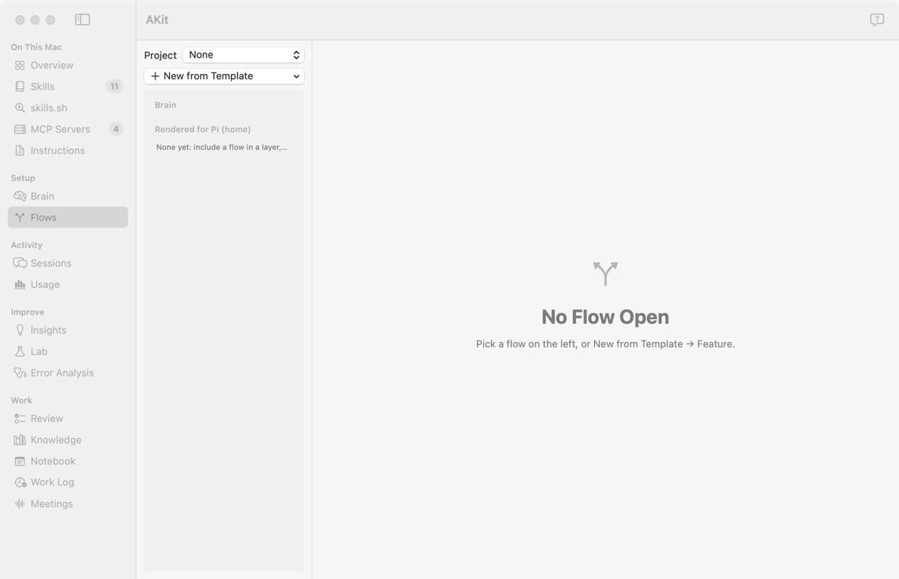
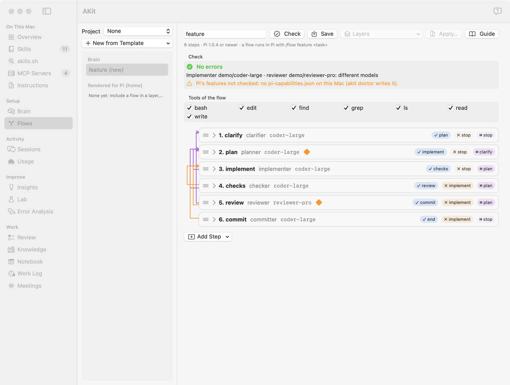

# Flows: руководство

Это руководство по экрану **Flows** в группе **Setup** бокового меню. Названия кнопок даны по-английски, как на экране.

**Что такое flow простыми словами.** Flow — это порядок работы нескольких агентов в Pi. Каждый шаг — карточка: какой агент работает, на какой модели, с какими скиллами и инструментами и куда идти дальше. AKit только описывает flow. Запускает его Pi командой `/flow <имя> <задача>`.

**Кому это нужно:**

- Вы хотите, чтобы агент всегда шёл одним путём: уточнить, спланировать, сделать, проверить, отревьюить, закоммитить.
- Вы хотите, чтобы ревью делала другая модель, а не та, что писала код.
- Вы хотите остановку перед важным шагом: «покажи план, я решу».

**Когда это не нужно:**

- Одна маленькая правка. Обычный разговор с Pi быстрее.
- Агент не Pi. Flows работают только в Pi.

Надписи экрана есть в словаре: [AKit Terms → Flows](terms#terms-flows).

## Что на экране
<!-- section: overview -->

**Что это:** слева — список flows, справа — открытый flow столбиком карточек.

- **Project** — проект. Из него берутся команды проверок, для него показан список «Rendered for Pi», в него ставит **Apply…**.
- **New from Template** — новый flow из готового: **Feature** и 21 пресет, как в OMC (см. ниже).
- **Brain** — flows из вашего brain, файлы `flows/<имя>.yaml`.
- **Rendered for Pi** — flows, которые уже лежат у Pi: `.pi/flows/` проекта и `~/.pi/agent/flows/`. Их не правят здесь, только смотрят.

## Первый flow из шаблона
<!-- section: template -->

**Что это:** шаблон **Feature** — путь для новой функции. Шаги: clarify → plan (стоп для одобрения) → implement → checks → review (стоп для приёмки) → commit. Подсказки шагов взяты из PurpleFlow (MIT) и переведены на английский.

**Как Feature бережёт токены:**

- Каждый шаг — новый агент Pi с чистым контекстом. Он получает задачу, одобренный план и итог прошлого шага (handoff), а не весь разговор.
- Шаг **checks** с командами проверки не запускает модель: команды запускает сам Pi-runner. Красные тесты уходят к implement вместе с хвостом вывода.
- Думает модель там, где это окупается: plan и review — **high**, clarify и commit — **low**.
- Неизменная часть подсказки идёт первой (роль, задача, подсказка шага, план), меняющаяся — в конце. Так повтор шага лучше попадает в кэш модели.

**Как пользоваться:**

1. Выберите проект в **Project**. Тогда шаг **checks** сразу получит команды тестов проекта.
2. Нажмите **New from Template** → **Feature**.
3. Проверьте поле **Name**. Это имя файла и имя для `/flow`.
4. У каждой карточки выберите **Model**. Красная звёздочка — поле обязательное.
5. Нажмите **Save**. AKit запишет `flows/feature.yaml` в brain и закоммитит.

**Пример.** Проект `notes-mac`, модели `demo/coder-large` для всех шагов и `demo/reviewer-pro` для review. После **Save** в списке **Brain** появится `feature`.

> **Совет:** **Save** серая, пока у какого-то шага нет модели или имя пустое.

**Пресеты как в OMC.** В меню **New from Template** рядом с именем написано, на какой процесс OMC похож пресет. Первая модель из списка Pi идёт на шаги, которые делают работу, вторая — на шаги, которые её проверяют (review, verify, critique, architect).

| Пресет | Как в OMC | Шаги |
|---|---|---|
| **Ralplan** | ralplan | plan → architect → critique (стоп для одобрения); только чтение |
| **Ralph** | ralph | implement → checks → verify, до 5 кругов → commit |
| **Tdd** | tdd | test (падающий тест) → implement → checks → review → commit |
| **Debug** | debug / trace | trace (причина) → fix → checks → verify → commit |
| **Review** | code-review | review; только чтение |
| **Deslop** | ai-slop-cleaner | clean → checks → review → commit |
| **Research** | research | research → report; только чтение |
| **Deep-Interview** | deep-interview | clarify → plan, оба со стопом; только чтение |
| **Autopilot** | autopilot | clarify → plan → architect → critique → implement → checks → verify → commit |
| **Plan** | plan | plan со стопом; только чтение |
| **Verify** | verify | checks → verify; только чтение |
| **Security-Review** | security-review | один шаг проверки безопасности; только чтение |
| **Interrogate** | interrogate | correctness → security → edge-cases → verdict; только чтение |
| **Blast-Radius** | blast-radius | map (что может сломаться) → checks; только чтение |
| **Fix-Ci** | fix-ci | fix → checks, до 5 кругов → review → commit |
| **Fix-Merge-Conflicts** | fix-merge-conflicts | fix → checks → review → commit |
| **Hillclimb** | hillclimb | baseline → change → checks → measure, до 5 кругов → commit |
| **Sharpen** | sharpen | один шаг: цель, проверка, что вне задачи; только чтение |
| **How** | how | explore → explain; только чтение |
| **Why** | why | один шаг: история git и решения; только чтение |
| **Deepinit** | deepinit | document (AGENTS.md) → review → commit |

Нет **team** и **arena**: им нужны параллельные шаги, а в этой версии шаги идут строго по одному.

**Пример.** **New from Template** → **Ralph (like OMC ralph)**, **Save**, **Apply…**, потом в Pi: `/flow ralph почини падающий тест экспорта`.

## Карточка шага
<!-- section: card -->

**Что это:** карточка свёрнута в одну строку: номер, шаг, агент, короткое имя модели, число скиллов и ромб gate. Метки путей (✗ failed, ⏸ blocked, ✓ done) видны, только если путь отличается от обычного: done — на следующий шаг, failed и blocked — стоп. Щелчок по строке открывает карточку. Открыта всегда одна карточка. Всё в карточке ставится щелчком. Руками YAML не пишут.

Открытая карточка показывает главное:

- **Agent** и **Model** — роль шага и модель из списка Pi (`pi --list-models`).
- **Reasoning** — сколько модель рассуждает на этом шаге: от `off` до `max`. Pi получает это как `--thinking`, Claude Code — как `--effort` (`off` и `minimal` там — `low`). **Model default** — как решит сам харнесс. Уровень виден и на строке свёрнутой карточки (значок мозга).
- **Runs on** — где работает шаг: **Pi** или **Claude Code**. Шаг на Claude Code Pi-runner запускает как `claude -p` без ваших настроек Claude (скиллы, хуки, плагины, MCP выключены). Правила проекта он всё же получает: раннер кладёт в его системную подсказку `AGENTS.md` проекта (если его нет — `CLAUDE.md`), как их видят шаги Pi. Такой шаг только читает: правка и запись файлов ему недоступны, вопросы о разрешениях получают отказ. `bash` у него тоже только читает (`git log`, `git diff`, `cat`): тесты и любые программы получают отказ, поэтому проверки отдайте полю **Checks** — их запускает раннер. Шаг на Claude Code получает код проекта и handoff шагов Pi, поэтому **Check** требует, чтобы Claude Code был в разрешённых в Settings → Sending policy; на рабочем Mac — только если это разрешает компания. Итог шага Claude отдаёт как JSON по схеме handoff, и следующий шаг Pi получает его как обычный handoff. Подходит для проверяющих шагов (architect, critic, reviewer, verifier): проверку делает модель другого семейства. Модель — `opus`, `sonnet` или `haiku`; на строке карточки метка «Claude Code».
- **Instructions** — сама инструкция агенту шага, всегда на виду. Она уходит агенту как есть, после задачи и плана. Правьте её прямо в поле.
- **Rewrite with Pi** — строка под инструкцией: напишите на любом языке, что шаг должен делать или что поменять (пусто — «сделай короче и яснее»), и нажмите **Rewrite with Pi** (или Return). Pi перепишет инструкцию в той форме, что нужна раннеру: что делать, когда заканчивать failed или blocked, что передать дальше, по-английски. Новый текст встаёт в поле; **Undo** над полем возвращает прежний, **Save** сохраняет. Модель и **Reasoning** вызова — в маленьком меню рядом (по умолчанию модель шага и `low`). Вызов идёт через правила отправки (Settings → Sending policy) и пишется в журнал отправок.
- **Skills** — «N chosen» и **Choose…**: список с поиском и флажками. Шаг видит только отмеченные скиллы. Шаг на Pi получает их через `--skill`. У шага на Claude Code своих скиллов в flow нет (`--safe-mode` выключает `~/.claude/skills`): он получает только отмеченные — списком в системной подсказке (имя, описание, путь к `SKILL.md`) и читает их через Read. Для него **Choose…** показывает скиллы Pi и скиллы Claude Code (`~/.claude/skills`, `.claude/skills` проекта); скиллы плагинов Claude туда не попадают. Скрипты скилла такой шаг запустит, только если у него есть `bash`.
- **Checks** — у шага checker: команды проверки проекта (`make test`, `npm test` …). Pi запускает их в конце шага. Красная проверка делает «done» → «failed». Шаг checker с командами модель не запускает.
- **Gate** — после шага Pi останавливается и спрашивает: Approve или Send Back с заметкой.
- Стрелки вверх и вниз и корзина — порядок шага и удаление.

**More Settings** — то, что меняют редко:

- **Tools** — флажки из инструментов flow. Шаг получает ровно их (Pi — `-t`, Claude Code — `--tools`), и подсказка называет те же. Другие инструменты guard в Pi блокирует. Ни одного флажка — шаг берёт инструменты flow.
- **On done**, **On failed**, **On blocked** — куда идти после шага (см. ниже).
- **Max rounds** — сколько раз run может войти в шаг: первая попытка плюс переделки после отказа. Это не ходы агента внутри шага — их сколько угодно. Когда лимит кончился, Pi спрашивает, что делать (см. [Куда идти после шага](#routes)).

**Tools of the flow** под карточками (свёрнут) — инструменты всего flow; инструменты шага берутся из них.

Если Pi на этом Mac чего-то не умеет (это пишет `akit doctor` в `pi-capabilities.json`), выбор серый, а рядом сказано почему. Например, без `ui-confirm` нельзя включить **Gate**.

**Пример.** Щёлкните строку **5. review**, в строке под **Instructions** напишите «обращай особое внимание на безопасность» и нажмите **Rewrite with Pi**. Проверьте текст и нажмите **Save**.

![Открытая карточка 2. plan: Agent planner и Model demo/coder-large в одной строке, Reasoning high и переключатель Runs on (Pi, Claude Code) в одной строке, Instructions с текстом, под ним строка «Tell Pi what this step should do or change» с меню модели и кнопкой Rewrite with Pi, Skills «0 chosen» с кнопкой Choose…, Gate включён, стрелки и корзина; раскрытый блок More Settings: Tools, пути On done, On failed, On blocked друг под другом и Max rounds; указатель над plan: его стрелки яркие, остальные бледные](images/flows-card.png)

**Порядок шагов:**

- Перетащите карточку за значок ☰ на другую карточку. Она встанет перед ней.
- Или откройте карточку и нажмите стрелки вверх и вниз.
- Корзина в открытой карточке убирает шаг. Пути, которые вели на него, тоже уходят.
- **Add Step** внизу добавляет карточку с выбранным агентом.

## Куда идти после шага
<!-- section: routes -->

**Что это:** в **More Settings** у каждой карточки три выбора: **On done**, **On failed**, **On blocked**.

- **On done** — по умолчанию **Next step**. Можно выбрать любой шаг или **End**.
- **On failed** и **On blocked** — по умолчанию **Stop and ask**: Pi показывает, что сказал шаг, и спрашивает: **Accept as is and go on** (принять как есть и идти дальше), **Send … back with a note** (вернуть шагу с заметкой) или **Stop**. Можно выбрать этот или более ранний шаг, или **End**.

Над схемой — легенда. Синяя ↓ между карточками — done идёт на следующий шаг. Путь назад — стрелка слева от карточек, у каждой своя дорожка: короткие ближе к карточкам, длинные дальше, так линии не путаются. В начале стрелки кружок: ✗ — on failed (оранжевая), ⏸ — on blocked (фиолетовая), ✓ — on done назад (синяя). Стрелка выходит из нижней половины карточки и входит в верхнюю. Наведите указатель на шаг: его стрелки станут жирными, остальные — бледными.

**Пример.** В шаге **checks** выбрано **On failed** → `implement`. Тесты красные — Pi возвращает работу implementer, и в его подсказке есть хвост вывода тестов.

> **Важно:** путь «failed» или «blocked» вперёд нельзя. **Check** назовёт такую ошибку.

**Лимит кругов (Max rounds).** Это сколько раз run может войти в шаг за весь run. Возвраты от разных шагов считаются вместе: красные тесты и замечания review тратят один и тот же счёт implement. Поэтому в Feature у implement 5, у остальных 3. Когда лимит кончился, Pi не обрывает run, а спрашивает: **One more round of …** (ещё круг), **Accept as is and go on** или **Stop**. После **Stop** (или если спросить было негде) `/flow resume` спросит снова, и выданные раньше круги сохранятся.

**Спор с отказом.** Если шаг уверен, что отказ неверен (например, implementer не согласен с review), он заканчивается `blocked:disputed` и пишет свои доводы. Pi показывает обе стороны и спрашивает: **… is right: go on** (прав автор — run идёт дальше, как будто проверка пройдена), **… is right: … does it** (прав проверяющий — автор переделывает и больше не спорит) или **Decide with a note** (ваше решение заметкой). Красные тесты оспорить нельзя. Без ответа run ждёт; `/flow resume` спросит снова.

## Проверить flow
<!-- section: check -->

**Что это:** **Check** проверяет flow до Apply: пути ведут на шаги, инструменты шага есть у flow, команды проверок простые, модели и скиллы известны Pi, ревьюер работает на другой модели.

**Как пользоваться:**

1. Нажмите **Check**.
2. В блоке **Check** читайте: **No errors** зелёным — всё хорошо. Иначе — список ошибок красным и предупреждений оранжевым.
3. Строка «Implementer … · reviewer …» сравнивает модели. «different models» — хорошо. «the same model» — выберите для review другую.

То же в терминале: `akit flow check --json`.

## Отдать flow на ревью агенту
<!-- section: export -->

**Что это:** **Export** в заголовке flow собирает всё, что влияет на run, в один Markdown-файл для агента с чистым контекстом. Тот прочитает и укажет ошибки и улучшения по каждому шагу.

В файле:

- просьба к ревьюеру: что проверить и в каком виде ответить (шаг, поле, новое значение);
- как работает раннер: свежий агент на шаг, handoff, порядок подсказки, пути по умолчанию, Max rounds, споры, проверки, gate;
- таблица шагов и результат **Check**;
- по каждому шагу: настройки, все пути (и пути по умолчанию), команда запуска `pi` или `claude -p`, **Instructions** и подсказка, которую шаг получит в первом круге (`<…>` — то, что знает только run);
- полный текст каждого скилла (один раз, с шагами, которые его берут) и что из него видит шаг на Claude Code;
- файл flow (YAML) и точный код раннера, который собирает подсказку и handoff.

Секреты, хосты и e-mail маскируются, как при отправке модели; в начале файла сказано, сколько.

**Как пользоваться:**

1. Нажмите **Export** → **Copy for Review** (в буфер) или **Save for Review…** (файл `<имя>-flow-review.md`). В файл идёт flow как на экране, с несохранёнными правками.
2. Отдайте файл агенту в новом чате.
3. Его ответ вставьте Claude Code (или другому агенту) в этом репозитории и попросите внести правки. Агент меняет flow командами `akit flow` (скилл `/akit`), каждая сначала показывает diff и **Check**, а с `--yes` пишет `flows/<имя>.yaml` в brain и делает коммит. Откройте flow снова — правки на экране; **Apply…** отдаёт их Pi.

То же в терминале: `akit flow export feature --out review.md`.

Команды правки:

- `akit flow set feature review thinking high` — поле шага: `agent`, `model`, `harness` (`pi`, `claude-code`), `thinking`, `prompt` (`--file FILE` или `--file -` из stdin), `skills`, `tools`, `paths`, `extensions`, `checks` (через `;`), `bash`, `gate`, `max-rounds`;
- `akit flow route feature review failed:tests implement` — путь; `stop` убирает его;
- `akit flow add-step feature checker --model M --after implement`, `remove-step`, `move-step … --after STEP | --first`;
- `akit flow set-flow feature tools read,bash,edit` — инструменты flow.

Без `--yes` ничего не пишется. Правка, которая добавляет ошибку **Check**, отклоняется.

## Отправить flow в Pi
<!-- section: apply -->

**Что это:** Pi читает flow не из brain, а из `.pi/flows/` проекта или `~/.pi/agent/flows/`. Туда его кладёт Apply вместе с расширением `akit-flow`.

**Как пользоваться:**

1. Сохраните flow (**Save**).
2. **Layers** → отметьте слой. AKit допишет в его `layer.yaml` строку `flows:` и закоммитит. Пока flow не входит ни в один слой, под заголовком горит оранжевая строка «In no layer…»: Apply его не запишет, и в Pi не будет `/flow`. Для домашней папки отметьте `core`.
3. Нажмите **Apply…**. Откроется окно Set Up Project для выбранного проекта (или для домашней папки, если **Project** — None).
4. В предпросмотре видны файлы: `.pi/flows/feature.yaml` и папка `.pi/extensions/akit-flow/` (`index.ts` и соседние файлы). У изменённого файла — дифф. Нажмите **Apply**.
5. В Pi: `/flow feature добавь экспорт в CSV`.

**Что AKit делает при Apply:**

- Копию заменяемых файлов кладёт в резервную папку.
- Папку `/.pi/akit-flow` (записи runs) прячет от git отдельным блоком в `.git/info/exclude`.
- Файл flow пишет в JSON. JSON — тоже YAML, и Pi читает его без лишних пакетов.

> **Важно:** если вы поправили файл flow или расширения руками, Apply его не перепишет. В предпросмотре он помечен как изменённый вручную, с диффом. Удалите файл или верните правку и нажмите **Apply…** снова.

## Посмотреть run
<!-- section: runs -->

**Что это:** экран **Runs** (группа Activity) показывает runs, которые Pi сделал по flow в ваших проектах. AKit читает папки `.pi/akit-flow/runs/` и ничего в них не меняет, кроме кнопки **Stop…**. Копировать или выгружать отсюда нельзя: в выводе шагов могут быть секреты.

**Как пользоваться:**

1. Откройте **Runs**. Слева список runs: flow, задача, проект, число отклонений ⚠.
2. Щёлкните run. Справа та же схема, что на экране Flows: свёрнутые карточки шагов. У карточки — значок состояния (✓ done, ✗ failed, ⏸ blocked, ◌ идёт), число попыток, время, токены и цена.
3. Щёлкните карточку. Под ней — каждая попытка: отклонения с цитатой, итог шага (handoff: цель, что сделано, файлы, вопросы) и вывод проверок (команда, код выхода, последние строки).
4. Кнопки попытки: **Open in Lab…** (Lab разбирает сессию шага), **Corrections** (сколько раз вы поправляли агента в этом шаге), **Show in Sessions** (сессия шага на экране Sessions, там же вкладка Tools).

**Когда run закончился,** Pi пишет итог: последний шаг и его исход, что сделано, заметки, открытые вопросы и где работа — ветка `akit-flow/<run>` в отдельном worktree, с готовой командой `git merge akit-flow/<run>` для вашей рабочей копии. Тот же итог получает модель, если run запустила она (инструмент `akit_flow`), и может продолжить с него.

**Пример.** Run `feature` «add CSV export» в `notes-mac`: шаг **checks** сначала ✗ — тесты красные, отклонение «check-failed: node check.mjs → 1». Run вернулся к **implement** (попытка 2), потом **checks** ✓. У **implement** ещё одно отклонение: guard заблокировал `bash rm -rf build`.

**Метки:**

- **Off the routes** (красная) — после шага run пошёл туда, куда пути шага не ведут. AKit сверяет каждый переход с путями flow. Обычно это значит, что flow изменили после run.
- **STOP requested** — кнопка **Stop…** уже записала `STOP`; Pi остановит run перед следующим шагом.
- **Worktree kept: uncommitted changes** — рабочей копии run больше 14 дней, но в ней есть незакоммиченные правки. AKit её не удаляет. Чистые старые копии (`~/.akit/local/flows/runs/<run>/worktree`) AKit удаляет сам, если run не идёт; ветка `akit-flow/<run>` и запись run остаются.

## Как шаги передают друг другу контекст
<!-- section: context -->

**Что это:** каждый шаг — новый агент без памяти о других шагах. Runner собирает ему подсказку из итогов (handoff) прошлых шагов, а не из их разговоров:

- **Все прошлые шаги — по строке:** исход, цель, что сделано, файлы. Так шаг видит весь run за немного токенов.
- **Открытые вопросы** всех прошлых шагов. Gate показывает вопросы шага над диффом: ответить на них можно через Send Back.
- **Одобренный план целиком.** Планировщик даёт его полем `plan`: шаги по порядку и одна команда проверки. Шаг checks запускает и её, если она простая.
- **Свой прошлый итог**, если шаг идёт повторно.
- **Итог предыдущего шага целиком, последним** — он весит больше всего.

**Кто главнее, если итоги расходятся:** план говорит, *что* строить; итоги шагов — *что сейчас*, и более поздний важнее раннего; ваша заметка на gate важнее всего.

**Файлы — по git.** После шага runner сам смотрит, какие файлы изменились. Это и видят следующие шаги и экран **Runs**. Если модель назвала другие файлы, в run пишется отклонение `files-mismatch`.

## Остановить run
<!-- section: stop -->

**Что это:** **Stop…** пишет файл `STOP` в папку run. Шаг, который идёт сейчас, доработает; перед следующим шагом Pi остановится (событие `halted`). Продолжить: `/flow resume` в Pi.

1. Выберите run, нажмите **Stop…**.
2. Подтвердите: **Stop Before the Next Step**.

> **Важно:** у законченного run кнопка серая.

## Тонкости и редкие случаи
<!-- section: details -->

- **Рабочий Mac.** Ответы и lock проекта лежат в `~/.akit/local/projects/`, в brain они не попадают. Сам flow — файл brain, как слой.
- **Pi не в целях проекта.** Flows не ставятся, в предпросмотре предупреждение.
- **Flow с тем же именем в двух слоях.** Ставится один раз, из первого слоя.
- **Список моделей пуст.** Pi не нашёл ключей. Проверьте Pi на экране **Overview**.
- **Flow поменяли во время run.** Run хранит свою копию flow (`flow.json` в папке run). `/flow resume` идёт по ней; если файл flow с тех пор изменился, Pi спрашивает, взять ли новый (только если в нём остались все шаги, что run уже прошёл). Без экрана run идёт по своей копии и пишет об этом.
- **Flow поменяли снаружи, пока он открыт здесь** (`akit flow set`, синхронизация brain). Без ваших правок экран перечитает файл, когда вы вернётесь в AKit. С правками **Save** не затрёт чужое: появится строка с **Reload** (взять файл, ваши правки пропадут) и **Save Mine** (записать своё поверх).
- **Сессии шагов.** Сессии шагов Pi лежат в папке run, сессии шагов Claude Code — в `~/.claude/projects` под путём worktree run. И те и другие видны в **Sessions** под фильтром **Flow Steps** и не попадают в Insights.
- **Версия Pi.** Под заголовком flow строка «This Mac's Pi … · tested on Pi 1.0.4» появляется, только когда есть о чём сказать. Если Pi новее проверенной версии, строка оранжевая: flow работает, но с предупреждением. Если Pi старше 1.0.4 — красная: flow не запустится. Данные пишет `akit doctor` (в Терминале) в `~/.akit/local/pi-capabilities.json`. Он же проверяет, что `/.pi/akit-flow` спрятан от git в каждом проекте с flows.

## Связи с другими экранами
<!-- section: links -->

- **[Brain](screens#brain)** — слои, в которые входит flow, и окно Set Up Project.
- **Overview** — версия Pi и его настройки.
- **Runs** (Activity) — runs по flow, см. [Посмотреть run](#runs).
- **Sessions** — фильтр **Flow Steps** показывает сессии шагов; в Insights они не входят.
- Терминал: `akit flow list`, `akit flow show <имя>`, `akit flow check`, `akit flow runs [--json]`, `akit flow schema`.
