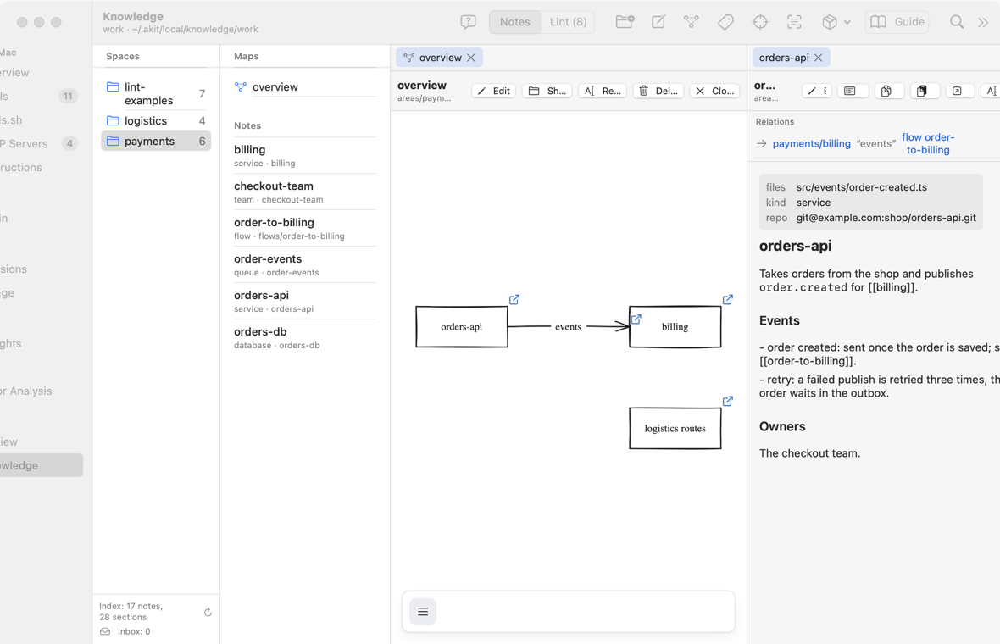
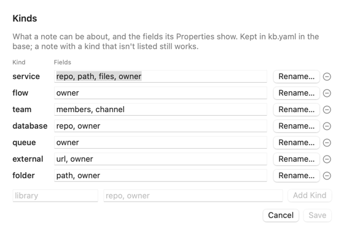
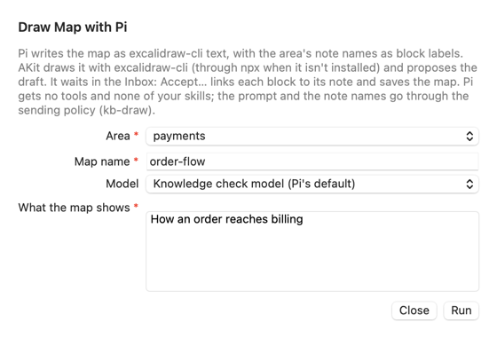

# База знаний: подробное руководство

Это руководство по экрану **Knowledge** в группе **Work** бокового меню. Названия кнопок и полей даны по-английски, как на экране.

**Что такое база знаний простыми словами.** Это папка с заметками о вашей работе: сервисы, потоки данных, команды. Каждая заметка — обычный файл Markdown. Папка — локальный git-репозиторий без remote: ничего не уходит с этого Mac. Агенты читают базу командами `akit kb`. Вы пишете её на этом экране или в Obsidian.

**Кому это нужно:**

- Вы каждый раз объясняете агенту одно и то же: какой сервис что делает, кто шлёт событие, где лежит код.
- Вы хотите держать эти знания рядом, в простых файлах, а не в чужом облаке.
- Вы уже ведёте заметки в Obsidian и хотите, чтобы агенты их тоже читали.

**Когда это не нужно:**

- Знания уже лежат в README и `AGENTS.md` проекта, и агенту их хватает.
- Вам нужна общая вики команды. База живёт на одном Mac и не имеет remote.

**Как построено руководство.** Части идут от простого к сложному: что это, создать базу, пример базы, попробовать всё на примере (с агентом в Claude Code и Pi), пространства и заметки, читать и править, карты, переименовать, папка базы и Obsidian, виды и свойства, настройки пространства, поиск, фокус, что видит агент, подсказка для Pi, проверка, предложения агента, коммиты, тонкости. Все надписи экрана собраны в словаре: [AKit Terms → Knowledge](terms#terms-knowledge).

**Как искать.** Меню Help → **Search Guides and Screens…** (⌥⌘F). Это руководство открывает кнопка **Guide** на экране Knowledge или Help → **Knowledge Base Guide**.

## Что такое база знаний
<!-- section: overview -->

**Что это:** база — папка мира. По умолчанию это `~/.akit/local/knowledge/<мир>`, например `~/.akit/local/knowledge/work`. Другую папку, например в Obsidian, задаёт Settings → **Knowledge**: [Папка базы и Obsidian](#folder). Мир — одно слово для одной части жизни: `work` или `personal`. В базе есть:

- `areas/` — пространства (spaces). Одно пространство — одна часть работы, например `payments` или `logistics`. В пространстве лежат заметки, можно в подпапках, например `flows/`.
- `inbox/` — предложения агентов. Их видно на вкладке **Inbox**: [Предложения агента](#inbox).
- `.git` — локальный git-репозиторий. У него никогда нет remote.

**Когда пригодится:**

- «Агент не знает, что `orders-api` шлёт событие `order.created`» → заметка `payments/orders-api` с разделом `## Events`.
- «Где код этого сервиса?» → поле `repo:` в начале заметки, например `repo: git@example.com:shop/orders-api.git`.
- «Как данные идут от заказа до счёта?» → заметка вида `flow` в папке `flows/`.

![Экран Knowledge: слева список Spaces с пространствами lint-examples с числом заметок 7, logistics с числом заметок 4 и payments с числом заметок 6; в середине часть Maps с картой overview и заметки пространства payments: billing, checkout-team, order-to-billing, order-events, orders-api, orders-db с видом service, team, flow, queue или database; справа вкладка orders-api, заголовок orders-api и путь areas/payments/orders-api.md, кнопки Edit, Properties, Copy, Paste, Open in Obsidian, Rename… и Delete…; ниже часть Relations со строкой → payments/billing «events», flow order-to-billing и картой overview, таблица полей files, kind service и repo git@example.com:shop/orders-api.git и текст заметки с разделами Events и Owners](images/knowledge.png)

### Главные слова
<!-- section: overview-terms -->

- **Пространство** (space, area): папка в `areas/`. Пример: `areas/payments`.
- **Заметка** (note): файл `.md` в пространстве. Её имя на экране и в командах — путь без `areas/` и без `.md`. Пример: `payments/orders-api`.
- **Вид** (kind): строка `kind:` в начале заметки. Примеры: `service`, `flow`, `team`. Список видов и их полей лежит в файле `kb.yaml` базы, и вы его меняете: [Виды и свойства](#kinds).
- **Свойство** (property): одна строка `ключ: значение` в начале заметки, например `owner: team-a`.
- **Начало заметки** (frontmatter): строки между двумя `---` в самом начале файла. AKit не переписывает его целиком: кнопка **Properties** меняет только одну строку.

> **Важно:** AKit никогда не отправляет базу на сервер. У неё нет remote, и AKit не делает коммит, пока remote есть.

## Создать базу: Create Base…
<!-- section: create -->

Если базы на этом Mac ещё нет, экран показывает «No knowledge base» и кнопку **Create Base…**.

1. Нажмите **Create Base…**.
2. В поле **World** оставьте предложенное слово (`work` на рабочем Mac, `personal` на личном) или впишите своё. Поле обязательное: у него красная звёздочка.
3. Нажмите **Create Base**.

AKit создаёт папку мира, `areas/`, `inbox/`, файлы `.gitignore` и `kb.yaml` (виды заметок по умолчанию) и git-репозиторий с первым коммитом «Create the knowledge base». Если у git нет вашего имени и почты, коммиты подписаны `AKit <akit@localhost>`.

То же делает команда `akit kb init --world work` в терминале.

> **Почему так:** база никогда не лежит в brain: brain уходит в ваш личный репозиторий. По умолчанию база лежит в `~/.akit/local/knowledge`. Другую папку, например в вашем vault Obsidian, задаёт [Папка базы и Obsidian](#folder).

Если баз несколько, вверху экрана есть список **Base**: выберите в нём мир.

## Пример базы: Sample Base
<!-- section: sample -->

**Что это:** пример базы — отдельная база мира `sample` с выдуманными заметками о магазине. В ней видно всё, что умеет экран: два несвязанных пространства `payments` и `logistics` с настройками `area.yaml`, заметка каждого вида из `kb.yaml` (`service`, `flow`, `team`, `database`, `queue`, `external`) с полями и разделами `##`, ссылки `[[…]]` внутри пространства и в другое пространство, карты и пространство `lint-examples` с нарочными ошибками для вкладки **Lint** ([Проверка](#lint)). Каждая новая возможность AKit добавляет сюда свой пример. Ваши базы пример не трогает.

**Когда пригодится:**

- «Хочу посмотреть, как выглядит база, прежде чем писать свою» → **Add Sample Base…**.
- «Посмотрел, пример больше не нужен» → **Remove Sample Base…**.

### Просто: Add Sample Base…
<!-- section: sample-add -->

1. Нажмите меню **Sample Base** в панели инструментов, потом **Add Sample Base…**. Если базы на этом Mac ещё нет, та же кнопка есть рядом с **Create Base…**.
2. Нажмите **Add Sample Base**.

AKit создаёт базу в папке мира `sample` (по умолчанию `~/.akit/local/knowledge/sample`) и делает один коммит «Seed: sample base v1». Экран сразу показывает пример, а в списке **Base** появляется `sample`. Если пример уже есть, повторное нажатие просто его открывает. Пример старой версии AKit обновит, но только если вы в нём ничего не меняли.

То же делает `akit kb seed` в терминале.


### Просто: Remove Sample Base…
<!-- section: sample-remove -->

1. Нажмите **Sample Base** → **Remove Sample Base…**. Кнопка доступна, только когда пример есть.
2. Нажмите **Move to Trash**.

Вся папка примера уходит в Корзину. Другие базы остаются как есть. То же делает `akit kb seed --remove --yes`.

> **Почему так:** AKit узнаёт пример по файлу `.akit-seed.json` в корне базы: в нём версия примера и список его файлов. Базу без этого файла AKit не удаляет и не перезаписывает, даже если её мир называется `sample`.

### Средне: удалить из терминала: akit kb rm
<!-- section: sample-rm -->

`akit kb rm` убирает в Корзину заметку, карту или всё пространство и сразу коммитит удаление, как **Delete…** на экране.

1. `akit kb rm payments/orders-db` показывает, что уйдёт в Корзину, и ничего не удаляет.
2. `akit kb rm payments/orders-db --yes` удаляет. Пространство: `akit kb rm logistics --yes`. Карта: `akit kb rm payments/maps/overview --yes`.

Предложения агентов в `inbox/` эта команда не удаляет: их принимают или отклоняют.

## Попробовать всё на примере
<!-- section: try -->

**Что это:** один проход по всем функциям на примере базы, от просмотра до работы агента. Примерно 20 минут. Всё делается в отдельной базе `sample`, ваши базы не меняются. В конце пример удаляется одним действием.

| Шаг | Что делаете | Что увидите |
|---|---|---|
| 1 | Создаёте пример базы | Пространства `payments`, `logistics`, `lint-examples` |
| 2 | Открываете заметки и карты | Блоки, стрелки, переход между картами |
| 3 | Ищете и смотрите карточку агента | Что агент получает в начале задачи |
| 4 | Направляете проект на пример | Агент в этом проекте читает `sample` |
| 5 | Запускаете агента: Claude Code или Pi | Агент читает базу и предлагает заметку |
| 6 | Проверяете и принимаете предложение | Заметка в базе, один коммит |
| 7 | Просите Pi нарисовать карту | Черновик карты во **Inbox** |
| 8 | Смотрите **Lint** | Нарочные ошибки с подсказками |
| 9 | Удаляете пример | Папка `sample` в Корзине |

### Просто: 1. создать пример
<!-- section: try-seed -->

1. Экран **Knowledge** → **Sample Base** → **Add Sample Base…** → **Add Sample Base**.
2. В списке **Base** вверху выберите `sample`.

В терминале: `akit kb seed`, потом `akit kb areas --base sample`. Ответ:

```
lint-examples  7 notes, 2 maps  Lint examples
logistics  4 notes, 1 map  Logistics
payments  6 notes, 1 map  Payments
```

### Просто: 2. заметки и карты
<!-- section: try-look -->

1. **Spaces** → `payments` → заметка `orders-api`. Справа: поля (`kind: service`, `repo:`), разделы `## Events` и `## Owners`, ниже **Relations**: стрелка → `payments/billing` с подписью «events».
2. **Maps** → `overview`. На карте два блока, `orders-api` и `billing`, и стрелка «events». Нажмите блок: откроется его заметка.
3. На карте `overview` есть блок `logistics routes`: он ведёт на карту `logistics/maps/routes`. Так пространства, которые не связаны, ссылаются друг на друга.
4. Нажмите **Edit** на карте, сдвиньте блок, нажмите **Edit** ещё раз. Правка сохраняется в файл сама, коммит AKit делает при **Close Map** ([Коммиты правок](#commits)).
5. Перетащите заметку `order-events` из списка на карту: появится блок со ссылкой на заметку.

В терминале то же видно так:

```
akit kb maps --base sample
akit kb relations payments/orders-api --base sample
```

Ответ второй команды: `payments/orders-api → payments/billing  "events"  flow payments/flows/order-to-billing  (payments/maps/overview)`.

### Просто: 3. поиск и карточка агента
<!-- section: try-search -->

1. Поле поиска → `invoice`. Первая строка: `payments/billing`, раздел `## Invoices`.
2. **Preview Agent Context…** → **Project** → любая папка. Если проект не назван в базе, карточка пустая. Это нормально: шаг 4 это исправит.

В терминале: `akit kb search invoice --base sample` и `akit kb show payments/orders-api --base sample`.

### Средне: 4. направить проект на пример
<!-- section: try-focus -->

Агент читает базу, которую AKit выбирает для его проекта. Ваша обычная база — `personal` или `work`. Чтобы агент в одном проекте читал пример, выберите для проекта фокус в базе `sample`:

1. В списке **Base** выбрана `sample`.
2. **Focus…** → **Project**: проект, в котором запустите агента, например `~/Projects/akit`.
3. **Focus**: `payments` → **Save**.

AKit запомнит в `~/.akit/local/knowledge/focus.json` пространство и базу. Теперь в этом проекте `akit kb context` без `--base` показывает пример:

```
cd ~/Projects/akit
akit kb context
Focus: payments (override)
payments/billing  billing: Bills each order once.
…
```

В терминале: `akit kb focus ~/Projects/akit --set payments --base sample`. Вернуть как было: `akit kb focus ~/Projects/akit --clear`.

### Средне: 5. агент читает базу
<!-- section: try-agent -->

Агент работает с базой через команды `akit kb`. Как он о них узнаёт, зависит от харнеса:

| Харнес | Как вызвать | Сам или по просьбе |
|---|---|---|
| Claude Code | Начните сообщение с `/akit` | Только когда вы пишете `/akit` |
| Pi | Начните сообщение с `/skill:akit` | Только когда вы пишете `/skill:akit` |
| Pi после **Pi Template…** | Просто задайте вопрос про сервисы | Сам: в начале задачи запускает `akit kb context --json` ([Подсказка для Pi](#pi-template)) |
| AKit Review | Ничего не нужно | Сам: карточка базы и инструменты `akit_kb_search`, `akit_kb_show` |

Скилл `/akit` есть у обоих харнесов: AKit кладёт его в `~/.claude/skills/akit` и `~/.pi/agent/skills/akit`. Сам агент его не вызывает: скилл включается, только когда вы его называете.

**Пример: агент только читает.** Запустите харнес в проекте из шага 4 и напишите:

```
/akit Посмотри в базе знаний, что делает orders-api и кто получает его события. Ничего не меняй.
```

В Pi то же, но начните с `/skill:akit`. Агент запустит `akit kb context --json`, потом `akit kb show payments/orders-api` и ответит: `orders-api` публикует `order.created`, его читает `billing`.

**Пример: агент предлагает заметку.** Напишите:

```
/akit Добавь в базу знаний сервис refunds: он возвращает деньги за отменённые заказы и читает order.cancelled из order-events. Предложи заметку и стрелку на карте overview.
```

Агент сам базу не правит. Он запускает `akit kb propose --note payments/refunds …`, и предложение ложится в `inbox/`. Стрелку `refunds → order-events` он сможет предложить только после того, как вы примете заметку: AKit отказывает стрелке к заметке, которой ещё нет.

### Средне: 6. проверить и принять
<!-- section: try-accept -->

1. Слева под **Spaces** появится **Inbox (4)**: три предложения из примера и одно от агента.
2. Нажмите предложение `payments/refunds`: справа будет текст заметки и причина, которую указал агент.
3. **Check Again** отправляет предложение модели проверки (Settings → **Knowledge check model**). Она ставит пометки: повтор, спор со стрелкой карты, сломанная ссылка. Пример такой пометки уже есть у `2026-10-24-payments-billing`: `duplicate`.
4. **Accept…** показывает, что будет записано; **Accept** пишет заметку в `areas/payments/refunds.md` и делает коммит. **Reject…** убирает предложение в Корзину.
5. Попросите агента ещё раз предложить стрелку. Её **Accept…** показывает вопрос **Add an arrow?**, а **Add** рисует стрелку на карте.

В терминале: `akit kb inbox`, `akit kb check ID`, `akit kb accept ID` (показать) и `akit kb accept ID --yes` (принять).

### Средне: 7. Pi рисует карту
<!-- section: try-draw -->

1. **Draw Map with Pi…**: **Area** `payments`, **Map name** `refund-flow`, **What the map shows**: `How a cancelled order gets its money back`.
2. **Model**: модель из списка Pi. По умолчанию — модель проверки, если это модель Pi.
3. Нажмите **Run**. Pi пишет описание карты, AKit рисует её через `excalidraw-cli` и кладёт черновик во **Inbox**.
4. Откройте черновик: блоки с именами заметок связаны с заметками. **Accept…** → **Save Map** кладёт карту в `areas/payments/maps/`.

Нужен `excalidraw-cli` или `npx`. Если их нет, окно пишет об этом, и **Run** выключена.

### Просто: 8. Lint
<!-- section: try-lint -->

Вкладка **Lint** показывает ошибки пространства `lint-examples`: сломанная ссылка `[[no-such-note]]`, карта, которая не читается, путь, которого нет, ссылка на две заметки сразу, стрелка без концов, блок без заметки. У каждой строки есть подсказка, как исправить. В терминале: `akit kb lint --base sample`.

### Просто: 9. удалить пример
<!-- section: try-remove -->

1. **Sample Base** → **Remove Sample Base…** → **Move to Trash**.
2. Если вы делали шаг 4, верните фокус проекта: **Focus…** → **None** → **Save**. Пока вы этого не сделали, команды в проекте сами вернутся к вашей обычной базе: базы `sample` больше нет.

В терминале: `akit kb seed --remove --yes` и `akit kb focus ~/Projects/akit --clear`.

## Пространства и заметки
<!-- section: spaces -->

Экран разбит на три колонки:

- **Spaces** — пространства базы и число заметок в каждом.
- Список заметок выбранного пространства: заголовок, вид и путь внутри пространства.
- Панель заметки: открытые вкладки и одна заметка.

### Просто: открыть заметку
<!-- section: spaces-open -->

1. Нажмите на пространство в **Spaces**, например `payments`.
2. Нажмите на заметку, например `orders-api`.

Заметка открывается во вкладке справа. Каждая открытая заметка — своя вкладка. Крестик на вкладке закрывает её.

### Просто: новое пространство
<!-- section: spaces-new-area -->

1. Нажмите **New Area…** в панели инструментов.
2. Впишите **Name**, например `logistics`. Имя — одна папка: без `/` и без точки в начале.
3. Нажмите **Add Area**.

Пустое пространство — просто папка. Git не хранит пустых папок, поэтому коммита нет: его сделает первая заметка.

### Просто: новая заметка
<!-- section: spaces-new-note -->

1. Нажмите **New Note…**.
2. Выберите **Area** в списке. Впишите **Name**, например `orders-api`. Оба поля обязательные.
3. Выберите **Kind**: **None** или вид из списка. Список берётся из `kb.yaml` базы: `service`, `flow`, `team`, `database`, `queue`, `external` и виды, которые вы добавили в **Kinds…**.
4. Нажмите **Add Note**.

AKit создаёт файл `areas/<пространство>/<имя>.md` с заголовком `# <имя>` и, если выбран вид, строкой `kind:` в начале. Заметку AKit сразу коммитит отдельным коммитом «Add note …». В этот коммит попадает только новый файл, даже если другие правки ещё ждут своего коммита.

То же делает `akit kb new-note payments orders-api --kind service`.

### Средне: удалить заметку или пространство
<!-- section: spaces-delete -->

- Заметка: кнопка **Delete…** в панели заметки или правый щелчок по заметке → **Delete…**. Потом **Move to Trash**.
- Пространство: правый щелчок по пространству в **Spaces** → **Delete…** → **Move to Trash**. В Корзину уходит вся папка со всеми заметками.

Файл или папка уходят в Корзину, а их удаление AKit сразу коммитит («Delete note …» или «Delete area …»). Ссылки `[[…]]` на заметку в других заметках остаются как есть.

Правый щелчок → **Show in Finder** показывает файл или папку в Finder.

## Читать и править заметку
<!-- section: note -->

Панель заметки показывает заголовок и путь файла, например `areas/payments/orders-api.md`. Ниже — поля из начала заметки (`kind`, `repo`, `files`) таблицей и текст заметки. Заголовки `#` и `##` крупнее, `**жирный**` и `` `код` `` показаны как в Markdown.

### Просто: Edit
<!-- section: note-edit -->

1. Нажмите **Edit**. Вместо текста появляется Markdown заметки.
2. Пишите. Каждая правка сразу сохраняется в файл. Кнопки «Сохранить» нет.
3. Нажмите **Edit** ещё раз, чтобы снова читать.

AKit пишет файл целиком и атомарно: сначала во временный файл, потом подменяет. Байты, которые вы не меняли, остаются как были: переносы строк, начало заметки, порядок полей.

![Панель заметки orders-api в режиме Edit: нажатая кнопка Edit, рядом Properties, Copy, Paste, Open in Obsidian, Rename… и Delete…; ниже часть Relations и Markdown заметки моноширинным шрифтом: строки kind: service, repo: git@example.com:shop/orders-api.git, files: [src/events/order-created.ts] между линиями ---, заголовок # orders-api и раздел ## Events со строками order created и retry](images/knowledge-note.png)

### Просто: Copy и Paste
<!-- section: note-copy -->

- **Copy** копирует весь текст заметки, вместе с началом заметки.
- **Paste** добавляет текст из буфера обмена в конец заметки и сразу сохраняет. Пример: вы скопировали абзац из чата с агентом и хотите сохранить его в заметке.

В режиме **Edit** обычные ⌘C и ⌘V тоже работают, в месте курсора.

### Просто: Open in Obsidian
<!-- section: note-obsidian -->

База — обычное хранилище (vault) Obsidian: ссылки `[[…]]` и начало заметки Obsidian понимает сам. **Open in Obsidian** открывает заметку в Obsidian по адресу `obsidian://open?path=…`. Плагин не нужен.

Если Obsidian не установлен, экран скажет об этом и покажет папку базы.

Obsidian открывает только заметки из своих хранилищ. Если базы среди них нет, Obsidian пишет «Unable to find a vault for the URL…». Поэтому AKit сначала смотрит список хранилищ Obsidian (только читает его). Если базы там нет, вместо Obsidian открывается окно **Open the Base in Obsidian**:

1. Нажмите **Copy Path**, потом **Open Obsidian**.
2. В Obsidian откройте переключатель хранилищ и выберите **Open folder as vault** → **Open**.
3. В окне выбора папки нажмите ⇧⌘G, вставьте путь и выберите папку.
4. Вернитесь в AKit и снова нажмите **Open in Obsidian**: заметка откроется.

Это нужно один раз на каждую базу, например `work` и `sample` отдельно. Настройки Obsidian лежат в папке `.obsidian/` внутри базы, и файл `.gitignore` базы не пускает её в коммиты. Другой путь — положить базу внутрь своего vault: [Папка базы и Obsidian](#folder).


## Карты
<!-- section: maps -->

**Что это:** карта — схема пространства: блоки и стрелки между ними, файл `areas/<пространство>/maps/<имя>.excalidraw`. Блок — прямоугольник со ссылкой на заметку, например `[[orders-api]]`. Стрелка между двумя блоками — связь, её подпись (например, `events`) говорит, что идёт по стрелке. У стрелки тоже может быть ссылка: на заметку о потоке, например `[[order-to-billing]]`. Блок может вести и на другую карту, например `[[logistics/maps/routes]]`. Карты рисует Excalidraw, он встроен в AKit и работает без сети.

Карту можно смотреть и править. Новую карту создаёт **New Map…** (или `akit kb new-map payments flows-overview`), удаляет **Delete…** (или `akit kb rm payments/maps/flows-overview --yes`). Список карт и связей показывают `akit kb maps` и `akit kb relations`.

### Просто: открыть карту
<!-- section: maps-open -->

1. Нажмите на пространство в **Spaces**, например `payments`.
2. Над заметками есть часть **Maps**. Нажмите на карту, например `overview`.

Карта открывается справа, вместо панели заметки, в режиме просмотра, в своей вкладке. Откройте ещё одну карту пространства — у неё будет своя вкладка рядом; крестик на вкладке закрывает её и коммитит ждущие правки. Вкладки показаны для карт пространства той карты, что на экране. Карта на ней ничего нельзя сдвинуть или стереть. Сверху — имя карты, путь файла и кнопки **Edit**, **Show in Finder**, **Delete…** и **Close Map**. Карту можно двигать мышью и колёсиком. **Show in Finder** показывает файл карты в Finder. **Close Map** возвращает панель заметки и коммитит ждущие правки.


### Просто: открыть заметку блока
<!-- section: maps-block -->

Нажмите на блок, например `orders-api`. Его заметка открывается во вкладке рядом с картой, справа. Карта остаётся на месте и уменьшается, чтобы её было видно целиком.

- Стрелка с ссылкой открывает свою заметку, например `order-to-billing`.
- Блок со ссылкой на карту открывает ту карту, даже в другом пространстве. Пример: `logistics routes` открывает карту `routes` пространства `logistics`.
- Ссылка на сайт (`https://…`) открывается в браузере. Сама карта никуда в сеть не ходит.
- Если ссылка не ведёт ни на одну заметку или карту базы, в заголовке карты появится строка «The link … points to no note or map in this base.».

Ссылки на карте читаются так же, как в заметках: `[[orders-api]]` ищется сначала в пространстве карты. Нажатие на заметку в списке закрывает карту.

### Просто: Relations заметки
<!-- section: maps-relations -->

Если заметка стоит блоком на карте и к ней ведёт стрелка, в панели заметки есть часть **Relations**: по строке на стрелку. Стрелка вправо — от этой заметки, влево — к ней. В строке другая заметка, подпись стрелки в кавычках, заметка потока (**flow …**) и справа имя карты. Нажмите на заметку, поток или карту, чтобы открыть их. Связи только для чтения: их рисуют стрелками на карте. То же показывает `akit kb relations orders-api`.



### Средне: перетащить заметку на карту
<!-- section: maps-drag -->

1. Откройте карту.
2. Перетащите заметку из списка заметок на карту.

На месте, где вы отпустили заметку, появится блок с её заголовком и ссылкой на неё, например `[[orders-db]]`. Ссылка — самая короткая, которая с этой карты ведёт ровно на эту заметку. Карта переходит в **Edit**, а блок сохраняется, как любая другая правка. Соедините его стрелкой с другим блоком — и у обеих заметок появится строка в **Relations**.

### Просто: New Map…
<!-- section: maps-new -->

1. Нажмите **New Map…** в панели инструментов.
2. Выберите **Area**, впишите **Name**, например `flows-overview`. Оба поля обязательные.
3. Нажмите **Add Map**.

AKit создаёт пустую карту `areas/<пространство>/maps/<имя>.excalidraw`, сразу коммитит её («Add map …») и открывает в режиме **Edit**. То же делает `akit kb new-map payments flows-overview`.

**Пустая карта.** Новая или ещё пустая карта в режиме просмотра — белый холст: на нём нечего показывать, и инструментов Excalidraw в этом режиме нет. Поэтому над холстом стоит строка **This map is empty** с кнопкой **Edit**. Нажмите её: сверху появятся инструменты Excalidraw. Можно также перетащить заметку из списка на карту или попросить Pi нарисовать карту: **Draw Map with Pi…**.

### Средне: править карту (Edit)
<!-- section: maps-edit -->

1. Откройте карту и нажмите **Edit**. Появляются инструменты Excalidraw: прямоугольник, стрелка, текст и другие.
2. Нарисуйте блок. Чтобы связать его с заметкой, выделите его, нажмите ⌘K и впишите ссылку, например `[[orders-api]]`.
3. Соедините два блока стрелкой: тяните её от одного блока к другому. Двойной щелчок по стрелке добавляет подпись, например `events`.
4. Нажмите **Edit** ещё раз, чтобы снова смотреть: тогда нажатие на блок открывает его заметку. В режиме **Edit** ссылку блока открывает маленький значок ссылки в его углу.

Каждая правка сохраняется в файл сама, через 0,8 секунды после последнего изменения. Кнопки «Сохранить» нет. AKit пишет файл ровно так, как его записал Excalidraw. Открыть карту и закрыть её без правок — не правка: файл не меняется, коммита нет. Коммит карты делает очередь, как у заметок: [Коммиты правок](#commits). В git он называется «Edit maps: payments/maps/overview».


### Средне: Delete… карты
<!-- section: maps-delete -->

**Delete…** в заголовке карты или правый щелчок по карте в **Maps** → **Delete…** → **Move to Trash**. Файл уходит в Корзину, удаление AKit сразу коммитит («Delete map …»). Заметки остаются. То же делает `akit kb rm payments/maps/overview --yes`.

### Сложно: Changed on disk
<!-- section: maps-conflict -->

Пока карта открыта, её файл может поменять кто-то ещё: Obsidian, другой редактор, `git checkout`. AKit помнит, какой файл он прочитал или записал последним. Перед каждой записью он сравнивает его с файлом на диске. Если файл другой, AKit ничего не пишет и спрашивает «Changed on disk»:

- **Reload** — показать карту с диска. Ваша несохранённая правка пропадает.
- **Keep Mine** — записать вашу карту. Копия с диска сначала уходит в `~/.akit/backups/<время>/…`, её путь показан в заголовке карты.

AKit ещё и следит за папкой базы. Если карту в **Edit** поменяли снаружи, «Changed on disk» появляется сразу, без вашей правки. Карту в режиме просмотра AKit просто показывает с диска.

Пример: вы правите `overview` в AKit, а в Obsidian кто-то сдвинул блок в той же карте. Через секунду-две AKit спросит «Changed on disk». Выберите **Reload**, если правка из Obsidian важнее, или **Keep Mine**, если важнее ваша: копия из Obsidian останется в резервной папке.

## Переименовать: Rename…
<!-- section: rename -->

**Что это:** **Rename…** меняет имя заметки или карты и все ссылки на неё в заметках и картах базы. Всё или ничего, одним коммитом.

1. Нажмите **Rename…** в панели заметки (или в заголовке карты, или правым щелчком по заметке или карте в списке).
2. Впишите **New name**, например `invoicing`. Это имя в той же папке; заметку можно перенести в другое пространство, вписав `logistics/invoicing`.
3. В части **Changes** AKit сразу показывает план: файл, который переименуется, и каждую ссылку, которая поменяется, строками `-` (было) и `+` (станет).
4. Нажмите **Rename**.

![Окно Rename Note для payments/billing: поле New name со значением invoicing, в части Changes строки «5 links change», areas/payments/billing.md → areas/payments/invoicing.md и по файлу на каждую ссылку: checkout-team, order-to-billing, maps/overview.excalidraw, order-events, orders-api со строками - [[billing]] и + [[invoicing]]; внизу Cancel и Rename](images/knowledge-rename.png)

Что AKit сохраняет в ссылке: псевдоним (`[[billing|Счета]]` → `[[invoicing|Счета]]`), заголовок (`[[billing#Invoices]]`), `.md`, форму `akit:note/…` и длину пути: `[[payments/billing]]` станет `[[payments/invoicing]]`. В карте меняется только значение `"link"` блока, остальные байты файла остаются. Подпись блока на карте — ваш текст, её AKit не трогает.

Перед коммитом AKit проверяет план целиком:

- каждая ссылка базы до и после ведёт туда же, куда вела, кроме ссылок на переименованное;
- каждая изменённая карта читается и связывает те же блоки с теми же заметками.

Если что-то не так, **Rename** серая, а в **Changes** красным написано, почему. Пример: заметку `a/foo` нельзя назвать `bar`, если есть `b/bar` и где-то написано `[[bar]]`: после переименования эта ссылка стала бы неоднозначной. Ничего не записывается.

Ждущие правки AKit сначала коммитит отдельно. Открытая карта отдаёт свою последнюю правку, и AKit её сохраняет до плана. Если это не удалось, появится «Save the open map first…», и ничего не переименуется. После коммита открытые вкладки заметок и карт показывают новые имена и ссылки.

То же делает `akit kb rename payments/billing invoicing`: без `--yes` она только показывает план, с `--yes` переименовывает. Коммит называется «Rename note payments/billing to payments/invoicing, 5 links in 5 files».

## Папка базы и Obsidian
<!-- section: folder -->

**Что это:** у каждого мира своя папка базы. По умолчанию это `~/.akit/local/knowledge/<мир>`. В Settings → **Knowledge** вы можете выбрать другую папку, например папку в вашем хранилище (vault) Obsidian. Выбор хранится только на этом Mac, в файле `~/.akit/local/knowledge/bases.json`.

**Когда пригодится:**

- «Я веду заметки в Obsidian и хочу базу там же» → **Choose…** → папка `~/Notes/Vault/kb` или сам vault.
- «База уже есть, и я хочу перенести её в vault» → **Move Base…**.
- «Хочу вернуть папку по умолчанию» → **Reset to Default**.


### Просто: Choose…
<!-- section: folder-choose -->

1. Откройте Settings (⌘,). Часть **Knowledge** стоит под **Brain repo**.
2. В строке мира, например `work`, нажмите **Choose…**.
3. Выберите папку и нажмите **Use for Base**.

Какая папка подходит:

- Новая или пустая папка. AKit делает в ней базу.
- Хранилище Obsidian (папка с `.obsidian/`) или папка внутри него. Заметки vault остаются как есть. AKit добавляет `areas/`, `inbox/`, `.gitignore`, `kb.yaml`, git и один коммит «Create the knowledge base». В этот коммит попадают только файлы базы, а `.obsidian/` git не видит.
- Готовая база. AKit берёт её как есть.

Старая база остаётся на месте, но AKit её больше не читает. Чтобы перенести базу вместе с заметками, нажмите **Move Base…**.

То же в терминале: `akit kb path work --set ~/Notes/Vault/kb`. Без флагов `akit kb path work` показывает папку мира.

> **Почему так:** AKit не берёт папку, из которой заметки уйдут с Mac. Это папка внутри brain (brain уходит в ваш репозиторий), синхронизируемая папка (iCloud Drive в `~/Library/Mobile Documents`, `~/Library/CloudStorage`, Dropbox, Google Drive), сетевой диск и git-репозиторий с remote. Правило одно для рабочего и личного Mac. Причина отказа видна под строкой мира.

> **Obsidian Sync.** Если в хранилище Obsidian включён Obsidian Sync, Sync отправляет в облако всё хранилище, и базу тоже. На рабочем Mac AKit такую папку не берёт и пишет причину. На личном Mac AKit берёт папку, но под строкой мира показывает оранжевое предупреждение. `akit kb path` и `akit kb init` пишут то же предупреждение в терминале. Чтобы заметки остались на Mac, выключите Sync для этого хранилища или добавьте папку базы в исключения Sync (Obsidian → Settings → **Sync**).

### Средне: Move Base…
<!-- section: folder-move -->

1. В строке мира нажмите **Move Base…**.
2. Выберите место и имя новой папки и нажмите **Move Here**. Такой папки ещё нет, или она пустая.

AKit сначала коммитит правки из очереди ([Коммиты правок](#commits)). Если это не вышло (например, git занят другой программой AKit), AKit ничего не переносит и пишет причину. На том же диске папка просто переименовывается, история git остаётся. На другой диск AKit копирует папку, сравнивает копию байт в байт и только потом кладёт старую папку в Корзину.

То же в терминале: `akit kb path work --move ~/Notes/Vault/kb`.

### Просто: Show in Finder и Reset to Default
<!-- section: folder-reset -->

- **Show in Finder** показывает папку базы в Finder.
- **Reset to Default** возвращает папку по умолчанию `~/.akit/local/knowledge/<мир>`. AKit ничего не переносит и не удаляет. Кнопка серая, если папка уже по умолчанию.

То же в терминале: `akit kb path work --reset`.

### Сложно: Open in Obsidian внутри vault
<!-- section: folder-obsidian -->

Если база лежит в vault Obsidian (в одной из папок выше есть `.obsidian/`), **Open in Obsidian** открывает адрес `obsidian://open?vault=<имя vault>&file=<путь внутри vault>`. Пример: vault `Notes`, заметка `kb/areas/payments/orders-api.md`. Если vault не найден, AKit открывает `obsidian://open?path=…`, как раньше.

## Виды и свойства
<!-- section: kinds -->

**Что это:** у каждой заметки есть вид (`kind:`) и свойства — строки в начале заметки, например `repo:`, `files:`, `owner:`. Какие виды есть и какие поля у каждого, решаете вы. Это не список в коде AKit, а файл `kb.yaml` в базе. По умолчанию в нём шесть видов: `service`, `flow`, `team`, `database`, `queue`, `external`.

**Когда пригодится:**

- «Хочу записать, какая команда отвечает за сервис» → **Properties** → поле **owner** → `team-a`.
- «Заметка была `service`, а это поток» → **Properties** → **Kind** → `flow`.
- «Нам нужен вид `library` с полями `repo` и `version`» → **Kinds…** → **Add Kind**.

### Просто: Properties
<!-- section: kinds-properties -->

1. Откройте заметку, например `payments/orders-api`.
2. Нажмите **Properties** в панели заметки. Над текстом появляется форма.
3. **Kind** — вид заметки из списка видов базы. **None** убирает строку `kind:`.
4. Ниже — поля вида. У вида `service` это **repo**, **files** и **owner**. Пустое поле значит, что строки ещё нет.
5. Впишите значение и нажмите Return (или перейдите в другое поле). Значение сразу сохраняется в файл.

Как писать значения:

- Одна строка: `team-a`.
- Список: в квадратных скобках через запятую, например `[src/a.ts, src/b.ts]`.
- Пустое значение удаляет строку. Кнопка с минусом справа от поля делает то же.

Ключи, которых нет у вида, форма показывает ниже полей вида: AKit их не трогает. **Add Field…** добавляет свой ключ: впишите **Name** (например, `url`) и **Value** и нажмите **Add**.

![Панель заметки orders-api с нажатой кнопкой Properties: над частью Relations и текстом форма со списком Kind со значением service, полями repo со значением git@example.com:shop/orders-api.git, files со значением [src/events/order-created.ts], пустым полем owner и кнопкой Add Field…](images/knowledge-properties.png)

> **Почему так:** AKit меняет одну строку начала заметки, а все остальные байты оставляет как были: порядок полей, комментарии, переносы строк Windows (CRLF), текст заметки. Строка `owner:` в тексте заметки, ниже начала, тоже не меняется. Если у заметки нет начала, AKit добавляет его.

Правки свойств ждут коммита в очереди, как правки в **Edit**: [Коммиты правок](#commits).

То же в терминале: `akit kb set payments/orders-api owner=team-a`, список — `files=[a.ts, b.ts]`, удалить — `--unset owner`. Команда сразу делает коммит.

### Средне: Kinds…
<!-- section: kinds-sheet -->

**Kinds…** в панели инструментов открывает список видов базы.

- Колонка **Fields** — поля вида через запятую. Их показывает **Properties**.
- **Add Kind**: впишите имя вида (одно слово, например `library`) и его поля, нажмите **Add Kind**.
- Кнопка с минусом убирает вид из `kb.yaml`. Заметки этого вида не меняются: их вид просто станет «неизвестным», и они работают как раньше.
- **Save** записывает `kb.yaml`. Коммит ждёт в очереди, как правка заметки. **Cancel** ничего не меняет.



То же в терминале: `akit kb kinds` (список), `akit kb kinds add library --fields repo,version`, `akit kb kinds fields library repo,owner`, `akit kb kinds remove library`.

### Сложно: Rename… вида
<!-- section: kinds-rename -->

**Rename…** у вида меняет его имя в `kb.yaml` и в строке `kind:` каждой заметки этого вида. Пример: `service` → `system` во всех заметках сразу.

- Всё или ничего. AKit сначала готовит все новые тексты. Если хоть одну заметку нельзя изменить (например, начало заметки с ошибкой YAML), не меняется ни один файл. Если запись файла не удалась на середине, AKit возвращает уже записанные файлы.
- Один коммит «Rename kind service to system in 2 notes», сразу. Перед ним AKit коммитит ждущие правки, чтобы они не попали в этот коммит.
- Кнопка доступна, когда в окне нет несохранённых правок: сначала **Save** или **Cancel**.

То же в терминале: `akit kb kinds rename service system`.

## Настройки пространства
<!-- section: area-settings -->

**Что это:** у пространства может быть файл `areas/<пространство>/area.yaml`: название, описание и проекты, о которых это пространство. Проект — адрес git remote (`git@example.com:shop/orders-api.git`), путь от домашней папки (`~/Projects/billing`) или маска (`~/Projects/shipping-*`). По проектам AKit и агенты найдут пространство нового клона или новой папки без настройки.

**Когда пригодится:**

- «Пространство `payments` — это репозитории `orders-api` и `billing`» → проекты этих репозиториев.
- «Склонировал `shipping-api` и хочу, чтобы агент сразу взял `logistics`» → проект `~/Projects/shipping-*`.

### Просто: Area Settings…
<!-- section: area-settings-edit -->

1. Правый щелчок по пространству в **Spaces** → **Area Settings…**.
2. **Title** — название, например `Payments`. **Description** — пара слов, о чём пространство.
3. **Projects**: впишите проект и нажмите **Add Project** (или Return). Кнопка с минусом убирает проект.
4. Нажмите **Save**.

AKit записывает `area.yaml`. Коммит ждёт в очереди, как правка заметки. Все поля необязательные. Название видно в подсказке над пространством в **Spaces**.

То же в терминале: `akit kb area payments` (показать), `akit kb area payments --title Payments --project git@example.com:shop/orders-api.git`, `--remove-project P`. Команда сразу делает коммит.

> **Важно:** одно пространство — один проект, система или отдельная тема. Не смешивайте в одном пространстве несвязанные системы: заведите для них новое.

## Поиск
<!-- section: search -->

**Что это:** поле поиска в панели инструментов ищет по всем заметкам базы. Это тот же поиск, что у агентов: `akit kb search`. Найдено то, где есть все слова запроса. Одна находка — один раздел заметки: текст под заголовком `##` или начало заметки до первого `##`.

**Когда пригодится:**

- «В какой заметке про `retry`?» → введите `retry`.
- «Что агент найдёт по слову `order`?» → введите `order`: вы видите те же разделы, что и агент.


### Просто: найти заметку
<!-- section: search-find -->

1. Нажмите в поле **Search notes** в панели инструментов.
2. Введите слова, например `order created`.
3. В середине вместо списка заметок — находки: заметка, раздел (`## Events`) и кусок текста.
4. Нажмите на находку: заметка откроется справа на этом разделе.

Очистите поле (крестик в поле), и снова виден список заметок пространства.

То же в терминале: `akit kb search "order created"`, с `--json` для агента.

### Средне: индекс поиска
<!-- section: search-index -->

Поиск идёт по индексу — файлу `.akit-index.sqlite` в базе. Строка под **Spaces** показывает его размер: «Index: 17 notes, 28 sections».

- AKit сам следит за папкой базы. Вы поправили заметку в AKit, в Obsidian или в другом редакторе — через секунду-две поиск её находит.
- **stale** рядом со строкой: индекс сейчас обновляет другая программа (например, `akit kb index` в терминале). Поиск показывает его прошлое состояние.
- Кнопка **Reindex** (круглая стрелка) строит индекс заново из файлов. Нужна редко: если вы думаете, что индекс отстал.

То же в терминале: `akit kb index` (обновить) и `akit kb index --rebuild` (построить заново).

> **Важно:** ваши поиски на этом экране не попадают в журнал промахов `.akit-misses.log`. Журнал — только о поисках агентов.

### Сложно: правка в Obsidian, пока заметка открыта
<!-- section: search-watch -->

AKit замечает правку заметки снаружи (в Obsidian, другим редактором, git).

- Заметка открыта для чтения → AKit просто показывает новую версию.
- Заметка открыта в **Edit** → окно **Changed on disk**. **Reload** показывает версию с диска. **Keep Mine** записывает ваш текст, а копию с диска кладёт в `~/.akit/backups`.
- Свои сохранения AKit узнаёт по содержимому файла: после них окна нет.

Правка снаружи попадает в ту же очередь коммитов, что и правки на экране: [Коммиты правок](#commits).

## Фокус
<!-- section: focus -->

**Что это:** фокус проекта — пространство, с которого агент начинает, когда работает в этом проекте. Это не стена: агент может читать и другие пространства. AKit ищет фокус так:

1. ваш выбор в **Focus…** (файл `~/.akit/local/knowledge/focus.json` на этом Mac, не в базе). Выбор запоминает и базу, в которой лежит пространство: команды и агенты в этом проекте читают её без `--base`;
2. пространство, чьи **Area Settings…** называют проект: его git remote или папку;
3. пространство заметки, у которой `repo:` — remote проекта.

**Когда пригодится:**

- «В `orders-api` агент должен начинать с `payments`» → обычно ничего делать не нужно: заметка `orders-api` с `repo:` уже даёт этот фокус.
- «Репозиторий `shop-frontend` нигде не назван, а агенту нужен `payments`» → выберите `payments` в **Focus…**.

### Просто: Focus…
<!-- section: focus-set -->

1. Нажмите **Focus…** в панели инструментов.
2. **Project**: выберите проект из списка или **Other Folder…**.
3. Строка **Now** показывает фокус сейчас и откуда он: **your choice**, **Area Settings** или **a note's repo:**.
4. **Focus**: выберите пространство. **None** убирает ваш выбор: тогда решают **Area Settings…** и `repo:`.
5. Нажмите **Save**.

То же в терминале: `akit kb focus ~/Projects/orders-api` (показать), `akit kb focus ~/Projects/orders-api --set payments`, `--clear`. Это команда для человека: агент запускает её, только если вы попросили.

## Что видит агент
<!-- section: context -->

**Что это:** в начале задачи агент читает карточку базы: `akit kb context <папка проекта>`. В карточке — заметки пространства-фокуса (имя и одна строка), стрелки между ними и их соседи в других пространствах. Карточка не длиннее 4000 токенов. **Preview Agent Context…** показывает ровно её.

**Когда пригодится:**

- «Почему агент не знает про `billing`?» → посмотрите, есть ли `billing` в карточке.
- «Карточка не помещается?» → число токенов и пометка **cut** покажут, что AKit обрезал.


### Просто: Preview Agent Context…
<!-- section: context-preview -->

1. Нажмите **Preview Agent Context…** в панели инструментов.
2. **Project**: выберите проект или **Other Folder…**.
3. Сверху — фокус и откуда он, справа — сколько токенов из 4000 занимает карточка.
4. **List** показывает карточку списком. **JSON** — ровно то, что печатает `akit kb context --json`.
5. Если справа открыта заметка, ниже видны её соседи на картах: `akit kb neighbors`.

Если фокуса нет, карточка пустая. Задайте его в **Focus…** или в **Area Settings…** пространства.

То же в терминале: `akit kb context ~/Projects/orders-api` и `akit kb neighbors payments/orders-api`, с `--json`.

## Подсказка для Pi
<!-- section: pi-template -->

**Что это:** Pi сам не знает, что на этом Mac есть база знаний. **Pi Template…** добавляет в слой `core` мозга короткий раздел для Pi: «в начале задачи про другие сервисы, события или репозитории запусти `akit kb context --json`, потом `akit kb search` и `akit kb show`; базу сам не правь». Раздел лежит в `layers/core/templates/kb-pi.md` и в `layer.yaml` записан с условием `when: target == pi`. Поэтому после **Update Home Folder…** он попадает только в `AGENTS.md`, который Pi читает в `~/.pi/agent`. В `~/.claude/CLAUDE.md` его нет: Claude Code эта подсказка не нужна.

**Когда пригодится:**

- «Pi в `orders-api` не смотрит в базу» → один раз на этом Mac нажмите **Pi Template…**, потом **Update Home Folder…**.
- «Хочу другие слова в подсказке» → поправьте `layers/core/templates/kb-pi.md` в мозге и снова **Update Home Folder…**. Слова выбраны в AKit; их можно менять.


### Просто: Pi Template…
<!-- section: pi-template-add -->

1. Нажмите **Pi Template…** в панели инструментов.
2. Посмотрите текст раздела (**Template**) и что изменится в мозге: `layer.yaml` и `templates/kb-pi.md`.
3. Нажмите **Add to Core Layer**. AKit сначала делает коммит ждущих правок базы, потом пишет оба файла в мозг и делает там один коммит.
4. Нажмите **Update Home Folder…** и примените план: раздел появится в `~/.pi/agent/AGENTS.md`.

Если раздел уже есть, окно пишет **Already set** и ничего не меняет. Если вы правили `kb-pi.md` руками, кнопка называется **Update Template**: AKit вернёт свой текст.

То же в терминале: `akit kb pi-template` (показать изменения), `akit kb pi-template --yes` (записать), потом `akit apply --home`. Второй запуск пишет «already set». Это команда для человека: агент запускает её, только если вы попросили.

## Проверка
<!-- section: lint -->

**Что это:** вкладка **Lint** вверху экрана проверяет всю базу. Она находит то, что ведёт в никуда или на то, чего нет на этом Mac. У каждой находки есть важность:

| Важность | Значок | Что значит |
|---|---|---|
| Error | красный | ссылка или карта сломана: агент получит неверный ответ |
| Warning | оранжевый | что-то не найдено или неясно: стоит поправить |
| Hint | серая лампочка | совет: можно оставить как есть |

**Когда пригодится:**

- «Переименовал заметку в Finder, и ссылки на неё сломались» → находка **broken-link**.
- «Склонировал репозиторий в другую папку, и агент не находит код» → находки **unknown-repo** и **missing-file**.
- «Нарисовал карту, но связи на ней агент не видит» → находки **block-without-note** и **unbound-arrow**.

В примере базы есть пространство `lint-examples`: в нём по одной находке каждого правила, нарочно.

![Экран Knowledge, вкладка Lint: вверху переключатель Notes, Inbox (2) и Lint (8), строка «2 errors, 6 warnings, 2 hints» и кнопка Check Again; ниже части Errors, Warnings и Hints; в каждой строке значок важности, текст находки, правило, файл и элемент карты, совет, кнопка Open, а у сломанной ссылки [[no-such-note]] ещё Create Note…](images/knowledge-lint.png)

### Просто: вкладка Lint
<!-- section: lint-tab -->

1. Нажмите **Lint** в переключателе вверху экрана. Число в скобках — сколько ошибок и предупреждений.
2. Находки идут частями: **Errors**, **Warnings**, **Hints**.
3. **Open** открывает заметку или карту находки. Вкладка снова становится **Notes**.
4. **Create Note…** есть у сломанной ссылки на заметку. Она открывает **New Note…** с пространством и именем из ссылки. Нажмите **Add Note**, и ссылка заработает.
5. **Check Again** проверяет базу заново и заново ищет проекты в папке проектов. Например, после того как вы склонировали репозиторий.

Пример: в заметке `lint-examples/links` есть `[[no-such-note]]`. **Create Note…** предлагает **Area** `lint-examples` и **Name** `no-such-note`.

### Средне: что проверяет Lint
<!-- section: lint-rules -->

| Правило | Важность | Что нашлось |
|---|---|---|
| `broken-link` | Error | ссылка `[[…]]` или `akit:` в заметке или на карте не ведёт ни к одной заметке или карте |
| `map-parse` | Error | файл `.excalidraw` не читается как карта Excalidraw |
| `ambiguous-link` | Warning | ссылке подходят несколько заметок, например `[[status]]` при `old/status` и `new/status` |
| `block-without-note` | Warning | у фигуры на карте есть подпись, но нет ссылки на заметку |
| `unbound-arrow` | Warning | стрелка не привязана к блокам обоими концами, поэтому это не связь |
| `unknown-repo` | Warning | `repo:` заметки — не известный проект |
| `missing-file` | Warning | пути из `files:` нет в локальной копии репозитория |
| `missing-home-path` | Warning | путь `~/…` в `repo:` или `files:` не существует |
| `unknown-kind` | Hint | вида из `kind:` нет в `kb.yaml` |
| `unrelated-area` | Hint | на карте пространства блок заметки другого пространства, а карты этих пространств не ссылаются друг на друга |

**Известный проект** — это:

- репозиторий в папке проектов (по умолчанию `~/Projects`, и на одну папку глубже) с таким же `origin`;
- проект, о котором AKit уже знает (в brain или в `~/.akit/local/projects`);
- проект из **Projects** любого пространства ([Настройки пространства](#area-settings)).

Адреса сравниваются без разницы в записи: `git@example.com:shop/orders-api.git` и `https://example.com/shop/orders-api` — один проект. `missing-file` проверяет файлы, только когда копия репозитория есть в папке проектов.

> **Почему так:** `unrelated-area` — только совет. Одно пространство — одна система. Если блок другой системы попал на карту, возможно, ему место в своём пространстве. Если системы связаны, добавьте на карту блок со ссылкой на карту другого пространства: тогда совета нет.

### Просто: серые ссылки в заметке
<!-- section: lint-note -->

Если в открытой заметке есть находки, под кнопками заметки видна часть **Checks**: по строке на находку. Сломанные и неясные ссылки, неизвестный `repo:` и несуществующие пути в тексте и в таблице полей — серые.

Пример: откройте `lint-examples/links`. В **Checks** две строки, `[[no-such-note]]` и `[[status]]` в тексте серые.

### Средне: проверка в терминале: akit kb lint
<!-- section: lint-terminal -->

`akit kb lint` печатает те же находки, что и вкладка **Lint**, и в конце «2 errors, 6 warnings, 2 hints.». `akit kb lint --json` отдаёт `{base, findings, counts}`. Каждая находка — `rule`, `severity`, `file`, `element` (элемент карты), `link`, `message` и `fix` (что сделать). Команда только читает базу, поэтому агенты её запускают сами.

## Предложения агента
<!-- section: inbox -->

**Что это:** агент не правит базу сам. Он присылает предложение: файл в папке `inbox/` базы. Вы читаете его и решаете: принять или отклонить. Пока вы не приняли предложение, заметки не меняются, а git его не видит: файл не попадает в коммиты и в поиск.

**Когда пригодится:**

- Агент узнал из кода новый факт: «`billing` повторяет запрос три раза». Он предлагает добавить часть `## Retries` в заметку `payments/billing`.
- Агент нашёл систему, которой нет в базе. Он предлагает новую заметку в новом пространстве, например `support/helpdesk`, а не кладёт её в чужое пространство.
- Агент видит связь, которой нет на карте. Он предлагает стрелку, например `orders-api -events-> billing`. Стрелку на карте рисуете вы.
- Агент нарисовал карту системы. Он присылает её черновик, а вы принимаете его как карту: [Карты от агента](#inbox-map).

В примере базы в `inbox/` уже лежат три предложения: часть `## Refunds` и свойство `sla` для `payments/billing`, стрелка `billing -paid orders-> warehouse` для карты `logistics/maps/routes` и карта `payments/maps/order-flow`, которую нарисовал агент.

Предложения видно на вкладке **Inbox** экрана, а в терминале — командой `akit kb inbox`. Принимает и отклоняет их только человек.

### Просто: вкладка Inbox
<!-- section: inbox-tab -->

1. Вверху экрана выберите **Inbox** в переключателе **Notes / Inbox / Lint**. Число в скобках, например **Inbox (2)**, — сколько предложений ждёт.
2. Слева список предложений. У каждого: что меняется (заметка или стрелка `A -вид-> B`), причина от агента, автор и время. Справа значки: зелёная галочка — все проверки прошли, оранжевый треугольник — есть предупреждение, красный знак — проверка не прошла. Флажок с числом — пометки модели проверки.
3. Выберите предложение. Справа видно:
   - **Reason** и **From** — причина, автор и время;
   - **Checks** — проверки без модели: `secret`, `target`, `links`, `arrow`;
   - **Check model** — пометки модели. Если предложение изменилось после проверки, AKit пишет, что пометки старые;
   - **What Accept writes** — разница: какие строки заметки изменятся (строки с `+` добавятся, с `-` уйдут). У стрелки здесь часть **Arrow**: стрелка и карта.
4. Кнопки вверху справа:
   - **Accept…** — показывает разницу ещё раз в окне **Accept Proposal**. Кнопка **Accept** пишет заметку и делает один коммит. Старая заметка копируется в `~/.akit/local/backups/knowledge/`. Если проверка не прошла, **Accept…** не нажимается;
   - **Reject…** — после вопроса отправляет файл предложения в Корзину (**Move to Trash**). База не меняется;
   - **Check Again** — спрашивает модель проверки ещё раз (как `akit kb check`). Если правила отправки не разрешают отправку, вверху экрана появляется причина, как в терминале: «Not sent: …».

Пример: в примере базы выберите `2026-10-24-payments-billing`. **What Accept writes** показывает `+ sla: next day` и новую часть `## Refunds`, а **Check model** — пометку `duplicate`. **Accept…** → **Accept** добавляет их в `payments/billing`, и в git появляется коммит «Edit payments/billing (accept proposal 2026-10-24-payments-billing)».

AKit читает `inbox/` заново, когда агент кладёт туда файл: список и число в **Inbox (N)** обновляются сами.


### Средне: принять стрелку: Add an arrow?
<!-- section: inbox-arrow -->

Стрелку AKit не рисует сам: вы видите её на карте и решаете.

1. Выберите предложение стрелки и нажмите **Accept…**.
2. Если в предложении названа карта, она открывается в режиме **Edit**. Если карта не названа, а в пространстве их несколько, AKit спрашивает: **Which map gets the arrow?** Выберите карту.
3. Над картой появляется полоса **Add an arrow?** со стрелкой, например `payments/billing -paid orders-> logistics/warehouse`. Если на карте нет блока для одной из заметок, полоса пишет, что AKit добавит новый блок со ссылкой, например `billing ([[billing]])`, справа от рисунка.
4. **Add** рисует стрелку между блоками и подписывает её. Карта сохраняется как обычная правка: коммит ждёт вместе с другими правками. Предложение закрывается и уходит из **Inbox**. **Cancel** ничего не рисует, предложение остаётся.

Пример: в примере базы стрелка `billing -paid orders-> warehouse` ложится на карту `logistics/maps/routes`. Блока `billing` там нет, и AKit добавляет его. После **Add** заметка `payments/billing` показывает в **Relations** стрелку к `logistics/warehouse` с подписью «paid orders», а `akit kb relations payments/billing` печатает её же.

### Просто: посмотреть предложения: akit kb inbox
<!-- section: inbox-list -->

`akit kb inbox` печатает предложения: id, что меняется (заметка или стрелка), причину от агента и проверки. `akit kb inbox --json` отдаёт `{base, proposals}`. У каждого предложения есть `id`, `kind`, `target`, `reason`, `created`, `author`, `set`, `arrow` и `checks`.

AKit проверяет предложение без модели, сразу:

| Проверка | Что значит |
|---|---|
| `secret` | в тексте нет токена, ключа или пароля |
| `target` | заметка лежит в `areas/`, путь не выходит из базы, у новой заметки названо пространство |
| `links` | каждая ссылка `[[…]]` ведёт к заметке или карте (новая заметка тоже считается) |
| `arrow` | у стрелки оба конца — заметки, а карта существует |
| `map` | у предложения карты есть черновик, и это сцена Excalidraw с элементами |

Если проверка не прошла, агент получает отказ, и файл не появляется. `kb inbox` проверяет заново: база могла измениться.

### Средне: принять или отклонить: akit kb accept и akit kb reject
<!-- section: inbox-accept -->

1. `akit kb accept ID` показывает разницу: какие строки заметки изменятся. Ничего не пишет.
2. `akit kb accept ID --yes` принимает. AKit делает коммит ждущих правок, копирует старую заметку в `~/.akit/local/backups/knowledge/<мир>/<время>/`, пишет заметку и делает один коммит. Файл предложения исчезает, и `git status` снова пустой.
3. `akit kb reject ID --yes` отправляет файл предложения в Корзину. Коммита нет: предложение не было в git.

Пример: `akit kb accept 2026-10-24-payments-billing --yes` в примере базы добавляет в `payments/billing` часть `## Refunds` и строку `sla: next day`. В git появляется коммит «Edit payments/billing (accept proposal 2026-10-24-payments-billing)».

Как применяется текст:

- Заметка уже есть: текст — это части `## Заголовок`. Часть с тем же заголовком заменяется, новая добавляется в конец.
- Заметки нет: текст становится новой заметкой. Если пространства нет, AKit создаёт и его.
- Стрелку `accept` не рисует: он пишет «Add the arrow … in the app (Knowledge → Inbox)» и выходит с кодом 2. Предложение остаётся. Стрелку принимают на вкладке **Inbox**: [Add an arrow?](#inbox-arrow).
- Карту `accept` тоже не пишет: он пишет «Open Knowledge → Inbox to accept a map.» и выходит с кодом 2. Карту принимают на вкладке **Inbox**: [Карты от агента](#inbox-map).

### Средне: модель проверки: akit kb check
<!-- section: inbox-check -->

**Что это:** лёгкая модель читает предложение и похожие места базы и ставит пометки. Пометок три вида:

| Пометка | Что значит |
|---|---|
| `duplicate` | предложение повторяет то, что уже написано в заметке (названа заметка) |
| `contradiction` | предложение спорит со стрелкой на карте (названа стрелка) |
| `broken-link` | предложение ссылается на заметку, которой нет |

Модель только ставит пометки. Она ничего не принимает и не отклоняет: решаете вы.

1. `akit kb check ID` отправляет модели предложение и то, с чем его сравнить: до пяти частей заметок из поиска и стрелки вокруг заметки, всего не больше 1500 токенов.
2. Отправка идёт через Pi по правилам отправки (Settings → **Sending policy**), под месячным лимитом. В журнале отправок она записана как `kb-check`.
3. Пометки лежат рядом с предложением, в скрытом файле `inbox/.<id>.check.json`. `akit kb inbox` показывает их строками `mark …`. Если предложение потом изменилось, `kb inbox` пишет, что пометки старые.

Пример: в примере базы у предложения `2026-10-24-payments-billing` уже есть пометка `duplicate`: заметка `order-to-billing` уже говорит, что происходит с заказом.

**Какая модель.** Settings → **Knowledge check model**:

| Поле | Что задаёт |
|---|---|
| **Harness** | Через какой харнес идёт проверка. В списке только харнесы, которые есть на этом Mac. По умолчанию **Pi**, можно выбрать **Claude Code** |
| **Model** | Модель из списка этого харнеса, свои имена не вписываются. Pi: список `pi --list-models`. Claude Code: `opus`, `sonnet`, `haiku`. **Default** — модель по умолчанию из того же списка: для Pi первая GPT-6 Luna, которая в нём есть (`opencode-go/gpt-6-luna` или `github-copilot/gpt-6-luna`), для Claude Code `haiku` |
| **Thinking** (Pi) или **Effort** (Claude Code) | Сколько модель думает. По умолчанию `low` |

Каждый харнес помнит свою модель: если переключить **Harness** на Claude Code и обратно на Pi, вернётся модель Pi. **Reset to Default** возвращает Pi с **Default** и забывает выбор для других харнесов.

Любая модель Pi может получить предложение. Другой харнес должен быть в списке Settings → **Sending policy**, иначе проверка не отправится.

Пример: дома Pi показывает `opencode-go/gpt-6-luna`, на рабочем Mac — `github-copilot/gpt-6-luna`. **Default** сам берёт ту, что есть. Если выбранной модели больше нет в списке харнеса, под полем появляется кнопка **Use Default (…)**, а `akit kb check` отказывается и говорит, какие модели есть.

В терминале то же делает `akit kb check-model MODEL [THINKING]`, другой харнес — `akit kb check-model --harness claude-code [MODEL]`; без MODEL команда показывает модель и список харнеса, а `akit kb check ID --model provider/model` меняет модель на один раз.


### Средне: карты от агента
<!-- section: inbox-map -->

**Что это:** агент рисует карту программой [excalidraw-cli](https://github.com/swiftlysingh/excalidraw-cli) и присылает черновик командой `akit kb propose --map ПРОСТРАНСТВО/ИМЯ --file черновик.excalidraw`. AKit кладёт черновик рядом с предложением, в `inbox/<id>.excalidraw`. Подписи блоков агент берёт из имён заметок. Когда вы принимаете карту, AKit даёт каждому такому блоку ссылку на его заметку.

1. На вкладке **Inbox** выберите предложение карты. У него значок карты, а в списке написано, например, `payments/maps/order-flow`.
2. Справа видно черновик: карту, как её показывает Excalidraw. Здесь её нельзя менять.
3. Под картой часть **Links on Accept**:
   - строка со значком ссылки — блок получит ссылку, например `orders-api → [[orders-api]]`;
   - строка со значком минуса — блок останется без ссылки: заметки с таким именем нет («no note has this name») или их несколько («fits …»);
   - ниже — что изменится: `+ block …` и `+ arrow …`. Если карта с таким именем уже есть, AKit пишет «replaces the map» и показывает, какие блоки и стрелки уйдут (`-`) и какие останутся.
4. **Accept…** переводит черновик в режим правки и ставит ссылки на блоки. Над картой появляется полоса **Save the map?** с путём карты и числом блоков со ссылками. Можно поправить карту, как обычную.
5. **Save Map** сохраняет карту в `areas/ПРОСТРАНСТВО/maps/ИМЯ.excalidraw` и делает один коммит. Предложение и черновик уходят из `inbox/`. Новая карта открывается на вкладке **Notes**. Если карта заменяет старую, старая копируется в `~/.akit/local/backups/knowledge/`. **Cancel** ничего не сохраняет: черновик снова показан без ссылок, предложение остаётся.

Пример: в примере базы выберите `2026-10-24-payments-maps-order-flow`. **Links on Accept** показывает `orders-api → [[orders-api]]` и `billing → [[billing]]`. **Accept…** → **Save Map** сохраняет карту `payments/maps/order-flow`, и в git появляется коммит «Add map payments/maps/order-flow (accept proposal 2026-10-24-payments-maps-order-flow)». Заметка `orders-api` теперь показывает в **Relations** стрелку «events» к `billing` с этой карты.

Если пространства ещё нет, AKit создаёт его, когда вы сохраняете карту. Файл, который не является сценой Excalidraw, и текст с токеном или паролем AKit не принимает: агент сразу получает отказ.

![Экран Knowledge, вкладка Inbox: выбрано предложение карты payments/maps/order-flow от агента pi; справа черновик на карте Excalidraw — блоки orders-api и billing и стрелка events между ними; ниже часть Links on Accept со строками orders-api → [[orders-api]] и billing → [[billing]] и список изменений: + block orders-api, + block billing, + arrow orders-api -events-> billing; вверху кнопки Accept…, Reject… и Check Again](images/knowledge-inbox-map.png)

### Средне: Draw Map with Pi…
<!-- section: draw-map -->

**Что это:** AKit сам просит Pi нарисовать карту. Черновик приходит на вкладку **Inbox**, как от любого агента.

1. На панели инструментов нажмите **Draw Map with Pi…**.
2. **Area** — пространство карты. **New Area…** — новое пространство, его имя вы пишете в поле **New area**.
3. **Map name** — имя файла карты, например `order-flow`.
4. **Model** — модель Pi. Если поле пустое, AKit берёт модель проверки (Settings → **Knowledge check model**).
5. **What the map shows** — что нарисовать, например «Как заказ доходит до billing».
6. **Run** запускает Pi. В части **Pi** видны шаги: Pi пишет текст карты, AKit рисует карту и создаёт предложение. **Stop** останавливает работу.
7. Когда черновик готов, окно закрывается, и вкладка **Inbox** открывается на новом предложении. Дальше — как в [Картах от агента](#inbox-map).

Pi получает только ваш текст и имена заметок пространства. Pi не получает инструментов и ничего не запускает: он только пишет карту текстом для программы excalidraw-cli, например `[orders-api] -> "events" -> [billing]`, и подписывает блоки именами заметок. Карту рисует сам AKit программой excalidraw-cli. Если её нет, AKit запускает её через `npx` (нужен Node 20.19 или новее). Если нет ни excalidraw-cli, ни `npx`, окно пишет это, и кнопка **Run** выключена. Затем AKit сам кладёт черновик на вкладку **Inbox**. Отправка идёт по правилам отправки (Settings → **Sending policy**), под месячным лимитом. В журнале отправок она записана как `kb-draw`, ровно с тем текстом, который получил Pi.

То же можно сделать без AKit: попросите Pi в терминале нарисовать карту. Навык `/akit` знает шаги: там Pi сам запускает excalidraw-cli и отправляет черновик командой `akit kb propose --map`.



> **Важно:** `accept` и `reject` — команды для человека. Агент запускает их, только если вы попросили об этом в этой сессии. Сам он предложения не принимает и не отклоняет.

## Коммиты правок
<!-- section: commits -->

**Что это:** правки на этом экране сохраняются в файл сразу, а коммит AKit делает сам, пачкой. Кнопки Commit нет. Пути изменённых заметок ждут в очереди — файле `.akit-pending.json` в базе.

AKit коммитит очередь одним коммитом, когда:

- вы закрываете вкладку заметки (крестик на вкладке) или карту (**Close Map**);
- прошло 5 минут без правок;
- вы закрываете AKit (⌘Q);
- AKit перезапускается для обновления (**Update** или **Rebuild and Relaunch**): до запуска новой копии;
- AKit открывается снова и находит очередь, которая осталась с прошлого раза.

Пример: вы поправили `orders-api` и `billing`, потом закрыли вкладку. В git появляется один коммит «Edit 2 notes: payments/billing, payments/orders-api».

> **Важно:** если коммит не удался (git занят другой программой AKit, у базы появился remote, git выдал ошибку), окна с ошибкой нет. Пути остаются в очереди, и следующий повод сделать коммит попробует снова. Файлы уже сохранены: правки не теряются.

### Сложно: как AKit не путает коммиты
<!-- section: commits-lock -->

- Каждый коммит в базе берёт один замок — файл `.akit-queue.lock`. Его берут и приложение, и команды `akit kb` в терминале. Поэтому два коммита никогда не идут одновременно.
- Каждый коммит называет свои файлы. Коммит новой заметки содержит только новую заметку, даже если в очереди ждут другие правки.
- Перед коммитом на выходе, при **Update** и при **Close Map** открытая карта отдаёт правку, которая ещё ждёт своих 0,8 секунды, и AKit её сохраняет. Так ⌘Q сразу после правки её не теряет.
- На выходе AKit ждёт коммита не дольше 5 секунд. Что не успело, остаётся в `.akit-pending.json` до следующего запуска.
- Правки, которые вы сделали в Obsidian или другом редакторе, AKit замечает сам, пока экран открыт, и ставит в ту же очередь. Коммит — по тем же правилам: через 5 минут без правок или при выходе.
- Когда AKit открывает базу, он один раз сверяет `areas/` и `kb.yaml` с последним коммитом (`git status`) и ставит в очередь всё, что изменилось. Так получают коммит и правки, сделанные, пока AKit был закрыт, и правки, которые не попали в очередь в прошлый раз.
- `inbox/` в очередь не попадает никогда: предложения агентов меняют в git только их принятие или отказ.

## Тонкости и редкие случаи
<!-- section: details -->

- Список заметок показывает заголовок `#` из текста заметки. Если заголовка нет, показано имя файла.
- Файлы и папки с точкой в начале (например, `.obsidian`) экран не показывает.
- Индекс поиска, замки, очередь и настройки Obsidian не попадают в git: они в `.gitignore` базы.
- Агенты читают базу командами `akit kb areas`, `akit kb notes`, `akit kb kinds`, `akit kb area`, `akit kb search`, `akit kb show`, `akit kb neighbors`, `akit kb context`, `akit kb lint`, `akit kb inbox` и `akit kb check`, а меняют её только предложениями: `akit kb propose`. Команды, которые меняют базу или мозг (`akit kb init`, `new-note`, `set`, `kinds add`, `kinds rename`, `area … --project`, `path --set`, `rm`, `seed`, `pi-template`, `accept`, `reject`, `check-model` и другие), помечены в `akit kb --help` как команды для человека. Агент запускает их, только если вы попросили об этом в этой сессии.
- `kb.yaml` и `area.yaml` AKit пишет целиком. Если вы вписали туда ключ, который AKit не знает, AKit этот файл не перепишет и скажет об этом: поправьте его вручную.
- Если `kb.yaml` нет (база создана старой версией AKit), экран и команды берут виды по умолчанию.

## Связи с другими экранами
<!-- section: links -->

- Тип этого Mac (рабочий или личный) задаёт [Settings](screens#settings): он решает, какое имя мира предлагает **Create Base…**. Папку базы задаёт Settings → **Knowledge**: [Папка базы и Obsidian](#folder).
- Все надписи экрана: [словарь](terms#terms-knowledge).
- Коротко об экране: [руководство по экранам](screens#knowledge).
