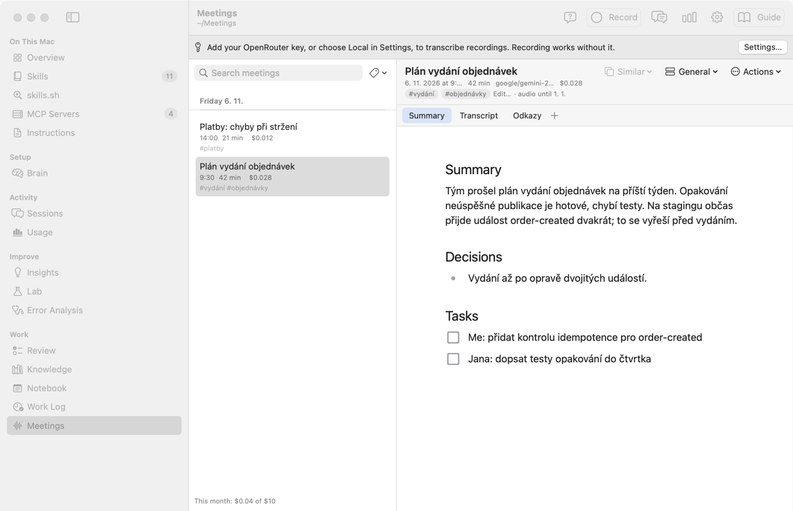
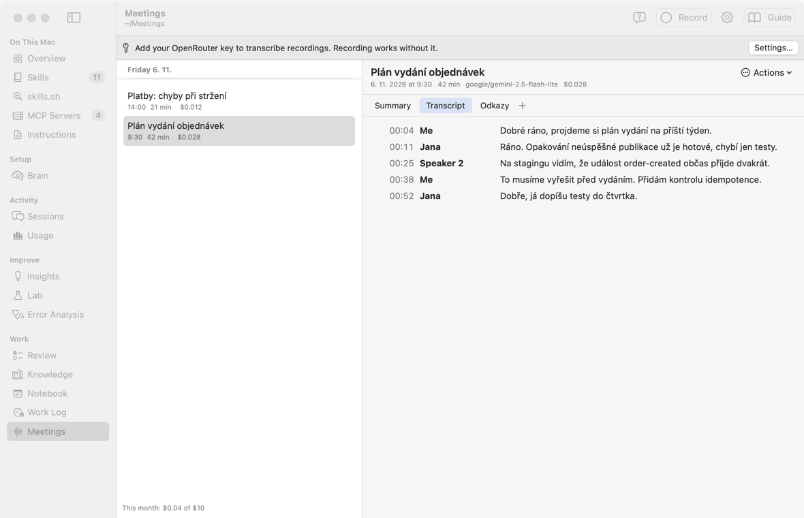
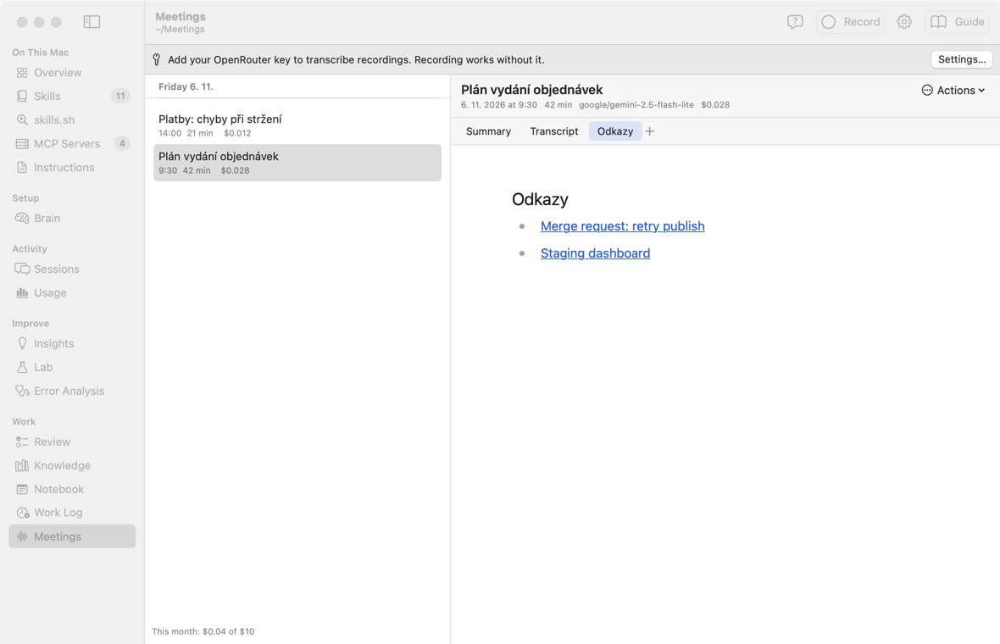
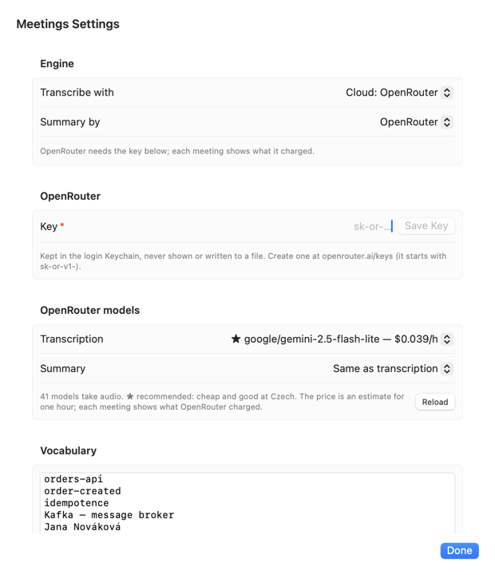

# Встречи: руководство

Это руководство по экрану **Meetings** в группе **Work** бокового меню. Названия кнопок даны по-английски, как на экране.

**Что это простыми словами.** Вы нажимаете **Record** перед звонком или разговором и **Stop** после. AKit записывает всё, что слышит Mac: ваш микрофон и звук системы (голоса в Teams, Zoom, Meet), в том числе в наушниках. После **Stop** модель через OpenRouter пишет текст разговора, краткое содержание, решения и задачи. Рядом можно держать свои вкладки Markdown: заметки, ссылки.

**Кому это нужно:**

- Много встреч за день, и к вечеру трудно вспомнить, кто что обещал.
- Нужны задачи после встречи: кто что делает дальше.
- Разговор идёт на чешском, а заметки удобнее читать коротко.

**Когда это не нужно:**

- Живые субтитры во время звонка. Текст появляется только после **Stop**.
- Запись весь день сама по себе. Запись идёт только от **Record** до **Stop**.

**Сколько стоит.** Цену называет OpenRouter. С моделью `google/gemini-2.5-flash-lite` час записи стоит около $0,04. 3 часа в день × 20 дней — около $2,4 в месяц. У каждой встречи видна её цена, внизу списка — сумма за месяц.

Надписи экрана есть в словаре: [AKit Terms → Meetings](terms#terms-meetings).

## Что на экране
<!-- section: overview -->

**Что это:** слева — встречи по дням, новый день сверху. Справа — открытая встреча и её вкладки.

- Панель инструментов: **Record** (или время записи и **Stop**), **Settings…**, **Guide**.
- Строка встречи: название, время начала, длина, цена. Если встреча не готова — её состояние: `recording`, `waiting`, `transcribing`, `failed`.
- Внизу списка: «This month: $0.04 of $10» — сколько стоили встречи этого месяца и месячный лимит.
- Вверху справа: название встречи, дата, длина, модель, цена и меню **Actions**.
- Вкладки: **Summary**, **Transcript**, ваши вкладки и **+**.
- Если ключа OpenRouter нет: строка «Add your OpenRouter key…» и кнопка **Settings…**. Записывать можно и без ключа.

## Записать встречу
<!-- section: record -->

1. Нажмите **Record** (или ⌥⌘R). В первый раз macOS спросит доступ к микрофону и к записи звука системы. Разрешите оба.
2. Говорите. Вместо **Record** видно время записи и кнопку **Stop**. Можно перейти на другой экран AKit: запись идёт дальше.
3. Нажмите **Stop**. Встреча получает состояние `waiting`, потом `transcribing`. Через минуту-две появляются Summary и Transcript.

**Что записывается:** всё сразу — микрофон и звук системы. Разговор в комнате идёт через микрофон. Голоса из звонка идут из системы, в том числе когда вы в наушниках.

**Эхо.** Если звук идёт из колонок, микрофон тоже его слышит. **Echo cancellation** в настройках убирает этот звук из микрофона. Он включён по умолчанию.

**Без заметных значков.** AKit не ставит значок в строку меню и не мигает красным. Время записи видно только на экране Meetings. Оранжевую точку микрофона рисует сама macOS, её не может скрыть ни одно приложение. Во время звонка она горит и так.

**Заметки во время встречи.** Пока встреча записывается и расшифровывается, вкладка **Summary** закрыта: её напишет модель. Для своих заметок нажмите **New Tab…** или **+**. Если вы правили Summary уже готовой встречи и нажали **Transcribe Again**, ваш текст не пропадёт: он переедет во вкладку **Notes**.

**Если сменились наушники.** Подключили AirPods или начался звонок — AKit сам переключит микрофон и звук системы на новое устройство. Пауза при переключении записывается тишиной. Если переключить не удалось, сверху появится сообщение: нажмите **Stop** и снова **Record**.

**Если AKit закрылся во время записи.** Звук пишется кусками по 5 минут. При следующем запуске AKit соберёт куски и отправит запись на расшифровку. Теряется не больше нескольких секунд. Закрыть окно AKit можно: запись идёт дальше. Выход из AKit (⌘Q) сначала останавливает запись.

## Ссылки и Raycast
<!-- section: links -->

**Что это:** ссылки `akit://` управляют записью из Raycast, закладки или программы горячих клавиш, как ссылки Notebook.

| Ссылка | Что делает |
|---|---|
| `akit://meetings` | открывает экран Meetings |
| `akit://meetings/record` | начинает запись |
| `akit://meetings/stop` | останавливает запись |
| `akit://meetings/toggle` | начинает запись или останавливает её, если она идёт |

Ссылки `record`, `stop` и `toggle` не переключают экран AKit. После них фокус сразу возвращается в приложение, где вы были. Поэтому при показе экрана окно AKit не остаётся впереди. Если окно AKit было закрыто, macOS сначала откроет его, а потом AKit вернёт фокус.

**Пример для Raycast.** Quicklink с адресом `akit://meetings/toggle` и горячей клавишей в настройках Raycast, например ⌃⌥R. Одна клавиша начинает запись, та же клавиша её останавливает.

## Summary и Transcript
<!-- section: tabs -->

**Summary** — краткое содержание (3–5 предложений), **Decisions** — решения, **Tasks** — задачи с флажками: «Me: …», «Jana: …». Это обычная страница Markdown: её можно править, флажки можно ставить.

**Transcript** — текст разговора: время, кто говорит, что сказал. Только для чтения.

- «Me» — это вы: модель знает, когда звучал ваш микрофон.
- Другие люди — «Speaker 1», «Speaker 2» … Меню **Actions** → **Rename Speakers…** даёт им имена. Новые имена появятся и в тексте, и в Summary.

**Язык.** Текст остаётся на языке разговора. Summary и задачи пишутся на языке из настроек, по умолчанию на чешском.

## Свои вкладки
<!-- section: own-tabs -->

**+** справа от вкладок добавляет свою вкладку: страницу Markdown этой встречи. Туда можно писать заметки, ссылки, вставлять картинки. Свои вкладки никогда не уходят в модель.

- Правый щелчок по своей вкладке: **Rename…**, **Delete…**. **Delete…** кладёт файл в Корзину.
- Редактор тот же, что в Notebook: меню блоков по `/`, флажки, ⌘-щелчок открывает ссылку.

## Меню Actions
<!-- section: actions -->

- **Rename Speakers…** — имена для «Me», «Speaker 1» …
- **Transcribe Again** — расшифровать заново, с текущей моделью. Пока аудио есть (14 дней).
- **Show in Finder** — папка встречи.
- **Move to Trash…** — вся встреча в Корзину: Summary, текст, свои вкладки, аудио.

Если расшифровка не удалась, встреча получает состояние `failed`, а сверху видна кнопка **Try Again**. Части, которые уже готовы, не отправляются второй раз.

## Настройки
<!-- section: settings -->

**Settings…** в панели инструментов.

- **Key** — ключ OpenRouter. Создайте его на openrouter.ai/keys, вставьте и нажмите **Save Key**. Ключ хранится в Keychain, на экране его не видно.
- **Transcription** — модель для звука. Список приходит из API OpenRouter: только модели, которые принимают аудио, самые дешёвые сверху. У каждой — примерная цена часа. ★ — рекомендуемые: дешёвые и хорошо понимают чешский. **Reload** запрашивает список заново.
- **Summary** — модель для краткого содержания. По умолчанию та же.
- **Summary and tasks** — язык Summary и задач, по умолчанию Czech.
- **Spoken language** — подсказка модели, на каком языке говорят.
- **Echo cancellation** — убирает звук колонок из микрофона.
- **Folder** — папка встреч, по умолчанию `~/Meetings`.
- **Monthly limit, $** — лимит в месяц, по умолчанию $10. Когда он достигнут, новые расшифровки ждут, а запись работает.

## Файлы
<!-- section: files -->

Каждая встреча — папка `~/Meetings/<дата>/<время>/`:

- `summary.md` — вкладка Summary;
- `transcript.md` — текст разговора;
- `tabs/<имя>.md` — ваши вкладки, картинки в `tabs/assets/`;
- `meeting.json` — состояние, говорящие, цена;
- `audio/` — звук кусками по 5 минут.

**Аудио хранится 14 дней,** потом уходит в Корзину. Текст, Summary и вкладки остаются.

Отдельное приложение `Meetings.app` показывает тот же экран и читает ту же папку, настройки и ключ.
