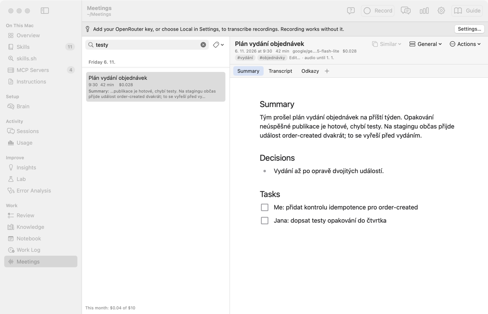
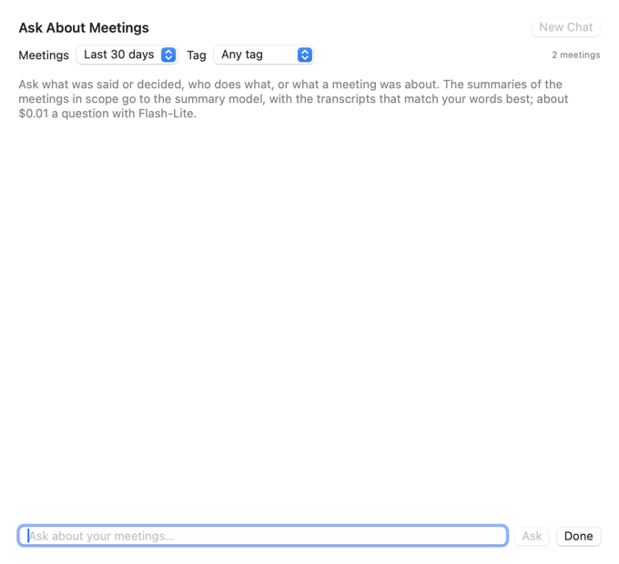
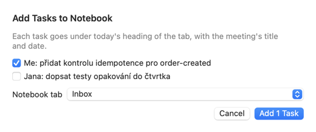
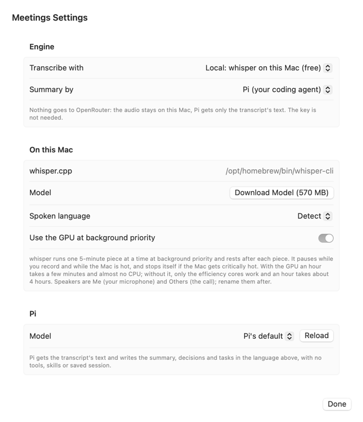
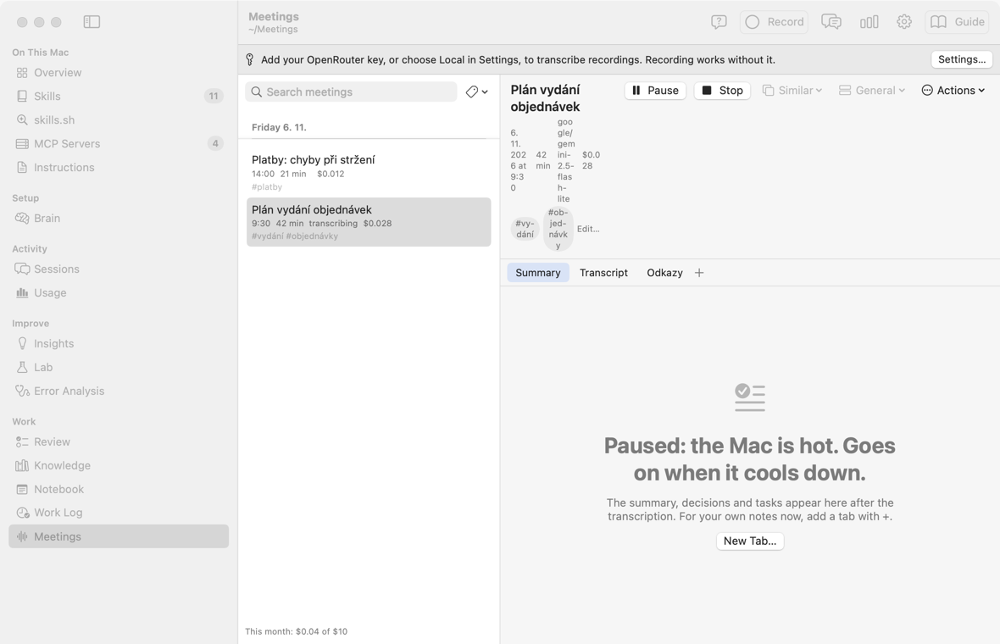
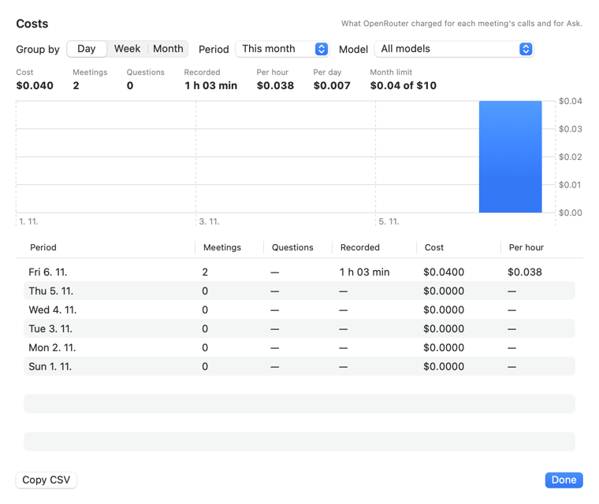

# Встречи: руководство

Это руководство по экрану **Meetings** в группе **Work** бокового меню. Названия кнопок даны по-английски, как на экране.

**Что это простыми словами.** Вы нажимаете **Record** перед звонком или разговором и **Stop** после. AKit записывает всё, что слышит Mac: ваш микрофон и звук системы (голоса в Teams, Zoom, Meet), в том числе в наушниках. После **Stop** модель через OpenRouter пишет текст разговора, краткое содержание, решения и задачи. Можно и без облака: текст пишет whisper на этом Mac, а краткое содержание — Pi (см. [На этом Mac](meetings#local)). Рядом можно держать свои вкладки Markdown: заметки, ссылки.

**Кому это нужно:**

- Много встреч за день, и к вечеру трудно вспомнить, кто что обещал.
- Нужны задачи после встречи: кто что делает дальше.
- Разговор идёт на чешском, а заметки удобнее читать коротко.

**Когда это не нужно:**

- Живые субтитры во время звонка. Текст появляется только после **Stop**.
- Запись весь день сама по себе. Запись идёт только от **Record** до **Stop**.

**Сколько стоит.** Цену называет OpenRouter. С моделью `google/gemini-2.5-flash-lite` час записи стоит около $0,04. 3 часа в день × 20 дней — около $2,4 в месяц. У каждой встречи видна её цена, внизу списка — сумма за месяц.

Надписи экрана есть в словаре: [AKit Terms → Meetings](terms#terms-meetings).

## Что на экране
<!-- section: overview -->

**Что это:** слева — встречи по дням, новый день сверху. Справа — открытая встреча и её вкладки.

- Панель инструментов: **Record** (или время записи и **Stop**), **Settings…**, **Guide**.
- Строка встречи: название, время начала, длина, цена. Если встреча не готова — её состояние: `recording`, `waiting`, `transcribing`, `failed`.
- Внизу списка: «This month: $0.04 of $10» — сколько стоили встречи этого месяца и месячный лимит.
- Вверху справа: название встречи, дата, длина, модель, цена и меню **Actions**.
- Вкладки: **Summary**, **Transcript**, ваши вкладки и **+**.
- Если ключа OpenRouter нет: строка «Add your OpenRouter key…» и кнопка **Settings…**. Записывать можно и без ключа.

## Записать встречу
<!-- section: record -->

1. Нажмите **Record** (или ⌥⌘R). В первый раз macOS спросит доступ к микрофону и к записи звука системы. Разрешите оба.
2. Говорите. Вместо **Record** видно время записи, кнопку **Stop** и две живые волны: значок микрофона — ваш голос и комната, значок динамика — звук Mac (звонок). Волна колеблется, когда звук идёт, и становится прямой линией в тишине. Прямая линия у динамика во время звонка значит, что звук системы не записывается. Можно перейти на другой экран AKit: запись идёт дальше.
3. Нажмите **Stop**. Встреча получает состояние `waiting`, потом `transcribing`. Через минуту-две появляются Summary и Transcript.

**Что записывается:** всё сразу — микрофон и звук системы. Разговор в комнате идёт через микрофон. Голоса из звонка идут из системы, в том числе когда вы в наушниках.

**Наушники и комната вместе.** Микрофон (вы и люди рядом) и звук системы (звонок в наушниках) пишутся раздельно. Обычно в модель уходит одна смешанная дорожка. Если в получасовом куске люди в комнате и в звонке говорят одновременно дольше 3 секунд, этот кусок уходит двумя дорожками отдельно, и строки сливаются по времени. Так голоса не теряются, когда двое говорят вместе. Люди в комнате подписаны «Room 1», «Room 2», люди из звонка — «Speaker 1», «Speaker 2». Настройка **Tracks** в Settings.

**Эхо.** Если звук идёт из колонок, микрофон тоже его слышит. **Echo cancellation** в настройках убирает этот звук из микрофона. Он включён по умолчанию.

**Без заметных значков.** AKit не ставит значок в строку меню и не мигает красным. Время записи видно только на экране Meetings. Оранжевую точку микрофона рисует сама macOS, её не может скрыть ни одно приложение. Во время звонка она горит и так.

**Заметки во время встречи.** Пока встреча записывается и расшифровывается, вкладка **Summary** закрыта: её напишет модель. Для своих заметок нажмите **New Tab…** или **+**. Если вы правили Summary уже готовой встречи и нажали **Transcribe Again**, ваш текст не пропадёт: он переедет во вкладку **Notes**.

**Если сменились наушники.** Подключили AirPods или начался звонок — AKit сам переключит микрофон и звук системы на новое устройство. Пауза при переключении записывается тишиной. Если переключить не удалось, сверху появится сообщение: нажмите **Stop** и снова **Record**.

**Если AKit закрылся во время записи.** Звук пишется кусками по 5 минут. При следующем запуске AKit соберёт куски и отправит запись на расшифровку. Теряется не больше нескольких секунд. Закрыть окно AKit можно: запись идёт дальше. Выход из AKit (⌘Q) сначала останавливает запись.

## Ссылки и Raycast
<!-- section: links -->

**Что это:** ссылки `akit://` управляют записью из Raycast, закладки или программы горячих клавиш, как ссылки Notebook.

| Ссылка | Что делает |
|---|---|
| `akit://meetings` | открывает экран Meetings |
| `akit://meetings/record` | начинает запись |
| `akit://meetings/stop` | останавливает запись |
| `akit://meetings/toggle` | начинает запись или останавливает её, если она идёт |

Ссылки `record`, `stop` и `toggle` не переключают экран AKit. После них фокус сразу возвращается в приложение, где вы были. Поэтому при показе экрана окно AKit не остаётся впереди. Если окно AKit было закрыто, macOS сначала откроет его, а потом AKit вернёт фокус.

**Пример для Raycast.** Quicklink с адресом `akit://meetings/toggle` и горячей клавишей в настройках Raycast, например ⌃⌥R. Одна клавиша начинает запись, та же клавиша её останавливает.

## Summary и Transcript
<!-- section: tabs -->

**Summary** — краткое содержание (3–5 предложений), **Decisions** — решения, **Tasks** — задачи с флажками: «Me: …», «Jana: …». Это обычная страница Markdown: её можно править, флажки можно ставить.

**Transcript** — текст разговора: время, кто говорит, что сказал. Только для чтения.

- «Me» — это вы: модель знает, когда звучал ваш микрофон.
- Другие люди — «Speaker 1», «Speaker 2» … Меню **Actions** → **Rename Speakers…** даёт им имена. Новые имена появятся и в тексте, и в Summary.

**Язык.** Текст остаётся на языке разговора. Summary и задачи пишутся на языке из настроек, по умолчанию на чешском.

## Шаблоны
<!-- section: templates -->

Шаблон говорит, какие разделы будут в Summary кроме **Summary**, **Decisions** и **Tasks**. Меню шаблона — в шапке встречи, слева от **Actions**.

| Шаблон | Разделы |
|---|---|
| General | только Summary, Decisions, Tasks |
| 1:1 | отзывы, заботы, рост |
| Standup | по человеку: сделано, дальше, что мешает; блокеры |
| Client call | что нужно клиенту, его вопросы с ответами, наши обещания |
| Interview | кандидат, сильные стороны, сомнения, рекомендация |
| Retro | что было хорошо, что плохо, идеи |

- Новая встреча берёт шаблон из настроек (**Template of a new meeting**).
- Шаблон можно сменить во время записи или после. Если встреча уже готова, Summary пишется заново: один текстовый запрос по тексту разговора, без звука, около $0.001.
- **Actions** → **Summarize Again** пишет Summary заново с тем же шаблоном.
- Свой шаблон: **Settings…** → **Summary** → **Add Template**. Имя и разделы, по одному на строку: `Заголовок: что туда писать`.

**Чистый текст.** По умолчанию в Transcript нет «э-э», «ну», повторов и оборванных фраз; слова со смыслом остаются. **Settings…** → **Transcript** → **Text**: **Clean: no filler words or repeats** (по умолчанию) или **Word for word** — всё дословно. Цена та же.

## Поиск и теги
<!-- section: search -->

Поле **Search meetings** над списком ищет по всем встречам: в названии, тегах, Summary, тексте разговора и своих вкладках. Регистр и диакритика не важны: `plan` находит «Plán». Под встречей видно, где нашлось: «Summary: …», «Transcript: …» или имя своей вкладки.

- Слова можно писать в любом порядке: встреча подходит, если в ней есть все слова.
- `#тег` показывает встречи с этим тегом: `#platby`. Можно вместе со словами: `#platby banka`.
- Кнопка с ярлыком справа от поля — список всех тегов с числом встреч.

**Теги.** Под названием встречи — её теги. Щелчок по тегу показывает все встречи с ним. **Edit…** (или **Add Tags…**) — теги через запятую. Если у встречи ещё нет тегов, модель предлагает 1–3 вместе с Summary. Если вы удалили все теги, новые сами не появятся.

Поиск работает на этом Mac, ничего не отправляется.

## Вопросы по встречам
<!-- section: ask -->

**Ask…** в панели инструментов открывает чат по встречам. Пример: «Что решили про релиз на этой неделе?» или «Какие задачи у меня с прошлого понедельника?».

- **Meetings** — какие встречи смотреть: **This meeting**, **Last 7 days**, **Last 30 days**, **All meetings**. **Tag** — только встречи с этим тегом. Справа видно, сколько встреч подходит.
- В модель уходят Summary всех этих встреч и тексты разговоров, где больше всего ваших слов. Модель — та, что пишет Summary. Вопрос с Flash-Lite стоит около $0.01.
- Ответ на языке вопроса. Метки `[1]`, `[2]` — ссылки: щелчок открывает встречу. Под ответом — список этих встреч.
- Следующий вопрос продолжает разговор: модель видит прежние ответы. **New Chat** начинает заново; смена **Meetings** или **Tag** тоже.
- **Actions** → **Ask About This Meeting…** — чат только по этой встрече.

Вопросы считаются в месячном лимите и видны в **Costs…** в столбце **Questions**. Текст вопросов и ответов не сохраняется.

**Similar** в шапке встречи — до 5 похожих встреч: по словам названия, тегов и Summary. Считается на этом Mac, бесплатно. Если похожих нет, кнопка серая.

## Свои вкладки
<!-- section: own-tabs -->

**+** справа от вкладок добавляет свою вкладку: страницу Markdown этой встречи. Туда можно писать заметки, ссылки, вставлять картинки. Свои вкладки никогда не уходят в модель.

- Правый щелчок по своей вкладке: **Rename…**, **Delete…**. **Delete…** кладёт файл в Корзину.
- Редактор тот же, что в Notebook: меню блоков по `/`, флажки, ⌘-щелчок открывает ссылку.

## Встреча в Notebook, Work Log и базе знаний
<!-- section: akit-links -->

В меню **Actions** готовой встречи — три пункта, которые связывают её с остальным AKit. Все три пишут в базу знаний, которую показывает экран Knowledge.

- **Add Tasks to Notebook…** — открытые задачи из Summary. Ваши («Me») уже отмечены. Выберите вкладку Notebook (**Notebook tab**) и нажмите **Add 1 Task** (число — сколько задач отмечено). Задачи появятся под сегодняшней датой, с названием встречи: `- [ ] přidat kontrolu idempotence — Plán vydání objednávek, 6. 11.`
- **Add to Work Log** — строка `#meeting` во время начала встречи: название и два первых предложения Summary. После этого пункт называется **Add to Work Log Again**.
- **Propose to Knowledge…** — модель Summary читает встречу и названия заметок базы и находит факты о сервисах, событиях, репозиториях и владельцах. Отметьте нужные и нажмите **Send N to Inbox** (N — сколько отмечено). **Find Again** спрашивает модель заново. Они ждут на экране Knowledge → **Inbox**, пока вы их не примете. Один запрос, около $0.002; цена добавляется к встрече.

В отдельном `Meetings.app` этих пунктов нет.

## Меню Actions
<!-- section: actions -->

- **Ask About This Meeting…** — вопросы только по этой встрече (см. «Вопросы по встречам»).
- **Rename Speakers…** — имена для «Me», «Speaker 1» …
- **Summarize Again** — написать Summary заново по готовому тексту. Без звука, поэтому и после 14 дней. Только для готовой встречи: если часть не расшифрована, сначала **Try Again**.
- **Add Tasks to Notebook…**, **Add to Work Log**, **Propose to Knowledge…** — см. выше.
- **Transcribe Again** — расшифровать заново, с текущей моделью. Пока аудио есть (14 дней).
- **Show in Finder** — папка встречи.
- **Move to Trash…** — вся встреча в Корзину: Summary, текст, свои вкладки, аудио.

Если расшифровка не удалась, встреча получает состояние `failed`, а сверху видна кнопка **Try Again**. Части, которые уже готовы, не отправляются второй раз.

## Настройки
<!-- section: settings -->

**Settings…** в панели инструментов.

- **Engine** — кто пишет текст (**Transcribe with**) и кто пишет Summary (**Summary by**): OpenRouter, или whisper и Pi на этом Mac. См. [На этом Mac](meetings#local).
- **Key** — ключ OpenRouter. Создайте его на openrouter.ai/keys, вставьте и нажмите **Save Key**. Ключ хранится в Keychain, на экране его не видно.
- **OpenRouter models** → **Transcription** — модель для звука. Список приходит из API OpenRouter: только модели, которые принимают аудио, самые дешёвые сверху. У каждой — примерная цена часа. ★ — рекомендуемые: дешёвые и хорошо понимают чешский. **Reload** запрашивает список заново.
- **Summary** — модель для краткого содержания. По умолчанию та же.
- **Summary and tasks** — язык Summary и задач, по умолчанию Czech.
- **Spoken language** — подсказка модели, на каком языке говорят.
- **Template of a new meeting**, **Add Template** — шаблон новой встречи и свои шаблоны (см. «Шаблоны»).
- **Text** — **Clean: no filler words or repeats** (по умолчанию) или **Word for word** (дословно).
- **Tracks** — как звук уходит в модель. **Auto** (по умолчанию): одна дорожка, а две отдельно — только там, где голоса комнаты и звонка накладываются. **Mixed**: всегда одна, дешевле всего. **Separate**: всегда две, вдвое дороже.
- **Echo cancellation** — убирает звук колонок из микрофона.
- **Folder** — папка встреч, по умолчанию `~/Meetings`.
- **Monthly limit, $** — лимит в месяц, по умолчанию $10. Когда он достигнут, новые расшифровки ждут, а запись работает.

## На этом Mac
<!-- section: local -->

**Что это:** звук не уходит в облако. Текст разговора пишет whisper на вашем Mac, а Summary, решения и задачи пишет Pi — ваш агент. Бесплатно, ключ OpenRouter не нужен.

**Как включить:**

1. **Settings…** → раздел **Engine**.
2. **Transcribe with** → **Local: whisper on this Mac (free)**.
3. **Summary by** → **Pi (your coding agent)**. Можно оставить **OpenRouter**: тогда в облако уходит только текст.
4. В разделе **On this Mac** нажмите **Install whisper.cpp** (ставит `whisper-cpp` через Homebrew) и **Download Model (570 MB)**.
5. В разделе **Pi** выберите **Model**. **Pi's default** — модель Pi по умолчанию.

**Как это работает, чтобы Mac не тормозил:**

- whisper берёт по одному куску записи (5 минут) и после каждого куска отдыхает столько же, сколько работал (не больше минуты).
- Он работает с фоновым приоритетом: на видеокарте и экономных ядрах, ваши программы идут первыми.
- Пока идёт новая запись, он ждёт и продолжает после **Stop**.
- Если Mac горячий, он ждёт, пока Mac остынет.
- Если Mac перегрелся совсем (critical), он сам останавливается.
- Встречи обрабатываются по одной.

**Кнопки во время работы** (вверху справа у встречи):

- **Pause** — пауза. Ничего не теряется. **Resume** — продолжить.
- **Stop** — сразу убить whisper или Pi. Готовые куски остаются. **Try Again** продолжит со следующего куска.

**Настройки раздела On this Mac:**

- **Spoken language** — язык речи для whisper. **Detect** определяет язык по каждому куску. Если речь почти всегда на чешском, выберите **Czech**: так меньше ошибок.
- **Use the GPU at background priority** — включено по умолчанию: час записи — несколько минут, процессор почти не занят. Выключено: работают только экономные ядра, час записи — около 4 часов.

**Пример.** Звонок на час на чешском. После **Stop** whisper за несколько минут пишет 12 кусков, Pi пишет Summary. Цена встречи — $0.

**Что учесть:**

- whisper не различает голоса. Говорящих двое: **Me** (ваш микрофон) и **Others** (звук звонка). Имена можно дать через **Rename Speakers…**.
- Pi получает только текст разговора, без звука. Если у модели Pi истёк ключ, встреча получает `failed` с причиной. Исправьте модель в **Pi** → **Model** и нажмите **Try Again**.

## Расходы
<!-- section: costs -->

**Costs…** в панели инструментов показывает, сколько OpenRouter списал за встречи и за вопросы **Ask…**.

- **Group by** — по дням (**Day**), неделям (**Week**, с понедельника) или месяцам (**Month**).
- **Period** — **This week**, **This month**, **Last 30 days**, **Last 3 months**, **This year**, **All time** или **Custom** со своими датами **From** и **To**.
- **Model** — все модели или одна.
- Сверху итоги: **Cost**, **Meetings**, **Questions** (вопросы Ask), **Recorded**, **Per hour** (цена часа записи), **Per day**, **Month limit**.
- График и таблица по периодам. Пустые дни тоже видны, с нулём.
- **Copy CSV** копирует таблицу для Numbers или Excel: период, встречи, часы, доллары, доллары в час, вопросы.

## Файлы
<!-- section: files -->

Каждая встреча — папка `~/Meetings/<дата>/<время>/`:

- `summary.md` — вкладка Summary;
- `transcript.md` — текст разговора;
- `tabs/<имя>.md` — ваши вкладки, картинки в `tabs/assets/`;
- `meeting.json` — состояние, говорящие, шаблон, теги, цена;
- `audio/` — звук кусками по 5 минут.

В самой папке `~/Meetings` файл `.asks.jsonl` — цена каждого вопроса **Ask…**: дата, модель, токены. Без текста.

**Аудио хранится 14 дней,** потом уходит в Корзину. Текст, Summary и вкладки остаются.

Отдельное приложение `Meetings.app` показывает тот же экран и читает ту же папку, настройки и ключ.
