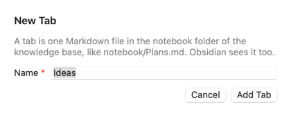

# Блокнот: руководство

Это руководство по экрану **Notebook** в группе **Work** бокового меню. Названия кнопок даны по-английски, как на экране.

**Что такое блокнот простыми словами.** Это место для мелкого текста рабочего дня: короткие заметки, планы, список дел, «что я сделал сегодня». Одна вкладка — один файл Markdown. Файлы лежат в базе знаний, в папке `notebook/` рядом с `areas/`. Obsidian видит их тоже. AKit сам делает коммиты правок в git базы.

**Кому это нужно:**

- Вы держите план дня в голове или на бумаге и хотите видеть его рядом с агентами.
- Вы хотите в конце дня видеть, что сделали.
- Вы хотите попросить агента: «добавь в план» или «отметь, что сделано».

**Когда это не нужно:**

- Вам нужны сроки, напоминания и исполнители. Блокнот — не менеджер задач.
- Знание о системе (какой сервис что делает) — это заметка на экране **Knowledge**, не запись в блокноте.

**Как построено руководство.** Части идут от простого к сложному: что на экране, писать, задачи, картинки и ссылки, «сегодня», вкладки, где лежат файлы, агент и блокнот, тонкости. Надписи экрана есть в словаре: [AKit Terms → Notebook](terms#terms-notebook).

## Что на экране
<!-- section: overview -->

**Что это:** экран **Notebook** показывает блокнот базы знаний. Если баз несколько, список **Base** в панели инструментов выбирает базу. Это та же база, что на экране **Knowledge**.

- Сверху — вкладки, например **Inbox** и **Plans**, и кнопка **+** (новая вкладка).
- Под ними — путь файла вкладки, например `notebook/Inbox.md`, и кнопка папки (**Show in Finder**).
- Ниже — редактор: заголовки, списки, задачи с флажками, картинки, ссылки, таблицы, код.
- Панель инструментов: **Today**, **New Tab…**, **Guide**.

Если базы нет, экран пишет «No knowledge base» и даёт кнопку **Open Knowledge**: базу создают там ([Создать базу](knowledge#create)).

![Экран Notebook: вкладки Inbox и Plans и кнопка плюс, путь notebook/Inbox.md, заголовок 2026-10-25 с задачами: отмеченная «Answer the question about refunds in [[billing]]» со ссылкой, неотмеченные «Check why order-created events arrive twice» и «Read the retry policy» со ссылкой https://example.com/retries, картинка схемы orders-api → billing с подписью order created (twice?), ниже заголовок 2026-10-24 с двумя отмеченными задачами](images/notebook.png)

## Писать
<!-- section: write -->

**Что это:** редактор показывает Markdown сразу оформленным. Пишите как в обычном тексте. Сохранять не нужно.

**Как пользоваться:**

1. Нажмите в текст и пишите.
2. В начале пустой строки нажмите `/`: появится меню блоков — заголовки, списки, задача, цитата, таблица, картинка, код.
3. Выделите слово: появится панель — жирный, курсив, код, ссылка.
4. Markdown тоже работает: `## ` — заголовок, `- ` — список, `[ ] ` — задача, `> ` — цитата.

**Как сохраняется:** AKit пишет файл через 0,8 секунды после последней правки. Открытие вкладки файл не меняет. Коммит в git базы AKit делает сам: через 5 минут без правок, при смене базы и при выходе из AKit. Подробнее о коммитах: [Коммиты правок](knowledge#commits).

> **Важно:** редактор пишет Markdown по-своему. Маркеры `*` и `+` становятся `-`, два пробела в конце строки — `\`, у картинки пропадает подпись: `` становится ``. Это происходит только когда вы правите вкладку, не при открытии.

## Задачи
<!-- section: tasks -->

**Что это:** задача — строка с флажком. В файле это `- [ ] текст`, отмеченная — `- [x] текст`.

**Как пользоваться:**

- Новая задача: в начале строки наберите `[ ] ` или выберите задачу в меню `/`.
- Отметить: нажмите на флажок. Файл сохраняется сразу.
- Вложенная задача: нажмите Tab в начале строки.

**Пример:**

```markdown
- [x] Answer the question about refunds in [[billing]]
- [ ] Check why order-created events arrive twice
```

## Картинки и ссылки
<!-- section: images-links -->

**Картинки.** Вставьте снимок экрана (⌘V) или перетащите файл в текст. AKit сохраняет картинку в `notebook/assets/` с датой и коротким хешем в имени, например `assets/2026-10-25-3f9a1c2b.png`. В тексте появляется ``. Одна и та же картинка дважды — один файл. Подходят png, jpg, gif, webp, heic, svg и pdf, до 20 МБ.

**Ссылки.** ⌘-щелчок по ссылке открывает её:

- `https://…` — в браузере по умолчанию.
- `[[заметка]]`, например `[[billing]]`, — заметку на экране **Knowledge**. Такие ссылки подчёркнуты точками.

Простой щелчок ставит курсор, чтобы ссылку можно было править.

> **Важно:** редактор не грузит ничего из интернета. Картинка по ссылке `https://…` не покажется. Сохраните её и вставьте файлом.

## Сегодня: Today
<!-- section: today -->

**Что это:** кнопка **Today** ставит наверх вкладки заголовок с сегодняшней датой, например `## 2026-10-26`, и курсор под ним. Так вкладка становится журналом: новый день сверху, по одному файлу на всю историю.

**Как пользоваться:**

1. Откройте вкладку журнала, например **Inbox**.
2. Нажмите **Today** в панели инструментов.
3. Пишите, что сделали или что надо сделать.

Если заголовок этого дня уже есть, **Today** только ставит курсор под него. Если вкладка начинается с заголовка `# Название`, дата встаёт под ним.

![Вкладка Inbox после Today: наверху новый заголовок 2026-10-26 и пустая строка с подсказкой «Type / for blocks, [ ] for a task», ниже прежний день 2026-10-25 с задачами и картинкой](images/notebook-today.png)

## Вкладки
<!-- section: tabs -->

**Что это:** вкладка — файл `notebook/<имя>.md`. Порядок вкладок AKit хранит в `notebook/.tabs.json`.

- **Новая:** **New Tab…** или **+**, введите имя, например `Ideas`, нажмите **Add Tab**. Коммит сразу.
- **Переименовать:** правый щелчок по вкладке → **Rename…**. Файл получает новое имя, вкладка остаётся на месте. Один коммит.
- **Удалить:** правый щелчок → **Delete…** → **Move to Trash**. Файл уходит в Корзину, удаление попадает в коммит. Картинки остаются в `assets/`.
- **Переставить:** перетащите вкладку на другую. Коммит сразу.

В имени нельзя `/ \ : * ? " < > | # ^ [ ]` и точку в начале.

Новый блокнот показывает одну вкладку **Inbox**. Её файл появляется после первой правки.



![Вкладка Plans: заголовок Plans, раздел This week с задачами «Split [[orders-api]] events by version» и «Ask logistics about the new warehouse», раздел Later с таблицей What и Who: Faster refunds — billing, Track parcels live — shipping](images/notebook-plans.png)

## Где лежат файлы и Obsidian
<!-- section: files -->

Блокнот — папка `notebook/` в базе знаний:

```
<база>/
  areas/           заметки о системах
  notebook/
    Inbox.md       вкладка
    Plans.md       вкладка
    .tabs.json     порядок вкладок
    assets/        картинки
```

Если база лежит в vault Obsidian ([Папка базы и Obsidian](knowledge#folder)), Obsidian показывает вкладки как обычные заметки. Правьте где удобно.

**Если файл изменился снаружи** (Obsidian, агент, git): если вы его в AKit не правили, AKit просто покажет новую версию. Если у вас есть несохранённая правка, AKit спросит «Changed on disk»:

- **Reload** — показать версию с диска, ваша правка пропадёт.
- **Keep Mine** — сохранить вашу версию, а версию с диска положить в `~/.akit/backups`.

Поиск по базе (`akit kb search`), проверка **Lint** и карточка агента (`akit kb context`) блокнот не читают: в нём планы, а не знания о системах.

## Агент и блокнот
<!-- section: agents -->

**Что это:** команды `akit notebook` дают агенту то же, что экран. Навык `/akit` их знает. Агент пишет в блокнот, только если вы попросили в этой сессии.

```
akit notebook tabs                         # вкладки и число открытых задач
akit notebook show Inbox --open            # открытые задачи вкладки
akit notebook add Inbox "call the bank" --task --today
                                           # задача под сегодняшней датой
akit notebook done Inbox "bank"            # отметить первую подходящую задачу
```

У всех команд есть `--json`. `add` и `done` сразу делают коммит.

**Пример:** вы пишете агенту «добавь в мой блокнот: проверить ретраи». Агент запускает `akit notebook add Inbox "проверить ретраи" --task --today`. Если вкладка **Inbox** открыта в AKit без ваших правок, AKit сразу покажет новую строку.

## Тонкости
<!-- section: details -->

- Frontmatter (`---` в начале файла) редактор не показывает, но сохраняет как был.
- Пустые строки в журнале редактор не хранит: пустой абзац под заголовком не попадает в файл.
- Имя вкладки — имя файла. Регистр букв при поиске вкладки командой не важен: `inbox` найдёт `Inbox`.
- Неиспользуемые картинки AKit пока не удаляет: они остаются в `notebook/assets/`.
