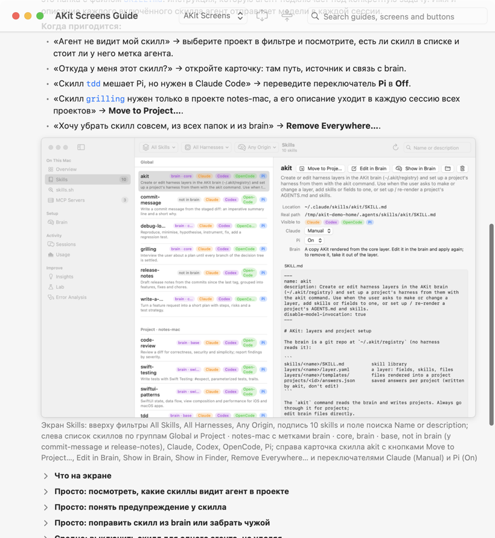
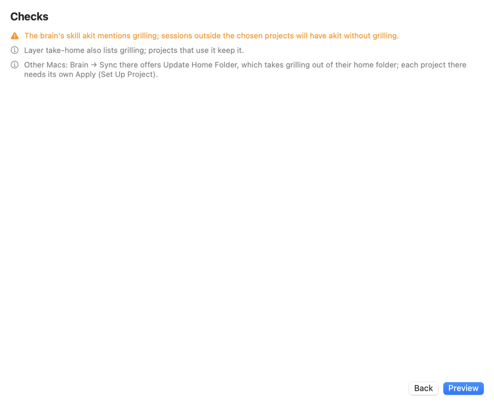
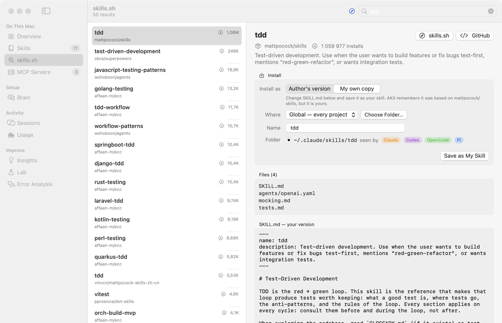
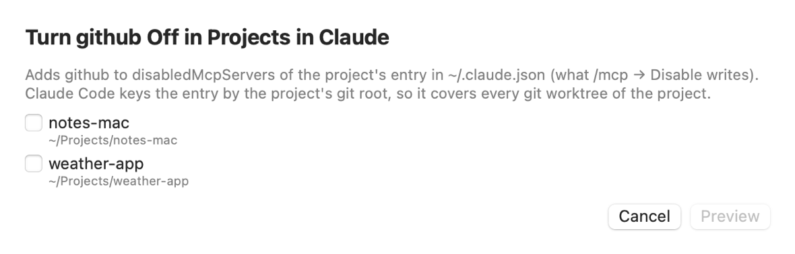
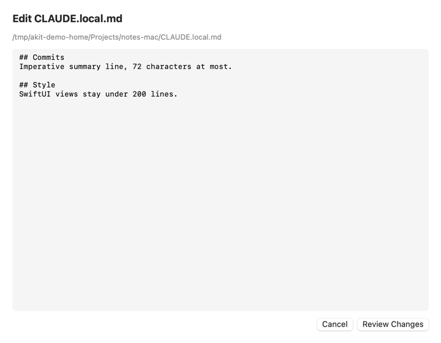
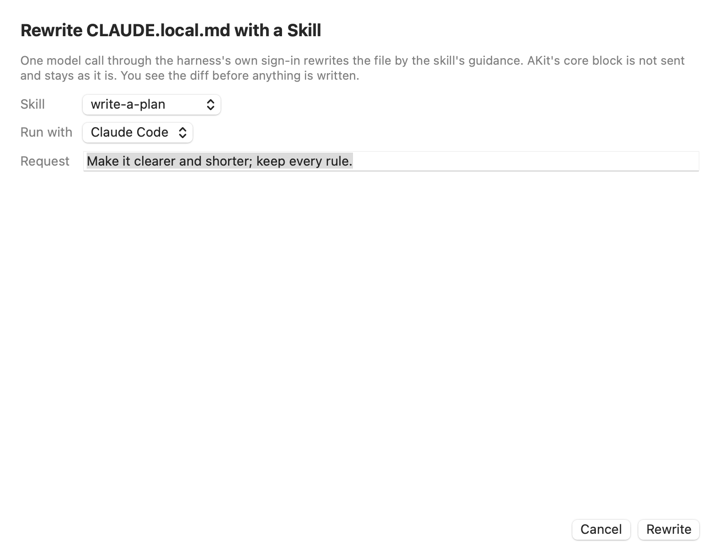
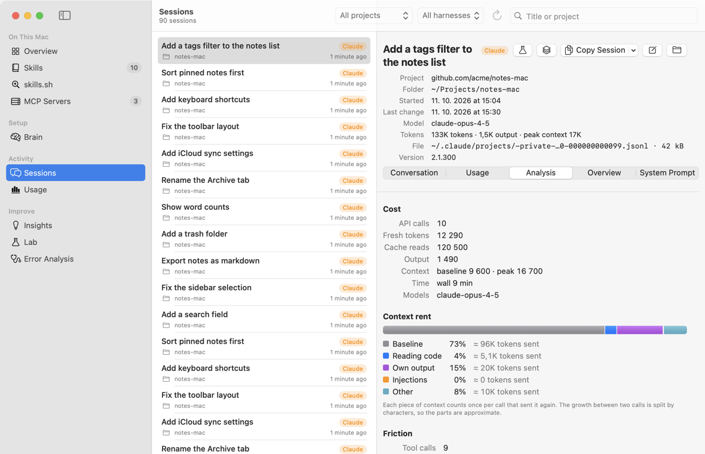
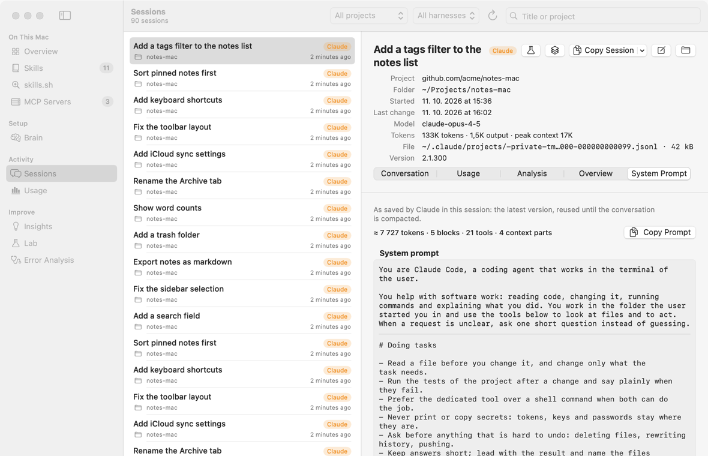
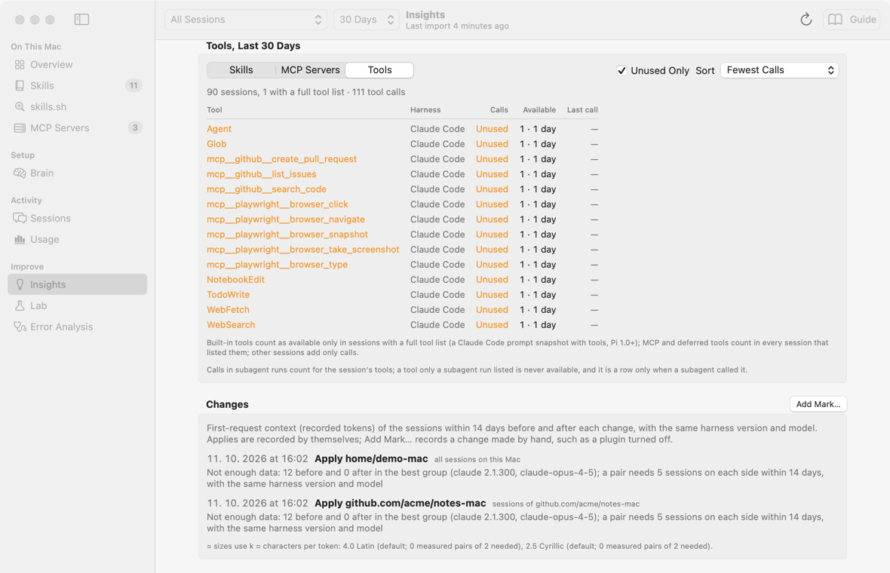
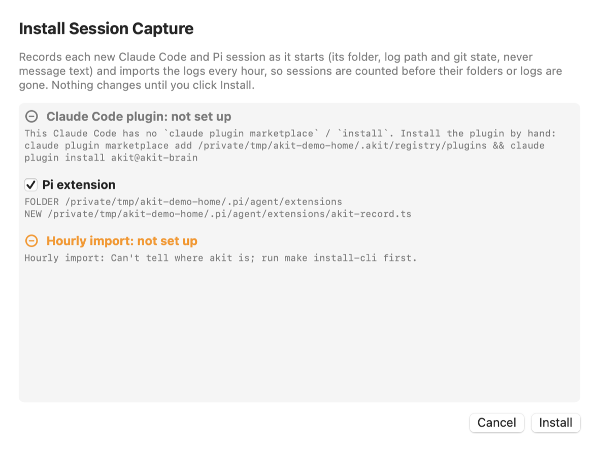

# AKit: руководство по экранам

AKit — приложение для Mac. Оно показывает в одном месте всё, с чем работают ваши ИИ-агенты для кода (Claude Code, Pi, Codex, OpenCode): скиллы, MCP-серверы, сессии и расходы. Оно же настраивает агентов для каждого проекта из вашего brain, приватного git-репозитория со скиллами и слоями.

Руководство написано для человека, который видит AKit впервые. Знать устройство агентов заранее не нужно: слова объяснены в разделе [С чего начать](#start). Названия кнопок, вкладок и полей даны по-английски, как на экране.

Каждый экран описан одинаково. Сначала идёт «Что это» и «Когда пригодится» с примерами из жизни. Потом «Что на экране»: каждая часть и каждая кнопка. Потом задачи от «Просто» к «Сложно», со снимками экрана. Редкие случаи собраны в конце, в «Тонкости и редкие случаи».

Открыть руководство можно кнопкой **Screens Guide** на экране Overview, через Help → **AKit Screens Guide** или правым щелчком по пункту бокового меню → **What Is … For?**. Наведите курсор на пункт меню или на заголовок группы, и появится подсказка в одну строку. Раздел открывается и закрывается щелчком по заголовку.

Help → **Copy Diagnostics** кладёт в буфер обмена отчёт о том, что AKit видит на этом Mac: brain, агенты, проекты, их worktree и что не так (то же, что `akit doctor`, без секретов). Его можно вставить агенту или в сообщение об ошибке. Внизу окна появится строка «Diagnostics copied…».

## С чего начать
<!-- section: start -->

Здесь четыре коротких темы: слова, маршрут по экранам, поиск по руководству и что AKit меняет на диске. Прочитайте слова и маршрут, остальное откроете, когда понадобится.

### Слова, без которых дальше непонятно
<!-- section: start-words -->

- **Агент** (на экране **Harness**): программа, которая пишет код вместе с моделью. Примеры: Claude Code, Pi, Codex, OpenCode. В руководстве «агент» и «харнесс» значат одно и то же.
- **Скилл**: папка с файлом `SKILL.md`, в котором написано, как делать одну работу. Пример: скилл `tdd` объясняет агенту, как писать тесты до кода.
- Как скилл срабатывает: модель видит его имя и описание и сама решает, когда его взять. Вы можете вызвать его сами через `/tdd`.
- **MCP-сервер**: программа или адрес в сети, который даёт агенту новые инструменты. Пример: сервер GitHub даёт инструменты для задач и пул-реквестов.
- **Сессия**: один разговор с агентом, который агент сам записал в файл. AKit читает эти файлы и не меняет их.
- **Проект**: папка с кодом, в которой вы запускаете агента. Пример: `~/Projects/weather-app`. Где искать проекты, задаёт [Settings](#settings) → **Project folders**.
- **Brain**: ваш приватный git-репозиторий (`~/.akit/registry`) со скиллами и слоями. Агенты его не читают: AKit собирает из него файлы для проектов и для домашней папки.
- **Слой** (layer): часть настройки в brain, которую можно применить к нескольким проектам. Пример: слой `swiftui` со скиллами и правилами для приложений на SwiftUI.
- Слой `core` особый: он ставится не в проект, а в домашнюю папку. Поэтому его скиллы есть во всех проектах на этом Mac.
- **Worktree**: вторая рабочая папка того же git-репозитория, для другой ветки. Git переносит в неё только файлы под git.
- **Local-only**: способ хранить файлы AKit в проекте так, чтобы git их не показывал. AKit пишет их пути в `.git/info/exclude`, а агенты их всё равно читают. Пример: рабочий проект, в который нельзя коммитить `AGENTS.md`.

### Маршрут: от простого к сложному
<!-- section: start-route -->

Идите по шагам по порядку. Шаги 1–4 только показывают: на диске ничего не меняется. Шаги 5–8 меняют файлы, и перед записью AKit показывает, что изменится. Шаг 9 начинается с просмотра; его кнопки меняют brain после показа diff. Шаги 10–11 отправляют данные сессий модели и стоят денег.

1. [Overview](#overview): узнаете, какие агенты установлены на этом Mac, их версии и папки с настройками. Только просмотр.
2. [Skills](#skills): посмотрите, какие скиллы видит каждый агент и откуда каждый взялся. Пока вы только выбираете скиллы в списке, ничего не меняется.
3. [Sessions](#sessions): найдёте вчерашний разговор с агентом и откроете его. Только просмотр.
4. [Usage](#usage): увидите, сколько токенов и денег ушло за неделю или месяц. Только просмотр.
5. [Skills](#skills): выключите один скилл для одного агента переключателем **Claude** или **Pi**. AKit показывает diff одной записи в настройках агента. **Apply** сначала копирует файл в `~/.akit/backups`.
6. [skills.sh](#skillsSh): найдёте готовый скилл в публичном каталоге и поставите его. На диске появляется новая папка скилла; diff здесь нет.
7. [MCP Servers](#mcp): добавите MCP-сервер из формы или из каталога. **Preview…** показывает изменение файла настроек, записывает его только **Apply**.
8. [Brain](#brain): настроите проект одним шагом кнопкой **Set Up Project…**. Каждое изменение видно как diff, записывает его только **Apply**.
9. [Insights](#insights): найдёте скиллы, MCP-серверы и инструменты, которыми модель не пользуется. Просмотр ничего не отправляет; кнопки **Apply…** и **Commit** меняют слой в brain после показа diff.
10. [Lab](#lab): попросите модель разобрать одну сессию. Это платно: сессия уходит модели по правилам из [Settings](#settings) → **Sending policy**.
11. [Error Analysis](#analysis): найдёте отказ, который повторяется во многих сессиях, и проверите, помог ли фикс. Это самый сложный экран; у него есть своё [руководство Error Analysis](error-analysis#overview).

> **Совет:** если шаг меняет файлы, сначала нажмите кнопку предпросмотра и прочитайте diff. **Cancel** в таком окне ничего не меняет.

### Как искать по руководству
<!-- section: start-search -->

Поиск находит экран, раздел, кнопку или снимок экрана по нескольким словам. Он ищет сразу во всех руководствах (AKit Screens, Error Analysis и словаре AKit Terms) и по всем экранам приложения.

Не понимаете надпись, число или метку? Найдите её в [Словаре](terms#terms-sidebar): он объясняет каждую надпись экранов, в порядке бокового меню. Или спросите [Ask AKit](#ask).


**Как открыть поиск:**

- Щёлкните поле поиска в панели инструментов окна руководства. В пустом поле написано «Search guides, screens and buttons».
- Или выберите Help → **Search Guides and Screens…** (⌥⌘F). Окно руководства откроется с курсором в поле поиска.

**Как писать запрос:**

- Напишите одно или несколько слов. Найдутся места, где есть все слова, в любом порядке.
- Каждое слово ищется как начало слова. Запрос `перекл` находит «переключатель», а `ключ` его не находит.
- Регистр и буквы ё/е не важны. Русские окончания тоже: «скиллы» находит «скилл» и «скиллов».
- Слово из заголовка раздела тоже считается. Запрос `skills корзина` находит строку про Корзину внутри раздела Skills.
- Поиск не знает, что «день» и «дням» — одно слово. Если слово сильно меняется, пишите его начало: `дн`.

**Что значат результаты.** Над списком стоит строка «N places for “…”». Если мест 80 или больше, видны первые 80: «First 80 places for “…”». У каждого результата есть метка вида, а внизу мелким шрифтом путь: руководство и разделы. Обычно порядок видов такой:

- **Screen**: экран приложения. Слова найдены в его названии или в его подсказке из бокового меню; под названием видна эта подсказка целиком, по-английски. Справа есть кнопка **Open Screen**: она показывает этот экран в главном окне.
- **Section**: слова найдены в заголовке раздела руководства.
- **Button**: все найденные слова стоят в названии кнопки, вкладки или поля (в руководстве они набраны жирным и по-английски). Заголовок результата — полное название, например **Remove Everywhere…**.
- **Screenshot**: слова найдены в подписи под снимком экрана. Справа видна уменьшенная картинка.
- **Text**: слова найдены в обычном тексте. Под заголовком виден кусок текста вокруг найденного слова.
- Жирная русская фраза (например, «Когда пригодится») кнопкой не считается: такой результат получает метку **Text**.

**Как перейти к месту и вернуться:**

1. Щёлкните результат. Руководство откроется на нужном разделе, а слова запроса будут отмечены жёлтым.
2. Прочитайте раздел. Вверху страницы есть ссылка **Back to the Results for “…”**.
3. Щёлкните её, и список результатов вернётся.

**Примеры запросов:**

- `usage` → экран Usage с кнопкой **Open Screen**, раздел Usage и кнопки со словом Usage, например **Copy Usage Only**. Этот запрос показан на снимке выше.
- `remove everywhere` → кнопка **Remove Everywhere…** и все места, где она описана.
- `корзина` → всё, что AKit убирает в Корзину.
- `local only` → выбор **Local only (hidden from git)** и проекты local-only.
- `keychain` → где хранятся секретные значения MCP-серверов.
- `ток дн` → токены по дням на экране Usage.

Если ничего не найдено, окно пишет «Nothing mentions “…”.». Уберите одно слово или напишите название кнопки так, как оно стоит на экране.

**Другие кнопки окна руководства:**



- Список **Guide** в панели инструментов переключает руководство: **AKit Screens** или **Error Analysis**. Поиск всегда ищет в обоих.
- **Expand All** (значок со стрелками наружу) открывает все разделы. **Collapse All** (значок со стрелками внутрь) закрывает все.
- Щелчок по снимку экрана открывает его в полном размере.
- Текст руководства можно выделить и скопировать.

### Что AKit меняет, а что только показывает
<!-- section: start-safety -->

- **Читает.** AKit читает файлы настроек агентов и файлы их сессий. Экраны группы **On This Mac** показывают фактическое состояние. Файлы сессий AKit не меняет никогда.
- **Пишет только после показа.** Изменение файла настроек сначала видно как diff или предпросмотр. Записывает его кнопка **Apply** (в некоторых окнах **Save**, **Delete**, **Move**, **Remove** или **Commit**). **Cancel** ничего не меняет.
- **Делает резервную копию.** Перед изменением файла настроек агента AKit копирует его в `~/.akit/backups`. Для переключателей MCP-серверов там хранятся последние 20 копий каждого файла.
- **Не пишет поверх чужих правок.** Если агент успел изменить файл настроек после показа diff, AKit ничего не пишет и просит посмотреть изменение заново.
- **Удаляет в Корзину.** Скилл или файл, который AKit убирает, уходит в Корзину. Оттуда его можно вернуть.
- **Не показывает секреты.** Значения MCP-серверов с флажком **Secret** хранятся в Keychain, а не в файле. В diff значения `env` и `headers` скрыты. Файлы `settings.local.json` и `auth.json` AKit никогда не меняет и не показывает.
- **Отправляет моделям только по правилам.** Данные сессий уходят модели только из Lab и Error Analysis. Куда можно отправлять, что маскируется и какой месячный лимит, задаёт [Settings](#settings).

> **Важно:** brain — это git-репозиторий. Изменения слоёв и библиотеки скиллов AKit записывает в него коммитами, поэтому историю можно посмотреть и вернуть средствами git.

## Как всё связано
<!-- section: map -->

Боковое меню разбито на четыре группы. Каждая отвечает на свой вопрос:

- **On This Mac**: что у агентов есть сейчас на этом Mac. Экраны Overview, Skills, skills.sh, MCP Servers.
- **Setup**: что у агентов должно быть, то есть ваш эталон настройки. Экран Brain.
- **Activity**: как агенты работали. Экраны Sessions и Usage.
- **Improve**: что в настройке лишнее, почему сессии шли плохо и помогло ли исправление. Экраны Insights, Lab и Error Analysis.

Отдельно от меню есть **Settings** (⌘,): папки проектов, тип этого Mac, репозиторий brain и правила отправки данных моделям.

Руководство идёт от простого к сложному: On This Mac → Activity → Setup → Improve. В боковом меню порядок другой: Setup стоит вторым, сразу после On This Mac.

```
 skills.sh ── установить скилл в папку
                 │ Import Skills…
                 ▼
              BRAIN ── Set Up Project… ──▶ проект или ~
            (эталон)                         │
                                             ▼
   Overview · Skills · MCP Servers  ◀── что агенты видят на самом деле
                                             │ агенты работают
                                             ▼
   Sessions ──▶ Usage                  (файлы сессий агентов)
      │                                      │ индекс сессий: числа, без текста
      │                                      ▼
      │                                  INSIGHTS ── Apply… ──▶ правка слоя в Brain
      │                                (скиллы, которые модель не вызывает)
      │ Analysis: локально и бесплатно
      │ Review in Terminal…
      ▼
     LAB  ◀── пакеты и контрольные ячейки ── ERROR ANALYSIS
   (очередь запусков)                        (выводы по многим сессиям)
      │                                            │
      └── Sends: журнал отправок        фикс ──▶ правите Brain ──▶ замер «до/после»
```

Схема читается сверху вниз. Скилл попадает в brain. Brain ставит его в проект. Агент работает и записывает сессии. Нижние экраны читают сессии и подсказывают, что поправить в brain.

### Типичный цикл
<!-- section: map-cycle -->

1. Настроили проект в **Brain** (**Set Up Project…**).
2. Агенты поработали в проекте.
3. В **Sessions** и **Usage** посмотрели, как прошли сессии и сколько это стоило.
4. В **Insights** увидели скиллы, которые занимают контекст и ни разу не вызваны моделью, и перевели их в ручной режим.
5. В **Error Analysis** нашли повторяющийся отказ. Пакеты сессий при этом прошли через **Lab**.
6. Поправили слой, скилл или AGENTS.md в **Brain** и применили к проекту.
7. **Error Analysis** и **Lab** показали, помог ли фикс.

> **Совет:** для начала хватит шагов 1–4. Шаги 5–7 нужны, когда сессий уже много и одна и та же ошибка повторяется.

### Где обычно путаются
<!-- section: map-confusions -->

**Skills или Brain?**

- Skills показывает, что агенты видят сейчас. Brain хранит то, что вы хотите им дать. **Set Up Project…** в Brain переносит одно в другое.
- Скилл из brain в Skills правят кнопкой **Edit in Brain**. Иначе следующее применение слоя перезапишет правку.
- Пример: вы поправили `tdd` прямо в папке `weather-app`. Следующий **Set Up Project…** вернёт версию из brain.

**Analysis в Sessions, разбор в Lab или Error Analysis?**

- Это три уровня. Вкладка **Analysis** даёт цифры одной сессии, локально и бесплатно.
- **Review in Terminal…** даёт мнение модели об одной сессии, за деньги.
- Error Analysis ищет закономерности по сотням сессий и считает их частоты со статистикой.
- Пример: «сколько ошибок было во вчерашней сессии?» — **Analysis**. «Что в ней пошло не так и что поменять?» — **Review in Terminal…**. «Что ломается каждую неделю?» — Error Analysis.

**Usage или Insights?**

- Usage показывает, сколько токенов и денег ушло.
- Insights показывает, какая часть контекста занята описаниями скиллов, которыми модель не пользуется, и что с этим сделать.
- Пример: «сколько я потратил за 7 дней?» — Usage. «Почему каждый запрос такой большой и что убрать?» — Insights.

**Lab или Error Analysis?**

- Lab отвечает за то, как и где что-то запускается: очередь, вкладка терминала, журнал отправок.
- Error Analysis отвечает за то, что из этого следует.
- Пример: пакет из 20 сессий стоит в очереди — смотрите Lab. Пакет готов, и нужны режимы отказа и их частоты — смотрите Error Analysis.

**Replay в Lab или Evals в Error Analysis?**

- Оба переделывают задачу при разных настройках. Replay берёт любой коммит и сравнивает настройки.
- Evals берёт контрольные задачи, отобранные под конкретный режим отказа, чтобы проверить фикс.
- Пример: «со слоем `swiftui` этот коммит получается лучше, чем без него?» — Replay. «Агент перестал читать большие файлы целиком после моей правки?» — Evals.

**MCP Servers и Brain.**

- Слои brain раздают скиллы и файлы. MCP-серверы проекта слой тоже может дать: через свой файл `.mcp.json`, ключи которого AKit дописывает в `.mcp.json` проекта.
- Глобальные MCP-серверы и серверы других агентов правятся прямо в конфигах на экране MCP Servers.
- Пример: сервер нужен всем проектам на SwiftUI — положите его в `.mcp.json` слоя `swiftui`. Сервер нужен одному агенту на этом Mac — добавьте его на экране MCP Servers.

## Меню: боковое и верхнее
<!-- section: menus -->

**Что это:** два меню, через которые вы попадаете во всё остальное. Боковое меню слева в окне переключает экраны. Верхнее меню macOS (строка вверху экрана) открывает руководства, настройки и служебные команды.

**Когда пригодится:**

- «Не помню, какой экран за что отвечает» → наведите курсор на пункт бокового меню: появится подсказка в одну строку.
- «Хочу прочитать про экран подробно» → правый щелчок по пункту → **What Is … For?**.
- «Не понимаю, что значит число или метка» → правый щелчок по нему → **Ask AKit About This**. Подробно: [Ask AKit](#ask).
- «Не знаю, где нужная кнопка» → Help → **Search Guides and Screens…** (⌥⌘F).
- «Экран показывает старые данные» → ⌘R (**Refresh**).
- «Нашёл ошибку в AKit» → Help → **Report a Bug…**.

### Боковое меню
<!-- section: menus-sidebar -->

Пункты собраны в четыре группы. Заголовок группы — вопрос, на который отвечают её экраны.

- **On This Mac**: [Overview](#overview), [Skills](#skills), [skills.sh](#skillsSh), [MCP Servers](#mcp), [Instructions](#instructions). Что у агентов есть сейчас.
- **Setup**: [Brain](#brain). Что у агентов должно быть.
- **Activity**: [Sessions](#sessions), [Usage](#usage). Как агенты работали.
- **Improve**: [Insights](#insights), [Lab](#lab), [Error Analysis](#analysis). Что лишнее, что ломается и помог ли фикс.

Что ещё есть в боковом меню:

- Число справа от **Skills** — сколько скиллов AKit нашёл. Справа от **MCP Servers** — сколько серверов.
- Число справа от **Lab** — сколько запусков сейчас идёт или ждёт в очереди. Если таких нет, числа нет.
- Подсказка: наведите курсор на пункт или на заголовок группы.
- Правый щелчок по пункту → **What Is … For?**: открывает это руководство на разделе экрана.
- Правый щелчок по пункту → **Ask AKit About This**: открывает панель [Ask AKit](#ask) и спрашивает, зачем этот экран.
- Кнопка над списком сворачивает и разворачивает боковое меню.

### Значок сборки внизу бокового меню
<!-- section: menus-build -->

Внизу бокового меню написано, какая копия AKit запущена. Это нужно, когда открыто несколько копий.

- **Production** (зелёный) — сборка из основной ветки. **Development** (оранжевый) — сборка из другой ветки или рабочей копии.
- Ниже стоит версия и имя папки, из которой собрано приложение.
- Подсказка при наведении показывает папку исходников, ветку и время сборки.
- Правый щелчок: **Show Source in Finder** и **Copy Source Path**.

### Верхнее меню
<!-- section: menus-bar -->

- **AKit → About AKit**: версия приложения.
- **AKit → Settings…** (⌘,): окно настроек. Подробно: [Settings](#settings).
- **View → Refresh** (⌘R): заново найти агентов, скиллы и серверы на диске. То же делает кнопка с круглой стрелкой на экранах.
- **Help → Ask AKit** (⌥⌘/): открывает и закрывает панель [Ask AKit](#ask) справа в окне. Пока панель открыта, пункт называется **Hide Ask AKit**.
- **Help → AKit Screens Guide**: это руководство.
- **Help → Error Analysis Guide**: [руководство Error Analysis](error-analysis#overview).
- **Help → AKit Terms Guide**: [словарь](terms#terms-sidebar) всех надписей, чисел и меток экранов.
- **Help → Search Guides and Screens…** (⌥⌘F): окно руководства с курсором в поле поиска. Подробно: [Как искать по руководству](#start-search).
- **Help → Copy Diagnostics**: копирует отчёт о том, что AKit видит на этом Mac, без секретов. Внизу окна появляется строка «Diagnostics copied…».
- **Help → Report a Bug…** и **Help → Suggest a Feature…**: открывают в браузере новый issue в репозитории AKit на GitHub. В тексте уже стоят шаблон и версии AKit и macOS.
- AKit сам ничего не отправляет: текст дописываете и отправляете вы, на GitHub (нужен аккаунт). Отчёт диагностики в шаблон не попадает: в нём названия ваших проектов, а issue виден всем.
- **Develop → Rebuild and Relaunch** (⇧⌘R): собрать AKit заново из его исходников и перезапустить. Пункт серый, если AKit не знает, где его исходники.
- Под ним в меню **Develop** написано: **Production** или **Development** с версией, ветка и папка, из которой собрано приложение.

> **Совет:** кнопка **Guide** на экране открывает руководство сразу на нужном разделе. На Overview (**Screens Guide**) и Insights она открывает это руководство, на Lab и Error Analysis — руководство Error Analysis. На остальных экранах есть правый щелчок по пункту бокового меню → **What Is … For?**.

## Ask AKit: спросить, что это значит
<!-- section: ask -->

**Что это:** панель справа в окне, где можно спросить про экран. Например: что значит число, метка или совет, зачем нужна кнопка, что делать дальше. Ответ собирается из этого руководства и из того, что показывает экран.

**Когда пригодится:**

- «Что значит ≈ Context space в таблице Insights?» → правый щелчок по строке → **Ask AKit About This**.
- «Почему этот скилл оранжевый?» → правый щелчок по скиллу → **Ask AKit About This**.
- «Как мне убрать скилл из одного проекта?» → откройте панель кнопкой **Ask AKit** и спросите своими словами.
- «Ответ непонятен» → задайте уточняющий вопрос в той же панели.


### Что в панели
<!-- section: ask-panel -->

Панель открывается тремя способами:

- кнопка **Ask AKit** (знак вопроса в облачке) вверху окна;
- **Help → Ask AKit** (⌥⌘/);
- правый щелчок по строке, числу, совету или метке → **Ask AKit About This**.

Что есть в панели:

- Вверху: имя агента и модели, например **Claude Code · opus**. Нажмите на него, чтобы выбрать другого агента. Подробно: [выбрать агента и модель](#ask-agent).
- Кнопка **New Chat** (лист с карандашом) очищает разговор и начинает новый. Если агент ещё отвечает, ответ отменяется.
- Посередине: вопросы справа, ответы слева. В ответе жирным выделены названия кнопок, как на экране.
- Синие ссылки в ответе и список **Sources** под ним открывают это руководство на нужном разделе. Открываются только ссылки на разделы руководств и на страницы `https`; другие ссылки не работают.
- **What Was Sent** под вашим вопросом раскрывает, что ушло с Mac: адресат, разделы руководств и текст запроса после маскировки секретов.
- Оранжевая строка вместо ответа — ошибка. Например, политика отправки не пустила данные к этому агенту. Текст говорит, что поправить.
- Внизу: строка **About: …**, если вопрос про конкретный элемент. Крестик справа снимает элемент: следующий вопрос будет про весь экран.
- Поле ввода и кнопка **Send** (стрелка вверх). Return тоже отправляет вопрос.
- Пока агент думает, вместо **Send** стоит **Stop**: она останавливает агента. В чате появится «Stopped.».
- Пока агент думает, **Ask AKit About This** в меню правого щелчка серый.
- Вопрос длиннее 4 000 символов обрезается. Под полем тогда видна строка «Only the first 4,000 characters are sent.».
- Под полем строка «Sends your question, this screen's data and the chat so far to …»: что уходит с Mac и куда.

### Просто: спросить про число или метку
<!-- section: ask-element -->

Пример: на экране Insights вы видите блок **Skill Listing** и не понимаете, что в нём.

1. Щёлкните по блоку правой кнопкой.
2. Выберите **Ask AKit About This**.
3. Справа откроется панель. AKit сам задаст вопрос «What does this mean, why does it matter, and what can I do about it?» и приложит значения из блока.
4. Подождите ответ. Он придёт на языке из Settings → **Lab** → **Review language** ([Settings](#settings)).
5. Нажмите ссылку в ответе, чтобы прочитать раздел руководства целиком.

**Ask AKit About This** есть в правом щелчке на всех экранах: пункты бокового меню, карточки агентов на Overview, строки скиллов и серверов, файлы на Instructions, сессии и их метрики, строки и плитки Usage, советы и таблицы Insights, запуски Lab, слои, проекты и скиллы Brain, режимы на Error Analysis.

### Просто: задать свой вопрос и уточнить
<!-- section: ask-chat -->

1. Откройте нужный экран.
2. Нажмите **Ask AKit** вверху окна или ⌥⌘/.
3. Напишите вопрос в поле «Ask about …» и нажмите Return.
4. Ответ придёт на языке вопроса: спросите по-русски — ответ будет по-русски.
5. Чтобы уточнить, просто напишите следующий вопрос. Агент видит предыдущие вопросы и ответы этого разговора.
6. Чтобы начать с чистого листа, нажмите **New Chat**.

> **Совет:** спрашивайте про то, что видно на экране, и называйте кнопки так, как они написаны. Так AKit быстрее найдёт нужный раздел руководства.

### Средне: выбрать агента и модель
<!-- section: ask-agent -->

Отвечает тот же агент, который пишет разборы в Lab: Claude Code или Pi, со своей учётной записью.

1. Нажмите имя агента вверху панели, например **Claude Code · opus**.
2. Выберите **Harness**: Claude Code или Pi.
3. В **Model** впишите модель или выберите её в меню **Models**. Пустое поле значит модель по умолчанию из Lab.
4. Выберите **Effort** (у Pi — **Thinking**). Чем ниже, тем быстрее ответ.

AKit запоминает выбор на этом Mac.

### Средне: что уходит с Mac
<!-- section: ask-data -->

Каждый вопрос — один запрос к модели без инструментов. В запрос уходят:

- ваш вопрос;
- данные экрана: что он показывает, числа, имена, id и статусы (например, сколько скиллов и как они называются);
- значения элемента, если вы спросили через **Ask AKit About This**;
- предыдущие вопросы и ответы этого разговора;
- разделы этого руководства, которые подходят к вопросу.

Текст из сессий не уходит никогда: ни название сессии (это её первый промпт), ни заметки, ни названия и описания режимов Error Analysis. Вместо них в запрос идут id сессий и режимов.

Перед первой отправкой за запуск AKit спрашивает: окно **Send to …?** говорит, кому уйдёт вопрос и что в нём будет. **Send** отправляет, **Cancel** — нет. Флажок **Don't ask again** убирает это окно совсем.

Правила те же, что у Lab и Error Analysis:

- Данные экрана считаются вашими настройками агента. На личном Mac они идут в учётную запись выбранного агента. На рабочем Mac — только туда, что разрешено в Settings → **Sending policy**. Иначе вместо ответа будет ошибка.
- Перед отправкой AKit прячет секреты и то, что задано в Settings → **Masked before sending**.
- Запрос считается в месячный лимит (Settings → **Cost**) и виден в **Lab → Sends** с целью «ask akit».
- Разговор не сохраняется: он живёт до **New Chat** или до выхода из AKit.

### Тонкости и редкие случаи
<!-- section: ask-details -->

- Агент не видит ваши файлы и не может ничего открыть. Он знает только то, что ушло в запрос.
- Если в руководстве нет ответа, агент так и скажет. Не верьте ответу, где нет ссылки на раздел руководства, без проверки.
- Переход на другой экран снимает строку **About: …**: новый вопрос будет про новый экран.
- Числа и пути на многих экранах можно выделить и скопировать. Правый щелчок по самому числу открывает меню текста (**Look Up**, **Copy**), а не **Ask AKit About This**. Щёлкайте по названию поля, по дате в строке таблицы или по пустому месту строки.
- Длинный разговор обрезается: агенту уходят только последние 8 сообщений.

## On This Mac: что есть сейчас
<!-- section: installed -->

Эти экраны показывают факт: что агенты на этом Mac загрузят при запуске. Агент (в AKit он называется harness) — это программа вроде Claude Code или Pi, которая работает с моделью в вашем проекте. Экраны этой группы ничего не придумывают и почти ничего не меняют. Если вы хотите менять настройку системно и для многих проектов, делайте это в Brain.

- **Overview**: какие агенты установлены и где лежат их файлы.
- **Skills**: какие скиллы видит каждый агент и как убрать лишние.
- **skills.sh**: найти готовый скилл в публичном каталоге и поставить его.
- **MCP Servers**: какие MCP-серверы подключены.
- **Instructions**: какие файлы AGENTS.md и CLAUDE.md агент читает в проекте и сколько они стоят.

### Overview
<!-- section: overview -->

**Что это:** список агентов, которых AKit нашёл на этом Mac: версия, путь к программе и к папке настроек, файлы настроек.

**Когда пригодится:**

- «Я поставил Pi, но не уверен, что AKit его видит» → найдите карточку **Pi** в списке.
- «Где лежит файл настроек Claude Code?» → посмотрите путь в карточке агента и откройте файл кнопкой с папкой.
- «Что Pi грузит из пакета, который я поставил?» → раскройте пакет в разделе **Packages** карточки Pi.
- «Я пользуюсь агентом Goose, а AKit его не показывает» → опишите его кнопкой **Add Harness…**.
- «Я не понимаю, какой экран для чего» → нажмите **Screens Guide**.


#### Что на экране
<!-- section: overview-screen -->

Вверху окна три кнопки:

- **Screens Guide** открывает это руководство.
- **Add Harness…** (кнопка с плюсом) открывает форму, в которой вы описываете агента, которого AKit пока не знает.
- **Refresh** (кнопка с круглой стрелкой, ⌘R) ищет агентов заново. Пока идёт поиск, на месте кнопки крутится индикатор.

Ниже идёт по одной карточке на агента:

- Заголовок: имя агента и его версия. У агента, которого описали вы, рядом стоит метка **Custom** и кнопки **Edit…** и **Remove…**.
- **Executable**: путь к программе агента. Текст «not found in PATH, only the config folder exists» значит, что программы нет, а папка настроек есть.
- **Config**: папка настроек агента, например `~/.claude`.
- Список файлов и папок агента. У Claude Code это **Settings**, **Local settings**, **MCP servers & state**, **Skills**, **Subagents**, **Commands (legacy)** и **Instructions**.
- Зелёная галочка значит, что файл есть. Пунктирный кружок значит, что файла ещё нет («Not created yet»).
- Оранжевая строка под путём — заметка о файле, например «May contain secrets» или «Claude rewrites this file on its own».
- Строка «symlink to …» под путём значит, что это ссылка на другое место. Красная строка значит, что ссылка ведёт в никуда.
- Кнопка с карандашом открывает файл в VS Code (**Open in VS Code**). Её нет, если VS Code не установлен.
- Кнопка с папкой показывает файл в Finder (**Show in Finder**).
- У Pi ниже есть раздел **Packages**: пакеты Pi и то, что Pi из них загрузит.

Под карточками есть строка «Only installed harnesses are shown. Checked: …». Она перечисляет всех агентов, которых AKit умеет искать. Здесь же строка «Your harnesses not found on this Mac:» называет ваших агентов, которых на этом Mac нет. Нажмите на имя, чтобы открыть описание.

#### Просто: проверить, что агент установлен
<!-- section: overview-check -->

Пример: вы поставили Pi и хотите убедиться, что AKit видит его и его настройки.

1. Откройте **Overview**.
2. Найдите карточку **Pi**. Рядом с именем стоит версия.
3. Посмотрите строку **Executable**: это путь к программе, которую запускает терминал.
4. Если карточки нет, нажмите **Refresh** (⌘R).

> **Совет:** если карточки нет и после **Refresh**, проверьте строку «Checked: …» внизу. Если агента нет и там, AKit его не знает: добавьте его кнопкой **Add Harness…**.

#### Просто: открыть файл настроек агента
<!-- section: overview-open -->

Пример: вы хотите посмотреть, что лежит в папке скиллов Claude Code.

1. В карточке **Claude Code** найдите строку **Skills** с путём `~/.claude/skills`.
2. Нажмите кнопку с папкой: Finder откроется на этой папке.
3. Или нажмите кнопку с карандашом: папка откроется в VS Code.

На снимке выше под этой строкой написано «symlink to …»: папка скиллов Claude Code — ссылка на общую папку `.agents/skills`.

Если файла ещё нет, строка бледная, а обе кнопки не работают.

#### Средне: посмотреть, что Pi грузит из пакета
<!-- section: overview-pi-packages -->

Пакет Pi — это набор расширений, скиллов, шаблонов промптов и тем, который Pi подключает по списку `packages` в своих настройках. AKit читает этот список в глобальных настройках Pi и в `.pi/settings.json` проектов.

Пример: вы подключили пакет и хотите понять, какие скиллы он добавил в контекст.

1. В карточке **Pi** найдите раздел **Packages**.
2. Найдите пакет. Под именем написан его источник: `npm:…`, `git:…` или путь.
3. Нажмите на строку вида «1 extension · 2 skills». Откроются списки **Extensions**, **Skills**, **Prompt templates** и **Themes**.
4. Нажмите на имя файла. Он откроется в Quick Look, только для чтения.

- У пакета из настроек проекта рядом стоит метка **Project · имя проекта**.
- Строка «Nothing loads from it» значит, что Pi ничего не возьмёт из этого пакета.
- Кнопка с папкой показывает папку пакета в Finder.

> **Важно:** AKit пакеты не ставит и их код не запускает. Он только показывает, что лежит на диске.

#### Средне: добавить агента, которого AKit не знает
<!-- section: overview-add-harness -->

Пример: вы пользуетесь агентом Goose. Вы хотите, чтобы AKit показывал его файлы и его скиллы.

1. Нажмите **Add Harness…**.
2. Заполните **Name** (например, `Goose`), **Command** (команда в терминале, `goose`) и **Config folder** (папка настроек, `~/.config/goose`).
3. В разделе **Files** укажите, что есть у агента: **Settings file**, **MCP servers file**, **Instructions**, **Agents folder**. Пустые поля можно пропустить.
4. В разделе **Skills** укажите **Skill folder**: папку, где агент ищет скиллы. Кнопка **Add Skill Folder** добавляет ещё одну папку, кнопка с минусом убирает.
5. В поле **In each project** укажите папку скиллов внутри проекта, например `.goose/skills`.
6. Нажмите **Add**.

- Кнопка **Choose…** рядом с полем выбирает файл или папку в окне Finder.
- Путь без `/` или `~/` в начале AKit считает от папки настроек. Сама папка настроек должна начинаться с `/` или `~/`.
- В папке скиллов AKit ищет `<имя>/SKILL.md` на любой глубине.
- Чтобы агент видел те же скиллы, что Claude Code и Pi, укажите `~/.agents/skills`.
- Оранжевые строки внизу формы называют ошибки. Пока они есть, кнопка **Add** не работает.
- AKit показывает агента, если команда найдена в PATH или папка настроек существует.
- Описание хранится в `~/.akit/harnesses.json`. Кнопка с карандашом внизу формы открывает этот файл в VS Code.

Чтобы изменить описание, нажмите **Edit…** в карточке агента, поправьте поля и нажмите **Save**. Чтобы убрать, нажмите **Remove…**. AKit удалит только описание из `~/.akit/harnesses.json`. Сам агент и его файлы останутся.

#### Тонкости и редкие случаи
<!-- section: overview-details -->

**Что AKit показывает в пакете Pi**

- Только обычные файлы внутри папки пакета.
- Логин и токен в адресе источника скрыты.
- Пакет и проект, на которые ведут ссылки, AKit считает один раз.

**Метки пакета**

- **not installed**: пакета нет на диске. Строка бледная, кнопка с папкой не работает.
- **too large to list**: в пакете слишком много файлов и папок, AKit его не разбирает.
- **too large to list** стоит и у пакетов, до которых AKit не дошёл, когда кончился лимит работы.
- **Narrowed by filters in …**: в настройках задан фильтр или `autoload: false`, и Pi грузит из пакета не всё.

**Лимиты чтения**

- Лимитов три: свой у каждого файла настроек, общий на одно обновление и 2 секунды на все пакеты.
- Когда лимит кончился, под списком есть строка «AKit stopped reading Pi packages after 2 s; …» или «…after its limit for one refresh; …».
- Проекты после этого места AKit не прочитал.

**Что AKit пропускает**

- Повторы одного пакета в настройках.
- Пакеты сверх 200 в одном файле настроек.
- Записи после первых 256 в слишком длинном списке.
- Обо всём пропущенном написано оранжевым под списком пакетов.

**Пакеты проекта**

- Pi грузит пакеты проекта только в проекте, которому вы разрешили доверие (project trust). AKit показывает их в любом случае.
- Если проект указывает тот же пакет, что и глобальные настройки, в этом проекте действует запись проекта. Глобальная запись там не действует.

**Файл с вашими агентами**

- Если `~/.akit/harnesses.json` не читается, внизу экрана есть оранжевая строка «~/.akit/harnesses.json can't be read: …» с причиной.

#### Связи с другими экранами
<!-- section: overview-links -->

- От списка агентов зависят остальные экраны. Фильтр **Harness** на экранах [Skills](#skills), [MCP Servers](#mcp), Sessions и Usage предлагает именно этих агентов.
- Скиллы из пакетов Pi видны на экране [Skills](#skills) в группе **Pi package · имя**.

### Skills
<!-- section: skills -->

**Что это:** все скиллы, которые агенты на этом Mac видят на самом деле, и откуда каждый взялся. Скилл — это папка с файлом `SKILL.md`: инструкция, которую агент подключает под конкретную задачу. Имя и описание каждого включённого скилла агент отправляет модели в каждой сессии.

**Когда пригодится:**

- «Агент не видит мой скилл» → выберите проект в фильтре и посмотрите, есть ли скилл в списке и стоит ли у него метка агента.
- «Откуда у меня этот скилл?» → откройте карточку: там путь, источник и связь с brain.
- «Скилл `tdd` мешает Pi, но нужен в Claude Code» → переведите переключатель **Pi** в **Off**.
- «Скилл `release` должен запускаться только по `/release` в любом агенте» → строка **Model invocation** → **Manual**.
- «Скилл `grilling` нужен только в проекте notes-mac, а его описание уходит в каждую сессию всех проектов» → **Move to Project…**.
- «Хочу убрать скилл совсем, из всех папок и из brain» → **Remove Everywhere…**.

![Экран Skills: вверху фильтры All Skills, All Harnesses, Any Origin, подпись 11 skills и поле поиска Name or description; слева список скиллов по группам Global и Project · notes-mac (в ней и скилл проекта note-templates) с метками brain · core, brain · base, not in brain, Claude, Codex, OpenCode, Pi; справа карточка скилла akit с кнопками Move to Project…, Edit in Brain, Show in Brain, Show in Finder, Remove Everywhere… и переключателями Claude (Manual) и Pi (On), ниже строка Model invocation (Manual)](images/skills.png)

#### Что на экране
<!-- section: skills-screen -->

**Верхняя панель**

- Под заголовком написано, сколько скиллов показано: «12 skills», «5 of 12 skills» или «2 found · 12 skills».
- Первый фильтр: **All Skills** (все), **Global Only** (только глобальные) или проект из списка. Рядом с проектом стоит число его собственных скиллов.
- Фильтр **All Harnesses**: все агенты или один. С одним агентом в списке остаются только скиллы, которые он видит.
- Фильтр brain: **Any Origin**, **From Brain** или **Not in Brain**. Он есть, только если brain подключён.
- Поле поиска **Name or description** ищет по имени и описанию скилла.
- **Refresh** (кнопка с круглой стрелкой, ⌘R) перечитывает скиллы с диска.

**Список слева**

Скиллы сгруппированы по месту хранения:

- **Global**: ваши глобальные скиллы. Их видит сессия в любом проекте.
- **Project · имя**: скиллы внутри папки проекта.
- **claude.ai (synced)**: скиллы, которые Claude Code получил из claude.ai.
- **Plugin · имя**: скиллы плагина Claude Code.
- **Pi package · имя**: скиллы пакета Pi.
- **Built into имя агента**: скиллы, встроенные в самого агента, например системные скиллы Codex.

В строке скилла:

- Имя и первые две строки описания.
- Оранжевый треугольник: AKit нашёл проблему. Подробности в карточке.
- Метка brain: **brain · core** (копию поставил AKit из слоя `core`), **in brain** или **not in brain**. Оранжевая метка **brain · …** значит, что копию правили вручную после установки.
- Цветные метки агентов, которые видят скилл: **Claude** (оранжевая), **Codex** (фиолетовая), **OpenCode** (зелёная), **Pi** (синяя).
- Метка вида **Claude · manual** или **Pi · off**: в этом агенте скилл переключён. Красная метка значит **Off**.

**Карточка справа**

- Имя и описание скилла. Метка **Read-only** с замком значит, что AKit этот скилл не меняет.
- **Move to Global…**: есть у скилла проекта. Делает его глобальным.
- **Move to Project…**: есть у глобального скилла. Переносит его в проекты.
- **Edit in Brain** и **Show in Brain**: есть у скилла, который AKit поставил из brain. **Edit in Brain** есть, только если установлен VS Code.
- **Open in VS Code**: есть у остальных скиллов, если VS Code установлен.
- Кнопка с папкой: **Show in Finder**.
- Кнопка с корзиной: **Move to Trash…**. Её нет у скиллов только для чтения и у копий из brain.
- Кнопка с перечёркнутой корзиной: **Remove Everywhere…**.
- **Location**: путь к `SKILL.md`. **Real path**: настоящий путь, если первый путь идёт через ссылку.
- **Visible to**: какие агенты видят скилл. «No harness» значит, что никто.
- **Claude** и **Pi**: переключатель скилла для этого агента.
- **Source**: откуда скилл установлен, если это известно.
- **Brain**: связь с brain, одной фразой.
- Оранжевые строки с треугольником: найденные проблемы.
- **Files (N)**: список файлов скилла, если их больше одного.
- Текст `SKILL.md` целиком.

**Контекстное меню** (правый щелчок по скиллу в списке) повторяет кнопки карточки и добавляет пункты **Claude: …** и **Pi: …** с состояниями переключателя.

#### Просто: посмотреть, какие скиллы видит агент в проекте
<!-- section: skills-view -->

Пример: вы запускаете Pi в проекте weather-app и хотите знать, какие скиллы он там получит.

1. В первом фильтре выберите проект **weather-app**. Кнопка фильтра теперь называется **Project · weather-app**.
2. В списке остались собственные скиллы проекта и глобальные. Группа проекта стоит первой.
3. В фильтре **All Harnesses** выберите **Pi**. Остались только скиллы, которые видит Pi.
4. Нажмите на скилл. Справа откроется его карточка с путём и текстом `SKILL.md`.

- Чтобы найти скилл по слову, введите его в поле **Name or description**, например `test`.
- Наведите курсор на заголовок группы проекта, и появится полный путь к проекту.
- Чтобы увидеть только то, что AKit поставил из brain, выберите **From Brain**. **Not in Brain** показывает ваши скиллы, которых в brain ещё нет.

> **Совет:** метка агента в строке скилла отвечает на вопрос «кто его видит». Если у скилла есть **Claude**, но нет **Pi**, Pi его не загрузит.

#### Просто: понять предупреждение у скилла
<!-- section: skills-warnings -->

Пример: у скилла `release-notes` в списке стоит оранжевый треугольник.

1. Нажмите на скилл.
2. Прочитайте оранжевые строки в карточке под блоком с путями.

Что значат строки про длину описания:

- «Claude Code cuts its description at N characters»: Claude Code отправит модели только первые N символов описания вместе с `when_to_use`. Остальное модель не увидит.
- N — это `skillListingMaxDescChars` в `~/.claude/settings.json`. По умолчанию 1536.
- «Pi warns: description over 1024 characters»: Pi предупреждает о длинном описании, но отправляет его целиком.

Другие строки:

- «Pi ignores this skill: description is missing»: у скилла нет описания, и Pi его пропускает.
- Строки «Pi: …»: имя скилла нарушает правила имён Pi.
- «… name collides with …»: у агента есть два скилла с одним именем. Такой скилл помечен оранжевыми листами вместо треугольника. Как оставить одну копию, смотрите в разделе «Средне: убрать дубль скилла».

Что делать: сократите описание или поправьте имя в `SKILL.md` и нажмите **Refresh** (⌘R).

#### Просто: поправить скилл из brain или забрать чужой
<!-- section: skills-brain -->

Brain — это ваш репозиторий с эталоном настройки: библиотека скиллов и слои. Слой — это набор скиллов и файлов, который AKit ставит в проект или в домашнюю папку.

**Скилл из brain.** Пример: вы хотите дописать шаг в скилл `tdd`, у которого метка **brain · core**.

1. Откройте карточку скилла.
2. Нажмите **Edit in Brain**. В VS Code откроется копия скилла в brain, а не копия в проекте.
3. Поправьте файл, потом примените слой снова на экране Brain.

- **Show in Brain** открывает этот скилл на экране Brain.
- Оранжевая строка «Edited here since the render…» значит, что эту копию правили вручную. Следующее применение слоя спросит, перезаписать ли её.

> **Важно:** не правьте копию из brain, открыв её кнопкой **Show in Finder**. Следующее применение слоя заметит правку и спросит, перезаписать ли её. Правьте через **Edit in Brain**.

**Чужой скилл.** Пример: вы поставили скилл `changelog` со skills.sh и хотите, чтобы он разъезжался по проектам через слои.

1. Откройте карточку скилла. В строке **Brain** написано «Not in the brain.».
2. Нажмите **Import to Brain…**. Откроется окно импорта, скилл в нём уже отмечен.
3. Завершите импорт в этом окне.

- Глобальный скилл AKit предлагает положить в слой `core` в ручном режиме.
- Скилл проекта AKit предлагает положить в первый слой этого проекта, кроме `core`. Так скилл не попадёт в остальные проекты. Если другого слоя у проекта нет, AKit предлагает `core`.
- Метка **in brain** значит, что в brain есть скилл с таким именем, но эту копию ставил не AKit. Ссылка **Show in Brain** покажет скилл brain.

#### Средне: выключить скилл для одного агента, не удаляя
<!-- section: skills-switch -->

Пример: скилл `tdd` полезен в Claude Code, но вы хотите вызывать его только сами, командой `/tdd`. Удалять файлы не нужно.

Переключатель не меняет файлы скилла. AKit пишет одну запись в настройки самого агента.

1. Откройте карточку скилла.
2. В строке **Claude** выберите другое состояние, например **Manual**.
3. Откроется окно «Set tdd to Manual in Claude». Под заголовком написано, что значит новое состояние и какое стоит сейчас («Now: On»).
4. Посмотрите изменение файла настроек: красным то, что уйдёт, зелёным то, что появится.
5. Нажмите **Apply**. AKit сначала копирует файл в `~/.akit/backups`, потом меняет только эту запись.
6. В списке у скилла появилась метка **Claude · manual**.


На снимке скилл `akit` переводят из **Manual** в **Off**. Файла `~/.claude/settings.json` ещё не было, поэтому окно пишет «Creates ~/.claude/settings.json.».

Состояния у Claude Code:

- **On**: модель видит имя и описание. Обычное состояние: модель сама решает, когда вызвать скилл.
- **Name Only**: модель видит только имя. Выберите, если описание длинное, а имя и так говорит, зачем скилл: например `commit-message`.
- **Manual**: модель скилл не видит, работает только `/имя`. Выберите для скилла, который запускаете вы сами: например `release`.
- **Off**: скилл скрыт и от модели, и из меню `/`. Выберите, если скилл в этом агенте не нужен совсем.

У Pi состояний два: **On** и **Off**. Режима «только имя» у Pi нет: скилл либо загружен, либо нет.

- **Cancel** ничего не меняет.
- Агент видит изменение в новых сессиях.
- То же можно сделать из списка: правый щелчок по скиллу → **Claude: …** или **Pi: …** → состояние.

> **Почему так:** описание каждого включённого скилла занимает место в контексте каждой сессии. **Name Only**, **Manual** и **Off** убирают его оттуда, а файлы остаются на месте.

#### Средне: запретить модели вызывать скилл самой (Manual) или разрешить (Auto)
<!-- section: skills-invocation -->

Пример: глобальный скилл `release` должны запускать только вы, командой `/release`, в любом агенте. Или наоборот: скилл `grilling` стоит в ручном режиме, а вы хотите, чтобы агент вызывал его сам.

Строка **Model invocation** меняет сам скилл: строку `disable-model-invocation: true` в его `SKILL.md`. Руками файл править не нужно.

1. Откройте карточку скилла.
2. В строке **Model invocation** выберите **Manual** или **Auto**.
3. Откроется окно «Make release Manual» или «Make grilling Auto». Под заголовком написано, что значит новое значение и какой файл AKit изменит.
4. Посмотрите изменения: красным то, что уйдёт, зелёным то, что появится.
5. Нажмите **Apply**. AKit сначала копирует файл в `~/.akit/backups`, потом меняет его.
6. Строка **Model invocation** показывает новое значение.


На снимке скилл `grilling` — копия из brain, поэтому в окне два файла: слой и копия в домашней папке.

Значения:

- **Auto**: агент видит описание скилла и может вызвать его сам.
- **Manual**: агент скилл не видит, работает только `/имя`.

Что AKit меняет, зависит от того, откуда скилл:

- **Ваш собственный скилл** (метка **not in brain** или **in brain**): AKit добавляет или убирает строку в `SKILL.md`. Остальные строки файла остаются как были.
- **Глобальная копия из brain** (метка **brain · core**): AKit меняет режим скилла в слое, делает коммит в brain и обновляет копию в домашней папке. Править копию руками бесполезно: следующий рендер вернул бы прежнее.

Чем это отличается от переключателя агента:

| | **Model invocation** | Переключатель **Claude** / **Pi** |
|---|---|---|
| Что меняется | сам скилл: `SKILL.md` или режим в слое brain | одна запись в настройках агента |
| На кого действует | на всех агентов, которые читают скилл | только на этого агента |
| Значения | **Auto**, **Manual** | **On**, **Name Only**, **Manual**, **Off** (у Pi только **On** и **Off**) |

- **Cancel** ничего не меняет.
- То же можно сделать из списка: правый щелчок по скиллу → **Make Manual…** или **Make Auto…**.
- Если переключатель **Claude** стоит в **Manual** или **Off**, значение **Auto** в файле не вернёт скилл модели в Claude Code. Окно об этом предупреждает: переведите и переключатель в **On**.
- Если скилл установлен из каталога, окно предупреждает: обновление из каталога может стереть правку.
- У `SKILL.md` без шапки `---` значение **Manual** поставить нельзя: AKit пишет «has no --- header» и ничего не меняет. Сначала добавьте шапку с `name` и `description`.
- Копию из brain, которую правили руками, AKit не трогает: окно ошибки «Can't change model invocation» пишет «was edited by hand since AKit wrote it». Сначала перенесите правки в brain.
- У копии из brain в проекте строка серая. Режим такого скилла меняйте на экране [Brain](#brain): в слое или в скиллах проекта.
- У скиллов плагинов, пакетов Pi, claude.ai и встроенных строка серая: подсказка называет причину.
- Если папка скилла — ссылка внутрь brain, строка тоже серая: меняйте скилл на экране [Brain](#brain).
- Когда строка серая, пунктов **Make Manual…** и **Make Auto…** в меню списка нет.
- Если скилл уже в выбранном состоянии, окно «Can't change model invocation» пишет «is already Manual; there is nothing to change.» (или «is already Auto»).
- Если AKit изменил слой, но коммит в brain не прошёл, ошибка пишет «has the new mode …, but it is not committed in the brain, and the home folder's copy was not updated». Сделайте коммит в brain, потом **Update Home Folder…** на экране Brain.
- Если коммит прошёл, а копия в домашней папке не обновилась, ошибка пишет «The brain has the new mode …, but the home folder's copy was not updated». Нажмите **Update Home Folder…** на экране Brain.
- Если скилл в brain сам содержит `disable-model-invocation: true`, режим слоя не сделает его **Auto**. AKit пишет об этом и ничего не меняет: уберите строку в brain (**Edit in Brain**).

> **Почему так:** в ручном режиме описание скилла не уходит в контекст ни одного агента. Переключатель агента делает то же только для одного агента.

#### Средне: сделать все глобальные скиллы ручными (Manual) сразу
<!-- section: skills-invocation-all -->

Пример: глобальных скиллов много, и их описания в начале каждой сессии занимают контекст. Вы хотите, чтобы агент их не видел, а вы запускали нужный командой `/имя`.

1. На панели экрана **Skills** нажмите **Model Invocation** → **Make All Global Skills Manual…**.
2. Откроется окно «Make All Global Skills Manual». Под заголовком написано, сколько своих копий и сколько копий из brain AKit изменит.
3. Список **Becomes Manual** называет скиллы, которые изменятся. Список **Stays as it is** называет скиллы, которые AKit не тронет, и причину для каждого.
4. Чтобы увидеть сами изменения, раскройте **Changes**.
5. Нажмите **Apply**. Свои копии AKit меняет по одной, с копией в `~/.akit/backups`. Копии из brain меняет через режим в слое: один коммит в brain, потом обновление копий в домашней папке.


- Скиллы проектов, плагинов, пакетов Pi, claude.ai и встроенные не меняются.
- Скилл, который уже **Manual**, в окно не попадает.
- **Make All Global Skills Auto…** делает обратное: возвращает всем глобальным скиллам **Auto**.
- Если все глобальные скиллы уже в выбранном состоянии, окно «Can't change model invocation» пишет «Every global skill is already Manual; there is nothing to change.».
- Если файл изменился после открытия окна, AKit его не трогает, а остальные меняет. Ошибка пишет, сколько своих копий изменилось, и называет причину для остальных.

#### Средне: убрать дубль скилла
<!-- section: skills-duplicates -->

Пример: скилл `commit-message` лежит в `~/.agents/skills` и ещё раз, старой версией, в проекте `weather-app`. Codex, OpenCode и Pi в этом проекте загружают обе копии. Агент получает два описания или случайную копию.

Дубль — это одно имя скилла в двух местах, которые агент загружает вместе:

| Где копии | Дубль? |
|---|---|
| Две глобальные копии, которые видит один агент | да |
| Глобальная копия и копия в проекте | да |
| Две копии в одном проекте | да |
| Копии в двух разных проектах | нет: одна сессия видит только одну |
| Ссылка и папка, на которую она ведёт | нет: это одна копия |

Скиллы плагинов, claude.ai, пакетов Pi и встроенные не считаются. Одиночные файлы Pi (`имя.md`) тоже. Claude Code узнаёт скилл по имени папки, другие агенты — по `name` в шапке. Для них копия считается, только когда эти имена совпадают.

1. На панели экрана **Skills** нажмите **Duplicates (N)**. Кнопка есть, только когда дубли есть. В списке останутся скиллы с дублями. У каждого стоят оранжевые листы.
2. Нажмите на скилл. Строка **Duplicate** в карточке называет другие копии и агентов, которые загружают их вместе.


3. Нажмите **Resolve Duplicate…** в карточке (или правый щелчок по скиллу → **Resolve Duplicate…**).
4. Откроется окно «Resolve Duplicate “commit-message”». AKit оставляет копию, которая доходит до большинства агентов (при равенстве — глобальную): у неё метка **Kept**. Копии, которые она заменяет, отмечены и уйдут в Корзину.
5. У каждой другой копии написано **same text** (текст как у оставленной) или **differs**. Нажмите на копию: справа видно, чем она отличается от оставленной.
6. Нужна другая копия? Нажмите у неё **Keep This Copy**.
7. Нажмите **Remove Other Copies**.


- Метка **only copy for …** значит: оставленная копия до этих агентов здесь не доходит (другой проект или папка, которую агент не читает). Такая копия не отмечена: без неё агент потеряет скилл.
- Окно — это **Remove Everywhere…** с готовыми галочками. Галочки можно менять так же. Галочку на оставленной копии AKit не ставит, и **Remove Other Copies** с ней недоступна.
- Копию, которую AKit отрендерил из brain, удаляет её запись: слой или ответы проекта. Отметьте её, если копия из brain не нужна.
- Если нужна своя версия скилла для проекта, не держите два скилла с одним именем: переименуйте копию в проекте (папку и `name`).

> **Почему так:** при двух копиях с одним именем каждый агент решает по-своему. Claude Code берёт глобальную копию. Pi берёт копию проекта (если проекту доверяет) и пишет предупреждение. Один и тот же скилл в двух агентах работает по-разному. Одна копия — один предсказуемый результат.

#### Средне: убрать скилл в Корзину
<!-- section: skills-trash -->

Пример: вы попробовали скилл `haiku-writer` и он не нужен.

1. Откройте карточку скилла и нажмите кнопку с корзиной (**Move to Trash…**). Или правый щелчок → **Move to Trash…**.
2. Прочитайте окно «Delete “haiku-writer”?». Оно называет папку, которая уйдёт в Корзину, и агентов, которые перестанут видеть скилл.
3. Нажмите **Move to Trash**.

- Скилл можно вернуть из Корзины.
- Если скилл подключён ссылкой, в Корзину уходит только ссылка. Окно пишет, где остаётся сам скилл.
- Если скилл установлен из каталога, окно пишет, откуда. Повторная установка вернёт его.
- У копии из brain кнопки нет. Чтобы её убрать, уберите скилл из слоя или используйте **Remove Everywhere…**.
- У скиллов только для чтения (плагины, пакеты Pi, claude.ai, встроенные) кнопки в карточке нет, а пункт меню серый.

> **Совет:** **Move to Trash…** убирает одну копию. Если скилл лежит в нескольких папках или его ставит brain, используйте [Remove Everywhere…](#skills-remove).

#### Сложно: перенести глобальный скилл в проекты
<!-- section: skills-move -->

Пример: скилл `grilling` лежит глобально. Он нужен только в проекте notes-mac, а его описание уходит в каждую сессию всех проектов. Перенесите его в notes-mac.

Кнопка **Move to Project…** есть в карточке глобального скилла и в контекстном меню. Нужен подключённый brain. После переноса скилл уходит из слоя `core` и из домашней папки, а проект получает его через свои ответы в brain. Ответы проекта — это запись в brain о том, какие слои и скиллы выбраны для проекта.

**Шаг 1. Выберите проекты**

1. Нажмите **Move to Project…**. Откроется окно «Move “grilling” to Projects».
2. Посмотрите список проектов. Справа у каждого число вызовов за 30 дней и дата последнего: «5 calls · last 2026-10-10» или «no calls».
3. Проекты, где скилл вызывали, уже отмечены. Отметьте или снимите галочки.
4. Нажмите **Check**. Кнопка работает, когда отмечен хотя бы один проект.


На снимке скилл никто не вызывал за 30 дней. Поэтому ни один проект не отмечен, а кнопка **Check** пока серая.

Что ещё есть на этом шаге:

- Переключатель **Commit** / **Local Only** у проекта: класть файлы скилла в git проекта или скрыть их от git. Он показывает текущий выбор проекта и работает, когда проект отмечен. У нового проекта по умолчанию **Local Only**.
- У local-only проекта скилл попадает в каждый его git worktree, в том числе в созданные позже. Worktree — это вторая рабочая папка того же репозитория.
- **Mode**: **auto** (агент видит скилл и может вызвать его сам) или **manual** (только `/имя`). По умолчанию **auto**, если модель вызывала скилл за 30 дней. Иначе остаётся текущий режим скилла.
- Справа от **Mode** написано, почему выбран этот режим: например «auto: the model called it 5 times in 30 days».
- Под именем проекта стоит его идентификатор в brain, например `github.com/acme/notes-mac`.
- **Keep it global too**: только скопировать скилл в проекты. Слой `core` и домашняя папка его сохраняют.
- Метка **not on this Mac**: папки проекта на этом Mac нет. Метка **not set up**: папка есть, но проект ещё не настроен (**Set Up Project…** на экране Brain).

Предупреждения под списком:

- Проект вызывал скилл, но не отмечен: у него скилла не будет.
- Есть вызовы в сессиях без проекта: в таких сессиях скилла тоже не будет.
- Отмечено 3 проекта или больше: возможно, лучше подойдёт слой (Brain → **New Layer…**). Перенос всё равно работает.

**Шаг 2. Проверки**

1. Прочитайте страницу **Checks**. Зелёная строка «Nothing stops the move.» значит, что всё в порядке.
2. Красные строки называют то, что мешает переносу. Оранжевые строки — предупреждения, с ними перенос возможен.
3. Нажмите **Preview**. Кнопка **Back** возвращает к списку проектов.



На снимке одно предупреждение: скилл `akit` в brain упоминает `grilling`, а в сессиях вне выбранных проектов `grilling` не будет. Серые строки со значком «i» — заметки: что ещё перечисляет скилл и что сделать на других Mac.

Если у проекта уже есть своя копия скилла, под красной строкой есть две кнопки:

- **Compare** показывает разницу между глобальной копией и копией проекта.
- **Keep the Project's** оставляет копию проекта как есть. Скилл только уходит из `core`.

**Шаг 3. Предпросмотр**

1. Слева список изменений по местам. Нажмите на строку, и справа появится её diff.
2. Проверьте, что всё верно, и нажмите **Move**.


Разделы предпросмотра:

- **Brain**: копия скилла в библиотеку brain (`skills/имя`), без слоя. Или «already in the brain».
- **Project …**: новые и изменённые файлы скилла в проекте. Строка **Commit to git** или **Local only (hidden from git)** показывает выбор проекта.
- «links into N worktrees»: ссылки, которые получат worktree local-only проекта.
- «N other pending changes»: другие изменения проекта, которые этот перенос не трогает. Они остаются для **Set Up Project…**.
- **Core layer**: diff файла `layers/core/layer.yaml`, из которого уходит скилл.
- **Home folder**: что уйдёт в Корзину из домашней папки.

**Шаг 4. Итог**

Последняя страница пишет «grilling is moved» и перечисляет, что сделано в каждом месте. Нажмите **Done**.

- В уже запущенных сессиях перезагрузите скиллы, например командой `/reload-skills`.
- На других ваших Mac экран Brain → **Sync** предложит **Update Home Folder**. Каждый проект там нужно применить отдельно.

> **Важно:** если перенос остановился на проекте, окно пишет «The move stopped» и что уже сделано. Слой `core` и домашняя папка при этом не меняются: скилл не пропадает.

Редкие случаи переноса собраны в разделе [Тонкости](#skills-details).

#### Сложно: сделать скилл проекта глобальным
<!-- section: skills-global -->

Пример: скилл `note-templates` появился в проекте notes-mac, а теперь нужен во всех проектах.

Кнопка **Move to Global…** есть в карточке и в контекстном меню скилла проекта: и того, что пришёл из ответов проекта, и собственного скилла проекта. Нужен подключённый brain.

1. Нажмите **Move to Global…**. Откроется окно «Move “note-templates” to Global».
2. Слева список изменений по местам. Нажмите на строку, и справа появится её diff.
3. Выберите **Mode**: **auto** или **manual**. По умолчанию стоит тот режим, который записан в ответах проекта.
4. Прочитайте строки под списком: красные мешают переносу, оранжевые предупреждают.
5. Нажмите **Move**.
6. Страница итога пишет «note-templates is global» и что сделано в каждом месте. Нажмите **Done**.


На снимке в списке выбрана строка **Core layer**. Справа её diff: в `layers/core/layer.yaml` добавляются строки `name: note-templates` и `mode: auto`.

Разделы списка:

- **Brain**: собственная копия проекта сначала копируется в библиотеку brain.
- **Core layer**: diff `layers/core/layer.yaml`. Скилл добавляется в слой `core`.
- **Home folder**: новые файлы в `~/.agents/skills`. Или «nothing to write», если скилл там уже есть.
- **Project …**: скилл уходит из ответов проекта, его копия уходит в Корзину. У local-only проекта убираются и ссылки в worktree.

> **Почему так:** порядок такой, чтобы скилл нигде не пропал. Сначала AKit добавляет его в `core` и в домашнюю папку, и только потом убирает из проектов. Собственные копии проектов уходят в Корзину последними.

Если перенос остановился, окно пишет «The move stopped» и где сейчас скилл. На других ваших Mac экран Brain → **Sync** предложит **Update Home Folder**, и скилл появится там.

#### Сложно: убрать скилл отовсюду
<!-- section: skills-remove -->

Пример: скилл `grilling` лежит в `~/.agents/skills`, его же видно через `~/.claude/skills`, и его перечисляют два слоя brain. Вы хотите, чтобы его описание не попадало ни в один контекст.

**Remove Everywhere…** находит все места, откуда скилл загружает хоть один агент на этом Mac. Кнопка с перечёркнутой корзиной есть в карточке скилла, пункт есть в контекстном меню.

1. Нажмите **Remove Everywhere…**. Откроется окно «Remove “grilling” Everywhere».
2. Посмотрите список мест слева. Они сгруппированы по папкам и проектам.
3. Под каждым местом написано действие («To the Trash», «Out of layer core, committed») и агенты, которые загружают скилл оттуда («Loaded by Claude, Codex, OpenCode, Pi»).
4. Снимите галочку с того, что должно остаться.
5. Нажмите на запись brain: справа появится diff `layer.yaml` или ответов проекта.
6. Прочитайте строку внизу: «After this, grilling loads in: nowhere.» или список мест, где скилл останется, и почему.
7. Нажмите **Remove**. Страница итога перечислит, что сделано в каждом месте.


Какие места AKit ищет:

- Домашние папки: `~/.agents/skills`, `~/.claude/skills`, `~/.pi/agent/skills`.
- Папки проектов: `.agents/skills`, `.claude/skills`, `.pi/skills`.
- Brain: слои и ответы проектов.
- Плагины, claude.ai, пакеты Pi.

Что отмечено сразу и что с ним будет:

- **Своя копия** уходит в Корзину («To the Trash»).
- **Ссылка на папку скилла** — отдельная строка с меткой «link». Уходит только ссылка. Папка, на которую она ведёт, идёт своей строкой, если её загружает какой-то агент.
- **Копия, которую поставил AKit** («AKit's copy: to the Trash with its Apply»), уходит вместе со своей записью в brain. Своей галочки у неё нет: снимите галочку с записи brain, и копия останется.
- **Запись в слое** убирается из `layer.yaml` коммитом («Out of layer core, committed»).
- **Запись в ответах проекта** убирается из ответов («Out of …'s answers»).

Что не отмечено сразу:

- **skills/имя** (библиотека brain) остаётся. Если отметить, папка удаляется из brain коммитом, а история git остаётся.
- Отметить **skills/имя** можно, только когда ни один слой и ни один проект скилл больше не перечисляют.
- Папка с другим именем, у которой в заголовке `SKILL.md` то же имя. У неё метка «maybe the same skill».
- Скилл claude.ai. Для него действие — перевести переключатель **Claude** в **Off**.

Что убрать нельзя. Рядом написано почему и что делать:

- **Копия или ссылка, которую отслеживает git** («Tracked in git in …; remove it there with a commit»). Уберите её коммитом в том репозитории. В проекте рядом есть кнопка **Pi: Off…**: она выключает скилл для Pi только в этом проекте.
- **Скилл плагина Claude Code** («Comes with the plugin …»). Кнопка **Disable Plugin…** выключает весь плагин.
- **Скилл пакета Pi** и **встроенный в агента скилл**.

> **Важно:** если после показа окна что-то изменилось на диске, AKit ничего не делает и просит посмотреть заново. Запущенные сессии держат старый список скиллов, пока не перезагрузят его, например командой `/reload-skills`.

#### Тонкости и редкие случаи
<!-- section: skills-details -->

**Группы и скиллы только для чтения**

- Скиллы плагинов и пакетов Pi только для чтения.
- Для скиллов пакетов Pi AKit тоже проверяет правила имени Pi и совпадения имён.
- Если проект сам указывает пакет Pi из глобальных настроек, в фильтре этого проекта показаны скиллы по записи проекта.

**Переключатель у Claude Code**

- Запись лежит в `skillOverrides` в `~/.claude/settings.json`.
- Запись идёт по имени папки скилла. Так Claude Code называет скилл, даже если в `SKILL.md` указано другое `name`. Тогда подсказка у переключателя показывает оба имени.
- Поэтому запись действует на все скиллы с этим именем во всех проектах.
- Если в `SKILL.md` стоит `disable-model-invocation: true`, Claude предлагает только **Manual** и **Off**.

**Переключатель у Pi**

- Запись лежит в списке `skills` в `~/.pi/agent/settings.json`. Для скилла проекта — в `.pi/settings.json` этого проекта.
- Pi читает файл проекта, только если запущен в корне проекта, а не во вложенной папке.

**Когда переключателя нет**

- **No switch** у скилла плагина Claude Code: Claude Code не применяет `skillOverrides` к плагинам.
- **No switch** у скилла пакета Pi: такие скиллы фильтруются в записи самого пакета.
- **Unknown** вместо переключателя: AKit не смог прочитать файл настроек, или в списке `skills` у Pi есть шаблон, который AKit не понимает. Причина написана в подсказке. Такой переключатель AKit не меняет.

**Окно изменения переключателя**

- Diff показывает только изменяемое место: `skillOverrides` или список `skills`. Значения `env` и `headers` скрыты.
- Если агент успел переписать файл после показа diff, AKit ничего не пишет и просит посмотреть изменение заново.
- Метка в списке появляется, только если состояние изменено переключателем. Скилл, который стоит в **Manual** из-за своего `SKILL.md`, метки не получает.

**Move to Project…: что нельзя перенести**

- Скиллы claude.ai, плагинов и пакетов Pi. Для них есть переключатель **Claude** / **Pi**.
- Скилл из одного файла `.md` без папки.
- В проект, у которого `.claude/skills` ведёт не в `.agents/skills`: Claude Code не увидит скилл.

**Move to Project…: проекты не на этом Mac**

- Проекту с меткой «not on this Mac» AKit добавляет скилл только в ответы. На его Mac **Set Up Project…** поставит скилл.
- Если о таком проекте у AKit нет записи, перенос в него недоступен.
- На рабочем Mac так можно только с личным проектом, запись которого есть в brain. AKit добавляет в его ответы в brain одно имя скилла и больше ничего.
- Рабочий проект, настроенный на другом Mac, недоступен: его ответы хранятся только на том Mac.

**Move to Project…: копии, которые отличаются**

- Если копию в домашней папке правили вручную, перенос недоступен.
- Перенос недоступен и тогда, когда другая копия скилла (например, в `~/.pi/agent/skills`) отличается от копии в brain.
- Кнопки **Show Edits: …** на странице **Checks** показывают каждый отличающийся файл. Перенесите нужное в скилл brain и запустите перенос снова.
- Папка с другим именем, у которой в заголовке то же имя, — другой скилл. AKit её не трогает.

**Move to Project…: во время переноса**

- Пока перенос идёт, кнопка **Back** недоступна.
- Если копия, которая должна уйти в Корзину, изменилась после предпросмотра, AKit ничего не делает и просит посмотреть заново.
- Копию с историей git (`.git`) или со ссылками за пределы скилла AKit в Корзину не убирает. Перенесите или удалите её вручную.

**Move to Global…**

- Копию, которую отслеживает git, AKit не трогает.
- Копия, отличная от копии в brain, блокирует перенос. Кнопки **Show Edits: …** показывают разницу.
- Если `~/.claude/skills` — своя папка, а не ссылка на `~/.agents/skills`, Claude Code не увидит скилл из домашней папки. Тогда перенос недоступен, если он забрал бы у Claude Code копию в проекте.
- Проекту не на этом Mac AKit меняет только ответы («answers only»). На его Mac **Set Up Project…** уберёт скилл из проекта.

**Remove Everywhere…: ссылки и папки**

- Ссылку вроде `~/.claude/skills/имя → ~/.agents/skills/имя` ставит skills.sh. Это отдельная строка с меткой «link».
- Если папку видно ещё и через папку-ссылку (`~/.claude/skills` → `~/.agents/skills`), под строкой написано «Also reached as …».
- Убрать можно только папку скилла, которая лежит прямо в папке скиллов агента.
- Папку глубже AKit не трогает: «Not directly in a skill folder AKit removes from». Так бывает, если у вашего агента папка скиллов — вся домашняя папка.

**Remove Everywhere…: git**

- Отслеживаемой считается и глобальная копия, если домашняя папка — git-репозиторий.
- Если git отслеживает ссылку, а папку нет, папка уходит, а ссылка остаётся «висячей». Об этом строка внизу: «stays as a link to a removed folder».
- Dotfiles в «голом» репозитории (`--git-dir=~/.dotfiles`) AKit не распознаёт. Такая копия уходит в Корзину, оттуда её можно вернуть.

**Remove Everywhere…: копии AKit и brain**

- Копия AKit помечена «rendered by layer core» или «rendered by the project's answers».
- Сначала запись убирается из `layer.yaml` слоя или из ответов проекта (коммит). Потом AKit применяет только файлы этого скилла.
- У local-only проекта уходят и ссылки в его worktree.
- Если копию AKit правили вручную, удаление недоступно. Кнопки **Show Edits: …** показывают правки.

**Remove Everywhere…: проекты не на этом Mac и рабочий Mac**

- У проекта не на этом Mac меняются только его ответы. На его Mac **Set Up Project…** уберёт скилл.
- На рабочем Mac так можно только с личным проектом из brain, и только эту одну запись.
- На рабочем Mac **skills/имя** нельзя удалить, пока скилл перечисляют ответы проекта в brain, у которого на этом Mac своя запись. Такую запись в brain рабочий Mac не меняет.
- Строка внизу напоминает, что проекты, настроенные на рабочем Mac, отсюда не видны.

**Плагины Claude Code**

- У скилла плагина **Remove Everywhere…** сразу открывает подтверждение «Disable the Plugin …?». Скилл плагина уходит только вместе с плагином.
- **Disable Plugin** выключает весь плагин: запись `enabledPlugins` в `~/.claude/settings.json`. Сначала AKit делает резервную копию.
- Подтверждение перечисляет точные ключи, все скиллы и MCP-серверы плагина.
- Оно также называет проекты, где их `.claude/settings.json` включает плагин снова.

#### То же в терминале
<!-- section: skills-cli -->

Команды без `--yes` только показывают план. С `--yes` они выполняют его.

```
akit skills state
akit stats skill ИМЯ
akit move skill ИМЯ --to ПРОЕКТ[,ПРОЕКТ…]
akit move skill ИМЯ --to-global [--from ПРОЕКТ[,ПРОЕКТ…]] [--mode auto|manual]
akit remove skill ИМЯ --everywhere
```

- `akit skills state` печатает скиллы и их состояние у агентов. Под строкой скилла идут те же предупреждения, что в карточке, со знаком `!`.
- `akit stats skill ИМЯ` показывает вызовы скилла по проектам. Это те же числа, что на первом шаге **Move to Project…**.
- `akit move skill ИМЯ --to …` делает то же, что **Move to Project…**.
- `akit move skill ИМЯ --to-global` делает то же, что **Move to Global…**. Без `--from` скилл уходит из всех проектов, в ответах которых он есть.
- `akit remove skill ИМЯ --everywhere` печатает список мест, как **Remove Everywhere…**. `--yes` убирает, `--library` удаляет и `skills/ИМЯ` из brain.

#### Связи с другими экранами
<!-- section: skills-links -->

- Список скиллов — это результат работы Brain (**Set Up Project…**) и установки со [skills.sh](#skillsSh).
- Кнопка **Show in Skills** на экране [skills.sh](#skillsSh) открывает установленный скилл здесь.
- **Show in Brain** ведёт на экран Brain. **Edit in Brain** открывает копию brain в VS Code, **Import to Brain…** открывает окно импорта прямо здесь.
- Новый скилл, который живёт только в одном проекте, создают на экране Brain кнопкой **New Skill…**.
- Пакеты Pi, из которых пришли скиллы группы **Pi package · имя**, видны на экране [Overview](#overview).

### skills.sh
<!-- section: skillsSh -->

**Что это:** поиск по публичному каталогу скиллов skills.sh и установка найденного скилла в одну папку скиллов: глобальную или в проекте.

**Когда пригодится:**

- «Нужен скилл для TDD, не хочу писать сам» → введите `tdd` в поиск и поставьте подходящий.
- «Хочу сначала прочитать, что скилл делает» → выберите его в списке: справа будет текст `SKILL.md` и список файлов.
- «Скилл нужен только в weather-app» → в поле **Where** выберите **Project · weather-app**.
- «Скилл хороший, но половину шагов я делаю иначе» → выберите **My own copy** и поправьте текст до установки.
- «Этот скилл у меня уже стоит?» → у установленного скилла в списке стоит зелёная галочка.


#### Что на экране
<!-- section: skillsSh-screen -->

**Верхняя панель**

- Поле поиска **Search skills.sh**. Поиск начинается с двух символов, через мгновение после того, как вы перестали печатать.
- Под заголовком написано число результатов: «50 results».
- Кнопка с компасом слева от поиска (**Open skills.sh**) открывает сайт каталога в браузере.

**Список слева**

- Имя скилла и его источник: репозиторий на GitHub.
- Число со стрелкой: сколько раз скилл установили, например «246K».
- Зелёная галочка: этот скилл уже установлен у вас («Already installed»).
- Правый щелчок: **Open on skills.sh** и **Open on GitHub**.

**Карточка справа**

- Имя, источник, число установок и описание скилла.
- Кнопка **skills.sh** открывает страницу скилла в каталоге.
- Кнопка **GitHub** открывает папку скилла в репозитории автора.
- Блок **Install**: форма установки. Она разобрана ниже.
- **Files (N)**: список файлов скилла, если их больше одного. Показаны первые 200.
- **SKILL.md**: текст скилла.

Пока скилл скачивается, в карточке написано «Downloading …». Пока вы не выбрали скилл в списке, AKit ничего не скачивает.

#### Просто: найти скилл и прочитать его
<!-- section: skillsSh-search -->

Пример: вы ищете скилл, который учит агента писать тесты до кода.

1. Введите `tdd` в поле **Search skills.sh**.
2. Нажмите на результат в списке.
3. Прочитайте описание и текст **SKILL.md** в карточке.
4. Если скилл состоит из нескольких файлов, посмотрите список **Files (N)**.
5. Чтобы увидеть историю и автора, нажмите **GitHub**.

> **Важно:** каталог публичный. Скилл — это инструкция, которую агент будет выполнять. Прочитайте **SKILL.md** до установки.

#### Просто: поставить скилл как есть
<!-- section: skillsSh-install -->

Пример: скилл `tdd` вам подходит без изменений, и он нужен во всех проектах.

1. В строке **Install as** оставьте **Author's version**.
2. В строке **Where** оставьте **Global — every project**.
3. Проверьте **Name**: так будет называться папка скилла.
4. В строке **Folder** выберите папку. Рядом с каждой написано «seen by» и метки агентов, которые её читают.
5. Нажмите **Install**.

После установки в форме появляется зелёный блок **Installed here** с путём к скиллу. Нажмите **Show in Skills**, чтобы открыть скилл на экране [Skills](#skills).

Поля формы **Install**:

- **Install as**: **Author's version** (как опубликовано) или **My own copy** (ваша копия с правками). Под переключателем написано, что значит выбор.
- **Where**: **Global — every project** (для всех проектов) или **Project · имя** (для одного проекта).
- **Choose Folder…**: выбрать любой репозиторий или папку, которой нет в списке проектов. В окне выбора кнопка называется **Install Here**.
- **Name**: имя скилла. AKit подставляет имя из скилла. Если какой-то агент такое имя не примет, AKit подставляет идентификатор скилла со skills.sh.
- **Folder**: папки скиллов в выбранном месте. AKit ставит одну копию, только в выбранную папку.
- **Install**: кнопка установки. Подсказка на ней называет точный путь.

> **Совет:** AKit запоминает вид папки, который вы выбрали в прошлый раз, например `.claude/skills`, и предлагает его снова.

#### Средне: поставить скилл в один проект
<!-- section: skillsSh-project -->

Пример: скилл `react-patterns` нужен только в weather-app. В остальных проектах его описание только займёт контекст.

1. В строке **Where** выберите **Project · weather-app**.
2. Если проекта нет в списке, нажмите **Choose Folder…**, выберите папку проекта и нажмите **Install Here**.
3. В строке **Folder** выберите папку внутри проекта. Метки «seen by» показывают, какие агенты увидят скилл.
4. Нажмите **Install**.

Если в строке **Folder** написано «No harness reads skills here», ни один установленный агент не читает скиллы в этом месте. Кнопка **Install** тогда не работает.

#### Средне: поставить свою копию с правками
<!-- section: skillsSh-own -->

Пример: скилл `tdd` хорош, но в вашей команде тесты запускают командой `make test`, а не `npm test`. Вы хотите поправить это сразу.

1. В строке **Install as** выберите **My own copy**.
2. Внизу карточки текст скилла стал редактируемым. Блок называется **SKILL.md — your version**.
3. Поправьте текст. Рядом с названием блока появится метка «changed».
4. Проверьте **Where**, **Name** и **Folder**.
5. Нажмите **Save as My Skill**.



- Ссылка **Reset to Original** возвращает текст автора.
- AKit запоминает, что скилл основан на этом источнике, но скилл теперь ваш.

Что выбрать:

- **Author's version**: вы доверяете автору и хотите скилл ровно таким, как опубликован. Скилл остаётся связан с источником. Пример: популярный скилл от команды фреймворка.
- **My own copy**: вам нужны правки под себя. Пример: другие команды сборки, другой язык ответов, лишние шаги.

> **Совет:** своя копия лежит в одной папке на одном Mac. Чтобы она разъезжалась по проектам через слои, заберите её в brain: Skills → **Import to Brain…**.

#### Средне: переустановить или убрать установленный скилл
<!-- section: skillsSh-reinstall -->

Пример: вы хотите заново скачать скилл, который ставили месяц назад, или убрать его.

Если скилл из этого же источника уже стоит в выбранном месте, в форме есть зелёный блок **Installed here**. В нём строка на каждую копию:

- **Show in Skills** открывает скилл на экране [Skills](#skills).
- **Open in VS Code** открывает папку скилла в VS Code, если он установлен.
- Кнопка с папкой: **Show in Finder**.
- Кнопка с корзиной: **Move to Trash…**. Она спрашивает подтверждение и убирает копию в Корзину.
- **Open Source on GitHub** открывает исходник скилла.

Кнопка установки меняет название:

- **Reinstall…**: в выбранной папке уже стоит этот же скилл. Подтверждение «Install it again?» убирает текущую копию в Корзину и ставит скилл заново.
- **Replace…**: в выбранной папке под этим именем лежит другой скилл. Подтверждение «Replace the existing skill?» убирает старый в Корзину и ставит новый.

> **Важно:** в обоих случаях старая папка уходит в Корзину. Оттуда её можно вернуть.

#### Тонкости и редкие случаи
<!-- section: skillsSh-details -->

**Имя скилла**

- Красная строка под полями формы значит, что с таким именем установить нельзя. Кнопка **Install** не работает.
- Имя не должно быть пустым, содержать `/` или `:`, начинаться с точки, быть длиннее 64 символов или иметь пробелы по краям.
- Оранжевые строки «Pi: …» предупреждают, что имя нарушает правила Pi. Они есть, только если выбранную папку читает Pi.

**Занятое имя**

- Оранжевая строка «A different skill named … already exists at …» значит, что установка заменит другой скилл. Старый уйдёт в Корзину.
- Красная строка «… exists and is not a single skill; choose another name» значит, что по этому пути лежит не один скилл. Выберите другое имя.

**Поиск**

- Если поиск не удался, в списке написано «Search failed» и причина.
- Зелёная галочка в списке стоит, только если имя и источник установленного скилла совпадают с результатом.

#### Связи с другими экранами
<!-- section: skillsSh-links -->

- Установленный скилл виден на экране [Skills](#skills). Туда ведёт кнопка **Show in Skills**.
- Чтобы скилл разъезжался по проектам через слои, заберите его в brain: Brain → **Import Skills…** или Skills → **Import to Brain…**.

### MCP Servers
<!-- section: mcp -->

**Что это:** MCP-сервер — это программа на вашем Mac или адрес в интернете, который даёт агенту дополнительные инструменты: например, работу с GitHub или управление браузером. Экран показывает, какие MCP-серверы подключены у каждого агента и проекта, и помогает их добавить, поправить или выключить.

**Когда пригодится:**

- «Хочу понять, какие серверы видит Claude Code в проекте `weather-app`» → выберите проект в фильтре слева и агента в фильтре **Harness**.
- «Хочу подключить GitHub к агенту» → нажмите **Catalog…**, найдите сервер и заполните форму кнопкой **Fill the Form**.
- «В README сервера есть кусок JSON, куда его вставить?» → **Add Server…**, вкладка **JSON**.
- «Токен лежит прямо в конфиге, хочу его спрятать» → **Edit…**, флажок **Secret** у значения.
- «Сервер нужен в одном проекте, а в остальных только ест контекст» → в карточке сервера блок **Switches**, меню **Change** → **Off in Project…**.


#### Что на экране
<!-- section: mcp-screen -->

Панель инструментов, слева направо:

- **Меню области** (подпись **All Servers**, **Global Only** или **Project · имя**). **All Servers** показывает серверы из всех проектов. **Global Only** показывает только серверы, которые получает каждый проект.
- Пункт с именем проекта в этом меню показывает то, что получит сессия в этом проекте: его серверы и глобальные. В скобках у проекта стоит число его собственных серверов.
- **Harness**: серверы одного агента. Агент (в интерфейсе — harness) — это программа вроде Claude Code или Pi. **All Harnesses** показывает серверы всех агентов.
- **Refresh** (кнопка с круглой стрелкой, ⌘R): перечитать файлы настроек.
- Кнопка с облаком (**claude.ai Connectors: On** или **Off**): включить или выключить все коннекторы claude.ai в Claude Code. Кнопка есть, только если Claude Code установлен.
- **Catalog…** (кнопка с книгами): найти сервер в публичных каталогах.
- **Add Server…** (кнопка с плюсом): добавить сервер из формы, из JSON или из каталога.
- Поле поиска **Name, command or URL**: ищет по имени сервера, команде и адресу.

Под заголовком окна написано число серверов, например «3 servers» или «2 of 5 servers».

Список слева:

- Серверы собраны в группы: **Global** (для всех проектов) и по одной на проект. Наведите курсор на заголовок группы проекта, чтобы увидеть путь к папке.
- В строке сервера: имя, значки агентов, которые его читают (например, «Claude» или «Codex»), и команда или адрес. Бледный значок агента означает, что у этого агента сервер сейчас не активен.
- Оранжевый треугольник рядом с именем означает предупреждение. Его текст есть в карточке.
- Оранжевая строка под именем, например «Claude · off in 1 folder», означает, что сервер выключен переключателем.
- Правый клик по серверу: **Open имя-файла in VS Code** (есть, только если VS Code установлен), **Show in Finder**, **Edit…**, **Delete…** и переключатели (пункты **Claude: …** и **Pi: …**).
- Раздел **Worktree Sync** внизу списка показывает, что добавила последняя синхронизация worktree. Кнопка **Dismiss** убирает раздел.
- Раздел **Couldn't read** перечисляет файлы настроек, которые AKit не смог прочитать.

Карточка сервера справа:

- Шапка: имя, вид подключения (`stdio`, `HTTP` или `SSE`), метка **Read-only** у сервера, который AKit не может менять.
- Кнопки в шапке: **Edit…**, **Delete…** (корзина), **Open in VS Code** (есть, только если VS Code установлен), **Show in Finder**.
- **Defined in**: файл, где сервер записан. **Command** — команда запуска с аргументами. **URL** — адрес удалённого сервера. **Folder** — рабочая папка, если она задана.
- **Used by**: какой агент читает сервер, из какого уровня настроек и в каком он состоянии. Состояния: **Active**, **Turned off**, **Waiting for approval** (Claude Code спросит о сервере проекта перед первым использованием), **Rejected** (вы отклонили его в Claude Code), **Overridden by …** (побеждает другая запись с тем же именем).
- **Switches**: состояние переключателя для каждого агента и меню **Change**.
- **Environment** и **Headers**: имена переменных и заголовков. Значения AKit не показывает: видна только ссылка вида `${ИМЯ}`, строка «runs: команда» или подпись «Value is written in the file (hidden)».
- **Needs variables**: переменные, которые нужны серверу. У каждой метка **In Keychain** с кнопкой **Replace…** или **Not in AKit's Keychain** с кнопкой **Set in Keychain…**.

#### Просто: посмотреть, какие серверы подключены и у кого
<!-- section: mcp-look -->

Пример: агент в проекте `weather-app` не видит инструменты GitHub, и вы хотите понять почему.

1. Откройте **MCP Servers**. В списке видны все серверы всех агентов.
2. В меню области выберите проект, например `weather-app`. Останутся серверы этого проекта и глобальные.
3. В меню **Harness** выберите агента, например Claude Code. Останутся только серверы, которые он читает.
4. Нажмите на сервер. В блоке **Used by** посмотрите состояние: **Active** значит, что агент его загрузит.
5. Если под именем в списке есть оранжевая строка «… · off in 1 folder», сервер выключен переключателем. Подробности в блоке **Switches**.

> **Совет:** если сервера нет в списке совсем, проверьте раздел **Couldn't read** внизу: возможно, AKit не смог прочитать файл настроек.

#### Просто: найти сервер в каталоге и добавить
<!-- section: mcp-catalog -->

Пример: вы хотите подключить GitHub и не знаете ни адреса, ни команды запуска.

1. Нажмите **Catalog…**. Откроется окно **Add MCP Server** на вкладке **Catalog**.
2. В поле поиска введите имя, например `github`. Список слева делится на два раздела: **Anthropic directory** и **MCP Registry**.
3. Нажмите на сервер. Справа видно описание, откуда он взят и ссылки **Repository**, **Documentation**, **Website** (те, что есть у сервера).
4. В блоке **Connection** выберите способ подключения, если их несколько. **Remote · адрес** — сервер работает в интернете. **Local · пакет** — пакет запускается на этом Mac.
5. В блоке **Values** отметьте необязательные значения, которые хотите задать. Обязательные (**required**) отмечены всегда. Значок ключа означает секрет.
6. В поле имени внизу, слева от кнопки **Fill the Form**, оставьте или поменяйте имя, под которым сервер попадёт в конфиг.
7. Нажмите **Fill the Form**. Окно перейдёт на вкладку **Form**. Сверху в разделе **From the Catalog** написано, для чего каждое значение.


8. Впишите значения, выберите место в **Add to** и нажмите **Preview…**. AKit покажет, что именно попадёт в файл.
9. Нажмите **Apply**. Перезапустите агента или перезагрузите его MCP-серверы, чтобы он увидел сервер.


Чем отличаются каталоги:

- **Anthropic directory** содержит проверенные серверы. У такого сервера подпись «Listed in Anthropic's connector directory.»
- **MCP Registry** открыт для всех и никем не проверяется. У такого сервера оранжевое предупреждение. Реестр ищет, когда в запросе есть хотя бы 2 символа, и поиск может занять до минуты.
- **Fill the Form** только заполняет форму. Адрес и значения можно изменить. В файл ничего не попадает до **Apply**.

> **Важно:** сервер из **MCP Registry** может опубликовать кто угодно. Перед добавлением откройте **Repository** и прочитайте, что сервер делает.

#### Средне: добавить сервер вручную
<!-- section: mcp-add -->

Пример: коллега прислал команду запуска сервера, или в README проекта есть готовый JSON.

1. Нажмите **Add Server…**. Откроется окно **Add MCP Server**.
2. Выберите способ ввода переключателем **Form** / **JSON** / **Catalog**.
3. Заполните форму (поля описаны ниже) и нажмите **Preview…**.
4. Проверьте diff и нажмите **Apply**. Кнопка **Back** возвращает к форме.


5. В последнем окне видно путь к резервной копии (**Backup: …**), если файл уже существовал. Нажмите **Done**.


Поля вкладки **Form**:

- **Name**: имя сервера в конфиге, например `linear`.
- **Transport**: как агент связывается с сервером. **Local command (stdio)** — агент сам запускает программу на этом Mac. **Remote (HTTP)** и **Remote (SSE)** — агент обращается по адресу.
- **Command** и **Arguments** (для локального сервера): программа и её аргументы, например `npx` и `-y @scope/server --flag`.
- **URL** (для удалённого сервера): адрес, например `https://mcp.linear.app/mcp`.
- **Environment** (для локального) или **Headers** (для удалённого): пары «имя — значение». Кнопка **Add** добавляет строку, кнопка с минусом убирает.
- Флажок **Secret** справа от поля значения: сохранить значение в Keychain, а не в файле.
- **Add to** в разделе **Where**: в какой файл записать сервер. Сначала идут глобальные места, потом проекты. В названии видно агента, уровень и имя файла. Под меню показан полный путь.
- **Secrets** (появляется, если есть секретное значение): как агент получит секрет. Варианты описаны в разделе [«Спрятать секрет»](#mcp-secret).

Вкладка **JSON**:

- Вставьте конфиг из README. Подходят три вида: `{"mcpServers": {…}}`, `"имя": {…}` или один объект сервера.
- Нажмите **Fill the Form**. AKit разберёт JSON и перейдёт на вкладку **Form**.
- Если в JSON несколько серверов, AKit покажет кнопки с их именами: выберите один.

> **Совет:** если в меню области выбран проект, окно сразу предлагает записать сервер в этот проект.

#### Средне: спрятать секрет
<!-- section: mcp-secret -->

Секрет — это токен или ключ, с которым сервер ходит в чужой сервис. AKit хранит такие значения в Keychain (связке ключей macOS), не пишет их в конфиги и не показывает на экране.

Когда сервер ссылается на переменную, которой ещё нет:

1. Откройте карточку сервера. В блоке **Needs variables** у переменной стоит **Not in AKit's Keychain**.
2. Нажмите **Set in Keychain…**.
3. Вставьте значение в поле ввода (в нём серая подсказка «paste the token») и нажмите **Save**. Потом **Done**.
4. Метка сменится на **In Keychain**. Кнопка **Replace…** позже заменит значение.

Когда значение уже записано в файле открытым текстом:

1. Нажмите **Edit…**.
2. У нужной строки в **Environment** или **Headers** поставьте флажок **Secret**. Поле значения можно оставить пустым: AKit перенесёт значение из файла в Keychain.
3. Нажмите **Preview…**, потом **Save**.

Меню **Secrets** в форме задаёт, как агент получит значение:

- **Read from the Keychain by the config (this Mac)**: конфиг сам читает значение из Keychain. Работает при любом способе запуска агента. Файл называет запись Keychain, которая есть только на этом Mac.
- **${VAR} reference, exported by ~/.akit/env.sh**: в файле остаётся ссылка `${ИМЯ}`, и файл можно отдать команде. Агент видит значение, только если запущен из терминала, где подключён `~/.akit/env.sh`.

> **Важно:** Keychain убирает секрет из файлов и из git. Но программы, которые работают под вашей учётной записью, по-прежнему могут прочитать его через `/usr/bin/security` — так же, как токен в `~/.zshrc`.

#### Средне: выключить сервер, не удаляя
<!-- section: mcp-switches -->

Пример: сервер `github` нужен только в `weather-app`, а в остальных проектах его инструменты зря занимают контекст.

1. Откройте карточку сервера и найдите блок **Switches**. В нём строка на каждого агента с текущим состоянием.
2. Нажмите **Change** рядом с нужным агентом и выберите действие.
3. Для **Off in Project…** отметьте проекты и нажмите **Preview**.
4. Прочитайте diff по каждому файлу и нажмите **Apply**. **Cancel** ничего не меняет.



Действия меню **Change**:

- **Off Everywhere…**: выключить сервер у этого агента везде. Есть только у серверов пользователя. У сервера, заданного в проекте, есть только **Off in Project…**.
- **Off in Project…**: выключить сервер в выбранных проектах и в их worktree. Worktree — это вторая рабочая папка того же git-репозитория.
- **Turn On…**: включить обратно везде и во всех папках. Убирает то, что добавил AKit.
- **Turn On in Project…**: включить обратно только в выбранных проектах.

Состояния:

- **On**: сервер включён.
- **Off Everywhere**: выключен у этого агента везде.
- **Off in N Folders**: выключен в N папках. Список папок есть в подсказке при наведении.
- **Partly Denied**: часть инструментов сервера запрещена правилом, которое AKit не писал.
- **Unknown**: файл настроек не читается. Причина в подсказке, меню **Change** недоступно.
- **No switch**: переключателя нет. Так у серверов из плагинов Claude: их выключают вместе с плагином через `/plugin`.

> **Почему так:** подсказка у состояния также перечисляет записи, сделанные вне AKit (через `/mcp` или вручную). Так вы видите, кто выключил сервер: AKit или вы сами в агенте.

Те же действия есть в контекстном меню списка: пункты **Claude: …** и **Pi: …**.

#### Средне: изменить или удалить сервер
<!-- section: mcp-edit -->

Пример: у сервера сменился адрес, или сервер больше не нужен.

Изменить:

1. В карточке сервера нажмите **Edit…** (или правый клик по серверу в списке → **Edit…**).
2. Откроется та же форма с заголовком «Edit “имя”». Значения из файла скрыты: в поле написано «unchanged (hidden)». Оставьте поле пустым, чтобы значение не менялось.
3. Нажмите **Preview…**, проверьте diff и нажмите **Save**.

Удалить:

1. Нажмите кнопку с корзиной **Delete…** в карточке (или правый клик → **Delete…**).
2. AKit сразу покажет diff с заголовком «Delete “имя”».
3. Нажмите **Delete**. **Cancel** ничего не меняет.

Что учесть:

- Место записи при правке поменять нельзя: в разделе **Where** показан файл сервера.
- Если поменять **Name**, предпросмотр называется «Rename “старое” to “новое”».
- У сервера с меткой **Read-only** кнопок **Edit…** и **Delete…** нет.
- После изменения перезапустите агента или перезагрузите его MCP-серверы.

#### Сложно: выключить все коннекторы claude.ai
<!-- section: mcp-connectors -->

Коннекторы claude.ai — это серверы, подключённые в вашей учётной записи claude.ai. Claude Code получает их автоматически. Если они не нужны в терминале, их можно выключить одним ключом.

1. Нажмите кнопку с облаком в панели инструментов (**claude.ai Connectors: On** или **Off**). Обычное облако значит, что коннекторы включены, перечёркнутое — что выключены.
2. AKit покажет diff: меняется ключ `disableClaudeAiConnectors` в `~/.claude/settings.json`.
3. Нажмите **Apply**.

Что учесть:

- Кнопка выключает или включает все коннекторы сразу. Отдельный коннектор так выключить нельзя.
- Если файл настроек не читается, кнопка недоступна. Её название тогда **claude.ai Connectors: Unknown**.

#### Тонкости и редкие случаи
<!-- section: mcp-details -->

**Что пишет Off Everywhere…**

- У Claude Code: правило `mcp__<сервер>` в `permissions.deny` в `~/.claude/settings.json`. Инструменты сервера уходят из контекста во всех сессиях. Сам сервер Claude Code всё равно запускает.
- У Pi: `enabled: false` у сервера в `~/.pi/agent/mcp.json`. Pi сохраняет запись и не подключает сервер.

**Что пишет Off in Project… у Claude Code**

- Имя сервера попадает в `disabledMcpServers` записи проекта в `~/.claude.json`. Так же пишет `/mcp` → Disable.
- Claude Code ведёт эту запись по корню git-репозитория. Поэтому одна запись действует и на все git worktree проекта.

**Что пишет Off in Project… у Pi**

- В `.pi/mcp.json` проекта появляется `enabled: false` у сервера.
- Pi различает папки точно. Поэтому AKit пишет файл в основную папку проекта и в каждый его worktree.
- AKit сразу добавляет `/.pi/mcp.json` в свой блок в `.git/info/exclude`: git этот файл не видит.
- Если файл уже отслеживается git, diff предупреждает об этом («Modifies a tracked file…»).
- Pi читает `.pi/mcp.json` только в проекте, которому разрешено доверие (project trust), и только если запущен в этой папке.
- Если папка проекта ведёт ссылкой за пределы своего git-репозитория, **Off in Project…** для Pi в ней отказывается работать и объясняет почему.

**Новые worktree и раздел Worktree Sync**

- Worktree, созданный позже, получает запись Pi при обновлении AKit (⌘R) или синхронизации worktrees (`akit worktrees sync`).
- Запись появляется, только если файл там не отслеживается git.
- Что синхронизация добавила или не смогла записать, видно в списке, в разделе **Worktree Sync**. Кнопка **Dismiss** убирает раздел.

**Что убирают Turn On… и Turn On in Project…**

- **Turn On…** убирает то, что добавил AKit: правило, имя из списка или `enabled: false`. Везде и во всех папках, у Pi также во всех worktree.
- **Turn On in Project…** делает то же только в выбранных проектах.
- Запись, сделанную вне AKit (через `/mcp` или вручную), AKit не трогает и пишет об этом в окне. Флажок **Also Remove Entries Made Outside AKit** убирает и её.
- Строка `/.pi/mcp.json` в `.git/info/exclude` при этом остаётся. Файл AKit не удаляет: в нём могут быть другие записи. Git по-прежнему его не видит.

**Diff, резервные копии и ожидание**

- Каждое действие сначала показывает diff по каждому файлу. В diff только изменяемые записи. Значения `env` и `headers` скрыты.
- Новую запись проекта в `~/.claude.json` diff показывает целиком.
- **Apply** делает резервную копию в `~/.akit/backups`. Хранятся последние 20 копий каждого файла.
- **Apply** отказывается писать, если эти записи изменились после показа diff.
- Пока Claude Code сам пишет `~/.claude.json`, AKit ждёт до 6 секунд.
- Если менять нечего, окно пишет «Nothing to change: it is already so.», и **Apply** недоступен.

**У кого нет переключателя**

- У серверов плагинов Claude переключателя нет (**No switch**): их выключают вместе с плагином через `/plugin`.
- У Pi переключатель есть только у серверов из `~/.pi/agent/mcp.json` и `.pi/mcp.json`.

**Секреты и переменные**

- Блок **Needs variables** поясняет, откуда агент берёт переменные. Если `~/.zshrc` подключает `~/.akit/env.sh`, агент из терминала получает значения из Keychain.
- Агент, запущенный из Dock, эти переменные не получает. Для него в **Edit…** выберите **Read from the Keychain by the config (this Mac)**.
- Если `~/.zshrc` ещё не подключает `~/.akit/env.sh`, блок показывает нужную строку и кнопку **Copy Line**.
- Предупреждение в карточке («Needs …: not in AKit's Keychain…») появляется, когда активному серверу нужна переменная, которой нет в Keychain AKit.

**Каталог**

- Список **Anthropic directory** AKit хранит сутки. Кнопка со стрелкой рядом с поиском скачивает его заново.
- Если реестр не ответил, под разделом **MCP Registry** появляется «Search failed: …» и ссылка **Try Again**.
- Пометка **deprecated** означает, что автор объявил сервер устаревшим.
- Подпись «The directory doesn't name Claude Code for this server…» означает, что сервер может работать только в приложениях Claude.
- Подпись «Asks you to sign in on first use…» означает вход при первом использовании. В Claude Code: `/mcp`, потом выберите сервер.
- Форма из каталога может содержать части вида `{имя}`. Замените их своими значениями, иначе **Preview…** покажет ошибку.

**Место записи**

- Строка «Not loaded now: …» под **Add to** означает, что агент сейчас не загружает этот файл. Причина написана там же.
- Оранжевая строка под **Add to** означает, что в это место AKit писать не может. Выберите другое.
- Для записи в общий файл проекта окно само выбирает секреты через `${VAR}`, для личного файла — через Keychain.

#### То же в терминале
<!-- section: mcp-cli -->

- `akit mcp state [ИМЯ]` показывает состояние переключателей.
- `akit mcp set ИМЯ --harness claude|pi --off everywhere` выключает сервер везде.
- `akit mcp set ИМЯ --harness claude|pi --off project --project ПУТЬ` выключает сервер в проекте.
- `akit mcp set ИМЯ --harness claude|pi --on [--project ПУТЬ]` включает обратно.
- `akit mcp connectors on|off` включает или выключает коннекторы claude.ai.
- `akit worktrees sync` дописывает записи Pi в новые worktree.
- Без `--yes` команда `set` и команда `connectors` только показывают изменения.

#### Связи с другими экранами
<!-- section: mcp-links -->

- Экран работает с конфигами агентов напрямую. [Brain](#brain) раздаёт MCP-серверы только в `.mcp.json` проектов, через слои.
- Неиспользуемые серверы видны на [Insights](#insights) → **MCP Servers**. Правый клик по имени открывает те же переключатели.
- Вкладка **Overview** экрана [Sessions](#sessions) показывает, сколько токенов занимает каждый сервер. Кнопка **Show in MCP Servers** ведёт оттуда сюда.

### Instructions
<!-- section: instructions -->

**Что это:** инструкции — это файлы `AGENTS.md`, `CLAUDE.md` и похожие. Агент читает их в начале сессии и отправляет модели в каждом запросе. Экран показывает, какие файлы получит сессия в выбранном проекте у выбранного агента, в каком порядке и сколько они стоят. Экран только показывает: файлы он не меняет.

**Когда пригодится:**

- «Что получает Claude Code, когда я запускаю его в `notes-mac`?» → выберите проект в меню слева вверху и **Claude** справа от него.
- «Почему Codex не видит мои правила?» → выберите **Codex**: файлы, которые он не читает, стоят в группе **Not Loaded** с причиной.
- «Сколько контекста съедают инструкции?» → строка под заголовком: число файлов и размер в токенах.

![Экран Instructions: в панели меню проекта notes-mac и переключатель Claude, Pi, Codex, OpenCode; подпись 3 files · 459 B ≈ 114 tokens in every request; слева группы Global (CLAUDE.md в ~/.claude), Project (CLAUDE.md и AGENTS.md с меткой @ from CLAUDE.md) и Not Loaded (AGENTS.md в Projects с оранжевой причиной Claude Code reads AGENTS.md only when no CLAUDE.md is in the project or above it); справа карточка ~/.claude/CLAUDE.md: Status Loaded in every request, размер, разделы My rules, Commits и AKit block с меткой brain · core, ниже текст файла](images/instructions.png)

#### Что на экране
<!-- section: instructions-screen -->

- Меню слева вверху: проект, в котором стартует сессия. **Global Files Only** показывает только общие файлы агента.
- Переключатель **Claude** / **Pi** / **Codex** / **OpenCode**: агент. У каждого свои правила, поэтому списки разные.
- Список идёт в том порядке, в каком модель получает файлы:
  - **Global**: общие файлы агента, например `~/.claude/CLAUDE.md`. Их получает каждая сессия.
  - **Above the Project**: файлы в папках выше проекта, например `~/Projects/AGENTS.md`. Их получает каждая сессия ниже этой папки.
  - **Project**: файлы в папке проекта.
  - **Loads Later**: правила Claude Code (`.claude/rules`) со строкой `paths:`. Агент читает их, только когда работает с подходящими файлами. В размер они не входят.
  - **Not Loaded**: файлы, которые агент нашёл, но не читает. Оранжевая строка говорит почему.
- Метка **@ from CLAUDE.md**: Claude Code читает файл, потому что `CLAUDE.md` подключает его строкой `@AGENTS.md`.
- Ножницы у файла: Codex читает не весь файл. Он берёт из файлов проекта не больше 32 КБ. В размер входит только прочитанная часть.
- Карточка справа: путь, состояние, размер, разделы и текст файла.
- **Sections**: части файла по заголовкам `##`. Метка **brain · core** — блок, который AKit пишет из слоя core. Его меняют в brain.
- **Open in …** открывает файл в редакторе. Значок папки показывает файл в Finder.

#### Просто: найти правило, которое модель получает дважды
<!-- section: instructions-duplicates -->

Пример: правило про коммиты есть и в `~/.claude/CLAUDE.md`, и в `CLAUDE.local.md` проекта `notes-mac`. Claude Code читает оба файла, и модель получает правило два раза.

1. Выберите проект и агента.
2. Если повторы есть, на панели появится **Duplicates (N)**. Нажмите её: в списке останутся только файлы с повторами. У таких файлов стоят оранжевые листы.
3. Нажмите на файл. В **Sections** под повторённым разделом написано, где он есть ещё:
   - «Also in …» — тот же текст в другом месте. Модель получает его дважды.
   - «Same heading, other text in …» — тот же заголовок `##`, но другой текст. Модель получает две версии и не знает, какая верная.


- Тот же текст — это совпадение после нормализации: пробелы в конце строк, пустые строки и уровень заголовка не важны.
- Раздел — это текст от одного заголовка `##` до следующего. `###` входит в свой раздел `##`.
- Блок AKit (`brain · core`) сравнивается по своим разделам `##`. Так видно, если проект повторяет правило из слоя core.
- Сравниваются только файлы, которые агент читает в этой сессии.

#### Средне: убрать повторённый раздел из одного файла
<!-- section: instructions-remove -->

Пример: правило про коммиты нужно только в `~/.claude/CLAUDE.md`, а копию в `CLAUDE.local.md` проекта можно убрать.

1. Выберите файл, из которого раздел должен уйти.
2. В **Sections** под повторённым разделом нажмите **Remove This Copy…**.
3. Откроется окно «Remove “Commits” from CLAUDE.local.md». Под заголовком написано, откуда модель в этой сессии всё ещё получит этот раздел.
4. Посмотрите изменения: красным то, что уйдёт.
5. Нажмите **Apply**. AKit сначала копирует файл в `~/.akit/backups`, потом записывает его без раздела.


- **Cancel** ничего не меняет.
- Убрать можно и одну из версий раздела с тем же заголовком (строка «Same heading, other text in …»).
- Если файл изменился после открытия окна, AKit его не тронет и покажет ошибку. Откройте окно снова.
- Файл, который git хранит в репозитории, AKit тоже меняет. Окно предупреждает: изменение будет видно в `git status`. Коммит AKit не делает.
- Если в файле больше ничего не осталось, файл остаётся пустым. Удалите его сами, если он не нужен.
- Окно говорит, кто ещё потеряет раздел: другие агенты, которые читают этот же файл, и все проекты, если файл общий или лежит выше проекта.
- Если два места — один файл (ссылка), AKit ничего не меняет и предлагает убрать ссылку. Иначе раздел ушёл бы из обоих мест.
- Если файл изменился после того, как экран его прочитал, AKit откажет. Нажмите **Refresh** (⌘R) и попробуйте снова.
- Текст до первого заголовка `##` с шапкой (`---`) или заголовком `#`, и раздел с незакрытым блоком кода AKit не убирает. Поправьте файл сами.
- Кнопка серая, если:
  - раздел — часть блока AKit (`brain · core`). Его меняют в brain: **Brain** → слой core → **Edit Layer…**, потом **Update Home Folder…**;
  - файл AKit записал в проект из слоёв brain. Следующий **Set Up Project…** вернул бы раздел, поэтому меняйте слой на экране [Brain](#brain).

#### Средне: перенести раздел в brain
<!-- section: instructions-import -->

Пример: правило про коммиты лежит только в `CLAUDE.local.md` проекта `notes-mac`, а нужно во всех проектах на SwiftUI. Слой `swiftui` в brain раздаёт такие правила.

1. Выберите файл и найдите раздел в **Sections**.
2. Нажмите **Import to Brain…** под разделом.
3. Откроется окно «Import “Commits” to the Brain». В меню **Layer** уже выбран слой: `core` для общего файла, для файла проекта — первый слой этого проекта.
4. Diff показывает текст AGENTS.md слоя: зелёным то, что добавится. Это тот же текст, что меняет **Edit Layer…** на экране [Brain](#brain).
5. Нажмите **Apply**. AKit делает коммит в brain.


- Раздел попадёт в файлы при следующей отрисовке слоя: для `core` — **Brain** → core → **Update Home Folder…**, для слоя проекта — **Set Up Project…**. Окно пишет, каких проектов это коснётся.
- Флажок **Also remove it from …** выключен: файл пока хранит свою копию. После отрисовки экран покажет повтор, и **Remove This Copy…** уберёт старую копию.
- Если включить флажок, раздел уйдёт из файла сразу (с резервной копией). До отрисовки сессии его не получат.
- Если в тексте слоя этот раздел уже есть, AKit пишет «has this section already» и ничего не меняет.
- Кнопки нет у блока AKit, у текста до первого заголовка `##` и у файлов, которые AKit сам записал из brain.
- AKit меняет только текст AGENTS.md слоя. Описание и `requires` слоя остаются как есть.
- Если в слое уже есть раздел с тем же заголовком и другим текстом, окно предупреждает: модель получит оба.
- Если в разделе есть `{{…}}` или `@…`, окно предупреждает: в файлах слоя этот текст может измениться или указывать в другое место.

#### Средне: поправить файл прямо в AKit (Edit)
<!-- section: instructions-edit -->

1. Выберите файл и нажмите **Edit…** в карточке.
2. Поправьте текст в окне «Edit …».
3. Нажмите **Review Changes**: окно покажет diff. **Back** возвращает к тексту.
4. Нажмите **Save**. AKit сначала копирует файл в `~/.akit/backups`, потом записывает его.



- Блок AKit (`brain · core`) менять нельзя: окно откажет. Его меняют в brain.
- Если файл изменился после открытия окна, **Save** откажет.
- Файлы, которые AKit записал из brain, не редактируются здесь: кнопки нет.

#### Средне: переписать файл со скиллом (Rewrite with Skill)
<!-- section: instructions-rewrite -->

Пример: инструкции стали длинными. Вы хотите, чтобы модель переписала их короче по правилам вашего скилла для текстов.

1. Выберите файл и нажмите **Rewrite with Skill…** в карточке.
2. В окне выберите:
   - **Skill** — скилл, по правилам которого модель перепишет текст. Сначала стоит скилл, выбранный в прошлый раз, иначе скилл со словом «writ» в имени;
   - **Harness** — через кого идёт вызов: Claude Code или Pi;
   - **Model** — модель. Меню **Models** показывает варианты: для Claude Code — алиасы (`opus`, `sonnet` …), для Pi — модели, к которым у Pi есть доступ;
   - **Effort** (у Pi — **Thinking**) — сколько модель думает;
   - **Request** — что изменить.

   Окно запоминает скилл, агента, модель и effort до следующего раза.
3. Нажмите **Rewrite**. AKit делает один вызов модели через вход выбранного агента. Вызов виден в **Lab** → **Sends**.
4. Окно покажет diff: что модель предлагает изменить. **Rewrite Again** просит ещё раз.
5. Нажмите **Apply**, чтобы записать (с резервной копией). Без **Apply** файл не меняется.



- Блок AKit в модель не уходит: вместо него AKit ставит метку и потом возвращает блок на место. Если ответ потерял метку, AKit ничего не пишет.
- Если правила отправки замаскировали бы часть файла или скилла (секрет, адрес почты), AKit файл не отправляет и пишет, какие правила сработали. Иначе ответ вернул бы замаскированный текст вместо настоящего.
- Переписать можно файлы, которые читают Claude Code или Pi: выберите одного из них на экране. Если **Harness** — другой агент, нужен разрешающий пункт в правилах отправки.
- Если файл изменился, пока модель отвечала, **Apply** откажет: ваши правки не пропадут.
- **Cancel** останавливает вызов модели.
- Вызов подчиняется правилам отправки и месячному лимиту из **Settings** (как разборы сессий).

#### Сложно: сделать раздел проекта общим (Move to Global)
<!-- section: instructions-move-global -->

Пример: правило про коммиты из `CLAUDE.local.md` проекта `notes-mac` нужно во всех проектах и у всех агентов.

1. Выберите файл проекта и найдите раздел в **Sections**.
2. Нажмите **Move to Global…** под разделом.
3. Окно «Move “Commits” to Global», шаг 1 из 2: зелёным — что добавится в текст AGENTS.md слоя `core` в brain, красным — что уйдёт из файла проекта на шаге 2.
4. Нажмите **Commit to Core**. AKit делает коммит в brain. Файлы на Mac пока не меняются.
5. Шаг 2 показывает diff блока AKit (`brain · core`) в общих файлах агентов на этом Mac: `~/.claude/CLAUDE.md` и файл Pi. Флажок **Then take it out of …** включён, если каждый агент, который читает раздел в проекте, получит его из блока.
6. Нажмите **Apply**. AKit записывает блоки (с резервной копией), проверяет, что каждый такой агент теперь видит раздел, и только потом убирает раздел из файла проекта.


- Так раздел ни на минуту не пропадает из контекста: из проекта он уходит, только когда уже есть в общем файле.
- Блок AKit есть только у Claude Code и Pi. Если раздел в проекте читает агент без такого блока (например, Codex), окно пишет его имя оранжевым, и файл проекта сохраняет раздел.
- Шаг 2 меняет только блоки, которые получают этот раздел. Остальные изменения слоя core ждут **Update Home Folder…**.
- Если шаг не прошёл, окно говорит, что уже сделано и чем закончить: **Update Home Folder…** на экране Brain, потом **Remove This Copy…**.
- На других Mac раздел появится после **Brain** → **Sync** и **Update Home Folder…** там.

#### Сложно: перенести общий раздел в проекты (Move to Project)
<!-- section: instructions-move-project -->

Пример: правило про коммиты в `~/.claude/CLAUDE.md` нужно только в `weather-app`, а остальным проектам оно мешает.

1. Выберите общий файл и найдите раздел в **Sections**.
2. Нажмите **Move to Project…** под разделом.
3. В окне «Move “Commits” to Projects» отметьте проекты, которым раздел нужен. Под проектом написано, в какой файл он попадёт: в тот, который в этом проекте читает каждый агент, читавший общий файл. Для раздела из `~/.claude/CLAUDE.md` это обычно `CLAUDE.md`. Если такого файла ещё нет, AKit создаст его (метка **new**).
4. Справа diff: зелёным — что добавится в файлы проектов, красным — что уйдёт из общего файла.
5. Нажмите **Apply**. AKit сначала пишет файлы проектов, потом убирает раздел из общего файла. Перед каждой записью — резервная копия.


- Проекты, которые вы не отметили, раздел больше не получат.
- Если в файле проекта такой раздел уже есть, AKit его не трогает и пишет об этом.
- Проект, чей `AGENTS.md` AKit рисует из brain, отметить нельзя. Для него: **Import to Brain…** в один из его слоёв, потом **Set Up Project…**.
- Если агенты, читавшие общий файл, в проекте не читают ни одного общего файла, проект отметить нельзя: оранжевая строка называет агентов.
- Если два проекта ссылаются на один и тот же файл, AKit пишет его один раз.
- Если какой-то файл изменился после открытия окна, AKit не пишет ничего.

#### Как агенты выбирают файлы
<!-- section: instructions-rules -->

Ни один агент не берёт только первый файл. Все складывают файлы из нескольких папок.

| Агент | Что читает |
|---|---|
| Claude Code | `~/.claude/CLAUDE.md`, потом `CLAUDE.md`, `.claude/CLAUDE.md` и `CLAUDE.local.md` в каждой папке от корня диска до проекта. `AGENTS.md` — только если ни одного `CLAUDE.md` нет, или если `CLAUDE.md` подключает его через `@` |
| Pi | один файл в `~/.pi/agent`, потом по одному файлу в каждой папке от корня диска до проекта. В папке побеждает первый из `AGENTS.override.md`, `AGENTS.md`, `CLAUDE.md` |
| Codex | один файл в `~/.codex`, потом по одному файлу в каждой папке от корня git-репозитория до проекта. `CLAUDE.md` не читает. Всего не больше 32 КБ |
| OpenCode | первый из `~/.config/opencode/AGENTS.md` и `~/.claude/CLAUDE.md`, потом одно имя на всё дерево: `AGENTS.md`, а если его нигде нет — `CLAUDE.md`. Ближняя к проекту папка идёт первой |

- Файл в папке выше проекта (например, `~/AGENTS.md`) получает каждая сессия в любом проекте ниже. Такие файлы легко забыть.
- Pi в worktree внутри основной папки репозитория (например, `.claude/worktrees/x`) не читает файл основной папки, если у worktree есть свой файл с тем же именем.
- Pi и Codex читают файл-ссылку ещё раз, даже если тот же файл уже прочитан выше.
- Одно правило в двух файлах стоит в два раза дороже. Два правила, которые спорят, модель получает оба.

> **Почему так:** модель получает эти файлы в каждом запросе. Экран показывает именно то, что уйдёт в контекст, по правилам каждого агента.

#### То же в терминале
<!-- section: instructions-cli -->

- `akit instructions` показывает файлы для сессии в текущей папке, у каждого установленного агента.
- `akit instructions ПАПКА --harness claude|pi|codex|opencode` — для другой папки и одного агента.
- `akit instructions --global` — только общие файлы.
- Строки `twice` и `differs` в конце — повторённые разделы и разделы с одним заголовком и разным текстом.

## Activity: как агенты работали
<!-- section: activity -->

Эти экраны читают файлы сессий, которые агенты записали сами. AKit их не меняет.

### Sessions
<!-- section: sessions -->

**Что это:** сессия — это один разговор с агентом, записанный им в файл. Экран помогает найти конкретную сессию, прочитать её и понять, на что ушли токены.

**Когда пригодится:**

- «Вчера агент чинил панель инструментов в `notes-mac`. Что именно он сделал?» → найдите сессию в списке и прочитайте вкладку **Conversation**.
- «Хочу показать этот разговор другому агенту» → кнопка **Copy Session** копирует его как Markdown.
- «Сколько токенов съела эта задача?» → вкладка **Usage**.
- «Агент долго возился. Где он терял время?» → вкладка **Analysis**, блок **Friction**.
- «Контекст забит ещё до первого вопроса. Чем?» → вкладка **Overview**.

![Экран Sessions: вверху подпись 90 sessions, фильтры All projects и All harnesses и поле поиска Title or project; слева список сессий проекта notes-mac с меткой агента Claude; справа сессия Add a tags filter to the notes list с полями Project, Folder, Started, Last change, Model, Tokens, File, Version, кнопками Review in Terminal… (колба), Add to Layer Set…, Copy Session, вкладками Conversation, Usage, Analysis, Overview, System Prompt и лентой разговора с шагами Skill, mcp__github__get_issue, Read, Grep, Write и их результатами](images/sessions.png)

#### Что на экране
<!-- section: sessions-screen -->

Панель инструментов:

- **Project**: сессии одного проекта. **All projects** показывает все. В скобках у проекта стоит число его сессий.
- **Harness**: сессии одного агента (в интерфейсе агент называется harness). **All harnesses** показывает всех.
- **Refresh** (⌘R): перечитать сессии.
- Поле поиска **Title or project**: ищет по заголовку сессии и по проекту.

Под заголовком окна написано число сессий, например «90 sessions» или «12 of 90».

Список слева:

- Сессии всех агентов, новые сверху.
- В строке: заголовок, значок агента, папка и время последнего изменения.
- 👍 и 👎 с числом рядом со значком агента — оценки ранов из Pi.
- Правый клик: **Show in Finder** (файл сессии) и **Show Project in Finder**.

Шапка открытой сессии:

- Кнопка с колбой **Review in Terminal…**: попросить модель разобрать сессию. Есть у сессий Claude Code и Pi.
- Кнопка со слоями **Add to Layer Set…**: сделать из сессии контрольную задачу. Есть у сессий Claude Code и Pi, если в brain есть слои кроме `core`.
- **Copy Session**: скопировать разговор как Markdown. Стрелка рядом открывает **Copy as Markdown**, **Copy as JSON** и **Copy Usage Only**.
- Кнопка с карандашом **Open in VS Code**: открыть файл сессии в VS Code. Кнопка есть, только если VS Code установлен.
- Кнопка с папкой **Show in Finder**: показать файл сессии.
- Поля: **Project**, **Folder**, **Started**, **Last change**, **Model**, **Tokens**, **File** (путь и размер), **Version** (версия агента), **Ratings** (оценки из Pi).
- Строка **Tokens** — краткий расход: всего токенов, сколько из них ответ и пик контекста. Например: «6,3K tokens · 140 output · peak context 1,2K».

Вкладки под шапкой:

- **Conversation**: сам разговор.
- **Usage**: токены по моделям.
- **Analysis**: эффективность сессии. Только у Claude Code.
- **Overview**: на что ушёл контекст и как прошли вызовы инструментов. У Claude Code и Pi.
- **System Prompt**: системный промпт сессии.

#### Просто: найти разговор
<!-- section: sessions-find -->

Пример: нужна вчерашняя сессия в проекте `notes-mac`, где агент менял сортировку заметок.

1. Откройте **Sessions**.
2. В меню **Project** выберите `notes-mac`. Останутся сессии из основной папки проекта и из всех его worktree, в том числе уже удалённых.
3. При необходимости выберите агента в меню **Harness**.
4. Введите слово из заголовка в поле поиска, например `pinned`.
5. Нажмите на сессию. Справа откроется шапка и разговор.

Что ещё есть в фильтре и в списке:

- Пункт **No project** показывает сессии вне проектов: из домашней папки и временных папок.
- Worktree — это вторая рабочая папка того же git-репозитория. У сессии из worktree в списке видно и проект, и папку: `akit · bowhead`.
- Наведите курсор на папку в строке, чтобы увидеть полный путь.

#### Просто: прочитать и скопировать разговор
<!-- section: sessions-read -->

Пример: вы хотите понять, какие файлы агент читал и где ошибся.

1. Откройте сессию. Вкладка **Conversation** выбрана сразу.
2. Ваши реплики стоят на цветной плашке. Ответы агента идут обычным текстом.
3. Шаги агента свёрнуты в строки: **Thinking** (размышление), имя инструмента (например, **Read** или **Bash**) и его результат («Read result»). Нажмите на стрелку слева, чтобы раскрыть шаг.
4. Вызов с ошибкой отмечен красным: «Bash failed».
5. Чтобы забрать разговор, нажмите **Copy Session**. На кнопке на полторы секунды появится «Copied».

Что учесть:

- Вызов, который закончился ошибкой без всякого вывода, показан как `(no output)`.
- **Copy as Markdown** и **Copy as JSON** отдают всю сессию: для evals или для другого агента. Секреты в копии скрыты так же, как на экране.
- **Copy Usage Only** копирует только расход токенов. Пункт недоступен, если в сессии нет записанных токенов.

#### Просто: сколько токенов ушло
<!-- section: sessions-usage -->

Пример: задача показалась дорогой, и вы хотите увидеть числа.

1. Откройте сессию и нажмите вкладку **Usage**.
2. Блок **Tokens** — таблица по моделям. Блок **Activity** — общие числа сессии. Блок **Tools** — сколько раз вызван каждый инструмент.


Столбцы таблицы **Tokens**:

- **Model**: модель. Строки «Subagents: …» — модели субагентов. Строка **Total** — сумма; она есть, если строк больше одной.
- **Requests**: число запросов к модели.
- **Input**: входные токены без чтения и записи кэша.
- **Output**: токены ответа. **Reasoning** — размышление, оно входит в **Output**.
- **Cache read** и **Cache write**: токены, прочитанные из кэша и записанные в кэш.
- **Total**: всё вместе.
- **Cost**: стоимость. Столбец есть, только если агент её записал. Иначе под таблицей стоит «This harness doesn't record cost.»

Строки блока **Activity**:

- **Context**: пик контекста и контекст последнего запроса.
- **Active time** и **Wall time**: время работы агента и время от первого до последнего сообщения.
- **Prompts**: число ваших реплик.
- **Tool calls**: число вызовов инструментов, в скобках — сколько с ошибкой.
- **Compactions** и **Subagent runs**: сжатия контекста и запуски субагентов. Строки есть, только если число больше нуля.

#### Средне: была ли сессия эффективной
<!-- section: sessions-analysis -->

Пример: агент решил задачу, но слишком долго. Вы хотите понять, куда ушли токены и где он спотыкался.

1. Откройте сессию Claude Code и нажмите вкладку **Analysis**.
2. Прочитайте блоки сверху вниз: **Cost**, **Context rent**, **Friction**, **Commits**.
3. Оранжевые числа в **Friction** — места, где что-то пошло не так. Наведите курсор на строку, чтобы увидеть правило подсчёта.



Блок **Cost**:

- **API calls**: число ответов модели в основном разговоре. В скобках — вызовы субагентов.
- **Fresh tokens**: «свежие» токены — вход, запись в кэш и ответ. Это то, что добавил каждый вызов.
- **Cache reads**: контекст, отправленный повторно и прочитанный из кэша.
- **Output**: токены ответов.
- **Context**: **baseline** — размер первого вызова (system prompt, инструменты, инструкции, список скиллов). **peak** — самый большой контекст за сессию.
- **Time**: **wall** — время от начала до конца. **active** — время, когда агент работал.
- **Models**: модели сессии.

Блок **Context rent** — на что ушёл контекст:

- **Baseline**: system prompt, инструменты, инструкции и список скиллов первого вызова.
- **Reading code**: чтение кода — Read, Grep, Glob и команды оболочки, которые только читают.
- **Own output**: текст агента, его размышления и ввод инструментов.
- **Injections**: то, что добавили агент и плагины — вывод hooks, напоминания, загруженные скиллы.
- **Other**: ваши реплики, результаты других инструментов и остаток.
- Каждая часть считается один раз за каждый вызов, который отправил её снова. Доли приблизительные: рост контекста делится по символам.

Блок **Friction** — трение:

- **Tool calls**: всего вызовов инструментов.
- **Failed**: вызовы с ошибкой. Отклонённые и прерванные сюда не входят.
- **Re-reads**: повторное чтение того же файла и диапазона без правки между чтениями.
- **Rejected**: вызовы, которые отклонили вы, правило доступа, hook, классификатор auto mode или расширение Pi.
- **Interrupts**: сколько раз вы остановили агента.
- **Repeated calls**: тот же инструмент с тем же вводом 3 раза подряд или больше. Каждая серия считается один раз.
- **Compactions**: сжатия контекста. Строка есть, только если они были.

Блок **Commits**:

- Коммиты, сделанные в сессии: хеш и заголовок. Блок есть, только если коммиты были.
- **On main** — коммит попал в основную ветку. **Not on main** — не попал.
- **Unknown** — папка сессии удалена или это не git-репозиторий.

> **Почему так:** анализ считается локально и бесплатно. Числа берутся из записанной сессии и из git, а не из слов агента.

#### Средне: посмотреть system prompt
<!-- section: sessions-prompt -->

System prompt — это текст, который агент отправляет модели перед вашим первым сообщением: правила, описания инструментов, ваши инструкции. Пример: вы хотите проверить, попал ли ваш `CLAUDE.md` в контекст.

1. Откройте сессию и нажмите вкладку **System Prompt**.
2. Сверху стоит сводка: примерное число токенов, число блоков, инструментов и частей контекста.
3. Ниже разделы: **System prompt** (сам текст), **Tools (N)** (инструменты с описанием и схемой ввода), **Loaded context (N)** (загруженные файлы с путями).
4. Кнопка **Copy Prompt** копирует текст промпта.



- У Claude Code промпт сохранён в самой сессии: показана последняя версия. Если сессию записала старая версия агента, вкладка пишет «No saved system prompt».
- У Pi вкладка предлагает кнопку **Capture System Prompt**. AKit запускает Pi в папке проекта и читает промпт, который тот отправил бы. Сообщение модели не уходит, и сессия не сохраняется.
- **Capture Again** ловит промпт Pi заново. Расширения Pi при этом загружаются, как при обычном запуске.
- У остальных агентов вкладка пишет «Not available».

#### Сложно: на что уходит контекст
<!-- section: sessions-map -->

Вкладка **Overview** показывает сессию на рисунках, без чтения текста. Она есть у Claude Code и Pi, считается локально и бесплатно. Пример: первый же вызов занимает 40 тысяч токенов, и вы хотите найти, что можно убрать.

![Вкладка Overview сессии Add a tags filter to the notes list: плитки Unused setup, each call ≈ 2,9K, Unused setup, whole session ≈ 29K, Used setup, whole session ≈ 26K и Setup in all, whole session ≈ 75K; переключатели First call / Whole session и Tokens / $; карта контекста с группами Tools, MCP servers, System prompt и Conversation: зелёные блоки Bash, Edit, Grep, Write, Read и github, красные блоки TodoWrite, Agent, WebFetch, NotebookEdit, Glob, WebSearch и playwright, серые части System prompt, синий блок First prompt and the rest; справа подсказка Click a block to see what it is](images/sessions-overview.png)

На снимке первый вызов сессии «Add a tags filter to the notes list». Зелёные блоки агент вызывал: `Bash`, `Edit`, `Grep`, `Write`, `Read` и MCP-сервер `github`. Красные он не вызвал ни разу: `TodoWrite`, `Agent`, `WebFetch`, `NotebookEdit`, `Glob`, `WebSearch` и MCP-сервер `playwright`. Самый большой красный блок — `playwright` (1K токенов, 11% первого вызова): если он не нужен в этом проекте, его стоит [выключить для проекта](#mcp-switches).

Здесь «настройка» (setup) — всё, что агент отправляет в каждом вызове помимо разговора: system prompt, инструменты, MCP-серверы, скиллы, субагенты, файлы правил, hooks.

1. Откройте сессию и нажмите **Overview**.
2. Посмотрите на плитки сверху: сколько токенов занимает неиспользованная настройка.
3. На карте найдите большие красные блоки. Красный — часть ни разу не вызывалась.
4. Нажмите на блок. Справа откроется панель: что это, откуда и как отключить (**To cut**).
5. Переключите карту на **Whole session**, чтобы увидеть цену части за всю сессию.

Плитки сверху:

- **Unused setup, each call**: сколько токенов неиспользованной настройки уходит в каждом вызове.
- **Unused setup, whole session**: сколько они заняли за всю сессию (размер × число вызовов).
- **Used setup, whole session** и **Setup in all, whole session**: то же для использованной и всей настройки.
- В режиме **$** появляется плитка **Session cost**: стоимость сессии, записанная агентом.

Переключатели над картой:

- **First call** / **Whole session** меняет площадь блоков: токены одного вызова или токены за всю сессию.
- **Tokens** / **$** переключает токены и деньги, которые записал агент.

Карта (treemap):

- Площадь блока — токены. Рамки — группы: **System prompt**, **Tools**, **MCP servers**, **Skills**, **Subagents**, **Rules files** (например, CLAUDE.md), **Hooks**.
- Красный блок — часть ни разу не вызывалась. Зелёный — вызывалась.
- Серый блок отправляется всегда. Вызвать его нельзя, поэтому «использование» для него не определено.
- Синий блок — сам разговор.
- Блок «N small» собирает мелкие части. Его панель показывает их список, и каждую можно открыть.

Панель справа после клика по блоку:

- **Size** и **Session**: размер и доля. В **Session** написано «≈ токены (размер × вызовы)».
- **Holds**: строка есть у инструмента. В ней отдельно размер описания и размер схемы ввода.
- **Cost**: стоимость части. Строка есть для Pi, когда стоимость записана.
- **Use**: вызывалась ли часть в этой сессии и сколько раз.
- **From**: откуда часть, например «Built into Claude Code», плагин или MCP-сервер.
- **To cut**: как её отключить. У части, которая вызывалась или отправляется всегда, строка называется **To change**.
- Файл, где часть задана, с кнопками **Open** (открыть и править) и **Reveal in Finder**.
- **Text sent to the model**: точный текст, который получает модель. Секреты скрыты.

Примеры **To cut**:

- Инструмент **Artifact** в Claude Code отключается строкой `"enableArtifact": false` в `~/.claude/settings.json` или через `/config`.
- Инструмент Pi убирается строкой `"defaultTools": ["-имя"]` в `settings.json` Pi.
- Скилл Pi перестаёт попадать в контекст со строкой `disable-model-invocation: true` в его SKILL.md.

Блок **Every call**:

- Столбик на каждый вызов. Цвета: **Unused setup**, **Used setup**, **Always loaded**, **Conversation**.
- Переключатель **Share** показывает долю, **Tokens** — токены.
- Одна и та же настройка уходит с каждым вызовом. Поэтому её доля падает, когда разговор растёт.

Блок **Over the whole session**:

- Части настройки по расходу за всю сессию, с полосой.
- Фильтр **Unused** / **Used** / **Always loaded** / **All setup** выбирает, какие части показать.
- Столбцы: **Part**, **Kind**, токены или доллары за сессию, доля и **Size × calls**.
- Клик по имени открывает часть в панели справа.
- Кнопка **Show All N** показывает все части, **Show the Top 15** — снова первые 15.

> **Важно:** одна сессия не доказывает, что часть не нужна. Смотрите несколько сессий или [Insights](#insights).

#### Сложно: как прошли вызовы инструментов
<!-- section: sessions-tools -->

Блок **Tool calls** стоит внизу вкладки **Overview**. Пример: агент много раз запускал сборку, и вы хотите понять, сколько вызовов упало и почему.

1. Откройте сессию, нажмите **Overview** и прокрутите до **Tool calls**.
2. Плитка **Calls** показывает число вызовов. Плитки **Succeeded**, **Failed**, **Rejected**, **Interrupted** показывают доли.
3. Блок **By tool** — полоса на каждый инструмент с долей исходов. Показаны первые 12 инструментов. Если их больше, флажок **All N tools** показывает все.
4. Таблица **What went wrong** перечисляет неудачи: **Tool**, **Outcome**, **Kind**, **Calls**, **Example** (пример ошибки).


На снимке 9 вызовов семи инструментов, один упал. Это `Bash`: исход **Command failed**, вид **Deterministic**. В столбце **Example** стоит текст ошибки: «Exit code 1: … cannot find 'TagFilter' in scope».

Значения столбца **Kind**:

- **Deterministic**: тот же вызов упадёт снова. Причина — неверный ввод или команда с ошибкой.
- **Transient**: таймаут, сеть или лимит. Повтор может пройти.
- **Policy**: вызов отклонён вами или правилом доступа.
- **By you**: вы прервали вызов.
- **Unknown**: вид ошибки определить не удалось.

Что учесть:

- Числа точные. Вид ошибки AKit угадывает по тексту результата.
- Вызовы субагентов здесь не считаются.
- Для старых сессий без записанного system prompt на вкладке есть только этот блок.

#### Сложно: попросить модель разобрать сессию
<!-- section: sessions-review -->

**Review in Terminal…** отправляет сессию модели. Модель пишет один абзац о том, что произошло, и до трёх улучшений. Пример: агент два раза пошёл не туда, и вы хотите получить совет, что поменять в настройке.

1. Откройте сессию Claude Code или Pi и нажмите кнопку с колбой **Review in Terminal…**.
2. Откроется окно **New Lab Run** с этой сессией. Проверьте поля **Harness** и **Model**.
3. В поле **How** выберите режим: **One model call** или **Agent with file tools**.
4. В **Open in** выберите, где открыть вкладку терминала. **Automatic** выбирает сам.
5. Нажмите **Queue and Start**. AKit перейдёт на экран Lab, где виден запуск.


Поля окна:

- **Harness**: агент, через которого идёт разбор. Он использует свой собственный вход в учётную запись.
- **Model**: модель. Меню **Models** рядом предлагает доступные.
- **Effort** (у Pi поле называется **Thinking**): глубина размышления.
- **How** → **One model call**: один вызов без инструментов. AKit отправляет выжимку сессии, не больше примерно 90 тысяч токенов. Это режим по умолчанию.
- **How** → **Agent with file tools**: агент читает всю запись сессии файловыми инструментами. Медленнее и дороже. Подходит для сессий, слишком длинных для выжимки.
- **Open in**: приложение, в котором откроется вкладка. Запуски идут по одному: новый ждёт в очереди.

> **Важно:** это запуск Lab, он платный. В ваших проектах при этом ничего не меняется.

Что получает модель:

- Текст сессии со скрытыми секретами.
- Для сессии Claude Code — ещё и цифры AKit, как на вкладке **Analysis**. У сессии Pi этих цифр нет: модель видит только текст разговора.
- Ревьюер получает только свой промпт и файловые инструменты. Ваши CLAUDE.md, AGENTS.md, скиллы, hooks и плагины ему не передаются, и токены на них не тратятся.

Кому можно отправить сессию:

- Окно сразу выбирает агента самой сессии. Для сессии Pi в поле **Harness** стоит Pi, а в поле **Model** — модель того провайдера, который записал сессию.
- Причина: сессию без всяких настроек можно вернуть тому агенту и провайдеру, который её записал, на любом Mac. Ничего вводить не нужно, если Pi уже вошёл к провайдеру.
- Если сессия Pi шла через несколько провайдеров, разрешены только адреса из списка в [Settings](#settings) → **Sending policy**.
- Адрес добавляет кнопка **Add Destination…**: для Pi — провайдер, ваш логин и организация, один раз. На рабочем Mac — по правилам компании.
- Туда же добавьте Claude Code, если сессию Pi должен разбирать он.
- Если чего-то не хватает, окно показывает это до запуска: оранжевая строка под полями агента с кнопкой **Add Destination…**, где известное уже заполнено.

#### Средне: оценки ранов из Pi
<!-- section: sessions-ratings -->

Ран — это один ваш запрос и всё, что агент сделал в ответ. В Pi ран можно оценить сразу после его конца. AKit показывает эти оценки. Пример: через неделю вы хотите найти раны, которые вам не понравились.

Где видны оценки:

- В списке сессий: 👍 и 👎 с числом рядом с сессией.
- В шапке открытой сессии, строка **Ratings**: для каждого оценённого рана время, оценка и комментарий.
- В той же строке стоит `(changed)`, если оценку меняли, и начало промпта этого рана («on “…”»).
- Клик по строке в **Ratings** открывает вкладку **Conversation** и прокручивает к концу этого рана.
- В ленте оценка стоит сразу после рана: зелёная плашка «You rated this run good» или красная «You rated this run bad», с комментарием.

Как поставить оценку в Pi (версии 0.80.4 и новее):

1. Дождитесь конца рана. Под редактором появится строка `rate last run:  👍 ⌥G   👎 ⌥X   💬 ⌥R`.
2. Нажмите ⌥G — хорошо, ⌥X — плохо или ⌥R — оценка с комментарием. Для ⌥R сначала введите строку текста, потом выберите 👍 или 👎.
3. Pi пишет `✅ Saved`, только когда оценка правда записана. Иначе он пишет `⚠️ Not saved` и причину.

Как поправить оценку до следующего промпта:

- Строка под редактором становится такой: `rated 👍:  change 👍 ⌥G   👎 ⌥X   💬 ⌥R   remove ⌥U`.
- ⌥G или ⌥X меняют оценку и сохраняют комментарий.
- ⌥R открывает уже написанный комментарий для правки, потом выбор оценки (текущая первой).
- ⌥U убирает оценку, и ран снова можно оценить.
- После следующего промпта оценка остаётся как есть.

Кто видит оценки:

- **Copy Session** и разбор **Review in Terminal…** в режиме **Agent with file tools** получают оценки на их месте в разговоре. Агент видит, какой ран вам понравился, а какой нет.
- Разбор одним вызовом (режим по умолчанию) и Error Analysis оценок не видят: их заметки и проверки должны быть непредвзятыми.
- Модель в самом Pi оценку не видит, и следующий запрос от неё не меняется.

> **Совет:** клавиши ⌥ работают, если в терминале Option работает как Meta. В iTerm2: Profiles → Keys → Left Option key: Esc+. В Terminal: Settings → Profiles → Keyboard → Use Option as Meta key.

#### Сложно: сделать из сессии контрольную задачу
<!-- section: sessions-layer-set -->

Контрольная задача — это задание, на котором AKit проверяет, помогает ли слой из brain. Пример: в этой сессии агент хорошо справился с типичной задачей, и вы хотите повторять её при оценке слоя `swiftui`.

1. Откройте сессию Claude Code или Pi.
2. Нажмите кнопку со слоями **Add to Layer Set…**.
3. Откроется окно Error Analysis «New Control Task from a Session» с этой сессией. Заполните его там.

Что учесть:

- Кнопка делает задачу из первой реплики сессии и кладёт её в набор слоя для оценки слоя.
- Кнопка есть, только если в brain есть слои кроме `core`.
- Кнопка ничего не отправляет моделям.
- Подробности — в руководстве Error Analysis, раздел [Evals](error-analysis#evals).

#### Тонкости и редкие случаи
<!-- section: sessions-details -->

**Когда карта доступна**

- Карте нужен записанный system prompt. Claude Code пишет его с версии 2.1.26x, Pi — с 1.0.
- Для сессий без него вкладка **Overview** пишет «This session has no recorded system prompt…» и показывает только блок **Tool calls**.

**Карта у Pi**

- У Pi каждая часть ведёт к своему файлу: AGENTS.md и SKILL.md записаны в сессии с путями.
- Схемы инструментов Pi не записывает. Поэтому они входят в блок «First prompt and the rest».

**Деньги на карте ($)**

- Pi пишет цену каждого вызова по видам токенов, и AKit делит её по частям.
- Настройка стоит в начале вызова. Поэтому она считается по цене чтения кэша, записи в кэш или свежих токенов этого вызова.
- Части в сумме дают записанную стоимость сессии.
- Claude Code пишет одну сумму на процесс и модель. Поэтому для него **$** выключен.
- Для подписки (например, GitHub Copilot в Pi) Pi пишет $0, и **$** тоже выключен.
- Цены из интернета AKit не берёт.
- В режиме **$** переключатель **First call** / **Whole session** выключен: деньги считаются только за всю сессию.

**Файлы в панели карты**

- Кнопки **Open** и **Reveal in Finder** ведут к файлу части: `SKILL.md` скилла, `.md` субагента, CLAUDE.md, файл с hook, `.mcp.json`.
- Скилл может быть своим, из плагина или из плагинов claude.ai в `~/.claude/plugins/synced`.
- Файлы, где могут быть ключи (`~/.claude.json`, `settings.local.json`), AKit не открывает. Для MCP-сервера есть **Show in MCP Servers** и **Reveal in Finder**.

**Точность чисел на карте**

- Размер части — оценка по символам, подогнанная под записанный размер первого вызова.
- Контекст каждого вызова записан точно.
- Это токены, а не деньги: часть, отправленная повторно, в основном читается из кэша и стоит дешевле.

**Analysis и сигналы Error Analysis**

- Прерывания, отказы, ошибки и повторы на вкладке **Analysis** считаются по тем же правилам, что и сигналы Error Analysis.
- Нажатие Esc на запросе разрешения считается прерыванием, а не отказом.

**Оценки вне текущей ветки**

- Если ран оценки не лежит на текущей ветке сессии, строка в **Ratings** неактивна. Подсказка: «The run isn't on this session's current branch».

**Разбор и настройка**

- Ревьюер работает без вашей настройки. Replay и контрольные задачи, наоборот, работают с вашей настройкой: её они и проверяют.

#### Связи с другими экранами
<!-- section: sessions-links -->

- [Usage](#usage) складывает те же данные по дням.
- **Review in Terminal…** создаёт запуск в [Lab](#lab).
- **Add to Layer Set…** открывает окно [Error Analysis](#analysis).
- **Show in MCP Servers** в панели карты ведёт на [MCP Servers](#mcp).
- Неиспользуемые части за много сессий показывает [Insights](#insights).

### Usage
<!-- section: usage -->

**Что это:** сколько токенов и денег ушло за период, по дням и по подпискам. Подписка здесь — это провайдер, которому агент платит или у которого есть план, например Anthropic.

**Когда пригодится:**

- «Сколько я потратил за месяц?» → оставьте период **Last 30 days** и посмотрите плитки **Tokens** и **Cost**.
- «В какой день был всплеск?» → плитка **Busiest day** и самый высокий столбик графика.
- «Сколько из этого ушло через Pi?» → выберите Pi в фильтре **Harness**.
- «Близко ли я к лимиту подписки?» → блок **Subscription limits**, если агент записал лимиты.


#### Что на экране
<!-- section: usage-screen -->

Панель инструментов:

- **Harness**: расход одного агента. **All harnesses** показывает всех. В меню есть агенты, которые что-то записали за период.
- **Period**: сколько дней показать. Значения: **Last 7 days**, **Last 30 days**, **Last 90 days**, **Last 365 days**, **All time**. Сразу выбран **Last 30 days**.
- **Refresh**: прочитать файлы сессий заново.

Под заголовком окна написано число дней, число подписок и время обновления, например «30 days · 1 subscription · updated 15:10».

Плитки сверху:

- **Tokens**: все токены за период. Ниже — сколько из них ответ и сколько было ответов модели («9,1K output · 385 responses»).
- **Cost**: стоимость за период. Ниже — разбивка «… recorded · … estimated». Прочерк и «These harnesses don't record cost» означают, что агенты стоимость не записали.
- **Active days**: в сколько дней периода была работа.
- **Busiest day**: день с наибольшим расходом токенов и его дата.

Блок **Subscription limits** (есть, только если агент записал лимиты):

- Строка на каждое окно лимита: полоса, «N% used» и время сброса («resets …»).
- Полоса красная, когда использовано 90% и больше.
- «as of …» — когда агент видел это состояние в последний раз. Агент сообщает лимит только после ответа модели, поэтому данные свежи настолько, насколько свежа последняя работа.

График **Tokens per day**:

- Столбик на каждый день. Цвета — подписки, легенда сверху.
- Наведите курсор на день: всплывёт подсказка с токенами и стоимостью по подпискам и строкой **Total**.

Таблица **By day**:

- Столбец **Day**: дни, новые сверху. Первая строка **Total** — сумма за период.
- По столбцу на каждую подписку и столбец **Total** справа.
- В ячейке: токены, под ними стоимость. У подписки без стоимости под токенами стоит пик использования лимитов за день.
- Цветная полоска в ячейке — доля от самого загруженного дня этой подписки.
- Флажок **Show days without usage** добавляет дни без работы.
- Наведите курсор на ячейку: видны агенты и модели за ней, вход, ответ, чтение и запись кэша.

Под таблицей стоит пояснение, откуда числа.

#### Просто: посмотреть расход за период
<!-- section: usage-period -->

Пример: конец месяца, вы хотите знать, сколько ушло.

1. Откройте **Usage**. Показаны последние 30 дней.
2. В меню **Period** выберите нужный период, например **Last 7 days**.
3. Прочитайте плитки **Tokens** и **Cost**.
4. В таблице **By day** найдите дни с самой длинной полоской.
5. Чтобы увидеть расход одного агента, выберите его в меню **Harness**.

> **Совет:** если экран пишет «No usage in this period», выберите период длиннее.

#### Средне: понять, откуда взята стоимость
<!-- section: usage-cost -->

AKit не считает стоимость по прайс-листам. Он показывает то, что агенты записали сами.

- **Recorded** (записанная) — сумма, которую агент сам записал в файл сессии.
- **Estimated** (оценённая) — оценка AKit для сессий Claude Code без записанной стоимости. Это единственное исключение из правила.
- Значок «≈» перед суммой означает, что часть суммы — оценка.
- Значок «≥» означает, что у части ответов стоимости нет, и сумма их не включает.

Кто что записывает:

- Pi и OpenCode записывают стоимость каждого ответа.
- Claude Code записывает одну сумму за запуск, когда выходит нормально (итог `/cost`). AKit делит её по дням запуска пропорционально токенам.
- Codex стоимость не записывает.

> **Почему так:** запуск Claude Code, который закончился без сохранённой стоимости (закрытый терминал или ещё идущая сессия), AKit оценивает сам. Он берёт цену одного токена из запусков, которые стоимость сохранили.

#### Тонкости и редкие случаи
<!-- section: usage-details -->

- Токены на этом экране включают чтение и запись кэша.
- Плитка **Cost** может писать «N of M responses have a cost»: стоимость есть не у всех ответов.
- Если время сброса лимита уже прошло, строка лимита пишет «has reset since (…)».
- Год в столбце **Day** появляется, только если период выходит за текущий год.
- Цвет подписки постоянный: фильтр **Harness** цвета не меняет.

#### Связи с другими экранами
<!-- section: usage-links -->

- Источник тот же, что у [Sessions](#sessions): расход одной сессии смотрите там, на вкладке **Usage**.
- Расходы на разборы и анализ (отправки моделям) смотрите в [Lab](#lab) → **Sends**.

## Setup: что должно быть
<!-- section: setup -->

Здесь живёт ваш эталон: один набор скиллов и правил, который разъезжается по проектам и по всем вашим Mac.

### Brain
<!-- section: brain -->

**Что это:** экран, где вы один раз описываете настройку агентов и потом ставите её в любой проект одним шагом. Та же настройка приезжает на все ваши Mac.

**Когда пригодится:**

- «Начинаю новый проект и хочу, чтобы агент сразу знал мои правила» → нажмите **Set Up Project…**, отметьте слои и нажмите **Apply**.
- «Поставил скиллы руками и боюсь их потерять» → **Import Skills…** копирует их в brain.
- «На втором Mac нет моих скиллов» → нажмите **Sync** на обоих Mac.
- «В рабочем репозитории нельзя коммитить файлы агентов» → в окне Set Up Project выберите **Local only (hidden from git)**.
- «Не знаю, помогает ли мой слой» → блок **Evals** на странице слоя, кнопка **Evaluate…**.


#### Главные слова
<!-- section: brain-terms -->

Сначала несколько понятий. Без них экран не прочитать.

- **Brain** — ваш приватный git-репозиторий в папке `~/.akit/registry`. Он как шкаф с заготовками: агенты в него не заглядывают. AKit берёт из него заготовки и собирает файлы для проектов и для домашней папки.
- **Агент (харнесс)** — программа, которая пишет код: Claude Code, Pi, Codex, OpenCode. В окнах AKit они названы **Harnesses**.
- **Скилл** — папка с файлом `SKILL.md`: инструкция, что агент делает в одной ситуации. Пример: скилл `tdd` говорит «сначала тест, потом код».
- **Библиотека скиллов** — раздел **Skills** в brain. В ней одна копия каждого скилла, например одна `code-review` на все проекты.
- **Слой** — переиспользуемый кусок настройки для одного вида проектов. Слой `swiftui` даёт скиллы `swiftui-patterns` и `swift-testing` и задаёт проекту вопрос `platform`.
- **Слой `core`** — особый слой. Он ставится не в проект, а в домашнюю папку, поэтому его скиллы есть во всех проектах на этом Mac.
- **Ответы проекта (answers)** — что вы выбрали для одного проекта: слои, ответы на их вопросы, агенты. Пример: `notes-mac` → слой `swiftui`, `platform` = macOS.

У скилла в слое есть режим. Режим принадлежит слою, а не скиллу: один скилл может быть **manual** в `core` и **auto** в проекте.

- **auto**: агент видит описание скилла и сам решает, когда его взять. Пример: `code-review` в слое `base`.
- **manual**: агент берёт скилл только по явной команде `/имя`. Пример: `grilling` в слое `take-home` запускается по `/grilling`.
- **off**: скилл не ставится.

> **Почему так:** агенты читают только файлы в проекте и в домашней папке. Поэтому правка в brain ничего не меняет, пока вы не примените её: **Apply** для проекта, **Update Home Folder…** для домашней папки.

#### Что на экране
<!-- section: brain-screen -->

Пока brain нет, экран показывает «No brain repo» и кнопку **Create Brain Repo**. Она создаёт папки `skills/`, `layers/core`, `projects/` и `machines/` и делает первый git-коммит. Другую папку для brain выбирают в Settings (⌘,).

Под заголовком окна стоит сводка, например «6 layers · 3 projects · 12 skills · ~/.akit/registry».

Панель инструментов, слева направо:

- **Sync** — получить изменения с других Mac и отправить свои. Рядом с именем бывают счётчики: «Sync ↑2 ↓1» значит 2 коммита отправить и 1 получить. «Sync ⚠︎» значит проблему: наведите курсор, чтобы прочитать её.
- **New Layer…** — создать слой.
- **Import Skills…** — скопировать скиллы из `~/.agents/skills` в brain.
- **Set Up Project…** — настроить проект из слоёв.
- **Refresh** (круглая стрелка, ⌘R) — прочитать brain заново.
- Поиск (лупа) с подсказкой «Layer, project or skill» — фильтрует все три списка.

Левая колонка — три списка:

- **Layers** — слои. В строке имя, описание и счётчики, например «2 skills · 1 field». Оранжевый треугольник значит проблемы в слое. Значок вердикта («helps (offline)» и другие) приходит из блока **Evals**.
- **Projects** — настроенные проекты и домашние папки (значок дома). Под именем перечислены слои, например «swiftui · base». Пометка «not on this Mac» значит, что папки проекта на этом Mac нет.
- **Skills** — библиотека скиллов: имя и описание.
- **Problems** — появляется сверху, только если в brain есть общие ошибки.

Правый клик по строке открывает меню:

- У слоя: **Edit…**, **Add Skills…**, **Open in VS Code** (если VS Code установлен), **Show in Finder**, **Move to Trash…** (у `core` выключен).
- У проекта: **Open in VS Code**, **Show in Finder**, **Forget Project…**.
- У скилла: **Open in VS Code**, **Show in Finder**, **Move to Trash…**.

Справа открывается страница выбранной строки. Страниц три вида: слой, проект, скилл. Они описаны в следующей задаче.

#### Просто: посмотреть, что лежит в brain
<!-- section: brain-look -->

Когда нужно: вы хотите понять, какие скиллы получит проект со слоем `take-home`.

1. В списке **Layers** нажмите `take-home`.
2. Справа прочитайте страницу сверху вниз.


Страница слоя:

- Заголовок: имя, описание и кнопки **Edit…**, **Open in VS Code**, **Show in Finder** (папка), **Move to Trash…** (корзина; у `core` её нет).
- **Requires** — слои, которые этот слой тянет за собой. `take-home` требует `base`, поэтому проект получит оба.
- **Conflicts** — слои, с которыми этот слой несовместим. **Folder** — папка слоя в brain.
- **Projects (N)** — проекты с этим слоем. Имя проекта — ссылка на его страницу. Метка «required» значит, что слой пришёл через **Requires** другого слоя. Ниже кнопка **Apply to Project…**.
- **Evals** — помогает ли слой (см. [проверку слоя](#brain-evals)). У `core` этого блока нет.
- **Fields (N)** — вопросы слоя к проекту: имя, текст вопроса, тип (`text`, `bool`, `choice`, `multi`), метка «required», значение по умолчанию и варианты.
- **Skills (N)** — скиллы слоя. У каждого: минус в круге (**Remove from Layer…**), меню режима **auto** / **manual** / **off**, иногда метка «override» и условие «when …». Справа **Add Skills…**.
- **Files (N)** — файлы-шаблоны слоя: откуда → куда, например `agents.md → AGENTS.md`.
- **layer.yaml** — раскрывается и показывает исходный файл слоя.

Страница скилла (нажмите строку в списке **Skills**):

- Заголовок: имя, описание, **Open in VS Code**, **Show in Finder**, **Move to Trash…**.
- **Location** — путь к `SKILL.md` в brain.
- **Used by** — слои со скиллом и режим в каждом. Меню **Add to Layer** добавляет скилл в другой слой: выберите слой, потом **auto** или **manual**.
- **Global** — строка есть только у скилла из `core`. В ней текст «Every session gets it through the core layer.» и кнопка **Move to Project…**.
- **SKILL.md** — текст скилла.

Страница проекта (нажмите строку в списке **Projects**):


- Заголовок: имя, под ним идентификатор проекта (например `github.com/acme/notes-mac`). Кнопки: **Layers & Skills…**, **Open in VS Code**, **Show in Finder**, корзина **Forget Project…**.
- **Layers** — слои проекта; имя — ссылка на страницу слоя. **Harnesses** — для каких агентов собраны файлы.
- **Folder** — папка проекта на этом Mac или «Not on this Mac». **Rendered from** — коммит brain, из которого собраны файлы. **Answers** — где лежат ответы проекта.
- **Skills** — скиллы сверх слоёв: «From the brain, for this project» (взяты из библиотеки для этого проекта) и собственные скиллы проекта. Кнопки **Layers & Skills…** и **New Skill…**.
- **AGENTS.md** — напоминание, что файл принадлежит проекту, и кнопка **Edit AGENTS.md**.
- **Worktrees** — см. [Worktrees](#brain-worktrees). Блок есть у git-проекта, который лежит на этом Mac.
- **Fields (N)** — ответы проекта на вопросы слоёв, например `platform` = macOS.

У домашней папки страница короче: вместо **Layers & Skills…** стоит **Update Home Folder…**, блоков **Skills**, **AGENTS.md** и **Worktrees** нет.

#### Просто: настроить проект одним шагом
<!-- section: brain-setup-project -->

Когда нужно: вы склонировали `weather-app` и хотите, чтобы агент сразу получил ваши скиллы и правила для SwiftUI.

1. Нажмите **Set Up Project…** в панели инструментов. Откроется окно **Set Up a Project**.
2. В меню **Project** выберите проект. Если его нет в списке, нажмите **Other Folder…** и укажите папку.
3. В блоке **Harnesses** отметьте агентов, которыми работаете в проекте: `claude`, `pi`, `opencode`, `codex`.
4. В блоке **Project files** оставьте выбор по умолчанию. Что он значит, описано в задаче [Commit to git или Local only](#brain-local-only).
5. В блоке **Layers** отметьте слои. Слой с пометкой «required» отмечен сам: его требует другой слой.
6. В блоке **Skills** ничего не трогайте, если хватает скиллов слоёв. Справа от скилла написано, откуда он: «from swiftui».
7. В блоке **Fields** ответьте на вопросы слоёв. Звёздочка `*` значит обязательный вопрос.
8. Нажмите **Preview Changes**.


9. Откроется страница **Changes in weather-app**. Слева список файлов, справа diff выбранного файла. Зелёные строки с `+` AKit добавит.
10. Нажмите на каждый файл и прочитайте diff. Снимите галочку с файла, который писать не нужно.
11. Нажмите **Apply**. **Back** возвращает к форме.


12. Последняя страница пишет «weather-app is set up» и счёт: «Written: N · moved to the Trash: N». Нажмите **Done**. **Show in Finder** открывает папку проекта.

Что появится в проекте:

- `.agents/skills/<имя>/` — скиллы. Их читают Pi, OpenCode и Codex.
- `AGENTS.md` — правила проекта, собранные из секций слоёв.
- `CLAUDE.md` и ссылка `.claude/skills` — только если отмечен `claude`. Так Claude Code видит те же правила и скиллы.
- Другие файлы слоёв, например `SUBMISSION.md` из слоя `take-home`.

> **Важно:** при выборе **Commit to git** AKit ничего не коммитит в проект сам. Проверьте новые файлы и закоммитьте их, как любую другую правку.

Подписи в списке изменений:

- «new» — новый файл. «changed» — файл изменится. «removed (to the Trash)» — файл уйдёт в Корзину.
- «replaces a file AKit didn't write» — на этом месте лежит ваш файл. «edited by hand since the last render» — вы правили файл после прошлого применения. Оба приходят неотмеченными.
- «the project's own» и «the project's own · layers changed» — файл принадлежит проекту, а слой предлагает свою версию. Отметьте его («tick to take the layers' version»), чтобы взять версию слоя.
- «no longer rendered, but edited by hand: kept» — слой больше не даёт файл, но вы его правили, поэтому он остаётся.
- Внизу списка строка «N files unchanged».

Позже то же окно открывает кнопка **Layers & Skills…** на странице проекта. Оно уже заполнено сохранёнными ответами.

#### Просто: получить изменения с другого Mac
<!-- section: brain-sync -->

Когда нужно: на ноутбуке вы добавили скилл `debug-loop` в слой, а на настольном Mac его нет.

1. На ноутбуке нажмите **Sync**. Он отправит ваши коммиты brain.
2. На настольном Mac нажмите **Sync**. Он получит их.
3. Прочитайте окно «Brain synced»: «Pulled 1 commit.», «Pushed 2 commits.» или «Nothing new on either side.».
4. Если изменился слой `core`, окно предложит **Update Home Folder…**. Нажмите её или **Later**.
5. Проекты с изменённым слоем примените заново: страница проекта → **Layers & Skills…** → **Preview Changes** → **Apply**.

Что ещё делает и показывает **Sync**:

- **Кнопка серая.** У brain нет удалённого репозитория. Подсказка называет команды: `git remote add origin <url>`, потом `git push -u origin HEAD`.
- **Незакоммиченные файлы.** Они не синхронизируются. Подсказка перечисляет их: «Not committed, so not synced: …».
- **Сводки использования.** Перед обменом Sync записывает в brain сводки использования скиллов с этого Mac. В них только счётчики, без текста сессий.
- **Рабочий Mac.** Там в сводку идут только счётчики скиллов из brain, под псевдонимом.
- **Сводки не записались.** Sync всё равно получает и отправляет изменения. Причина видна в окне результата.

#### Средне: забрать свои скиллы в brain
<!-- section: brain-import -->

Когда нужно: в `~/.agents/skills` лежат скиллы, которые вы поставили руками, и вы хотите иметь их на всех Mac.

1. Нажмите **Import Skills…**. Откроется окно **Import Skills into the Brain**.
2. В меню **Layer** выберите слой, который получит скиллы. По умолчанию это `core`, то есть домашняя папка.
3. В меню **Mode** выберите режим: **manual** (по умолчанию) или **auto**.
4. Отметьте скиллы в списке «N skills found». **Select All** и **Select None** отмечают или снимают все.
5. Проверьте блок `layers/<слой>/layer.yaml` внизу: он показывает, как изменится слой.
6. Нажмите **Import N Skills**.

- **Что делает импорт.** Он копирует скиллы в `skills/` в brain и вписывает их в выбранный слой. Оригиналы остаются на месте, поэтому агенты продолжают их видеть.
- **Подписи у скилла.** «copy» — будет скопирован. «already imported» — уже в brain и в слое. «same copy in the brain; add to …» — копия есть, скилл только добавится в слой.
- **«a different copy is in the brain; skipped».** В brain лежит другая версия с тем же именем. Такой скилл отметить нельзя.
- **«Not copied: …».** Часть файлов скилла не будет скопирована; строка называет их.
- **Другой вход.** На экране [Skills](#skills) кнопка **Import to Brain…** делает то же для одного скилла.

#### Средне: создать скилл только для одного проекта
<!-- section: brain-new-skill -->

Когда нужно: проекту `weather-app` нужен скилл `deploy`, который бесполезен в других проектах.

1. Откройте страницу проекта и в блоке **Skills** нажмите **New Skill…**.
2. Заполните **Name** (например `deploy`) и **Description**: когда агент должен брать скилл.
3. В поле **Instructions** напишите, что агент делает. Текст можно править позже в `SKILL.md`.
4. Нажмите **Create Skill**. Если установлен VS Code, `SKILL.md` сразу откроется в нём.

- **Где живёт скилл.** В папке `.agents/skills/deploy` проекта. В библиотеку brain он не попадает. Коммитьте его вместе с проектом.
- **Кто его видит.** Pi, Codex и OpenCode видят скилл сразу. Claude Code видит его, когда в проекте есть ссылка `.claude/skills`: её добавляет **Layers & Skills…** → **Apply**.
- **На странице проекта** такой скилл стоит под заголовком «The project's own (.agents/skills, never overwritten)». У него есть минус в круге (**Move to Trash…**), **Move to Global…** и **Edit** (открывает `SKILL.md` в VS Code).
- **Удаление.** **Move to Trash…** убирает папку скилла из проекта в Корзину. Удаление в проекте закоммитьте сами.

#### Средне: сделать слой и наполнить его
<!-- section: brain-new-layer -->

Когда нужно: вы часто делаете тестовые задания и хотите одним шагом ставить для них чек-лист и правила.

> **Совет:** сначала сделайте **Import Skills…**. Слой выбирает скиллы из библиотеки brain; при пустой библиотеке окно пишет «No skills in the brain».

1. Нажмите **New Layer…**. Откроется окно **New Layer**.
2. Введите **Name** (например `take-home`) и **Description**: для каких проектов слой.
3. В строке **Requires** отметьте слои, которые нужны этому слою, например `base`.
4. В списке **Skills** отметьте скиллы и выберите каждому **auto** или **manual**.
5. В поле **AGENTS.md section** напишите правила для агента. `{{project_name}}` и имена вопросов AKit заменит значениями.
6. Нажмите **Create Layer**.

Изменить слой позже:

- **Add Skills…** (на странице слоя или в его меню) открывает **Add Skills to “имя”**. Выберите **Mode**, отметьте скиллы и нажмите **Add N Skills**. «Nothing to add» значит, что в слое уже все скиллы brain.
- **Меню режима** рядом со скиллом сразу сохраняет **auto**, **manual** или **off**.
- **Remove from Layer…** (минус в круге) убирает скилл из слоя. Проекты теряют его при следующем применении, а после `core` AKit предложит **Update Home Folder…**.
- **Edit…** открывает **Edit Layer “имя”**: поля **Description**, **Requires** и **AGENTS.md section**. Пустая секция ничего не добавляет. **Save** сохраняет и делает коммит в brain.
- **Add to Layer** на странице скилла добавляет один скилл в слой со стороны скилла.

> **Важно:** правка слоя меняет только brain. Проекты изменятся, когда вы примените слой заново, а домашняя папка — после **Update Home Folder…**.

Вопросы слоя (**Fields**), файлы-шаблоны, условия «when» и **Conflicts** в окнах не редактируются. Откройте папку слоя кнопкой **Open in VS Code** или **Show in Finder** и правьте `layer.yaml`.

#### Средне: добавить слой к настроенному проекту
<!-- section: brain-apply-layer -->

Когда нужно: `notes-mac` уже настроен со слоем `swiftui`, а теперь ему нужен ещё `backend-node`.

1. Откройте страницу слоя `backend-node`.
2. В блоке **Projects** нажмите **Apply to Project…**. Откроется то же окно, с заголовком «Apply backend-node to a Project».
3. Выберите проект в меню **Project**. Слой уже отмечен поверх прежних слоёв проекта.
4. Нажмите **Preview Changes**, прочитайте diff и нажмите **Apply**.

Другой путь к тому же: страница проекта → **Layers & Skills…** и галочка у слоя.

Там же, в блоке **Skills** окна, проект получает отдельные скиллы без слоя:

- **Взять скилл из библиотеки.** Поставьте галочку у скилла и выберите **auto** или **manual**. После **Apply** он появится на странице проекта под «From the brain, for this project».
- **Поменять режим скилла слоя.** Переключите **auto** / **manual** или снимите галочку. Справа появится «changed for this project».
- **Скилл исчез из brain.** Строка «… is no longer in the brain» с кнопкой **Remove**: такой скилл можно только убрать из ответов.
- **Поле Filter** над списком ищет скилл по имени.

#### Средне: Commit to git или Local only
<!-- section: brain-local-only -->

Когда нужно: вы настраиваете репозиторий и решаете, должны ли файлы агентов попасть в git.

В окне Set Up Project блок **Project files** даёт два варианта:

- **Commit to git** — файлы AKit вы проверяете и коммитите сами. Подходит для личного проекта: команда и другие ваши Mac получают их через git.
- **Local only (hidden from git)** — AKit пишет пути своих файлов в `.git/info/exclude`. Git их не показывает, а агенты их всё равно читают.

Пример: рабочий репозиторий Acme, где коммитить `AGENTS.md` и свои скиллы нельзя. Выберите **Local only (hidden from git)**: `git status` останется чистым, а агент получит ваши скиллы.

1. Откройте **Set Up Project…** или **Layers & Skills…** на странице проекта.
2. В блоке **Project files** выберите вариант. Подпись под ним объясняет выбор.
3. Нажмите **Preview Changes**. Строки сверху называют, что именно скроется от git.
4. Нажмите **Apply**.


- **По умолчанию** рабочий Mac выбирает Local only, личный — Commit to git. Подпись добавляет «Default on this work Mac.» или «Default on this personal Mac.».
- **Поменялся только этот выбор.** Предпросмотр пишет «All … files already match the layers», а **Apply** всё равно доступен. Он сохраняет выбор и обновляет блок AKit в `.git/info/exclude`.
- **Не git-репозиторий.** При Local only подпись добавляет «Not the top of a git repository: nothing to hide.».
- **После Apply** последняя страница пишет «AKit's files stay out of git (local only); nothing to commit.».
- **Git worktree.** Настроить worktree нельзя: предпросмотр пишет «This folder is a git worktree of …», и **Apply** выключен. Настраивают основную папку репозитория.

#### Средне: обновить домашнюю папку после изменения core
<!-- section: brain-home -->

Когда нужно: вы добавили скилл `write-a-plan` в слой `core` и хотите видеть его во всех проектах на этом Mac.


1. Откройте слой `core` и нажмите **Update Home Folder…**. Та же кнопка есть на странице домашней папки в списке **Projects**.
2. Откроется то же окно, что у **Set Up Project…**, с заголовком **Update the Home Folder**. В нём только слой `core`.
3. В блоке **Harnesses** отметьте агентов.
4. Нажмите **Preview Changes** и прочитайте diff на странице **Changes in the Home Folder**.
5. Нажмите **Apply**. Последняя страница пишет «The home folder is updated».
6. Перезагрузите скиллы в агенте, например командой `/reload-skills`.

- **AKit предложит кнопку сам:** после **Sync**, который принёс изменения `core`, и после того, как вы убрали скилл из `core` («Removed from core»).
- **Куда идёт секция AGENTS.md.** Не в `~/AGENTS.md`, а в общие инструкции агентов: в `~/.claude/CLAUDE.md` для Claude Code и в файл Pi в папке `~/.pi/agent`.
- **Ваш текст цел.** AKit ставит секцию блоком между двумя строками-маркерами и меняет только этот блок. Подробности в [тонкостях](#brain-details).
- **`core` нельзя удалить.** У него нет корзины и нет блока **Evals**.

#### Сложно: Worktrees на странице проекта
<!-- section: brain-worktrees -->

Git worktree — вторая рабочая папка того же репозитория с другой веткой. Её создаёт `git worktree add`, а некоторые инструменты запускают агентов сразу в worktree.

Когда нужно: проект `acme-api` настроен как Local only. Вы создали worktree для ветки `fix-login`, а агент в нём не видит ваши скиллы.

> **Почему так:** git переносит в worktree только файлы под git. Файлы local-only проекта скрыты от git, поэтому AKit кладёт в каждый worktree ссылки на свои файлы в основной папке.

1. Откройте страницу проекта и найдите блок **Worktrees**.
2. Прочитайте список: в строке папка worktree, ветка (или «detached») и состояние.
3. Если у строки «lacks N», нажмите **Sync Worktrees**. AKit создаст недостающие ссылки.

Состояния:

- «linked» — всё на месте.
- «lacks N» — не хватает N ссылок. Наведите курсор, чтобы увидеть, каких.
- «N conflicts» — на этом месте лежит свой файл ветки. AKit его не трогает.
- «nothing to link» — блок AKit в `.git/info/exclude` пока пуст. Его пишет **Apply** (**Layers & Skills…**).

Что ещё важно:

- **Обычно кнопка не нужна.** AKit синхронизирует worktree сам: при каждом обновлении и примерно через секунду после появления нового worktree, пока приложение открыто.
- **Sync Worktrees осторожен.** Он создаёт только недостающие ссылки. Другие ссылки и файлы он не трогает. Кнопка серая, когда создавать нечего.
- **Лишние ссылки.** Ссылки на файлы, которые AKit убрал из блока, убирает **Apply** (и Forget): только они точно сделаны AKit.
- **Осталась чужая ссылка.** Ссылку от worktree, которого не было во время Apply, уберите вручную.
- **Строка «Last sync at …»** под списком даёт итог последней синхронизации, которая что-то изменила или нашла новое. Синхронизация без перемен строку не меняет.
- **Pi.** Сессия Pi, запущенная в worktree до появления ссылок, увидит скиллы только после перезапуска.
- **Проект с Commit to git.** Списка нет. Блок пишет «Committed to git…»: worktree получает файлы AKit из своей ветки, когда вы их закоммитите.
- **Другие тексты блока.** «No other worktrees.» — worktree нет. Оранжевая строка «The worktrees can't be read…» — папка не основная папка репозитория или блок AKit в `.git/info/exclude` сломан.

#### Сложно: JSON-файлы из слоя
<!-- section: brain-json -->

Когда нужно: слой должен давать проекту MCP-сервер (внешний инструмент для агента) или настройки агента.

Слой может нести четыре JSON-файла. AKit не перезаписывает такой файл проекта целиком, а дописывает в него ключи слоя:

- `.mcp.json` и `.claude/settings.json` — для Claude Code.
- `.pi/mcp.json` и `.pi/settings.json` — для Pi. MCP-серверы Pi читает пакет pi-mcp-adapter.

Пример: слой `backend-node` даёт в `.mcp.json` сервер `postgres`. В проекте уже есть свой сервер `github`. После **Apply** в файле оба сервера.

Что видно в предпросмотре:

- **«keys merged; the project's own keys stay»** — подпись у такого файла. Ключи проекта остаются.
- **«the project sets … itself»** — предупреждение сверху. Проект уже задал этот ключ по-своему, и AKit его не трогает.
- **`••••`** — так diff показывает значения под `env` и `headers`. В файл записываются настоящие значения.
- **«… which Pi runs; check it before Apply.»** (или «which Claude Code runs») — слой задаёт ключ, который агент запускает. Проверьте его глазами.
- **Какие ключи запускаются.** Например `shellCommandPrefix` или `packages` в `.pi/settings.json`, `hooks` или `statusLine` в `.claude/settings.json`, `headersHelper` в `.mcp.json`.

Правила для слоя:

- **Секреты в слое не хранятся.** Под `env` и `headers` слой может дать только ссылку вида `${ИМЯ}`, например `${GITHUB_TOKEN}`. Всё другое — ошибка.
- **Значение с `!` в начале** в `.mcp.json` и `.pi/mcp.json` даёт отдельную ошибку. Причина: pi-mcp-adapter выполняет такое значение как команду оболочки.
- **Другие `.json`-файлы слоя** записываются целиком, как обычные файлы.

Редкие случаи:

- **Файл проекта не читается как JSON.** **Apply** недоступен.
- **Слой больше не даёт ключ.** AKit убирает его, если проект его не менял.
- **Файл опустел.** Файл, который AKit сам создал, уходит в Корзину, когда в нём ничего не осталось.
- **Проект сам удалил ключ AKit.** AKit его не возвращает: «the project removed …; AKit leaves it out».
- **Проект сам удалил весь файл.** AKit предлагает его в предпросмотре неотмеченным.
- **Домашняя папка.** JSON-файлы в неё пока не ставятся.
- **Запретные файлы.** `settings.local.json` и `auth.json` AKit никогда не меняет и не показывает.

#### Сложно: перенести скилл между core и проектами
<!-- section: brain-move -->

Когда нужно: скилл `swift-testing` лежит в `core`, а нужен только в двух проектах. Или наоборот: скилл проекта нужен везде.

Из `core` в проекты:

1. Откройте страницу скилла в списке **Skills**.
2. В строке **Global** нажмите **Move to Project…**. Откроется окно **Move “имя” to Projects**: то же, что на экране [Skills](#skills), там оно описано по шагам.

- **Что произойдёт.** Скилл попадает в ответы выбранных проектов. Потом он уходит из слоя `core` (отдельный коммит) и из домашней папки этого Mac.
- **Порядок безопасный.** Сначала проекты, потом `core`, потом домашняя папка. Так скилл нигде не пропадает.
- **Local-only проект.** Скилл появляется и во всех его worktree, и в новых тоже.
- **Другие Mac.** Там **Sync** потом предложит **Update Home Folder…**, а каждый проект нужно применить заново.

Из проекта в `core`:

1. Откройте страницу проекта.
2. В блоке **Skills** нажмите **Move to Global…** у скилла. Откроется окно **Move “имя” to Global**: то же, что на экране [Skills](#skills).

- **У каких скиллов есть кнопка.** У скилла из brain («From the brain, for this project») и у собственного скилла проекта.
- **Порядок.** Скилл сначала попадает в слой `core` и в домашнюю папку этого Mac, потом уходит из проекта. Собственный скилл проекта сначала копируется в библиотеку brain.

#### Сложно: забыть проект
<!-- section: brain-forget -->

Когда нужно: проект `weather-app` закрыт, и вы хотите убрать его из brain и, может быть, убрать из папки файлы AKit.

1. На странице проекта нажмите корзину **Forget Project…**. Или правый клик по проекту → **Forget Project…**.
2. Прочитайте окно «Forget “имя”?». Оно называет, что уйдёт в Корзину и что останется.
3. Нажмите нужную кнопку. **Cancel** ничего не меняет.

Что делает Forget: ответы проекта уходят в Корзину. На личном Mac brain получает коммит.

Кнопки на личном Mac:

- Если AKit записал файлы в проект, кнопок две. **Forget, Keep Files** оставляет файлы на месте. **Forget and Trash Files** убирает их в Корзину.
- Если файлов AKit в проекте нет, кнопка одна: **Forget**.
- Если AKit добавлял ключи в `.mcp.json`, `.claude/settings.json`, `.pi/mcp.json` или `.pi/settings.json`, кнопка называется **Forget and Remove AKit's Files and Keys**.
- Если это домашняя папка и AKit записал свой блок в `~/.claude/CLAUDE.md` или в файл Pi, кнопка называется **Forget and Remove AKit's Files and Blocks**.

Кнопки на рабочем Mac, когда своей записи о проекте на нём нет (проект настроен на другом Mac). Ответы проекта лежат в brain для других Mac и остаются там:

- Если файлы AKit есть, кнопка одна: **Trash Files**.
- Если AKit добавлял ключи в JSON-файлы: **Remove AKit's Files and Keys**.
- Если это домашняя папка с блоком AKit: **Remove AKit's Files and Blocks**.
- Если и файлов AKit нет, в окне только **Cancel**.
- Проект, настроенный на самом рабочем Mac, хранит ответы только на этом Mac. У него кнопки те же, что на личном Mac: ответы уходят в Корзину, а коммита в brain нет.

Что остаётся на месте:

- **Файлы, изменённые вручную.** Окно называет их: «Kept (edited by hand): …».
- **Ключи проекта.** Из JSON-файлов уходят только ключи AKit.
- **JSON не читается.** AKit предупреждает, что его ключи останутся и их нужно убрать вручную.
- **Текст вокруг блока.** Из файла инструкций уходит только блок AKit, остальной текст остаётся.
- **Блок, который AKit не может убрать.** Блок, который вы правили вручную, и блок в файле-ссылке остаются. Окно называет такие файлы.

Ещё три случая:

- **Local-only проект.** Forget убирает и блок AKit из `.git/info/exclude`, и ссылки AKit из worktree. После этого файлы видны в `git status`.
- **Папки проекта нет на этом Mac.** Файлы остаются там, где лежат; окно пишет об этом.
- **Домашняя папка другого Mac.** Кнопки Forget у неё нет: её забывают на том Mac.

#### Сложно: проверить, помогает ли слой
<!-- section: brain-evals -->

Когда нужно: вы написали слой `backend-node` и хотите знать, решает ли агент задачи с ним лучше, чем без него.

Оценка (eval) прогоняет набор задач слоя дважды: без слоя и со слоем. Одна задача в одной настройке — это ячейка (cell). Полное описание — в [руководстве Error Analysis](error-analysis#evaluate-layer).

> **Важно:** ячейки — платные запуски вашего аккаунта Claude Code. AKit ничего не ставит в очередь, пока вы не подтвердите число ячеек и сумму.

Блок **Evals** на странице слоя (у `core` его нет):

- **Вердикт** — последний для каждой модели: «helps (offline)», «didn't show it helped» или «no conclusion». Рядом модель, effort, дата и коммит brain.
- **Строки результата** видны при наведении на вердикт. Тот же значок стоит рядом с именем слоя в списке.
- **«No verdict yet…»** — оценок ещё не было.
- **«running: n of N cells»** — ячейки оценки идут.
- **«Set: N tasks»** — сколько задач в наборе слоя. Без набора блок пишет «No layer set yet…».
- **Вердикт хранится только на этом Mac.** В brain он не попадает.

Кнопки блока:

- **Create Layer Set** — если набора нет. Создаёт пустой набор и сразу открывает его в Error Analysis → Evals.
- **Evaluate…** — если набор есть. Серая, пока в наборе нет задач.
- **Show in Error Analysis** — страница набора на вкладке Evals: задачи, ответы и оценки.
- **Guide** — открывает руководство Error Analysis на разделе «Оценка слоя из Brain: Evaluate…».

Первая оценка слоя, по шагам:

1. Нажмите **Create Layer Set**. В Error Analysis → Evals добавьте задачи кнопкой **Add to Layer Set…**.
2. Вернитесь на страницу слоя и нажмите **Evaluate…**. Откроется окно **Evaluate имя**.
3. В поле **Model** введите модель, например `opus`. Проверьте **Effort** и **Repeats**.
4. Прочитайте план: **Set**, **Answers**, **Setups** и под ними число ячеек, стоимость и время.
5. Если написано «No estimate yet…», нажмите **Queue 2 Calibration Cells…** и подтвердите **Queue**.
6. Когда калибровка закончится, снова нажмите **Evaluate…**. Теперь видна оценка стоимости.
7. Нажмите **Queue N Cells…**, прочитайте вопрос с суммой и нажмите **Queue**.
8. Следите за строкой «running: n of N cells». Потом в блоке появится вердикт.


Что показывает окно:

- **Как идёт оценка.** Каждая задача идёт без слоя и со слоем, в изолированных клонах, агентом Claude Code.
- **Set** — набор: сколько задач, сколько из них пропало или заблокировано, и репозиторий.
- **Answers** — ответы на вопросы слоя. Менять их — кнопкой **Edit in Set…**: она ведёт на страницу набора.
- **Setups** — настройки: без слоя и со слоем.
- **Поля Agent.** **Model**, **Effort**, **Repeats** (от 1 до 10, сначала 3) и переключатель «Read-only sanity cells on 3 tasks (must fail)».
- **Ещё два поля.** Меню **Open in** (по умолчанию **Automatic**) и переключатель **Keep the clones**.
- **Guide** в окне открывает тот же раздел руководства, что **Guide** в блоке.

Деньги:

- **Число ячеек.** Строка «N cells to run (K already done or queued)».
- **Стоимость.** «≈ $X (range $L–$H) from N recorded control cells of Claude Code · opus».
- **Время.** «≈ … in the Lab queue».
- **Откуда цифры.** Только из того, что прошлые ячейки этой модели записали. Если их нет, то из реплеев.
- **Queue N Cells…** сначала спрашивает «Queue N cells for about $X (range $L–$H)?». Ячейки ставит только кнопка **Queue**. Лимит на месяц проверяется до этого.
- **Чужие запуски в очереди.** Если в очереди Lab уже ждут другие запуски, вопрос добавит «k other queued runs will start too».

Калибровка:

- **Когда нужна.** Записей ещё нет («No estimate yet…»). Тогда **Queue N Cells…** серая, и платить можно только за **Queue 2 Calibration Cells…**.
- **Что это.** По одной ячейке каждой настройки (без слоя и со слоем) на одной задаче. Они измеряют цену, и оценка их сохраняет.
- **После калибровки** **Evaluate…** показывает оценку по каждой настройке: «from the recorded cells of each setup …».
- **Продолжение.** По умолчанию окно продолжит ту же оценку. Это переключатель «Continue the eval of …: n of N cells done».
- **Одна ячейка.** Если у одной настройки ячейка уже есть, кнопка называется **Queue 1 Calibration Cell…**.

Защита:

- **Проверка настройки.** Каждая ячейка до запуска агента проверяет, что скилл или текст слоя не попал не в ту настройку. См. [руководство Error Analysis](error-analysis#evaluate-layer), «Проверка настройки».
- **Поле «The agent may not run».** Оно перечисляет команды, которые агенту запрещены в обеих настройках.
- **Репозиторий самого AKit.** Там в поле стоит `make snapshot, make run, make restart, make install, make install-cli, make screenshots, make guide-screenshots, make open, open, swift run`.
- **Зачем этот список.** Иначе агент собрал бы, поставил или запустил dev-сборку AKit с вашим настоящим `~/.akit`. Тот же список AKit даёт там каждой контрольной ячейке и реплею.

#### Тонкости и редкие случаи
<!-- section: brain-details -->

**Удаление из brain**

- **Удалить слой.** **Move to Trash…** убирает `layers/имя` в Корзину и делает коммит. Слой уходит из ответов проектов; примените их заново, чтобы убрать его файлы.
- **Слой нужен другим.** Удалить нельзя, пока слой стоит в **Requires** другого слоя. Окно называет эти слои.
- **Удалить скилл из библиотеки.** **Move to Trash…** убирает `skills/имя` в Корзину и делает коммит. Копии в проектах остаются до следующего применения.
- **Скилл в слое.** Удалить нельзя, пока его перечисляет слой. Сначала уберите его из слоя: минус в круге на странице слоя.

**Окно Set Up Project**

- **Ошибки сверху.** Если в предпросмотре есть красные строки, там же написано, что **Apply** выключен, пока их не исправить.
- **Всё совпадает.** Если писать нечего, предпросмотр пишет «… is up to date», а вместо **Apply** стоит **Done**.
- **Резервная копия.** Если Apply заменил файлы, последняя страница называет папку с их копиями: «Replaced files are backed up in …».
- **New Layer…** в блоке **Layers** создаёт слой, не закрывая окно. Он сразу появляется в списке.
- **Проект не на этом Mac.** Он настроен на другом Mac, или его папка вне папок проектов из Settings. Чтобы менять его здесь: **Set Up Project…** → **Other Folder…**.
- **Где лежат ответы.** На личном Mac — в brain, в `projects/<идентификатор>`. На рабочем Mac — только на этом Mac. Подсказка у идентификатора в окне называет место.

**AGENTS.md проекта**

- **Файл принадлежит проекту.** Слои только начинают его. Правьте его свободно: кнопка **Edit AGENTS.md** на странице проекта. Кнопка есть, если файл уже есть и установлен VS Code.
- **Слой изменился позже.** Новую версию AKit предлагает в предпросмотре и никогда не пишет поверх вашего текста.
- **Файла ещё нет.** Блок пишет «No AGENTS.md yet.»: первую версию пишет слой с секцией AGENTS.md.

**Домашняя папка: блок в файле инструкций**

- **Маркеры.** Текст секции `core` стоит блоком между строками `<!-- akit:core:start -->` и `<!-- akit:core:end -->`.
- **Только блок.** AKit меняет только этот блок, ваш текст вокруг остаётся. Подпись у файла: «AKit's block only; the text around it stays».
- **Вы не трогали файл.** После удаления блока файл становится ровно таким, каким был.
- **Вы дописали текст рядом.** Он сохранится. AKit только не даст двум строкам слиться в одну.
- **Вы поправили текст внутри блока.** AKit его не перезаписывает. Новая версия слоя приходит неотмеченной, с подписью «edited by hand · layers changed».
- **После этого**, пока слой не изменится снова, у файла подпись «edited by hand».
- **Вы удалили блок целиком.** Подпись «removed by hand». AKit не возвращает блок, пока вы не отметите файл.
- **Маркеры сломаны** (нет конца, два начала). **Apply** недоступен, пока вы их не почините.
- **Файл-ссылка** (например, из репозитория dotfiles). AKit его не трогает и пишет об этом предупреждение. Остальное обновляется.

**Домашняя папка: какой файл читает Pi**

- **Один файл.** В своей папке Pi читает один файл: первый из `AGENTS.override.md`, `AGENTS.md`, `CLAUDE.md`. Блок идёт в него.
- **Папка Pi.** Это `~/.pi/agent` или папка из переменной `PI_CODING_AGENT_DIR`.
- **Ни одного файла нет.** AKit создаёт `AGENTS.md`.
- **Блок ушёл, файл пуст.** AKit убирает такой `AGENTS.md` в Корзину. Иначе пустой файл закрыл бы от Pi `CLAUDE.md` рядом.
- **Рядом лежат другие файлы** (например, `CLAUDE.md` рядом с `AGENTS.md`). Предпросмотр предупреждает, что Pi их не читает.
- **Pi теперь читает другой файл.** Старый блок предлагается убрать, тоже неотмеченным: «AKit's old block · tick to take it out».
- **Запуск из Finder.** Приложение, запущенное из Finder, не видит `PI_CODING_AGENT_DIR` из терминала. Оно берёт папку Pi из прошлого обновления.
- **Строка об этом.** Предпросмотр пишет «Pi's folder: … (remembered from an earlier render…)».

**Рабочий Mac**

- **Что это.** Mac можно пометить рабочим в Settings. Тогда данные о рабочих проектах не уходят в brain.
- **Ответы проектов.** Они лежат только на этом Mac, а не в brain.
- **Project files.** По умолчанию там выбран Local only.
- **Forget.** Копия ответов в brain нужна другим Mac и остаётся. Поэтому у проекта без своей записи на этом Mac кнопки другие (см. [забыть проект](#brain-forget)).
- **Старая запись в brain.** Если проект был в brain до того, как Mac стал рабочим, окно после Forget называет команду: `git rm -r projects/<идентификатор>` в brain, потом коммит.
- **Sync.** В brain уходят только счётчики скиллов из brain под псевдонимом.

#### То же в терминале
<!-- section: brain-cli -->

- **Sync:** `akit sync` делает то же: записывает сводки использования, получает и отправляет изменения brain.
- **Оценка слоя:** `akit analysis control evaluate СЛОЙ` показывает план оценки.
- **Постановка ячеек:** их ставит только `--yes --max-cost USD`. Оценка не запустится, если верхняя граница стоимости выше USD.

```
akit sync
akit analysis control evaluate swiftui
akit analysis control evaluate swiftui --yes --max-cost 20
```

#### Связи с другими экранами
<!-- section: brain-links -->

- **[Skills](#skills)** — результат применения виден там. Оттуда же скиллы попадают в brain (**Import to Brain…**), и там описаны окна **Move to Project…** и **Move to Global…**.
- **[Error Analysis](#analysis)** — найденные там фиксы обычно делаются здесь: поправили слой или скилл и применили заново.
- **Error Analysis → Evals** — там собирают задачи для оценки слоя кнопкой **Add to Layer Set…**. См. [руководство Error Analysis](error-analysis#evaluate-layer).
- **[Lab](#lab)** — в его очереди идут ячейки оценки слоя.
- **[Settings](#settings)** — папка brain, папки проектов и роль этого Mac (личный или рабочий).

## Improve: почему плохо и помог ли фикс
<!-- section: improve -->

Эти экраны отвечают на вопросы качества: что в настройке лишнее, была ли сессия эффективной, что ломается снова и снова, и стало ли лучше после правки. Числа берутся из транскриптов и git, а не из рассказа агента.

- **Insights** находит лишнее в настройке: скиллы, MCP-серверы и инструменты, которыми никто не пользуется.
- **Lab** запускает агента или модель на измерение и показывает результат и цену.
- **Error Analysis** собирает выводы по многим сессиям: что ломается, как часто, помог ли фикс.

### Insights
<!-- section: insights -->

**Что это:** экран находит скиллы, чьи описания попадают в каждый запрос, хотя модель их ни разу не вызвала, и помогает убрать их из контекста. Ещё он показывает, какие скиллы, MCP-серверы и инструменты не использовались за выбранный период.

Скилл — это папка с инструкцией для агента. Агент (Claude Code, Pi) отправляет модели описание каждого скилла в каждом запросе, чтобы модель могла выбрать нужный. Если модель скилл не вызывает, его описание занимает контекст зря.

Пример с числами. Описание скилла `changelog` — 400 символов, это примерно 100 токенов. В сессии 50 запросов, значит, скилл занял примерно 5 000 токенов контекста. Если таких скиллов 30, каждый запрос несёт примерно 3 000 лишних токенов.

**Когда пригодится:**

- «Хочу понять, сколько контекста съедают скиллы» → смотрите блок **≈ Context per Request, by Owner**.
- «У меня 40 скиллов, какими я не пользуюсь?» → откройте таблицу внизу и включите **Unused Only**.
- «AKit советует убрать скилл `code-review` из контекста» → нажмите **Apply…** в карточке и пройдите шаги до **Apply** в проекте.
- «Скилл `ios-release` нужен только в проекте `weather-app`» → карточка «Only used in …» и кнопка **Move to Project…**.
- «Я отключил плагин. Стало ли лучше?» → блок **Changes** и кнопка **Add Mark…**.

![Экран Insights: вверху список области All Sessions и список периода 30 Days, подпись Last import 2 minutes ago, кнопки Import Now и Guide; оранжевая строка Session capture is off for Claude Code and Pi с кнопкой Install Capture…; блок ≈ Context per Request, by Owner со строками layer ≈ 83 · 4 skills и hand-installed ≈ 46 · 2 skills; блок Recommendations с карточкой release-notes (Advice, кнопки Remove Everywhere… и Dismiss…) и карточкой code-review (Layer patch, строка layers/base/layer.yaml: mode auto → manual, кнопки Apply…, Remove Everywhere…, Dismiss…); ниже начало таблицы Skills, Last 30 Days с переключателем Skills / MCP Servers / Tools, флажком Unused Only и списком Sort](images/insights.png)

#### Что на экране
<!-- section: insights-screen -->

Сверху вниз:

- **Список области** (слева вверху): **All Sessions** или один проект. От него зависят все числа экрана.
- **Список периода** рядом: **7 Days**, **30 Days**, **90 Days**, **Custom…**. Он задаёт период таблицы. На рекомендации период не влияет.
- Под названием экрана написано, когда был последний импорт, например «Last import 2 minutes ago».
- **Import Now** (стрелка по кругу): дочитывает новые строки сессий в индекс и пересчитывает экран. Экран делает это и сам при открытии.
- **Guide**: открывает это руководство.
- **Зелёная строка** с галочкой: итог последнего действия, например «Committed …». Крестик справа её закрывает.
- **Строка записи сессий** (оранжевая или серая) с кнопкой **Install Capture…**: запись сессий при старте не установлена, устарела или выключена. Когда всё установлено, строки нет.
- **≈ Context per Request, by Owner**: сколько примерно токенов описания скиллов занимают в каждом запросе, по владельцам.
- **Recommendations**: карточки с советами. Если советов нет, написано «Nothing to recommend.».
- **Таблица** с заголовком вида «Skills, Last 30 Days»: скиллы, MCP-серверы или инструменты за период.
- **Skill Listing** (внутри таблицы **Skills**): сколько места список скиллов занимает и сколько ему отведено.
- **Changes**: что каждое изменение сделало с контекстом первого запроса. Справа кнопка **Add Mark…**.
- **Hidden by dismissal: N** внизу: сколько советов вы спрятали кнопкой **Dismiss…**.
- **No data** внизу: скиллы, которые видит только Pi. Pi не записывает список скиллов, поэтому посчитать для них долю вызовов нельзя.

#### Просто: посмотреть, сколько контекста занимают описания скиллов
<!-- section: insights-owners -->

Нужно, когда вы хотите понять, откуда берётся «налог» на каждый запрос. Например: плагины занимают 2 000 токенов, а ваши собственные скиллы только 300.

1. Откройте **Insights**.
2. Слева вверху оставьте **All Sessions** или выберите проект, например `weather-app`.
3. Посмотрите блок **≈ Context per Request, by Owner**. Каждая строка — владелец: полоска, примерное число токенов и число скиллов.
4. Под строками написана сумма: «≈ … tokens of skill descriptions in every request».

На снимке в начале раздела две строки: **layer** ≈ 83 токена на 4 скилла и **hand-installed** ≈ 46 токенов на 2 скилла. Сумма под ними — ≈ 129 токенов в каждом запросе.

Владельцы:

- **layer** — скиллы из слоёв brain. Слой — это набор настроек в brain (репозитории ваших настроек), который AKit применяет к проекту или к домашней папке.
- **plugin** — скиллы из плагинов.
- **hand-installed** — скиллы, которые вы поставили вручную.
- **built-in** — скиллы, встроенные в агента.
- **unknown** — владелец не определён.

> **Почему так:** знак ≈ значит оценку. AKit не знает точного числа токенов. Он делит число символов описания на коэффициент k (символов на токен). Коэффициент написан в той же строке и внизу блока **Changes**.

Если в блоке написано «No skill listing recorded in this scope yet», в этой области ещё нет данных. Нажмите **Import Now** или включите запись сессий (см. [запись сессий](#insights-capture)).

#### Просто: что не использовалось за период
<!-- section: insights-unused -->

Нужно, когда вы хотите почистить настройку. Например: за 30 дней модель ни разу не вызвала MCP-сервер `docs`.

1. В списке периода выберите период, например **30 Days**.
2. В таблице выберите, что смотреть: **Skills**, **MCP Servers** или **Tools**. Заголовок таблицы называет выбор и период, например «Tools, Last 30 Days».


3. Включите флажок **Unused Only**. Останутся только строки без единого вызова за период.



4. В списке **Sort** выберите порядок.
5. Если строк больше 15, нажмите **Show All N …** внизу таблицы. **Show Fewer** снова сворачивает список.

![Таблица на экране Insights: заголовок Skills, Last 30 Days, переключатель Skills / MCP Servers / Tools, флажок Unused Only, список Sort со значением Context Space, строка 90 sessions, 163 requests; блок Skill Listing со строкой Budget, строкой 25 sessions: listing median 613 characters и зелёной строкой Every description fit its budget; шесть строк скиллов release-notes, tdd, commit-message, code-review, swiftui-patterns, swift-testing со столбцами Skill, Owner, Listed, Model calls, User calls, Last call, ≈ Tokens, ≈ Context space; ниже блок Changes с кнопкой Add Mark… и двумя записями Apply](images/insights-table.png)

На снимке шесть скиллов, и флажок **Unused Only** снят. У `release-notes` и `code-review` в столбце **Model calls** стоит «0 (0%)»: модель их не вызывала, вызывали только вы (**User calls** 2 и 4).

Как читать таблицу:

- Имена неиспользуемых строк выделены оранжевым. У MCP-серверов и инструментов в столбце **Calls** написано «Unused».
- Наведите курсор на любое число: подсказка объясняет, что оно считает.
- У MCP-сервера стрелка перед именем раскрывает строку «Not called: …». Это его инструменты без вызовов за период.


Порядок в списке **Sort**:

- **Context Space** — сначала те, кто занял больше контекста. Есть только у скиллов.
- **Fewest Calls** и **Most Calls** — по числу вызовов.
- **Least Recently Used** — сначала никогда не вызванные, потом с самым старым последним вызовом.
- **Name** — по имени.

Свой период:

1. В списке периода выберите **Custom…**. Откроется окошко **Custom Window**.
2. Введите число дней от 1 до 365 или измените его стрелками.
3. Нажмите **Apply**. **Cancel** оставляет прежний период.

> **Важно:** «не использовалось» значит: за период не было ни одного вызова ни в одной сессии этой области. Вызов в старой сессии, которую вы продолжили сегодня, тоже считается вызовом.

#### Средне: принять рекомендацию
<!-- section: insights-apply -->

Нужно, когда в блоке **Recommendations** есть карточка. Например: скилл `code-review` из слоя `base` был в списке 25 сессий за 25 дней, и модель его ни разу не вызвала.

Что написано в карточке:

- Имя скилла, владелец и вид карточки: **Layer patch** или **Advice**.
- Справа серый код. Это id для команд `akit recommend apply` и `akit recommend dismiss`.
- Строка с основанием: примерный занятый контекст, число сессий и дней, «model calls 0», число ваших вызовов («user calls»).
- У карточки **Layer patch** — путь к файлу `layer.yaml` и «mode auto → manual».

Карточка **Layer patch** значит: скилл принадлежит слою, и AKit может исправить сам. Исправление переводит скилл из автоматического режима в ручной. В ручном режиме описание не попадает в запросы, а вызов через `/имя` работает как раньше.

1. Нажмите **Apply…**. Откроется окно «Set ИМЯ to Manual», например «Set code-review to Manual».


2. Проверьте diff. В нём одна правка файла `layer.yaml` слоя: режим `auto` → `manual`. На снимке в `layers/base/layer.yaml` красная строка `- code-review` заменена зелёными `name: code-review` и `mode: manual`.
3. Под diff написано, какие проекты получат изменение только после повторной настройки. На снимке это `notes-mac` и `weather-app`.
4. Нажмите **Commit**. AKit записывает правку в brain и делает коммит. Проекты ещё не изменились.
5. Вверху экрана появится зелёная строка и список «It takes effect after these are set up again:».
6. Нажмите **Plan…** рядом с проектом. Откроется **Set Up Project** с сохранёнными ответами этого проекта.
7. Проверьте diff проекта и нажмите **Apply**. Только эта кнопка меняет файлы проекта.

Особые строки в списке после **Commit**:

- **Plan…** рядом с домашней папкой этого Mac открывает **Update Home Folder**.
- «another Mac's home folder: update it on that Mac» — домашнюю папку другого Mac обновляют на нём самом.
- «not on this Mac» — проекта нет на этом Mac. Настройте его там, где он есть.

Карточка **Advice** значит: AKit не может исправить сам. Причина — это плагин или скилл не из слоя. В карточке написано, что сделать руками. На снимке в начале раздела так у `release-notes`: скилл поставлен вручную, и карточка советует импортировать его в brain в ручном режиме.

Другие кнопки карточки:

- **Remove Everywhere…** — если скилл не нужен совсем. Открывает то же окно, что на экране [Skills](#skills): скилл убирается отовсюду, откуда его загружают агенты.
- **Dismiss…** у скилла из слоя — «оставить как есть». Открывает окно «Keep ИМЯ Auto» с diff; **Commit** закрепляет автоматический режим (`keep_auto` в `layer.yaml`). Совет больше не появится.
- **Dismiss…** у карточки **Advice** — вопрос «Hide This Advice?». Кнопка **Dismiss** прячет совет, пока его ≈ context space не вырастет вдвое.

> **Важно:** если в карточке оранжевая строка «Other Macs' summaries are old (…)», сначала синхронизируйте brain. Возможно, на другом Mac скилл с тех пор вызывали.

#### Средне: включить запись сессий
<!-- section: insights-capture -->

Нужно, когда вверху экрана есть строка «Session capture is off for …» или «… out of date for …». Запись сессий — это три части, которые отмечают каждую новую сессию при старте и раз в час импортируют логи. Без неё сессия может не попасть в счёт, если её папку или лог удалили.

1. Нажмите **Install Capture…** в этой строке. Откроется окно **Install Session Capture**.
2. Посмотрите список частей: **Claude Code plugin**, **Pi extension**, **Hourly import**.
3. У каждой части написано, какие файлы будут созданы или изменены и какие команды запустятся.
4. Отметьте нужные части флажками.
5. Нажмите **Install**. До этого ничего не меняется.



Что ещё бывает в окне:

- Часть без флажка с пометкой «not set up» AKit поставить не может. Под ней написано почему и что сделать руками. На картинке так у **Claude Code plugin** и **Hourly import**.
- Часть без флажка с галочкой уже установлена.
- Часть, от которой вы отказались в `akit setup`, сначала не отмечена.
- Неотмеченная часть запоминается как отказ.
- Если установка части не удалась, окно остаётся открытым и показывает ошибку красным. Вместо **Cancel** появляется **Close**.

> **Совет:** запись хранит только папку сессии, путь к логу и состояние git. Текста сообщений в ней нет.

#### Средне: действия из таблицы
<!-- section: insights-actions -->

Нужно, когда вы нашли в таблице лишнюю строку и хотите сразу что-то с ней сделать. Например: выключить скилл `changelog` для Claude Code, не уходя с экрана.

Правый клик по имени скилла в таблице **Skills**:

- **Claude: …** и **Pi: …** — переключатели скилла для каждого агента, те же, что на экране [Skills](#skills). Состояния: **On**, **Name Only**, **Manual**, **Off**. Изменение сначала показано как diff; записывает его только **Apply**.
- **Show in Skills** — открывает этот скилл на экране Skills.
- **Move to Project…** — есть у глобального скилла, который AKit может перенести. Открывает то же окно, что на экране Skills.
- **Remove Everywhere…** — убирает скилл отовсюду, откуда его загружают агенты. Окно то же, что на экране Skills.
- **Disable Plugin плагин…** — стоит вместо **Remove Everywhere…** у скилла плагина (`плагин:имя`). Скилл плагина уходит только вместе с плагином. AKit спросит «Disable the Plugin …?» и сначала сделает резервную копию.
- **Not installed on this Mac** — серая строка: скилла на этом Mac нет, переключать нечего.

Правый клик по имени сервера в таблице **MCP Servers**:

- **Claude: …** и **Pi: …** — переключатели сервера, как на экране [MCP Servers](#mcp).
- **Delete…** — то же удаление, что на экране MCP Servers: с подтверждением и резервной копией файла.
- **Not configured on this Mac** — серая строка: сервера нет в настройках этого Mac.

После удаления таблицы экрана пересчитываются.

> **Важно:** **Delete…** недоступен для сервера плагина, сервера claude.ai и файла, который AKit не может править. Подсказка говорит, что сделать: выключить сервер переключателями выше, а плагин — через `/plugin`.

#### Сложно: карточка «Only used in …» и перенос в проект
<!-- section: insights-move -->

Нужно, когда глобальный скилл на деле нужен одному проекту. Например: `ios-release` лежит в общей папке, за 30 дней его вызывали 12 раз, и все 12 раз в проекте `weather-app`. Остальные проекты платят за его описание зря.

Карточка называется «Only used in ПРОЕКТ (N calls / 30 days)». Она видна только в области **All Sessions**.

1. Слева вверху выберите **All Sessions**.
2. Найдите карточку в блоке **Recommendations**. Под заголовком написано, в скольких сессиях вне проекта скилл был в списке и ни разу не вызван.
3. Нажмите **Move to Project…**. Откроется то же окно, что на экране [Skills](#skills). Нужный проект в нём уже отмечен.
4. Пройдите шаги окна: проверки, просмотр изменений, подтверждение.

Когда карточка появляется (нужны все условия):

- Скилл глобальный: из слоя `core` или поставлен вручную в общую папку.
- За последние 30 дней его вызывали только в одном проекте.
- Его ни разу не вызвали в сессии без проекта.
- С описанием он был в списке минимум 20 сессий вне этого проекта.

В терминале ту же карточку показывает `akit recommend`. Рядом он печатает готовую строку `akit move skill ИМЯ --to ПРОЕКТ`.

> **Почему так:** вызовы на других Mac считаются по их сводкам в brain. Если другой Mac вызвал скилл вне сводки проекта (в сессии без проекта или в рабочем проекте), карточка исчезает: скилл нужен не только одному проекту.

#### Сложно: бюджет списка скиллов
<!-- section: insights-listing -->

Нужно, когда модель «не видит» скилл, хотя он установлен. Частая причина: список скиллов Claude Code больше своего бюджета. Тогда Claude Code оставляет от реже всего вызываемых скиллов только имя, без описания. Без описания модель не может выбрать скилл.

Где смотреть: таблица **Skills**, над строками.

- Строка «Descriptions dropped by the harness»: в скольких сессиях Claude Code за период часть скиллов попала в список только по имени и какие скиллы теряли описание чаще всего.
- Блок **Skill Listing** под ней: настройки бюджета, измеренный размер списка и порядок исправления.

Как считается бюджет:

```
бюджет в символах = окно контекста × символов на токен × доля

200 000 токенов × 4 × 0,01 = 8 000 символов
```

- Доля — ключ `skillListingBudgetFraction`. По умолчанию 0,01, то есть 1% окна контекста.
- Символов на токен — 4. Для моделей новее Opus и Sonnet 4.6 — 3.
- Окно контекста — 200k. Сессия считается сессией с окном 1M, если хотя бы один её запрос записал больше 200 000 токенов.

Пример. У вас 40 скиллов, каждая строка списка в среднем 300 символов. Полный список — примерно 12 000 символов, а бюджет 8 000. Лишние 4 000 символов Claude Code убирает: часть скиллов остаётся без описаний. Чтобы влезли все, нужна доля 0,015. Это примерно 1 000 токенов сверху в каждом запросе.

Что написано в блоке **Skill Listing**:

- Первая строка «Budget: …» — доля окна контекста и предел длины описания (`skillListingMaxDescChars`, по умолчанию 1536 символов). Рядом написано, откуда взято каждое значение.
- Вторая строка — измерения: сколько сессий, размер списка (медиана и p90), размер со всеми описаниями, бюджет и сколько сессий его превысили.
- «Every description would have fit at …» — доля, при которой влезли бы все описания, и сколько ≈ токенов это добавит в каждый запрос.
- «Every description fit its budget.» (зелёная) — всё в порядке, делать ничего не нужно.

Порядок исправления (в блоке он пронумерован):

1. Сначала рекомендации. Нажмите **Show Recommendations**: экран прокрутится к блоку **Recommendations**. Переведите неиспользуемые скиллы в ручной режим, перенесите их в проект или выключите плагин.
2. Только если этого мало — **Raise Budget…**. Откроется окно **Raise the Skill Listing Budget**.
3. Проверьте diff. В нём один ключ `skillListingBudgetFraction`.
4. Нажмите **Apply**. AKit делает резервную копию файла настроек и меняет только этот ключ.

> **Почему так:** скилл в ручном режиме или в своём проекте не стоит ничего. Поднятый бюджет добавляет токены в каждый запрос каждой сессии. Поэтому сначала уберите лишнее, а бюджет поднимайте в последнюю очередь.

#### Сложно: помогло ли изменение
<!-- section: insights-changes -->

Нужно, когда вы что-то поменяли в настройке и хотите увидеть результат в числах. Например: вы применили слой к проекту `notes-mac` и хотите знать, стал ли первый запрос сессии легче.

Блок **Changes** сравнивает контекст первого запроса до и после каждого изменения. Числа здесь — записанные токены, не оценка.

Что попадает в список:

- Каждое применение слоя. Строка называется «Apply ПРОЕКТ». Применения записываются сами.
- Каждая метка. Строка называется «Mark “описание”». Метку вы ставите сами.

Как читать строку:

- Дата и время изменения, название, область («sessions of ПРОЕКТ» или «all sessions on this Mac»).
- Результат: агент, его версия и модель, «median A → B tokens», разница, сколько сессий до и после.
- «Skill listing: N skills left, M skills joined» — какие скиллы ушли из списка или появились. «Skill listing unchanged.» — список не изменился.
- «Not enough data: …» — сессий мало. Причина написана тут же. Паре нужно по 5 сессий с каждой стороны.

Записать изменение, сделанное вручную:

1. Нажмите **Add Mark…** справа от заголовка **Changes**. Откроется окно **Add Mark**.
2. В поле **Note** напишите коротко, что вы сделали, например «Disabled the marketing plugin».
3. В поле **When** укажите время изменения. Будущее время выбрать нельзя.
4. Нажмите **Add Mark**.

Сначала видно 8 последних изменений. **Show All N Changes** показывает все, **Show Fewer** сворачивает.

Коэффициент k. Строка внизу блока («≈ sizes use k = characters per token: …») показывает коэффициент, которым считаются все значения «≈» на экране. Их два: для латиницы и для кириллицы. Пока измеренных пар «до/после» меньше двух, написано «default». Потом — «calibrated from N pairs».

> **Почему так:** сравниваются только сессии за 14 дней до и 14 дней после изменения, с той же версией агента и той же моделью. Иначе разницу мог бы дать новый агент или другая модель, а не ваша правка.

#### Тонкости и редкие случаи
<!-- section: insights-details -->

**Откуда данные**

- Экран читает локальный индекс сессий (`~/.akit/index`). В индексе только числа: какие скиллы были в списке, кто их вызывал, размеры.
- Текста сообщений в индексе нет. Он никуда не отправляется.
- Рекомендации считают этот Mac и сводки других Mac из brain.

**Область и период**

- Если выбран проект, счёт идёт с момента, когда слой впервые применили к этому проекту.
- Период влияет только на таблицу. Рекомендации всегда считаются по своему правилу.
- Имя скилла в таблице считается с начала периода или с момента, когда у скилла появилось нынешнее описание. Дата есть в подсказке у имени.

**Правило рекомендаций**

- В рекомендации попадает скилл в автоматическом режиме, который был в списке с описанием минимум в 20 сессиях за минимум 14 разных дней и ни разу не вызван моделью.
- Сессия, где скилл был только по имени, не считается. Без описания модель не может выбрать скилл по нему.
- Вызовы через `/имя` скилл не защищают: в ручном режиме они работают так же.
- Кнопки **Apply…** и **Move to Project…** работают, только когда brain подключён.

**Таблица Skills: что входит и как считается «не используется»**

- В таблице все скиллы, которые были в списке за период. По умолчанию порядок — по убыванию ≈ context space.
- Скилл с вызовом за период не считается неиспользуемым. Это верно, даже если вызов был до смены его описания и не попал в **Model calls**.
- Последний вызов неиспользуемой строки раньше периода, или его нет.
- Над таблицей строка с итогами: число сессий и запросов, контекст первого запроса (медиана и p90, записанные токены) и размер списка скиллов на запрос.

**Таблица Skills: столбцы**

- **Skill** и **Owner** — имя скилла и его владелец (слой, плагин и так далее).
- **Listed** — в скольких сессиях и за сколько дней скилл был в списке с описанием.
- **Model calls** — вызовы моделью и доля сессий из **Listed**, где был вызов. «+ Pi» — чтения скилла в Pi.
- Вызовы в сессиях, где скилл был только по имени, тоже защищают его. В долю они не входят.
- **User calls** — ваши вызовы через `/имя`.
- **Last call** — последний вызов в сессиях этой области, в том числе раньше периода. «—» значит, что вызовов нет.
- **≈ Tokens** — размер описания скилла в каждом запросе.
- **≈ Context space** — токены описания × запросы, сумма по сессиям.

**Таблица MCP Servers**

- В таблице серверы, чьи инструменты были доступны или вызывались за период. MCP-сервер — это программа, которая даёт агенту дополнительные инструменты.
- **Tools called** — сколько его инструментов вызывалось / сколько их было.
- **Calls** — вызовы всех его инструментов за период, вместе с субагентами.
- **Available** — в скольких сессиях был доступен хотя бы один его инструмент.
- **Last call** — как у скиллов.

**Таблица Tools**

- В таблице все инструменты: встроенные и MCP (`mcp__сервер__инструмент`).
- **Harness** — агент: Claude Code или Pi.
- **Calls** — вызовы за период.
- **Available** — в скольких сессиях и за сколько дней инструмент был доступен.
- **Last call** — как у скиллов.

**Tools: откуда берётся доступность**

- Доступность берётся из списка инструментов, который записал агент. Это Claude Code (снимок промпта и отложенные инструменты, доступные через ToolSearch) и Pi 1.0+.
- Встроенный инструмент считается только в сессиях с полным списком: снимок промпта с инструментами или Pi 1.0+. Строка над таблицей показывает, сколько таких сессий («with a full tool list»).
- MCP-инструмент считается в каждой сессии, где он был в списке.
- Остальные сессии добавляют только вызовы.

**Tools: субагенты и старые файлы**

- Вызов в субагенте считается вызовом инструмента сессии.
- Инструмент, который был только у субагента, появляется в таблице, только если субагент его вызвал.
- Пока индекс заново читает старые файлы сессий, под таблицей написано, сколько их осталось.

**Строка «Descriptions dropped by the harness»**

- Обычная причина — список больше бюджета. Другая причина — вы сами задали скиллу режим `name-only`.
- Скилл, у которого описания нет нигде в индексе, сюда не входит. Скорее всего, описание у него пустое.
- Сессия, где скилл позже в той же сессии появился с описанием, сюда тоже не входит. Она входит в **Listed**.
- Остальные такие сессии не входят в **Listed** этих скиллов.
- Если перевести неиспользуемые скиллы в ручной режим, остальным вернутся их описания.
- Если в периоде нет ни одной сессии Claude Code со списком скиллов, строки нет.

**Skill Listing: настройки**

- Значения берутся из `~/.claude/settings.json`. Если выбран проект, ещё из его `.claude/settings.json`.
- Файл `settings.local.json` AKit не читает.
- Предел длины описания (`skillListingMaxDescChars`) экран только показывает. Менять его здесь нельзя.
- Размеры считаются так же, как их считает Claude Code: имя скилла + 4 + описание (только имя: имя + 2), между строками один перевод строки.
- «Even the whole context window can't hold every description.» — описания не влезут ни при какой доле. Остаётся только убирать скиллы.

**Skill Listing: окно Raise Budget… и переменная окружения**

- Если ключ успел измениться, пока окно было открыто, **Apply** ничего не пишет.
- Переменную `SLASH_COMMAND_TOOL_CHAR_BUDGET` приложение, запущенное из Finder, не видит. Её показывают `akit stats listing` и `akit doctor`.
- Если переменная задана, Claude Code берёт бюджет из неё. Тогда команда предлагает менять её, а не долю.

**Changes**

- Если выбран проект, видны применения к этому проекту и все метки. Метка относится ко всему Mac.

**Dismiss…**

- Спрятанные советы считаются в строке «Hidden by dismissal: N» внизу экрана.
- На личном Mac спрятанный совет **Advice** записывается коммитом в brain. После этого экран загружается заново.

**Строка записи сессий**

- Оранжевая «Session capture is off for …» — часть записи на этом Mac не установлена. Части: плагин Claude, расширение Pi, ежечасный импорт.
- Оранжевая «… out of date for …» — часть установлена, но устарела.
- Серая «Session capture is off …» — вы отказались от записи в `akit setup` или выполнили `akit insights uninstall`.
- Если за время, пока окно **Install Session Capture** открыто, что-то изменилось (например, в терминале запустили `akit setup`), окно покажет новый список и попросит проверить его ещё раз.

#### Что экран меняет
<!-- section: insights-writes -->

Сам экран не меняет проекты. Каждая запись идёт через свою кнопку:

- **Commit** (окно **Apply…** или **Dismiss…** у скилла из слоя) меняет только `layer.yaml` в brain.
- **Apply** в окне **Set Up Project**, которое открывает **Plan…**, меняет проект. Больше ничто на этом экране проект не меняет.
- **Install** меняет только то, что показано в списке частей: плагин в brain (с коммитом), регистрацию плагина в Claude Code, расширение Pi и задачу launchd.
- **Apply** в окне переключателя скилла меняет одну запись в настройках агента: `~/.claude/settings.json` или настройки Pi.
- **Apply** в окне **Raise the Skill Listing Budget** меняет один ключ в файле настроек Claude Code. Сначала делается резервная копия.
- **Add Mark** добавляет строку в локальный индекс (`~/.akit/index`).
- При каждом открытии экран пересчитывает коэффициент k и сохраняет его в индексе, если он изменился.

> **Важно:** файл `settings.local.json` AKit на этом экране не читает и не меняет.

#### То же в терминале
<!-- section: insights-cli -->

Всё, что показывает экран, есть и в терминале.

- `akit recommend` — рекомендации, в том числе карточки «Only used in …».
- `akit recommend apply` и `akit recommend dismiss` — принять или спрятать совет по его id.
- `akit stats --details` — таблица скиллов. `akit stats --unused` — только неиспользуемые.
- `akit stats tools --details` — MCP-серверы и инструменты. `akit stats tools --unused` — только неиспользуемые.
- `akit stats` — последняя строка вывода говорит о потерянных описаниях.
- `akit stats listing` — бюджет списка скиллов.
- `akit stats changes` — блок **Changes**. `akit stats mark` — поставить метку.
- `akit move skill ИМЯ --to ПРОЕКТ` — перенести скилл в проект.
- `akit insights install --yes` — установить запись сессий.

#### Связи с другими экранами
<!-- section: insights-links -->

- Данные берутся из тех же файлов сессий, что у [Sessions](#sessions) и [Usage](#usage).
- **Apply…** правит слой в [Brain](#brain). **Plan…** открывает **Set Up Project** или **Update Home Folder** оттуда же.
- **Show in Skills**, **Move to Project…** и **Remove Everywhere…** — те же окна, что на экране [Skills](#skills).
- Переключатели и **Delete…** сервера — те же, что на экране [MCP Servers](#mcp).

### Lab
<!-- section: lab -->

**Что это:** Lab — это очередь и исполнитель всего, что запускает агента или модель и стоит денег. Вы ставите запуск в очередь, Lab выполняет его и показывает результат и цену.

Запуск — это одно задание для агента или модели. Например: «разбери вот эту сессию» или «переделай вот этот коммит с нуля».

**Когда пригодится:**

- «Сколько я потратил на разборы в этом месяце?» → вкладка **Sends**, строка внизу.
- «Сессия шла два часа и сделала мало. Что пошло не так?» → **New Run…** → **Review a Session**.
- «Разбор кажется мне спорным» → **Re-check with Another Model…** на странице запуска.
- «Помогают ли мои плагины и хуки или только тратят токены?» → **New Run…** → **Replay a Commit** с настройками **Full** и **Lean**.
- «Я поставил пакет Error Analysis. Где он?» → он в списке запусков как **Error analysis batch**.

![Экран Lab: вверху переключатель Runs / Sends, подпись 15 runs · $1.05 recorded, кнопка с плюсом (New Run…) и кнопка Guide; в списке запусков слева выбран пакет Error analysis: all projects · 30 sessions с подписью 28/30 done, 2 failed; справа страница пакета: поле Folder, блок Batch со сводкой 28 of 30 done, 2 failed, полосами Notes 30/30, Verifier 28/30, Matching 28/30, Judges 28/30 и строкой Clustering: not yet, кнопки Resume, Retry Errors, Open Report и таблица Sessions с кнопкой Show Notes в каждой строке](images/lab.png)

#### Что на экране
<!-- section: lab-screen -->

Панель инструментов:

- **Runs / Sends** — переключатель. **Runs** — запуски. **Sends** — журнал всего, что ушло моделям.
- Под названием экрана — итог: сколько запусков, сколько идёт и ждёт, сколько записано денег. Например «15 runs · $1.05 recorded».
- **New Run…** (плюс) — создать запуск.
- **Guide** — открывает руководство по Error Analysis на разделе про Lab.

Список запусков (слева). В строке:

- Название запуска и статус: **Queued**, **Starting**, **Running** (или название текущего шага), **Finished**, **Cancelled**, **Error**.
- Где запуск открыт: **Orca**, **herdr** или **Background** (в фоне).
- Агент, если это не Claude Code.
- Значок итога: зелёная галочка — тесты прошли, красный крестик — не прошли, оранжевый флажок — ячейка помечена.
- У пакета — продвижение, например «28/30 done, 2 failed».
- Справа — цена запуска и когда он создан.

Страница запуска (справа). Сверху таблица:

- **Kind** — вид запуска: **Session review**, **Replay task**, **Error analysis batch** или **Control cell**.
- **Agent** — агент, модель и усилие.
- **Language** — язык разбора. Строка есть, только если он не английский.
- **Opens in** — где открыт и в какой папке.
- **Setup** — настройка, с которой шёл запуск (есть не у всех видов).
- **Queued**, **Started**, **Ended** — когда поставлен, начат, закончен.
- **Cost** — цена: сумма, число вызовов модели и токены.
- **Folder** — папка запуска в `~/.akit/lab`.

Кнопки под таблицей:

- **Show in Orca** (или **Show in herdr**) — показать вкладку терминала этого запуска. У фоновых запусков кнопки нет.
- **Cancel** — остановить идущий запуск или убрать ждущий из очереди.
- **Start** — запустить следующий ждущий запуск, если сейчас ничего не идёт.
- **Re-check with Another Model…** — есть у законченного разбора сессии.
- **Show in Finder** — открыть папку запуска.
- **Remove…** — переместить запуск в Корзину вместе со всем, что агент там написал. AKit сначала спросит. У идущего запуска кнопки нет.

Ниже — результат. Он зависит от вида запуска и описан в задачах ниже.

#### Просто: посмотреть запуски и их цену
<!-- section: lab-runs -->

Нужно, когда вы хотите понять, что сейчас идёт и сколько стоил каждый запуск.

1. Откройте **Lab**. Вкладка **Runs** открыта по умолчанию.
2. Посмотрите итог под названием экрана, например «15 runs · $1.05 recorded».
3. Найдите запуск в списке слева. Его цена — справа в строке.
4. Нажмите на запуск. В строке **Cost** на его странице цена расписана: «$1.05 over 2 model calls · 77K tokens».

Как читать цену:

- «$1.05» — сумма, которую записал агент.
- «120K tok» — агент цену не записал, видны только токены. Так бывает с подпиской в Pi, например GitHub Copilot.
- «$1.05+» — знак «+» значит, что часть вызовов цену не записала.

> **Важно:** запуски идут по одному. Остальные ждут в очереди со статусом **Queued**.

#### Просто: журнал отправок
<!-- section: lab-sends -->

Нужно, когда вы хотите знать, что именно ушло моделям и сколько это стоило. Например: «куда ушла вчерашняя сессия и под каким аккаунтом?»

1. Откройте **Lab**.
2. Вверху нажмите **Sends**.
3. Каждая строка — один вызов модели, который отправил наружу данные сессии или код. Новые сверху.


Столбцы:

- **Date** — когда.
- **Purpose** — зачем: например `notes` (заметки) или `verifier` (проверка заметок).
- **Destination** — куда: агент, провайдер и аккаунт. Если аккаунт не введён, написано «account not entered».
- **Model** — модель. «default» значит модель по умолчанию.
- **Tokens in / cached / out** — токены: вход, из кэша, выход.
- **Cost** — записанная цена. «—» значит, что агент цену не записал.
- **Session** — сессия, данные которой ушли.

Строка внизу: «This month: … recorded» — сколько записано за месяц, и лимит («limit $20.00» или «no limit»). Лимит задаётся в Settings → **Lab**.

#### Средне: разбор одной сессии
<!-- section: lab-review -->

Нужно, когда одна сессия пошла плохо и вы хотите понять почему. Например: агент два часа добавлял экран прогноза в `weather-app` и сломал соседний экран.

Модель читает сессию (секреты замаскированы) и числа AKit для неё. Потом она пишет абзац о том, что произошло, и до трёх улучшений. В ваших проектах ничего не меняется.

1. Нажмите **New Run…**. Откроется окно **New Lab Run**.
2. Вверху выберите **Review a Session**.
3. Выберите сессию в списке. У каждой есть метка агента, проект и время. Поле **Search sessions** ищет по названию и по пути проекта.
4. Заполните поля ниже (см. список).
5. Нажмите **Queue and Start**.


Поля окна:

- **Harness** — через какого агента пойдёт разбор: Claude Code или Pi. Разбор идёт под входом этого агента.
- **Model** — модель. Меню **Models** рядом подставляет имя из списка.
- **Effort** — усилие модели. У Pi это поле называется **Thinking**.
- **How** — способ разбора: **One model call** или **Agent with file tools**.
- **Open in** — где откроется запуск: **Automatic**, **Orca**, **herdr** или **Background**. Под полем написано, в какой папке откроется вкладка.

Два способа в поле **How**:

- **One model call** — один вызов без инструментов и без ваших настроек. AKit отправляет дайджест сессии, не больше примерно 90K токенов.
- **Agent with file tools** — агент читает весь транскрипт файловыми инструментами. Это медленнее и дороже. Способ нужен для сессий, которые слишком длинны для дайджеста.

> **Совет:** разбор можно начать и с экрана [Sessions](#sessions): кнопка **Review in Terminal…** у сессии. Тогда вид запуска и сессия уже выбраны.

#### Средне: читать результат разбора
<!-- section: lab-result -->

Нужно, когда разбор получил статус **Finished**.

1. Выберите разбор в списке запусков. В строке **Kind** у него написано **Session review**.
2. Прочитайте цветную карточку вверху. Это итог: достигнута ли цель сессии и сколько найдено проблем по серьёзности.
3. Прочитайте **What to Change**. Это советы, не больше трёх. Строка **Evidence** под советом раскрывает заметки, на которых он основан.
4. Прочитайте **Problems by Type**. Это принятые заметки, сгруппированные по режимам Error Analysis.
5. Раскройте **Details: what happened, requirements, rejected notes**, если нужны подробности.


Что есть у заметки:

- Номер (`n1`), шаг сессии (`step #7`) и метки, например серьёзность **High**.
- Текст: что пошло не так.
- **Quote** — дословная цитата из этого шага.
- **The verifier's case against it** — довод проверяющей модели «проблемы здесь нет» и её вердикт. Строка есть только у принятых заметок с серьёзностью **High**.


Кнопки рядом со строкой «Reviewed session: …»:

- **Show Session** — открывает экран Sessions.
- **Overview…** — открывает вкладку **Overview** разобранной сессии в отдельном окне: куда ушёл контекст и чем закончились вызовы инструментов. Кнопка **Done** закрывает окно.

Проверить разбор другой моделью:

1. Нажмите **Re-check with Another Model…**.
2. Выберите **Harness**, **Model** и **Effort**.
3. Нажмите **Queue and Start**. В списке появится новый запуск.


Новый разбор — это заметки и проверка, по одному вызову модели на каждое. Его заметки заменяют заметки старого разбора. Старый запуск сохраняет свой абзац и свои улучшения. На его странице появляется строка «A later review of this session replaced its notes» и кнопка **Show Review**: она открывает новый разбор.

> **Почему так:** модель-ревьюер получает те же данные, что показывает **Overview…** (`context.json`), и ищет крупную неиспользованную настройку. Поэтому советы разбора и картинка в **Overview…** говорят об одном и том же.

#### Сложно: Replay a Commit
<!-- section: lab-replay -->

Нужно, когда вы хотите сравнить две настройки на одной и той же задаче. Это ответ на вопрос «настройка A лучше настройки B?».

Как это работает. AKit берёт коммит из вашего репозитория, в котором меняются тесты. Агент делает этот коммит заново: с родительского коммита, в изолированной копии, без доступа к ответу. Потом работу судят собственные тесты коммита. Тесты, которые до коммита падали, должны пройти. Остальные должны проходить по-прежнему.

Пример. Вы хотите узнать, помогают ли ваши плагины, хуки и скиллы в проекте `notes-mac`. Вы берёте коммит `1c9cf65` и запускаете его по 3 раза с настройками **Full** и **Lean**. Получается 6 запусков. Если **Lean** проходит тесты так же часто и тратит меньше токенов, настройка **Full** не окупается на этой задаче.

1. Нажмите **New Run…** и выберите **Replay a Commit**.
2. В поле **Repository** выберите репозиторий. **Other…** открывает выбор папки.
3. В поле **Commit** введите хеш. Меню **Recent** показывает недавние коммиты, которые меняют тесты. Пометка «✓ checked» значит, что задача уже проверена.
4. В строке **Tests** написано, сколько тестов найдено. **Check Now** проверяет задачу сразу: тесты на родительском коммите и на самом коммите (две сборки, несколько минут). Иначе это сделает первый запуск.
5. В строке **Setups** отметьте настройки: **Full**, **Lean** или обе.
6. Заполните **Model** и **Effort**.
7. В **Repeats** задайте число повторов на настройку, от 1 до 10.
8. Нажмите **Queue N Runs**. Число запусков = повторы × настройки.

Настройки:

- **Full** — ваша обычная настройка: плагины, хуки, скиллы.
- **Lean** — `--setting-sources project`: без пользовательских плагинов и хуков.

Флажок **Keep the clone (…)** оставляет копию репозитория после запуска. Без него копия уходит в Корзину вместе с папкой сборки.

Что на странице запуска (**Kind** — **Replay task**):

- **Hidden tests** — итог: **Passed**, **Failed** или **Not run**. Ниже строки **Fail-to-pass** и **Pass-to-pass**: сколько тестов проходит теперь и сколько проходит по-прежнему.
- **Setups compared** — сравнение настроек. Столбцы: **Setup**, **Passed**, **Fresh tokens**, **Calls**, **Wall time**. Сначала медиана, потом разброс в скобках.
- Оранжевая строка «Left out of comparisons: …» — агент подсмотрел ответ. Такой запуск в сравнение не входит.

> **Важно:** запуски моделей дают разные результаты от раза к разу. Сравнивайте минимум 3 запуска на настройку. Вопрос «помогает ли слой `tdd`?» решается не здесь, а оценкой слоя: [Brain](#brain) → слой → **Evaluate…** (см. [оценку слоя](error-analysis#evaluate-layer)).

#### Сложно: Error Analysis Batch и Control cell
<!-- section: lab-batch -->

Эти два вида запусков приходят из Error Analysis. Здесь только то, что нужно знать на экране Lab. Подробно: [Lab в руководстве Error Analysis](error-analysis#lab).

**Error Analysis Batch** — пакет сессий. AKit выбирает сессии из индекса, и модель пишет заметки по каждой.

1. Нажмите **New Run…** и выберите **Error Analysis Batch**.
2. Задайте **Project** (или **All projects**), **Period**, **Sessions from**, число сессий **Sessions**, **Notes by**, **Matching model** и **Language**.
3. Нажмите **Sample and Queue**.


В списке запусков пакет подписан **Error analysis batch**. На его странице:

- **Pause** — остановить после текущих вызовов. **Resume** — продолжить с того же места.
- **Retry Errors** — запустить заново только сессии с ошибкой.
- **Open Report** — открыть отчёт пакета в Error Analysis → **Reports**.
- **Show Notes** в строке сессии — её исход, заметки и советы.


**Control cell** — контрольная ячейка: один прогон контрольной задачи при одной настройке. Ячейки ставит в очередь Error Analysis → **Evals** кнопкой **Run Cells…**. На странице ячейки есть разделы **Control task** (задача) и **Oracle** (вердикт и проверки на подглядывание).


На снимке оракул сказал **Passed**, но агент поменял файл тестов. Поэтому ячейка помечена флажком, и сравнения считают её проваленной.

> **Важно:** цена пакета — это сумма всех его вызовов модели.

#### Тонкости и редкие случаи
<!-- section: lab-details -->

**Откуда берётся цена**

- Цена — это сумма, которую записал сам агент: Claude Code (`total_cost_usd`) или Pi (`usage.cost` каждого ответа).
- Цены из интернета AKit не берёт и по токенам их не считает.
- Claude Code пишет цену по тарифу API, даже если у вас подписка.
- Если агент цену не записал, вместо неё видны токены. В строке **Cost** тогда написано «no cost recorded».
- В месячный итог на вкладке **Sends** входят только записанные цены.

**Очередь**

- Запуски идут по одному, остальные ждут.
- Каждый запуск открывается во вкладке Orca, в herdr или в фоне. **Automatic** выбирает место по папке запуска.
- Если последний старт не удался, очередь ждёт. Кнопка **Start** запускает её снова.

**Разбор сессии**

- Для сессии Pi модель получает только транскрипт. Числа AKit есть только для сессий Claude Code.
- Разбор способом **Agent with file tools** пишет абзац и раздел **What to Improve**. Заметок он не создаёт.
- У сессии хранится один набор заметок. Поэтому более поздний разбор заменяет заметки раннего.
- Если агент не написал результат, на странице оранжевая строка «The agent wrote no review.json.».

**Числа самого запуска**

- Раздел **The run's own agent session** внизу страницы показывает числа сессии, в которой работал сам запуск.
- Для запусков через Pi этих чисел нет: AKit пока не измеряет сессии Pi.

#### Связи с другими экранами
<!-- section: lab-links -->

- Запуски приходят из [Sessions](#sessions) (кнопка **Review in Terminal…**) и из [Error Analysis](#analysis).
- Куда можно отправлять данные и какой месячный лимит, задаёт [Settings](#settings) → **Lab**.
- Расходы обычных сессий показывает [Usage](#usage). Расходы на разборы и анализ — только вкладка **Sends** здесь.
- Подробное руководство: [Lab в руководстве Error Analysis](error-analysis#lab).

### Error Analysis
<!-- section: analysis -->

**Что это:** экран отвечает на три вопроса: что ломается снова и снова, как часто и помог ли фикс. Здесь собираются выводы. Сами запуски делает [Lab](#lab).

Разбор одной сессии говорит «что пошло не так здесь». Error Analysis смотрит на много сессий сразу и находит повторяющиеся проблемы. Такая проблема называется режимом (mode). Пример режима: «прочитан целиком файл больше 20 КБ».

У этого экрана есть своё подробное руководство. Откройте его кнопкой **Guide** на этом экране или через Help → **Error Analysis Guide**. Ниже — только вход.

**Когда пригодится:**

- «Агент снова сказал „готово“ и не запустил сборку. Это случайность или привычка?» → вкладка **Modes** покажет, в скольких сессиях это было.
- «Я добавил правило в `CLAUDE.md`. Помогло?» → на странице режима запишите фикс, и AKit сравнит «до» и «после».
- «Модель нашла проблему, но я не уверен, что это проблема» → вкладка **Review** собирает спорные случаи для вашего решения.
- «Хочу честно сравнить две настройки на одних и тех же задачах» → вкладка **Evals**.


#### Что на экране
<!-- section: analysis-screen -->

Панель инструментов:

- Пять вкладок: **Modes**, **Review**, **Bootstrap**, **Reports**, **Evals**. Число в скобках у **Review** — сколько дел ждёт вас.
- Под названием экрана — итог, например «11 current modes · 64 reviewed sessions».
- **History** (часы со стрелкой) — все изменения списка режимов.
- **Reload** (стрелка по кругу) — перечитать данные анализа из `~/.akit/lab/analysis`.
- **Guide** — открывает подробное руководство.

**Modes** отвечает на вопрос «какие проблемы у меня бывают?». Это список режимов. У каждого есть статус (например **active** или **candidate**), число заметок, в которых он встречен, и результат проверки. Нажмите на режим, чтобы открыть его страницу. Подробно: [Modes](error-analysis#modes).


На странице режима видно определение, проверку (**Code check**) и фикс. Фикс вы применяете сами: меняете скилл, слой или `AGENTS.md`, обычно через [Brain](#brain). AKit запоминает момент применения и сравнивает «до» и «после». Подробно: [страница режима](error-analysis#mode-page).

**Review** отвечает на вопрос «что ждёт моего решения?». Здесь спорные случаи: новые режимы-кандидаты, заметки, которым модель не уверена, какой режим подходит, и пограничные вердикты проверок. Подробно: [Review](error-analysis#review).


**Bootstrap** отвечает на вопрос «можно ли доверять заметкам модели?». Вы сами размечаете 30 или больше сессий. Это эталон: по нему AKit считает, какую долю ваших проблем модель нашла. Подробно: [Bootstrap](error-analysis#bootstrap).


Нажмите на сессию в списке **Reserved sessions**, и откроется её разметка: шаги транскрипта и форма заметки.


**Reports** отвечает на вопрос «как часто это случается?». Отчёт пакета показывает частоты режимов с интервалами, насыщение (появляются ли ещё новые режимы) и матрицу переходов. Подробно: [Reports](error-analysis#reports).


**Evals** отвечает на вопрос «помог ли фикс на одних и тех же задачах?». Здесь два вида объектов:

- Контрольные задачи. Задачу делают из сессии (**From Session…**), пишут как воспроизведение (**Reproduction…**) или берут из коммита (**From Commit…**; его судят собственные тесты коммита). Lab прогоняет их как **Control cell** при разных настройках.
- Наборы слоёв (**Layer Sets**): задачи и ответы на поля, на которых оценивается слой brain.

Саму оценку слоя запускают из Brain → слой → **Evaluate…**. Страница набора показывает все его оценки и сравнение выбранной. Подробно: [Evals](error-analysis#evals).


Кнопка **Run Cells…** открывает окно, где вы выбираете задачи, настройки и агента. Внизу окна стоит число ячеек и оценка времени.


#### Просто: первый путь в пять шагов
<!-- section: analysis-first -->

Нужно, когда вы открыли экран впервые и хотите дойти до первого полезного вывода. Полный порядок с объяснениями: [первые шаги](error-analysis#first-steps).

1. Разберите одну длинную сессию. Экран [Sessions](#sessions) → **Review in Terminal…** → **How** = **One model call** → **Queue and Start**. Так вы узнаете цену одного разбора.
2. Разметьте стартовый набор. Вкладка **Bootstrap** → **Pick Sessions…** → **Reserve**. Прочитайте сессии и запишите свои заметки, пока модель свои не показывает.
3. Запустите пакет. [Lab](#lab) → **New Run…** → **Error Analysis Batch** → **Sample and Queue**. Модель напишет заметки по каждой сессии пакета.
4. Разберите вкладку **Review**. Подтвердите настоящие режимы кнопкой **Confirm**, остальные слейте или отклоните.
5. Откройте отчёт. Вкладка **Reports** покажет частоты режимов. Выберите частый режим на вкладке **Modes** и запишите для него фикс.

> **Совет:** начните с шага 1, даже если не собираетесь идти дальше. После первого разбора окна отправки показывают оценку цены в долларах для этой модели.

#### Тонкости и редкие случаи
<!-- section: analysis-details -->

- Числа в отчётах берутся из проверок режимов, а не из заметок модели. Заметки только ведут список режимов.
- Пакеты сессий проходят через модель как запуски Lab. Из них получаются заметки, заметки группируются в режимы.
- Экран не меняет ваши сессии, скиллы и `CLAUDE.md`. Фикс вы применяете сами.
- Если вы держали экран открытым, пока шёл пакет, нажмите **Reload**.

#### Связи с другими экранами
<!-- section: analysis-links -->

- Сессии берутся из индекса сессий — того же, что у [Insights](#insights).
- Всю работу с моделями запускает [Lab](#lab): пакеты, разборы и контрольные ячейки видны там. Расходы — на вкладке **Sends**.
- Фиксы ведут в [Brain](#brain): там вы меняете скилл или слой.
- Оценка слоя запускается из Brain → слой → **Evaluate…**: [оценка слоя](error-analysis#evaluate-layer).
- Политика отправки и месячный лимит: [Settings](#settings) → **Lab**.
- Подробно про каждую кнопку: кнопка **Guide** на этом экране или Help → **Error Analysis Guide**.

## Settings
<!-- section: settings -->

**Что это:** окно настроек самого AKit. Открывается клавишами ⌘, и не входит в боковое меню. Здесь заданы папки проектов, тип этого Mac, место brain и правила отправки данных моделям.

**Когда пригодится:**

- «AKit не видит мой проект» → добавьте папку, где он лежит, в **Project folders**.
- «Это рабочий компьютер, данные о проектах не должны уйти в мой личный репозиторий» → выберите **Work** в **This Mac**.
- «Мой brain лежит в другой папке» → укажите её в **Brain repo**.
- «AKit пишет: The brain has no git email of its own» → заполните **Commit name** и **Commit email** в **Brain repo**.
- «Хочу разборы сессий на русском» → выберите **Russian** в **Review language**.
- «Боюсь потратить на разборы слишком много» → задайте **Monthly limit (US dollars)** в части **Cost**.
- «Lab пишет, что отправка не разрешена» → добавьте адресата в **Sending policy**.


Каждое изменение сохраняется сразу. Исключение одно: поля **Commit name** и **Commit email** сохраняет кнопка **Save**.

### Что в окне
<!-- section: settings-window -->

Окно — одна длинная форма из восьми частей (ссылка **How It Works** стоит в заголовке пятой). Прокручивайте её вниз.

- **Project folders**: список папок, в которых AKit ищет проекты. У каждой папки справа кнопка с минусом в кружке: она убирает папку из списка. Кнопки **Add Folder…** и **Reset to Default**.
- **This Mac**: переключатель **This Mac is** с двумя значениями, **Personal** и **Work**. На рабочем Mac появляется поле **Name of this Mac**. Под переключателем написано, что значит текущий выбор.
- **Brain repo**: путь к вашему brain. Кнопки **Choose…** и **Reset to Default**. Если brain — git-репозиторий, ниже стоят поля **Commit name** и **Commit email** и кнопка **Save**.
- **Lab**: список **Review language**, язык новых разборов сессий.
- **Sending policy**: строка режима (Personal Mac или Work Mac), список разрешённых адресатов, кнопки **Add Destination…** и **Check Accounts**.
- **How It Works**: ссылка справа от заголовка **Sending policy**. Она открывает руководство Error Analysis на разделе о настройках.
- **Pi accounts**: учётные записи Pi, по одной на провайдера. У каждой справа карандаш (изменить) и минус в кружке (убрать). Кнопка **Add Pi Account…**.
- **Masked before sending**: что AKit прячет в тексте перед отправкой. Переключатель **Mask e-mail addresses** и два поля: **Internal host patterns** и **Other patterns**.
- **Cost**: поле **Monthly limit (US dollars)** и строка **Recorded this month**.


### Просто: добавить папку с проектами
<!-- section: settings-folders -->

Нужно, когда проект лежит не в `~/Projects`. Пример: рабочие проекты лежат в `~/Work`, и фильтр **Project** на экране Skills их не показывает.

1. Откройте Settings (⌘,).
2. В части **Project folders** нажмите **Add Folder…**.
3. Выберите папку (можно несколько сразу) и нажмите **Add**.
4. Папка появится в списке. AKit сразу ищет проекты заново.

- AKit ищет проекты на два уровня вглубь от каждой папки. Проект `~/Work/acme/weather-app` найдётся, а папка на уровень глубже — нет.
- Папки, в которых запускали Claude Code, AKit добавляет к проектам сам.
- **Reset to Default** возвращает список к одной папке `~/Projects`. Кнопка серая, когда список уже такой.
- Список хранится только на этом Mac.
- Найденные проекты видят фильтры **Project** на экранах и окно Set Up Project в [Brain](#brain).

### Просто: выбрать язык разборов
<!-- section: settings-language -->

Нужно, когда вы хотите читать разборы сессий на своём языке.

1. В части **Lab** откройте список **Review language**.
2. Выберите **English**, **Russian** или **Czech**.

- Язык действует на новые разборы сессий: на абзац с выводом и на список улучшений. Тексты самого AKit остаются английскими.
- Значение хранится в `~/.akit/lab/settings.json`. Поэтому команда `akit lab new review` берёт тот же язык; флаг `--language` его заменяет.
- Тот же язык стоит по умолчанию в поле **Language** формы пакета [Error Analysis](#analysis).

> **Важно:** после смены языка уже разобранные сессии при следующем разборе в Error Analysis перепишутся заново. Это стоит денег.

### Просто: поставить месячный лимит
<!-- section: settings-cost -->

Нужно, чтобы разборы и анализ не стоили больше, чем вы решили. Пример: не больше 20 долларов в месяц.

1. Прокрутите окно вниз до части **Cost**.
2. В поле **Monthly limit (US dollars)** введите сумму: `20` или `12.50`.
3. Строка **Recorded this month** ниже показывает, сколько уже записано в этом месяце.

- Пустое поле значит «без лимита». В пустом поле написано «No limit».
- Если текст не читается как сумма, под полем появляется красная строка «Enter an amount such as 20 or 12.50, or leave it empty for no limit.». Прежний лимит при этом остаётся.
- Лимит общий для всех вызовов моделей, которые делает AKit: и для [Lab](#lab), и для [Error Analysis](#analysis).
- Считается только стоимость, которую записали сами агенты. Список вызовов есть в Lab → **Sends**.
- Перед каждым вызовом AKit складывает записанное за календарный месяц и оценку этого вызова. Если сумма больше лимита, вызов не делается.

### Средне: указать, где лежит brain
<!-- section: settings-brain -->

Нужно, когда ваш brain лежит не в `~/.akit/registry`. Пример: вы клонировали его в `~/Projects/my-brain`.

1. В части **Brain repo** нажмите **Choose…**.
2. Выберите папку (в этом окне можно создать новую) и нажмите **Use as Brain**.
3. Путь в строке изменится. AKit сразу читает всё заново.

- Brain — ваш git-репозиторий с библиотекой скиллов и слоями. Ни один агент эту папку не читает: AKit собирает из неё файлы.
- **Reset to Default** возвращает путь `~/.akit/registry`. Кнопка серая, когда путь уже такой.

### Средне: задать имя и почту для коммитов в brain
<!-- section: settings-brain-identity -->

Нужно на рабочем Mac. Без этого AKit отказывается менять brain и пишет: «The brain has no git email of its own, so a commit would carry the global one (maybe the work email)». Пример: вы меняете режим скилла в слое, а AKit показывает эту ошибку.

1. Откройте Settings (⌘,) и найдите часть **Brain repo**.
2. В поле **Commit name** введите ваше имя.
3. В поле **Commit email** введите вашу личную почту. Пример: `anna@example.com`.
4. Нажмите **Save**. Под полями появится строка «Saved in the brain's git settings.».
5. Повторите действие, которое AKit отклонил.

- Имя и почта попадают в коммиты, которые AKit делает в brain. Эти коммиты уходят в удалённый репозиторий brain при синхронизации.
- Почему AKit требует их на рабочем Mac: общие настройки git на таком компьютере обычно содержат рабочие имя и почту. Без своих значений они попали бы в ваш личный brain.
- AKit не подставляет имя и почту из общих настроек git. Введите личные.
- Значения хранятся в настройках git самого brain (`.git/config`) на этом Mac. Они не синхронизируются: на каждом Mac их задают отдельно.
- Пока сохранены не оба значения, на рабочем Mac под полями стоит оранжевая строка «This work Mac can't commit in the brain until both are set.». На экране [Brain](#brain) сверху стоит похожее предупреждение с кнопкой **Open Settings…**.
- На личном Mac поля можно оставить пустыми. Тогда AKit берёт имя и почту из общих настроек git. Убрать уже сохранённые значения в окне нельзя: выполните в терминале `git -C ~/.akit/registry config --unset user.email` и то же для `user.name`.
- Полей нет, если папка brain не git-репозиторий.
- **Save** серая, пока одно из полей пустое или значения не изменились.
- Если почта введена без `@`, под полями появляется красная строка «Enter the email the brain's commits carry, like me@example.com.».
- То же из терминала: `git -C ~/.akit/registry config user.email <почта>` и `git -C ~/.akit/registry config user.name <имя>`.

### Средне: отметить рабочий Mac
<!-- section: settings-machine -->

Нужно на компьютере работодателя. Сведения о рабочих проектах не должны попасть в ваш личный brain и в его удалённый репозиторий.

1. В части **This Mac** выберите **Work**. Выбор сохраняется сразу.
2. В поле **Name of this Mac** введите имя, например `acme-laptop`, и нажмите Return. Если оставить поле пустым, имя будет `work`.
3. Прочитайте строки под переключателем: там написано, что изменилось.
4. Заполните **Commit name** и **Commit email** в части **Brain repo** и нажмите **Save**. Без них рабочий Mac не может менять brain. Подробно: [задать имя и почту для коммитов в brain](#settings-brain-identity).

**Что меняет выбор:**

- **Personal**: ответы и замки (locks) проектов сохраняются в brain, в папке `projects/`, и коммитятся.
- **Work**: ответы и замки проектов остаются в папке на этом Mac и в brain не попадают. Путь к этой папке написан в тексте под переключателем.
- Записи, которые попали в brain раньше, там остаются. Рабочие записи уберите вручную.
- В окне Set Up Project рабочий Mac по умолчанию выбирает **Local only (hidden from git)**, личный — **Commit to git**.
- В части **Sending policy** строка режима меняется на «Work Mac: …».

**Как вернуть Personal:**

1. Выберите **Personal**. AKit спросит «Make this a personal Mac?».
2. Нажмите **Make Personal**, чтобы подтвердить, или **Cancel**.

> **Важно:** после **Make Personal** идентификаторы, ответы и замки проектов с этого Mac коммитятся в brain и уходят в удалённый репозиторий при следующей синхронизации. Записи, которые до этого хранились только на этом Mac, AKit больше не читает.

### Сложно: разрешить, куда отправлять сессии
<!-- section: settings-policy -->

Нужно, когда разбор должен делать не тот агент или провайдер, который записал сессию. Пример: сессию Pi через GitHub Copilot должен разобрать Claude Code.

Правило одно на личном и на рабочем Mac. Сессию всегда можно вернуть тому агенту и провайдеру, который её записал: у него эти данные уже есть. Всем остальным — только если адресат есть в списке **Sending policy**. Запись в списке — это «агент · провайдер · аккаунт · план или организация».

**Добавить адресата вручную:**


1. В части **Sending policy** нажмите **Add Destination…**.
2. В поле **Harness** выберите агента: Claude Code или Pi.
3. Заполните **Provider**. Меню **Providers** рядом подставляет имя: для Claude Code это `anthropic`, `bedrock` или `vertex`, для Pi — провайдеры из списка моделей Pi.
4. Заполните **Account** (ваш логин, например `you@example.com`) и **Plan or org** (план или организация, например `Acme Inc.`).
5. Нажмите **Add**. Кнопка серая, пока не заполнены все три поля. **Cancel** закрывает окно без записи.

- Для Claude Code вводите то, что показывает команда `claude auth status`.
- Запись с **Harness** Pi заодно создаёт учётную запись Pi для этого провайдера, если её ещё нет.
- Пока список пуст, в нём написано «No destinations allowed yet.».
- Кнопка с минусом в кружке убирает запись из списка.

**Проверить, под каким аккаунтом пойдёт разбор:**

1. Нажмите **Check Accounts**. Пока идёт проверка, кнопка называется **Checking…**.
2. Под кнопками появится строка на каждого установленного агента. Зелёная галочка и адресат значат, что аккаунт определён.
3. Под адресатом стоит вердикт для собственных сессий этого агента: «allowed (on the list)», «allowed (same origin)» или «not allowed. …» с причиной.
4. Если адресата нет в списке, справа есть кнопка **Add to List**. Она добавляет его одним нажатием.

- Проверка ничего не отправляет. Она спрашивает Claude Code (`claude auth status`) и Pi (`pi auth check`).
- Оранжевая строка с треугольником значит, что аккаунт не определился. Причина написана в строке.
- Для Pi без введённого аккаунта кнопка называется **Add to List…**: сначала откроется окно, где нужно ввести логин и план или организацию.
- Если не установлен ни Claude Code, ни Pi, строка пишет «Neither Claude Code nor Pi is installed.».

> **Совет:** на рабочем Mac заполняйте список по правилам компании для данных сессий, а не только для кода. В сессиях есть ваши запросы, пути и вывод команд.

### Сложно: ввести учётную запись Pi
<!-- section: settings-pi -->

Нужно, когда адресат в списке — Pi. Pi не умеет сказать, под каким аккаунтом он вошёл к провайдеру, поэтому аккаунт вы вводите сами.

1. В части **Pi accounts** нажмите **Add Pi Account…**.
2. Заполните **Provider** (например, `github-copilot`), **Account** и **Plan or org**. Для GitHub Copilot **Plan or org** — организация, которая его выдаёт.
3. Нажмите **Add**.

- Карандаш справа от записи открывает окно **Edit Pi Account**; там кнопка называется **Save**. Минус в кружке убирает запись.
- На одного провайдера есть одна запись. **Add Pi Account…** для провайдера, у которого запись уже есть, заменяет её.
- Без записи сессия Pi уходит только тому провайдеру, который её записал. Для этого вводить ничего не нужно.
- AKit никогда не читает ключи Pi. Если вы сменили аккаунт внутри Pi, AKit этого не увидит: поправьте запись сами.

### Сложно: спрятать свои данные перед отправкой
<!-- section: settings-scrub -->

Нужно, когда в сессиях есть то, что нельзя показывать модели: адреса внутренних серверов, номера заказов, почта коллег. Перед любой отправкой AKit заменяет такие места метками.


1. Прокрутите окно до части **Masked before sending**.
2. Оставьте включённым **Mask e-mail addresses**: адреса почты заменяются на `[email hidden]`.
3. В поле **Internal host patterns** напишите регулярное выражение для своих хостов, по одному на строку. Пример из подсказки поля: `[a-z0-9.-]+\.corp\.example\.com`. Совпадения становятся `[host hidden]`.
4. В поле **Other patterns** напишите любые другие выражения. Пример из подсказки поля: `ACME-[0-9]{6}`. Совпадения становятся `[secret hidden]`.

- Известные форматы секретов (правила gitleaks: ключи AWS, GitHub, Anthropic, OpenAI и другие) маскируются всегда. Выключить это нельзя.
- Выражения для хостов не различают регистр.
- Неверное выражение показано красной строкой под полями и пропускается.
- Внизу части написан номер версии маскирования: «Scrub version N».

> **Важно:** новый шаблон меняет текст, который уходит модели. Если он что-то находит в уже разобранной сессии, следующий разбор в Error Analysis перепишет её заметки заново. Это стоит денег.

Все правила маскирования, с примерами паролей, описаны в [руководстве Error Analysis](error-analysis#settings).

### Тонкости и редкие случаи
<!-- section: settings-details -->

**Где хранятся настройки:**

- Папки проектов и путь к brain хранятся в настройках приложения, только на этом Mac.
- Тип Mac хранится в `~/.akit/machine.json`. То же самое меняет команда `akit machine`.
- Язык разборов, список адресатов, учётные записи Pi, шаблоны маскирования и лимит хранятся в `~/.akit/lab/settings.json`. Тот же файл читает и меняет `akit lab policy`.

**Ошибки сохранения:**

- Красная строка «Couldn't save ~/.akit/machine.json: …» в части **This Mac** значит, что тип Mac не записан.
- Красная строка «Couldn't save ~/.akit/lab/settings.json: …» в части **Lab** значит, что не записаны язык и правила отправки.
- Оранжевая строка с треугольником в части **This Mac** сообщает о проблеме с файлом типа Mac. Текст строки называет причину.

**Если `settings.json` испорчен:**

- Если файл есть, но не читается, AKit ничего не отправляет моделям. Причина: нельзя проверить список адресатов, шаблоны маскирования и лимит.
- Сообщение начинается с «Not sent: …». Исправьте файл или уберите его и повторите.

**Изменения из терминала:**

- Если `akit lab policy` изменил файл, пока окно открыто, AKit применяет только вашу правку к тому, что сейчас на диске. Потом форма показывает итог.
- Окно разбора сессии тоже может добавить адресата или учётную запись Pi. Форма Settings подхватит их сама.

**Сообщение о лимите:**

- Когда лимит мешает вызову, AKit пишет «Not sent: the monthly limit is $X, $Y is recorded this month and this needs ≈ $Z. Raise it in Settings → Lab».
- В самом окне поле лимита стоит в части **Cost**, в самом низу формы.

### Связи с другими экранами
<!-- section: settings-links -->

- **Project folders** → фильтр **Project** на экранах [Skills](#skills) и [Sessions](#sessions) и окно Set Up Project в [Brain](#brain).
- **This Mac** → что [Brain](#brain) записывает в репозиторий и какой выбор **Project files** стоит по умолчанию.
- **Brain repo** → всё содержимое экрана [Brain](#brain).
- **Review language**, **Sending policy**, **Pi accounts**, **Masked before sending** и **Cost** → каждый запуск [Lab](#lab) и [Error Analysis](#analysis). Что и кому ушло, показывает Lab → **Sends**.
- Подробно о политике отправки, с каждым правилом маскирования: [руководство Error Analysis](error-analysis#settings).

