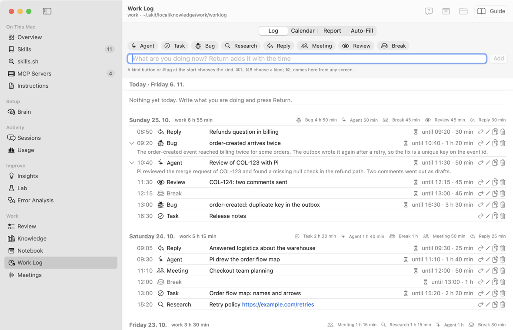
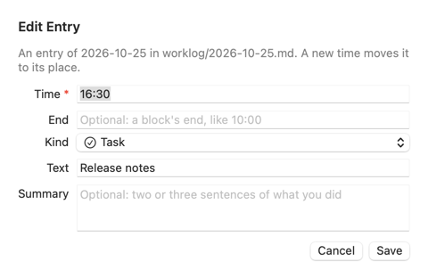
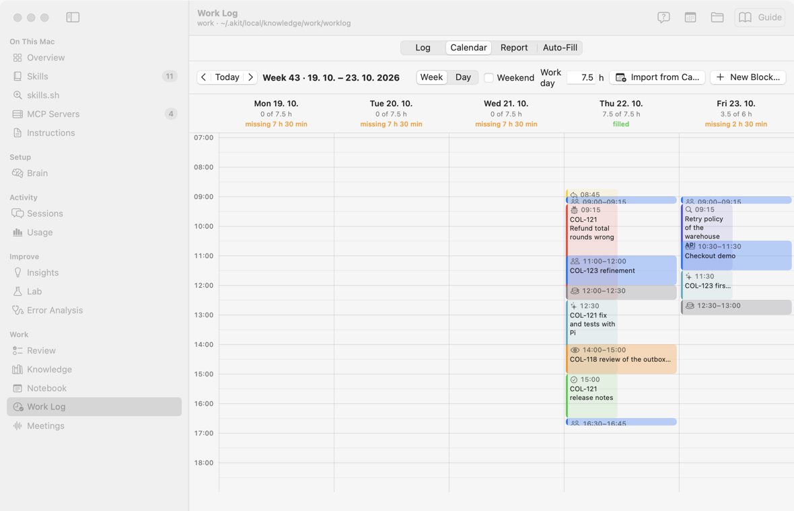
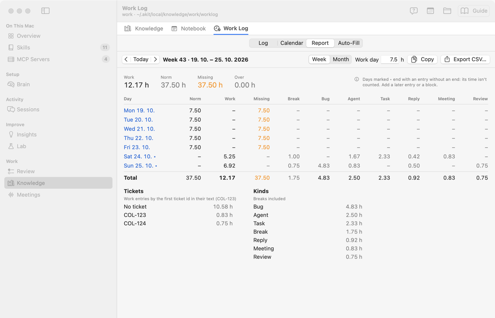
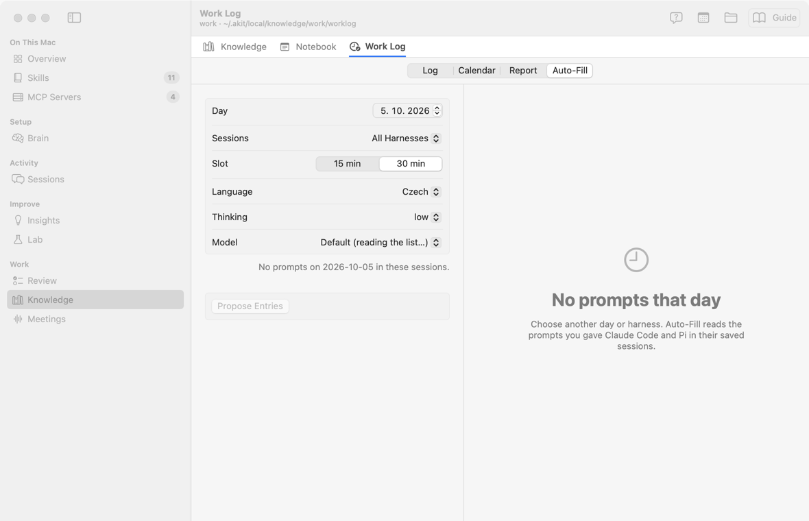

# Журнал работы: руководство

Это руководство по экрану **Work Log**: это вкладка пункта **Knowledge** в группе **Work** бокового меню. Названия кнопок даны по-английски, как на экране.

**Что такое журнал простыми словами.** Короткие строки о том, что вы делаете. Вы пишете несколько слов и нажимаете Return. День и время AKit ставит сам. Одна строка — одна запись. Один день — один файл Markdown в папке `worklog/` базы знаний. По записям AKit считает, сколько времени ушло на каждый вид работы.

**Кому это нужно:**

- Задач много, вы часто переключаетесь и к вечеру не помните, что делали.
- Вы хотите видеть, сколько времени ушло на баги, агентов, ответы людям.
- Вы хотите дать агенту или скрипту свой день в удобном виде (`akit worklog show --json`).

**Когда это не нужно:**

- План и список дел — это экран **Notebook**. Журнал — то, что уже идёт или прошло.
- Точный учёт часов для счёта клиенту. Журнал считает время между записями, не таймер.

Надписи экрана есть в словаре: [AKit Terms → Work Log](terms#terms-worklog).

## Что на экране
<!-- section: overview -->

**Что это:** сверху — кнопки видов и поле записи. Ниже — дни, новый сверху. Если баз несколько, список **Base** в панели инструментов выбирает базу. Это та же база, что на экране **Knowledge**.

- Кнопки видов: **Agent**, **Task**, **Bug**, **Research**, **Reply**, **Meeting**, **Review**, **Break**.
- Поле «What are you doing now?» и кнопка **Add**.
- День: дата, `work` — сколько всего работы, справа — время по видам.
- Дни показаны страницами: сегодня и 14 последних дней с записями. Внизу — **Show 14 More Days (N left)**: ещё 14 дней и сколько осталось.
- **Go to Day…** (значок календаря в панели инструментов): выберите день — журнал откроет его, даже если он год назад.
- Запись: время, вид, текст, до какого времени и сколько длилась, кнопки действий.

## Записать, что вы делаете
<!-- section: write -->

**Что это:** одна запись — одна строка. День и время берутся из часов в момент Return. Выбирать их не нужно.

**Как пользоваться:**

1. Откройте **Work Log** или нажмите ⌘L на любом экране AKit. Курсор уже стоит в поле.
2. Если нужно, щёлкните вид, например **Bug**. Или нажмите ⌘3. Или начните текст с `#bug`.
3. Напишите пару слов: «order-created приходит дважды».
4. Нажмите Return.

**Пример.** Вы выбрали **Agent** и написали «ревью COL-123». В файле дня появилась строка `- 10:40 #agent ревью COL-123`.

> **Совет:** перерыв — это **Break** без текста: выберите вид и нажмите Return. Время перерыва не входит в `work`.

После записи поле пустое, вид снят. Своё слово вида тоже работает: `#deploy выкатка` даст вид `deploy`.

## Сколько длилась запись
<!-- section: time -->

**Что это:** запись длится до следующей записи того же дня. Справа в строке: `until 10:40 · 1 h 20 min` — запись шла до 10:40, всего 1 h 20 min. Последняя запись сегодня идёт до «сейчас»: `until now · 25 min`, синим цветом. У последней записи прошлого дня длины нет: конец неизвестен.

**Пример.** 09:20 **Bug**, 10:40 **Agent**. Баг занял 1 h 20 min.

> **Важно:** закончили работу или ушли — запишите **Break**. Иначе последняя запись растёт до конца дня.

## Исправить и повторить
<!-- section: edit -->

Справа в каждой строке четыре кнопки: **Again Now** (стрелка), **Edit…** (карандаш), **Copy** (два листа), **Delete…** (корзина). Те же команды есть в меню правого щелчка.

- Карандаш, двойной щелчок по записи или правый щелчок → **Edit…**: время, вид, текст. Новое время ставит запись на её место по порядку. День не меняется.
- **Again Now** (стрелка): та же запись со временем «сейчас». Удобно, когда вы вернулись к задаче.
- **Copy**: строка записи и её сводка в буфер.
- Стрелка слева от записи: показывает или прячет сводку, если она есть. Сводку можно изменить в **Edit…**, поле **Summary**.

- **Delete…** (корзина): строка уходит из файла. Git базы хранит старую версию.

## Ссылки и Raycast
<!-- section: links -->

**Что это:** ссылки `akit://` открывают журнал из Raycast, закладки или скрипта.

| Ссылка | Что делает |
|---|---|
| `akit://worklog` | открывает журнал, курсор в поле |
| `akit://worklog?kind=bug` | то же и выбирает вид Bug |
| `akit://worklog/add?text=созвон&kind=meeting` | сразу добавляет запись со временем «сейчас» |

**Пример для Raycast.** Quicklink с адресом `akit://worklog/add?text={argument}`. Вы вызываете Raycast, пишете «ответ Пете» и нажимаете Return. Запись готова.

Без окна AKit запись добавляет команда: `akit worklog add "ответ Пете" --kind reply`.

## Calendar: встречи и блоки
<!-- section: calendar -->

**Что это:** вкладка **Calendar** показывает неделю (или один день) по часам. Встреча, обед или фокус‑блок — это **блок**: у него есть начало и конец. Блок держит своё время. Обычная запись длится до следующей записи, но минуты блоков внутри неё не считаются. Пустое место в колонке — время, которое ничем не заполнено.

**Как пользоваться:**

1. Нажмите **Calendar** вверху экрана. Стрелки и **Today** листают недели. **Week** / **Day** — неделя или один день крупно. **Weekend** показывает субботу и воскресенье.
2. Новый блок: протяните мышью по пустому месту колонки (шаг 15 минут) или щёлкните (30 минут). Можно и кнопкой **New Block…**. В окне выберите **Kind** (по умолчанию **Meeting**) и напишите текст, например «Обед» с видом **Break**.
3. Перетащите блок, чтобы сдвинуть его. Тяните нижний край, чтобы изменить конец. Щелчок открывает **Edit…**.
4. **Import from Calendar…** берёт встречи этих дней из macOS Calendar (туда можно добавить Outlook, Google, iCloud). Первый раз macOS спросит разрешение. AKit календари только читает. Встречи на весь день и отклонённые приглашения не берутся. Встречи, которые уже есть в журнале, без флажка. Нажмите **Add N Selected**.

В шапке дня: сколько часов заполнено из нормы и сколько не хватает (**missing**) или **filled**. Щелчок по шапке открывает этот день. Правый щелчок: **Set Norm…** (своя норма дня, например 4 ч), **Day Off (no norm)**, **Default Norm**.

**Work day** — норма рабочего дня в часах, по умолчанию 7.5. Впишите 8 или 9 и нажмите Return. Норма действует с понедельника по пятницу; у выходных нормы нет.

## Report: часы за неделю или месяц
<!-- section: report -->

**Что это:** вкладка **Report** — таблица по дням: **Norm**, **Work**, **Missing**, **Break** и часы по видам. Ниже — часы по задачам (первый номер вида `COL-123` в тексте записи) и по видам.

**Как пользоваться:**

1. Нажмите **Report**. **Week** или **Month**, стрелки листают.
2. Щелчок по дню открывает его в **Calendar**: там видно, где пусто.
3. **Copy** копирует таблицу с табуляцией — она вставляется в таблицу Excel или Numbers. **Export CSV…** сохраняет файл CSV.

> **Важно:** последняя обычная запись прошлого дня без записи или блока после неё не имеет конца. Её время не считается; такой день помечен ◦. Добавьте запись «конец дня» с видом **Break** или блок.

В терминале: `akit worklog report last-week --csv`, `akit worklog hours 8`, блок — `akit worklog add "Standup" --kind meeting --at 09:00 --to 09:15`.

## Auto-Fill: восстановить день
<!-- section: autofill -->

**Что это:** вкладка **Auto-Fill** на этом же экране. Она восстанавливает день по вашим запросам к агентам. AKit берёт запросы из сохранённых сессий Claude Code и Pi и раскладывает их по отрезкам 15 или 30 минут. У каждого отрезка — проект, ветка git в тот момент и задача (`COL-123` из имени ветки или из запроса). Модель пишет по записи на отрезок: задача, что решали, ветка. Время блоков (встречи из **Calendar**) Auto-Fill пропускает.

**Как пользоваться:**

1. Нажмите **Auto-Fill** вверху экрана.
2. Выберите **Day**, **Sessions** (**All Harnesses**, **Claude Code** или **Pi**) и **Slot** (**15 min** или **30 min**).
3. Справа видно, что AKit нашёл. Пока ничего не отправлено.
4. **Language**: язык записей, по умолчанию чешский (**Czech**). **Thinking**: сколько модель думает, по умолчанию **low**; выше — сводки лучше, но дольше и дороже. **Model**: по умолчанию GPT-6 Luna из списка Pi (на рабочем Mac — GitHub Copilot). Можно выбрать другую модель из списка.
5. Нажмите **Propose Entries**. Придут записи с флажками. Под каждой — сводка: 2–3 предложения о том, что вы делали. Стрелка слева от записи сворачивает и разворачивает сводку.
6. Снимите лишние флажки и нажмите **Add Selected**. Записи встанут в этот день со своим временем.

> **Важно:** **Propose Entries** отправляет начало каждого запроса (до 240 знаков), проект, ветку и задачу выбранной модели через Pi. Действуют политика отправки (Settings → **Sending policy**), месячный лимит и журнал отправок (`worklog-fill`). Если политика не разрешает, AKit пишет «Not sent: …» и что сделать.

В терминале: `akit worklog fill yesterday --slot 15 --language cs` показывает предложения, `--add` добавляет их.

## Файлы и Obsidian
<!-- section: files -->

**Что это:** один файл на день: `worklog/2026-10-28.md` в базе знаний. Каждая запись — строка `- 09:14 #bug текст`, блок — `- 09:00-09:30 #meeting Standup`. Своя норма дня — строка `norm: 4 h`, общая норма — `worklog/settings.yaml`. Сводка записи — следующая строка с отступом: `  > Нашёл, что outbox писал событие дважды…`. Obsidian видит эти файлы. Свою строку без времени (заметку) AKit оставляет как есть.

AKit сам делает коммиты записей в git базы, как правки блокнота. Кнопка папки (**Show in Finder**) показывает файл сегодняшнего дня.

## Агент и журнал
<!-- section: agents -->

**Что это:** команда `akit worklog` даёт журнал агенту и скриптам.

| Команда | Что делает |
|---|---|
| `akit worklog add TEXT [--kind KIND] [--at HH:MM]` | запись сегодня; `--at` — время раньше «сейчас» |
| `akit worklog add TEXT --at HH:MM --to HH:MM [--day DAY]` | блок (встреча, обед) в любой день |
| `akit worklog report [week\|month\|last-week\|last-month] [--csv]` | часы по дням: норма, работа, не хватает |
| `akit worklog hours [ЧАСЫ] [--day DAY ЧАСЫ]` | норма рабочего дня или одного дня |
| `akit worklog show [today\|yesterday\|ДАТА] [--days N] [--json]` | записи дня с длительностью и итоги по видам |
| `akit worklog kinds` | виды-пресеты |
| `akit worklog fill [ДЕНЬ] [--slot 15\|30] [--harness claude\|pi\|all] [--model M] [--add]` | Auto-Fill: предложения записей по запросам дня; `--add` добавляет |

Агент добавляет запись, только если вы попросили: «запиши в журнал, что я разбирал баг».
